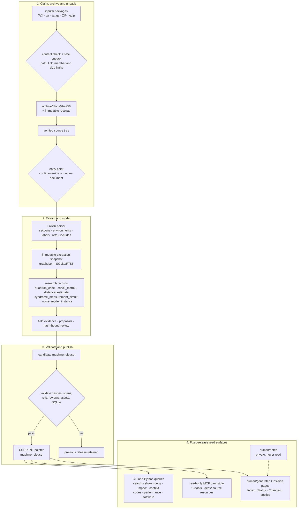

# QEC Graph

> Provenance-preserving LaTeX → QEC knowledge workspace, with a CLI, a local
> read-only MCP server, and an Obsidian view.

> **English** · [中文](README.zh-CN.md)

QEC Graph archives original LaTeX source packages, extracts their structure with
exact source spans, links typed QEC research records and field-level evidence,
and publishes an immutable machine release. The same release serves the CLI, the
read-only MCP server and the generated Obsidian view; the human view is never an
authority and `human/notes/` is never read.

## How it works



One workspace writer claims inbox files, archives the original bytes, stages a
candidate release, validates it, publishes `CURRENT`, and only then consumes the
claimed input copies. Queries and MCP sessions pin one release, so a later
`sync` cannot change an open session's answers. A failed publication leaves the
previous release readable.

> [!NOTE]
> QEC Graph is not a TeX engine, a PDF/OCR pipeline, a large-code distance
> solver, or a Lean verifier. Lean is **deferred/experimental**; the database,
> query and MCP paths do not import or invoke it.

## At a glance

| Capability | What is implemented |
|---|---|
| Ingestion | TeX/gzip/tar/tar.gz/ZIP detection, safe unpacking, SHA-256 blobs and receipts, entry-point selection |
| Provenance | UTF-8 byte hashes, Unicode codepoint half-open spans, 1-based lines, stable IDs and revisions |
| Research model | `qecgraph.research` records, 26 kinds, 41 typed relations, field evidence, explicit unknown/conflict states |
| Review | Proposal/diff, explicit decide, hash-bound apply, stale review detection |
| Query | Exact filters, bounded context, dependency/impact traversal, code/performance/software queries |
| MCP | 13 fixed-scope read tools, `qec://source/...` resources, budgets, one pinned release per session |
| Human view | Generated Obsidian pages with stable links and tombstones; `human/notes/` is private |
| Surfaces | Workspace is primary; single-paper store and multi-paper corpus remain available |

## Implemented surfaces

| Surface | Current implementation |
|---|---|
| Workspace transaction | claim → archive → unpack → entry point → extract → stage → validate → publish → consume, with a POSIX writer lock and crash recovery |
| Source extraction | `pylatexenc==2.10`, source-preserving spans, include/resource resolution, explicit diagnostics, content-checked incremental AST cache |
| Research records | `qecgraph.research` kinds such as `quantum_code`, `check_matrix`, `distance_estimate`, `performance_curve`, `experiment` and `software_usage` |
| Review and evidence | `proposal` / `review` envelopes, field-level evidence, reviewed dependency closure, stale and unbound states excluded by default |
| Read queries | `search`, `show`, `deps`, `impact`, `context`, `codes`, `performance`, `software`; SQLite/FTS5 with a deterministic fallback |
| MCP server | local stdio JSON-RPC `2025-06-18`, read-only tools, source resources, per-call budgets, no path or shell arguments |
| Human view | deterministic `human/Index.md` and `human/generated/` pages, per-page atomic writes, tombstones, `human_stale` recovery |
| Distribution | wheel/sdist, standalone executables, research Compose profile and read-only MCP isolation profile |

## Install

```sh
curl -fsSL https://raw.githubusercontent.com/Guangqi-Phys/qec-graph/main/install.sh | sh
```

Run the same command to update. The standalone executable bundles Python.
Downloads are available for macOS (Apple Silicon) and Linux (x86_64 and arm64).
[GitHub Releases](https://github.com/Guangqi-Phys/qec-graph/releases)

## Quick start

Run these commands in the folder you want to use as your workspace.

```sh
mkdir -p inputs
# Put downloaded LaTeX source packages in inputs/.
qec-graph init --workspace .

# After adding more packages
qec-graph sync
qec-graph status
qec-graph validate
```

Successful imports keep the original package in `archive/` and clear its inbox
copy. Open `human/` as an Obsidian vault and start at `Index.md`.
Use `qec-graph inputs quarantine <name>` for a package that keeps failing.

## MCP

The MCP server is a local stdio process pinned to one machine release. It is
read-only: tools cannot pass filesystem paths, SQL, shell commands, a different
workspace or a different release. Source text is returned as data, never as
instructions.

### Start the server

From the workspace root:

```sh
qec-graph mcp config --workspace .
```

This prints a ready `mcpServers.qecgraph` object whose command and `--machine`
path point at the current pinned release. Use that object in a client config, or
start the server directly:

```sh
qec-graph mcp serve --machine "$PWD/machine"
```

For a strict deployment, mount only `machine/` and pass `--machine`. `--workspace`
is convenient locally but is not an operating-system isolation boundary.
`human/`, `inputs/` and especially `human/notes/` must not be readable in a
strict deployment.

### Read tools

| Tool group | Available tools |
|---|---|
| Graph reads | `qecgraph_search`, `qecgraph_show`, `qecgraph_context`, `qecgraph_deps`, `qecgraph_impact` |
| Workspace records and sources | `qec_workspace_status`, `qec_get_entity`, `qec_get_context`, `qec_get_source`, `qec_get_asset` |
| Structured QEC queries | `qec_find_codes`, `qec_find_performance`, `qec_find_software` |

All tools accept `max_chars` within the session budget. Search and the three
`qec_find_*` tools also accept `limit`/`offset`. Source text uses half-open
Unicode codepoint ranges; managed asset bytes use byte offsets. A result states
its scope, evidence status and whether it was truncated. No result means no match
in the pinned scope, not that a theorem or code does not exist.

### Connect a client

The examples below use a shell command; replace `/absolute/path/to/qec-graph`
and `/absolute/path/to/machine` with the installed executable and the workspace
machine directory. To pin a specific release, add `--release <release-id>`.

#### Codex

```sh
codex mcp add qecgraph -- "$(command -v qec-graph)" mcp serve --machine "$PWD/machine"
codex mcp list
```

Equivalent `~/.codex/config.toml` entry:

```toml
[mcp_servers.qecgraph]
command = "/absolute/path/to/qec-graph"
args = ["mcp", "serve", "--machine", "/absolute/path/to/machine"]
```

Open a new Codex session after adding the server. Codex starts the stdio process
and exposes the read tools to the agent.

#### Claude Code

```sh
claude mcp add --transport stdio qecgraph -- "$(command -v qec-graph)" mcp serve --machine "$PWD/machine"
claude mcp list
```

Equivalent project `.mcp.json`:

```json
{
  "mcpServers": {
    "qecgraph": {
      "type": "stdio",
      "command": "/absolute/path/to/qec-graph",
      "args": ["mcp", "serve", "--machine", "/absolute/path/to/machine"]
    }
  }
}
```

Claude Code starts the server per session; approve the project-scoped `.mcp.json`
when prompted.

#### OpenCode

```sh
opencode mcp add qecgraph -- qec-graph mcp serve --machine "$PWD/machine"
opencode mcp list
```

Equivalent `opencode.json` or `opencode.jsonc`:

```json
{
  "$schema": "https://opencode.ai/config.json",
  "mcp": {
    "servers": {
      "qecgraph": {
        "type": "local",
        "command": ["/absolute/path/to/qec-graph", "mcp", "serve", "--machine", "/absolute/path/to/machine"]
      }
    }
  }
}
```

Use `disabled: true` to keep the server configured without connecting it.

### Pin and refresh

`qec-graph mcp config --workspace .` includes `--release` by default, so the
client gets exactly the release that was current when the config was generated.
After `qec-graph sync` publishes a new release, re-run the command and replace
the client entry. Existing sessions stay on their old release until restarted.
Use `qec-graph mcp config --machine /path/to/machine` for a machine-only mount.

## Documentation map

| I want to… | Read |
|---|---|
| Run the shortest example | [Quick start](docs/user/quickstart.md) |
| Configure a workspace, archive or Obsidian | [Workspace guide](docs/user/workspace.md) |
| Search records, codes or performance data points | [Data and search](docs/user/data-and-search.md) |
| Look up commands, exit codes or release checks | [Advanced usage](docs/user/advanced-usage.md) |
| Understand identities, evidence and publication | [System design](docs/design/DESIGN.md) |
| Browse the documentation index | [docs/README.md](docs/README.md) |
| Operate a store or corpus | [Operations](docs/operations/README.md) |

## License

MIT. See [LICENSE](LICENSE) and [CONTRIBUTING](CONTRIBUTING.md) for development
and documentation rules.
