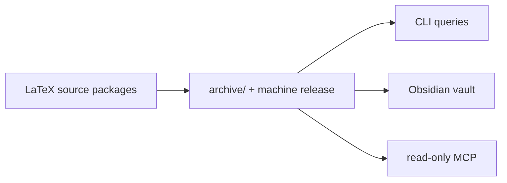

# QEC Graph

> Provenance-preserving LaTeX → QEC knowledge workspace, with a CLI, a local
> read-only MCP server, and an Obsidian view.

> **English** · [中文](README.zh-CN.md)

QEC Graph archives the original source packages, extracts LaTeX structure with
exact character spans, links reviewed research records and evidence, and serves
the result from an immutable machine release.



## At a glance

| Capability | What you get |
|---|---|
| Source ingestion | TeX/gzip/tar/ZIP detection, safe unpacking, SHA-256 archive, entry-point selection |
| Provenance | UTF-8 byte hashes, Unicode half-open spans, 1-based lines, stable IDs and revisions |
| Research model | `qecgraph.research` records, field-level evidence, explicit unknown/conflict states |
| Query | Exact filters, bounded context, dependency/impact traversal, fixed-release MCP tools |
| Human view | Generated Obsidian pages with stable links; private `human/notes/` is never read |
| Compatibility | Legacy single-paper store and multi-paper corpus remain supported |

> [!NOTE]
> QEC Graph is not a TeX engine, a PDF/OCR pipeline, a large-code distance
> solver, or a Lean verifier. Lean is **deferred/experimental** in 0.4.x; the
> database, query and MCP paths do not invoke it.

## Install

```sh
curl -fsSL https://raw.githubusercontent.com/Guangqi-Phys/qec-graph/main/install.sh | sh
```

Run the same command to update. The standalone executable bundles Python.
Downloads are available for macOS (Apple Silicon) and Linux (x86_64 and arm64).
[GitHub Releases](https://github.com/Guangqi-Phys/qec-graph/releases)

## Quick start

Run these commands in the folder you want to use as your workspace.

```sh
mkdir -p inputs
# Put downloaded LaTeX source packages in inputs/.
qec-graph init --workspace .

# After adding more packages
qec-graph sync
qec-graph status
qec-graph validate
```

Successful imports keep the original package in `archive/` and clear its inbox
copy. Open `human/` as an Obsidian vault and start at `Index.md`.
Use `qec-graph inputs quarantine <name>` for a package that keeps failing.

## Documentation map

| I want to… | Read |
|---|---|
| Run the shortest example | [Quick start](docs/user/quickstart.md) |
| Configure a workspace, archive or Obsidian | [Workspace guide](docs/user/workspace.md) |
| Search records, codes or performance data points | [Data and search](docs/user/data-and-search.md) |
| Look up commands, exit codes or release checks | [Advanced usage](docs/user/advanced-usage.md) |
| Understand identities, evidence and publication | [System design](docs/design/DESIGN.md) |
| Maintain a legacy store/corpus | [Operations](docs/operations/README.md) |
| Browse the documentation index | [docs/README.md](docs/README.md) |

## MCP

From the initialized workspace root, register the read-only server with Codex.

```sh
codex mcp add qecgraph -- "$(command -v qec-graph)" mcp serve --machine "$PWD/machine"
```

Open a new Codex session after registering. For other MCP clients, run
`qec-graph mcp config --workspace .` to print a configuration pinned to the
current snapshot. [Data and search guide](docs/user/data-and-search.md)

## License

MIT. See [LICENSE](LICENSE) and [CONTRIBUTING](CONTRIBUTING.md) for development
and documentation rules.
