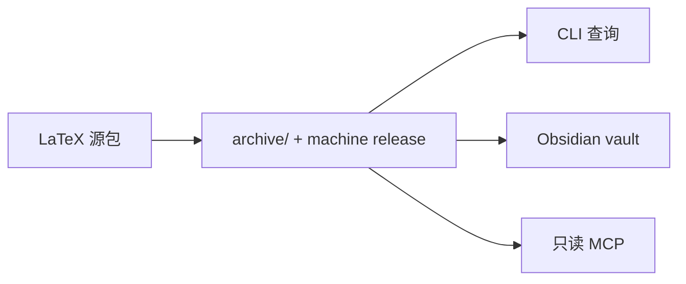

# QEC Graph

> 保留来源的 LaTeX → QEC 知识工作区，带 CLI、本地只读 MCP 服务和 Obsidian 视图。

> **中文** · [English](README.md)

QEC Graph 归档原始源包，按精确字符区间抽取 LaTeX 结构，把审核过的研究记录和证据
链接起来，并从不可变机器 release 提供服务。



## 一览

| 能力 | 你得到什么 |
|---|---|
| 来源导入 | TeX/gzip/tar/ZIP 识别、安全解包、SHA-256 归档、入口选择 |
| 来源保真 | UTF-8 字节哈希、Unicode 半开区间、行号从 1 开始、稳定 ID 和修订 |
| 研究模型 | `qecgraph.research` 记录、字段级证据、显式 unknown/conflict 状态 |
| 查询 | 精确过滤、有界上下文、依赖/影响遍历、固定 release 的 MCP 工具 |
| 人类视图 | 带稳定链接的生成 Obsidian 页面；私有 `human/notes/` 永不被读取 |
| 兼容 | 继续支持旧单篇 store 和多篇 corpus |

> [!NOTE]
> QEC Graph 不是 TeX 引擎、PDF/OCR 流水线、大规模码距求解器或 Lean 验证器。
> Lean 在 0.4.x 中为**延期/实验性**能力；数据库、查询和 MCP 路径不调用它。

## 安装

```sh
curl -fsSL https://raw.githubusercontent.com/Guangqi-Phys/qec-graph/main/install.sh | sh
```

再次运行同一命令即可更新。单文件可执行程序内置 Python。
下载支持 macOS（Apple Silicon）以及 Linux（x86_64 和 arm64）。
[GitHub Releases](https://github.com/Guangqi-Phys/qec-graph/releases)

## 快速开始

把下面的命令放在你想作为工作区的目录中运行。

```sh
mkdir -p inputs
# Put downloaded LaTeX source packages in inputs/.
qec-graph init --workspace .

# After adding more packages
qec-graph sync
qec-graph status
qec-graph validate
```

成功导入后原始包留在 `archive/`，收件箱副本被清除。把 `human/` 作为 Obsidian
vault 打开，从 `Index.md` 开始。反复失败的包用
`qec-graph inputs quarantine <name>` 处理。

## 文档地图

| 我想…… | 阅读 |
|---|---|
| 运行最短示例 | [快速开始](docs/user/quickstart.zh-CN.md) |
| 配置工作区、归档或 Obsidian | [工作区说明](docs/user/workspace.zh-CN.md) |
| 搜索记录、码或性能点 | [数据与检索](docs/user/data-and-search.zh-CN.md) |
| 查命令、退出码或发布检查 | [进阶用法](docs/user/advanced-usage.zh-CN.md) |
| 理解身份、证据和发布 | [系统设计](docs/design/DESIGN.zh-CN.md) |
| 维护旧 store/corpus | [运维](docs/operations/README.zh-CN.md) |
| 浏览文档索引 | [docs/README.zh-CN.md](docs/README.zh-CN.md) |

## MCP

在已初始化工作区根目录，把只读服务注册到 Codex。

```sh
codex mcp add qecgraph -- "$(command -v qec-graph)" mcp serve --machine "$PWD/machine"
```

注册后打开新的 Codex 会话。其他 MCP 客户端运行
`qec-graph mcp config --workspace .`，打印绑定当前快照的配置。
[数据与检索](docs/user/data-and-search.zh-CN.md)

## 许可证

MIT。开发与文档规则见 [LICENSE](LICENSE) 和 [CONTRIBUTING](CONTRIBUTING.md)。
