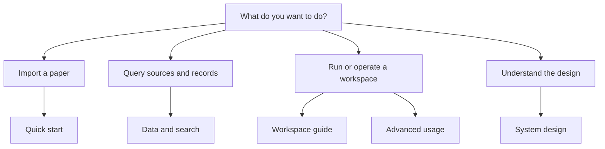

# QEC Graph documentation

> **Status: Current (0.5.x).** This is the single documentation entry point.

> **English** · [中文](README.zh-CN.md)

> [!TIP]
> New here? Start with the [quick start](user/quickstart.md) for
> a five-minute run, or [Advanced usage](user/advanced-usage.md) for the full
> command reference. Agents should read this page and then
> [the system design](design/DESIGN.md).

## Choose your path

| I am… | Start here | Why |
|---|---|---|
| A new user | [Quick start](user/quickstart.md) | Shortest path from archive to first query |
| Importing or maintaining a workspace | [Workspace guide](user/workspace.md) | Archive configuration, entry points, Obsidian and provider handoff |
| Querying records or sources | [Data and search](user/data-and-search.md) | Record types, evidence policy and CLI/MCP queries |
| Running commands | [Advanced usage](user/advanced-usage.md) | Install, exit codes, grouped commands and release checks |
| Working on the splitter | [Single-paper splitter](user/splitter.md) | Source spans, fragment layout and LaTeX limits |
| An agent or contributor | [System design](design/DESIGN.md) | Authoritative architecture, data, publication and boundaries |
| Operating a corpus | [Operations](operations/README.md) | Corpus/review maintenance and validation pointers |

## On this page

- [Choose your path](#choose-your-path)
- [Current user pages](#current-user-pages)
- [Design and operations](#design-and-operations)
- [Page types](#page-types)
- [Language and status](#language-and-status)

## Current user pages

| Page | Language | Type | Use when |
|---|---|---|---|
| [Quick start](user/quickstart.md) | English | Tutorial | You want the shortest working example |
| [Advanced usage](user/advanced-usage.md) | English | How-to / reference | You need installers, command groups, exit codes or release checks |
| [Workspace guide](user/workspace.md) | English | How-to | You need archive configuration, Obsidian layout or provider handoff |
| [Data and search](user/data-and-search.md) | English | Reference | You need `research` records, evidence and query semantics |
| [Single-paper splitter](user/splitter.md) | English | Reference | You need source spans, fragment layout or LaTeX limitations |

## Design and operations

| Page | Status | Type | What it covers |
|---|---|---|---|
| [QEC Graph — System Design](design/DESIGN.md) | Current | Explanation / reference | The only design document: architecture, data/evidence, workspace publication, CLI/MCP, human view and deferred Lean |
| [Operations](operations/README.md) | Current | How-to / reference | Legacy store/corpus maintenance, corpus/review workflows and validation pointers |
| [Validation evidence](../validation/README.md) | Evidence | Evidence | Recorded inputs, commands, revisions and results; not a design contract |
| [Changelog](../CHANGELOG.md) | Current | Reference | Compatibility and behavior changes |
| [Contributing rules](../CONTRIBUTING.md#documentation-rules) | Current | Reference | Page locations, status/TOC rules and the docs test |

## Page types

Pages follow the four documentation needs from [Diátaxis](https://diataxis.fr/):
**tutorial** (learning), **how-to** (a task), **reference** (facts) and
**explanation** (why). A page has one primary type; a guide may also contain a
reference table.

## Language and status

Every current page is bilingual: `page.md` is English and `page.zh-CN.md` is
Simplified Chinese, with matching headings, tables and executable examples.
Each page declares its status at the top. **Only Current pages describe 0.5.x.**

There are no redirect-only or archive pages. Superseded material lives in Git
history, not in a second documentation tree.
