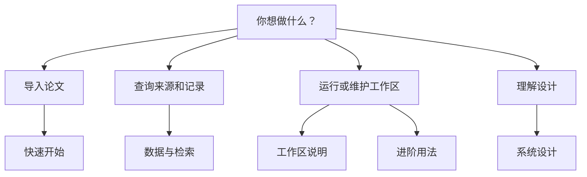

# QEC Graph 文档

> **状态：当前（0.5.x）。** 这里是唯一的文档入口。

> **中文** · [English](README.md)

> [!TIP]
> 第一次使用？从[中文快速开始](user/quickstart.zh-CN.md)的五分钟流程开始；
> 需要完整命令参考时看[进阶用法](user/advanced-usage.zh-CN.md)。Agent 应先读本页，
> 再读[系统设计](design/DESIGN.zh-CN.md)。

## 选择路径

| 我是…… | 从这里开始 | 原因 |
|---|---|---|
| 新用户 | [中文快速开始](user/quickstart.zh-CN.md) | 从归档到首次查询的最短路径 |
| 导入或维护工作区 | [工作区说明](user/workspace.zh-CN.md) | 归档配置、入口、Obsidian 和 provider 交接 |
| 查询记录或来源 | [数据与检索](user/data-and-search.zh-CN.md) | 记录类型、证据策略和 CLI/MCP 查询 |
| 运行命令 | [进阶用法](user/advanced-usage.zh-CN.md) | 安装、退出码、命令分组和发布检查 |
| 处理 splitter | [单篇 LaTeX 切割](user/splitter.zh-CN.md) | 来源区间、片段布局和 LaTeX 限制 |
| Agent 或贡献者 | [系统设计](design/DESIGN.zh-CN.md) | 权威架构、数据、发布和边界 |
| 维护corpus | [运维](operations/README.zh-CN.md) | corpus/review 维护和验证入口 |

## 本页目录

- [选择路径](#选择路径)
- [当前用户文档](#当前用户文档)
- [设计与运维](#设计与运维)
- [文档类型](#文档类型)
- [语言和状态](#语言和状态)

## 当前用户文档

| 页面 | 语言 | 类型 | 适用场景 |
|---|---|---|---|
| [快速开始](user/quickstart.zh-CN.md) | 中文 | Tutorial | 想要最短的可运行示例 |
| [进阶用法](user/advanced-usage.zh-CN.md) | 中文 | How-to / reference | 需要安装器、命令分组、退出码或发布检查 |
| [工作区说明](user/workspace.zh-CN.md) | 中文 | How-to | 需要归档配置、Obsidian 布局或 provider 交接 |
| [数据与检索](user/data-and-search.zh-CN.md) | 中文 | Reference | 需要 `research` 记录、证据和查询语义 |
| [单篇 LaTeX 切割](user/splitter.zh-CN.md) | 中文 | Reference | 需要来源区间、片段布局或 LaTeX 限制 |

## 设计与运维

| 页面 | 状态 | 类型 | 内容 |
|---|---|---|---|
| [QEC Graph — 系统设计](design/DESIGN.zh-CN.md) | 当前 | Explanation / reference | 唯一设计文档：架构、数据/证据、工作区发布、CLI/MCP、人类视图和延期 Lean |
| [运维](operations/README.zh-CN.md) | 当前 | How-to / reference | store/corpus 维护、corpus/review 流程和验证入口 |
| [验证证据](../validation/README.zh-CN.md) | 证据 | Evidence | 当前可执行检查及运行方式；历史运行产物不再随仓库提供 |
| [变更日志](../CHANGELOG.md) | 当前 | Reference | 兼容性和行为变化 |
| [贡献规则](../CONTRIBUTING.md#documentation-rules) | 当前 | Reference | 文档位置、状态/TOC 规则和 docs 测试 |

## 文档类型

页面按 [Diátaxis](https://diataxis.fr/) 的四种文档需求组织：
**tutorial**（学习）、**how-to**（完成任务）、**reference**（事实）和
**explanation**（解释原因）。每篇有一个主要类型；指南中可以包含参考表。

## 语言和状态

`docs/` 下的文档页保持中英双语：每篇英文页都有同名 `.zh-CN.md` 中文页，结构和
代码示例保持一致，并在页首提供语言切换。主目录的贡献和安全政策只保留英文。
每篇页面顶部声明状态；**只有当前状态页面描述 0.5.x 版本**。

当前文档树没有重定向页或归档页。被替代的内容只保留在 Git history 中。
