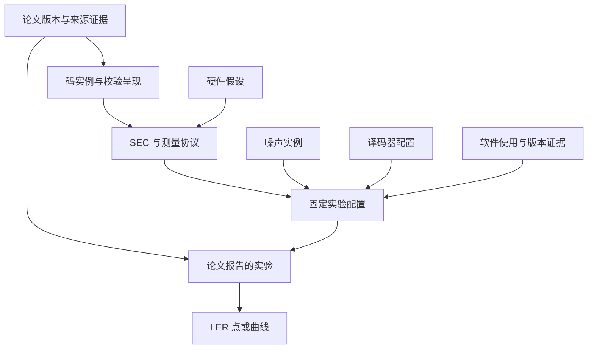

# QEC Graph 设计更新：研究数据入库、软件目录、MCP 与人类知识库

**设计编号：RFC-QEC-002 · 日期：2026-11-09 · 状态：交给 Codex 实施的增量规范。**

本文件更新上一轮 QEC Graph 设计。用户已在自己的代码库中执行过上一版任务，因此本文件**不假定当前仓库仍是旧原型，也不宣称已检查用户当前分支**。Codex 应先盘点已有实现，再补齐本规范中的差距，保留已经工作的解析、来源定位、图查询、维护和 Lean 接口。

本文所有新命令、字段和工作区布局均为目标契约，需实现并验收后才能对用户宣称可用。软件目录是本次核查后的种子资料，不是对安装兼容性、完整性或论文复现结果的保证。

## 阅读导航

| 部分 | 内容 |
|---|---|
| A | 核心决定、用户需求映射与统一对象关系 |
| B | Code、ErrorModel、CircuitPerformance、Hardware 的数据契约 |
| C | 自动抽取、来源证据、缺失信息、审核和图表数值 |
| D | 可维护的 QEC 软件注册表及论文使用关系 |
| E | 安装后工作区、压缩包入库、命令、MCP 与 human 隔离 |
| F | package 发布、迁移、实施顺序和验收门槛 |

附带 `CODEX_UPDATE_TASK.md` 是执行任务书；`software_catalog.seed.json` 是可导入的软件目录种子。完整字段说明集中在本文件，不要求 Codex 来回拼接旧聊天。

## A. 核心决定

### A1. 保留一套权威数据，生成两种消费视图

推荐整体结构为：**原始来源归档 → 带来源的研究记录与关系 → machine 查询快照和 human 阅读页面**。

JSON 记录与审核文件保存结构化权威内容；原文、矩阵、程序、原始统计和证据作为版本化资产保存。SQLite、FTS、向量索引和 Markdown 阅读页由它们派生。人类页面和机器索引不各自维护一份可独立修改的事实。

一个 typed graph 继续提供 SourceGraph、LemmaGraph、DataGraph：

- SourceGraph 定位论文版本、文字、公式、表格、图片、附件和软件提及。
- LemmaGraph 保存定义、论断、证明、依赖及形式化映射；距离下界定理可以支持一个参数 claim。
- DataGraph 连接具体码实例、校验呈现、线路、噪声、译码器、软件使用、实验和性能点。

软件注册表是 DataGraph 的一个领域，不需要再建立一套相互独立的事实库。

### A2. Circuit-level performance 必须有完整的实验上下文

一条 LER 数字至少需要绑定：

\[
\text{code/presentation} + \text{circuit} + \text{noise instance}
+ \text{decoder config} + \text{metric/sampling} + \text{source}.
\]

软件及运行环境也必须记录，未报告的字段保留未知。不能把论文 A 的噪声、论文 B 的 decoder 和论文 C 的曲线拼成同一实验配置。



图中箭头表示设计中的关联方向，不替代后文规定的实际关系名。硬件平台和模拟所用 CPU/GPU 是不同对象；论文报告的实验和我们自己重跑的 ExecutionRun 也是不同对象。

### A3. 建议调整命令职责

| 用户动作 | 建议命令 | 行为 |
|---|---|---|
| 第一次在新目录启动 | `qec-graph init` | 创建工作区，并默认处理现有 inputs |
| 再放入新文章 | `qec-graph sync` | 幂等导入新包，更新受影响的记录和投影 |
| 解析器、Schema 或索引升级后重建 | `qec-graph rebuild` | 使用归档和权威记录重建，不依赖 inputs 仍有文件 |
| 坚持一次命令接收新包并重建 | `qec-graph rebuild --include-inputs` | 显式先 sync 再 rebuild；有失败时按事务规则处理 |
| 查看缺失字段和待审核内容 | `qec-graph review list` | 显示来源、冲突、缺失项和修复入口 |
| 向 AI 提供查询 | `qec-graph mcp serve` | 启动只读机器查询服务 |
| 更新人类阅读页面 | `qec-graph human build` | 从机器可用权威数据生成 human 页面 |

新包成功归档、校验和提交后，才消费 inputs 中的那份副本。失败项保留。所谓“清空 inputs”表示成功收件后归档，不表示丢弃以后重建所需的原始材料。

### A4. 自动化的完成状态分开报告

`init` 成功不应被解释为“论文所有数学和实验信息都已准确理解”。输出至少区分：

1. 原包是否已可靠归档。
2. 是否完整处理受支持的文档结构。
3. 每个目标字段是否已找到、解析、核对或仍待处理。
4. 是否存在冲突、推测或待审核软件对应。
5. 机器快照和 human 阅读页各自是否已发布。

允许“来源入库成功，部分语义字段尚未知”。禁止把没有抽取到的信息自动填成 false、0 或一个猜测的值。

### A5. human 是独立阅读视图，agents 的接口是 machine

`human/` 可以直接作为 Obsidian vault，自动页面使用稳定文件名和双向链接，人类笔记单独保存。默认不被任何 agent 检索、嵌入、摘要、索引或来源回读。

这种约束在本项目 MCP 中由资源白名单与路径边界执行；对拥有整个文件系统权限的外部 agent，仅有 `AGENTS.md` 无法形成强制隔离。需要严格禁止时，给 agent 和 MCP 只挂载机器目录，使用独立进程权限；人库渲染由独立的确定性程序完成。详细边界见 E 部分。

### A6. “所有开源软件”转为可度量覆盖的注册表

系统目标应是“覆盖当前资料库中出现的软件，并持续扩大经核实的 QEC 软件目录”。不能承诺穷尽互联网。目录必须显示收录范围、官方来源、上次核查日期、尚未解析的提及和覆盖缺口。

算法、软件项目、发行包、版本以及论文中的实际使用是不同对象。尤其 `BP-OSD` 作为算法名称，不能自动等同于名为 `bposd` 的 Python 包。

### A7. 需求到实体的对应

| 用户要记录的信息 | 建议权威对象 |
|---|---|
| `[[n,k,d]]` 与分类 | CodeInstance、ClassificationClaim、ParameterClaim、DistanceClaim |
| check weight 与检查矩阵构造 | CodePresentation、ConstructionRecipe、MatrixAsset、CheckWeightClaim |
| 精确 error model，idle/loss | NoiseModel、NoiseInstantiation、ChannelPlacement、Evidence |
| SEC depth 与 circuit distance | CircuitProtocol、DepthClaim、DistanceClaim |
| 指定点的 LER | ReportedExperiment、PerformanceSeries、PerformancePoint、MetricDefinition |
| decoder setup | DecoderConfiguration、Algorithm |
| Stim/PyMatching 等实现 | SoftwareProject、SoftwareDistribution、SoftwareRelease、SoftwareUsage |
| 量子硬件考虑 | HardwareAssumptions、HardwareMapping、ResourceClaim |
| CPU/GPU 与仿真环境 | ExecutionEnvironment、ExecutionRun；未复现时仅保留来源报告 |

实际 kind 拼写由当前仓库的 Schema 统一决定。下面的名字是概念契约，不能为了照搬命名而重写已经兼容的实现。

### A8. 用户投递即登记，是否采信由用户判断

**按用户最新要求，取消“只使用正式接纳的论文”的门槛。** 用户投递并成功保留的材料默认登记在 SourceGraph 与来源目录；不依据发表状态、同行评审、资料质量、相关性分数或是否经过人工审核决定能否入库或被发现。

默认来源搜索与 human 来源目录展示全部已登记材料及其状态。可解析的内容自动进入对应提取与图索引流程；暂不能解析的材料保留来源条目、原包引用和具体失败/待处理状态，供用户查看和继续处理。来源冲突并列显示，不由系统决定哪篇论文值得采信。

`rebuild` 默认检查**全部归档材料**，包括以前未解析成功或尚未产生领域数据的材料，并按当前处理器尝试处理。用户明确设置的范围/排除规则才改变处理范围，且目录中仍保留可见记录和原因。已提交 manifest 用于记录一次构建的准确输入与输出，不充当论文批准名单。

来源可见性与字段的含义分开：用户可看到未核对提案、未知值和冲突；要求 `d≥12` 等精确数值条件时，仍按所选证据政策解释上下界，不把 upper bound 当 lower bound。状态用于辅助用户判断，不自动评价论文好坏。

### A9. 本文术语与接口命名

本文统一使用 `NoiseModel` / `NoiseInstantiation`、`CircuitProtocol`、`ReportedExperiment`、`PerformanceSeries` / `PerformancePoint`、`ExecutionRun`、`HardwareAssumptions` 与 `SoftwareDistribution`。`DistanceClaim` 同时支持码或线路作为 subject，通过明确的 metric 区分。

一个 ReportedExperiment 保存论文所报告的固定实验条件和扫描规则；具体扫描点绑定 NoiseInstantiation。图中的“固定实验配置”是这些条件的概念集合，不要求另建一个含义重复的 BenchmarkSetup。若现有仓库已有复用的 setup 实体，可保留并显式映射。

实体 ID 与 revision 引用的最终 JSON 编码、文件名和 Schema 版本由 Codex 结合现有仓库冻结。本文示例是领域契约；`software_catalog.seed.json` 的 seed schema 和合成 fixture schema 都需要显式 adapter，不能被误作生产 Schema 已实现。

## B. 领域数据模型与提取验收

日期：2026-11-09。本文是新需求的设计契约，不宣称这些字段、校验器或命令已经在用户仓库实现。
Codex 必须先检查现有 Schema、实体注册表与迁移机制，再按以下语义增量实现；不得假定仓库仍是先前原型版本。

### B1. 以可追溯的实验条件组织数据

不要把一篇论文的所有数字压成一行 `n,k,d,p,LER`。同一论文可能比较多个码、多个 SEC、多个噪声模型与译码器。
本次目标是让每个数字都能回答：属于哪个对象、使用什么定义、在什么条件下得到、原文依据在哪里。

| 实体 | 职责 | 重要关系 |
|---|---|---|
| `PaperWork` / `PaperVersion` | 一项工作及其准确来源版本 | version 属于 work，绑定原始资产 |
| `CodeMention` | 一处原文对码的提及 | 指向 source span；可候选链接至 CodeInstance |
| `ClassicalSeed` | 构造量子码所用的经典码/矩阵与参数 | 与量子实例分开；可通过 construction 关联 |
| `CodeFamily` / `Construction` | 码族定义、构造方法、参数化输入 | 实例由指定构造和输入得到 |
| `CodeInstance` | 一个固定数学码实例的身份及参数断言 | 具有一个或多个 Presentation |
| `CodePresentation` | 实际生成元、矩阵、比特顺序和校验集合 | check weight、SEC 绑定该表示 |
| `DistanceClaim` | 特定度量下的上下界或精确值及证据 | subject 可为码、表示或电路 |
| `CircuitProtocol` | syndrome extraction 与边界、轮数、调度 | 测量指定 Presentation |
| `NoiseModel` / `NoiseInstantiation` | 噪声规则及某一点的具体参数 | 实例化模型，作用于指定 circuit |
| `DecoderConfiguration` | 算法、变体、参数、输入模型及软件使用 | 属于某个实验条件，不能只存算法名字 |
| `ReportedExperiment` | 文献报告的一组可比较条件 | 连接 code、presentation、circuit、noise、decoder、hardware |
| `PerformancePoint` / `PerformanceSeries` | 某条件下的单点结果及曲线身份 | point 绑定实验、噪声实例与指标定义 |
| `ExecutionRun` | 我们实际运行的复现实验 | 可尝试复现 ReportedExperiment；保存真实运行证据 |
| `SoftwareUsage` | 一次有来源的软件使用声明 | 连接 package/release 与实验或运行，并注明角色 |
| `HardwareAssumptions` / `ExecutionEnvironment` | 被研究的量子硬件 / 执行仿真的计算机 | 不能合并成一个 hardware 字段 |

“论文提到某软件”和“论文用该软件得到这条曲线”是不同关系。缺少具体方法证据时仅保留 `mentions_software`，不能连接全部性能点。
来源块与规范化对象仍然分开；相同 `[[n,k,d]]`、名称或文本相似度不能自动合并码实例。
同一对象在不同论文中的主张可以不同，保留冲突和各自证据，不用最后导入的值覆盖前者。

### B2. 通用记录、未知值和字段证据

沿用现有稳定 ID、revision、来源版本和资产哈希。所有影响比较结果的关系绑定准确 revision；发布快照固定这些绑定。
主实体的 `data` 是值的唯一权威位置，`field_evidence` 用 JSON Pointer 指向相应字段并保存来源与处理记录，不复制另一份可独立编辑的值。
多个互相冲突的值使用多个断言/Claim 记录，实体展示摘要注明选择政策，不能在一个标量上无声覆盖。

| 字段组 | 约定 |
|---|---|
| 身份 | `schema_version,id,kind,revision`；ID 与文件名、内容哈希分开 |
| 来源 | `paper_version_ref,source_span_refs,asset_refs`；保留表格行列、图号、caption、公式、文本及适用范围 |
| 抽取 | `method,processor_version,model_id,prompt_hash,input_hash,run_id`；仅记录实际存在的处理信息 |
| 审核 | `review_status,reviewer,reviewed_input_hashes,review_scope`；AI 提议不能冒充人工审核 |
| 数学/计算证据 | `evidence_kind,evidence_refs,checker_result,limitations`；与来源审核分开 |
| 新鲜度 | `current/stale/unbound` 绑定的输入与原因；旧证据仍可查询 |

必须区分以下状态：

| 状态 | 含义 |
|---|---|
| `known` | 已取得一个明确值；是否可信还看来源、方法和审核 |
| `not_extracted` | 当前流程尚未提取，不能推断原文没有 |
| `unresolved` | 找到相关信息，但对象、定义、单位或适用范围尚未消歧 |
| `not_reported` | 在明确列出的可用材料范围内，经检查未找到该信息；记录审核范围和日期 |
| `not_applicable` | 根据适用模型确认无意义，必须说明原因 |
| `conflicting` | 存在不一致的来源主张，保留各项 |

未知值使用 `null`，不能使用 `0`、空字符串或默认 `false`。`[]` 表示确认没有元素；“未确定用了哪些软件”应为 null 或 unresolved，不是空使用列表。
不能因为正文没命中关键词，就把 loss、idle、软件版本写成“未考虑”或 `not_reported`；补充材料和链接代码可能尚未取得。
最低入库门槛是来源可追溯与记录结构正确；字段不完整可以入库，但必须降低相应查询的完整性状态，不能捏造填满。

### B3. Code：用户要求字段的具体保存方式

#### B3.1. 参数与多轴分类

| 用户关心的信息 | 最低字段 | 保存规则 |
|---|---|---|
| 领域与原记法 | `coding_domain,parameter_notation` | classical/quantum/unresolved；保留原始括号、符号、下标和构造角色 |
| `[[n,k,d]]` | `n_data,k_logical,local_dimension,distance_claim_refs` | 二元量子码用双括号展示；d 来自选定 DistanceClaim，不作无证据标量 |
| 参数化码族 | `parameter_symbols,parameter_constraints,parameter_formulas` | 不能把公式当单个实例整数；实例化时记录具体输入 |
| CSS / non-CSS | `formalism,css_structure,css_claim_refs` | `formalism=stabilizer/subsystem/non_stabilizer/unknown`；CSS 性质说明对哪个表示成立 |
| 构造类别 | `construction_ref,construction_tags` | ordinary HGP、lifted product、BB、surface 等可多标签，按定义建层级 |
| 其他属性 | `field,qudit_dimension,topology,locality,ldpc_claim_refs` | 不把 CSS、HGP、QC、LDPC 塞进互斥的单一 type |
| check weight | `check_weight_metrics` 位于 Presentation | 绑定具体校验集合、X/Z 扇区、统计方式与来源 |
| 矩阵构造 | `construction_recipe_ref,generator_asset_refs` | 保存公式、种子、索引、参数和实现；原文未给则明确未知 |

`n_data` 是码的数据量子比特数；辅助比特、备用比特、通信比特与设备总数分别存硬件/协议资源，不能替换 n。
HGP 构造中的经典种子 `[n,k,d]` 与量子实例 `[[n,k,d]]` 分别建模；括号风格只能辅助识别，须结合原文语境。原文格式不规范时将 coding_domain 标 unresolved，不能让经典码参数通过默认量子码查询。

为了保留 non-stabilizer/subsystem 文献，另设 `logical_subsystem_dimension`、`gauge_subsystem_dimension`、`codespace_dimension` 和 `r_gauge`，原文参数记法始终保留。本文字段定义：逻辑子系统维数为 K、gauge 维数为 R；普通子空间码的 code space 维数为 K，子系统表示下为 K×R。`k_logical` 与 `r_gauge` 表示以 local_dimension 为基的逻辑/gauge 个数，未知基数或维数不能换算时置 null。不可把非加性参数中的 K 当作 k，也不可漏掉子系统参数 r；推导值有独立方法和证据。二元时 r_gauge 的单位是 gauge qubits；不另维护第二份可矛盾的 gauge_qubits 权威值。参数语义见 [D5][D6]；不同论文用字母的习惯仍须按原文映射。

首版矩阵计算校验器可以先支持二元 stabilizer/CSS；其他已识别类型仍可保存来源主张及原记法，计算能力返回 unsupported/incomplete，不能把它们强行套用二元公式。支持范围要由 Schema 与 validator capability 分别声明。

CSS 与 ordinary HGP 是不同分类轴；HGP 的经典种子为 QC，不自动等于论文采用了同一种量子 QC 表示。
精确过滤 `construction=ordinary_hgp` 时按构造定义与证据匹配；不能因为 lifted product 或 BB 也有乘积结构，就当作 ordinary HGP 返回。
若多个生成元集合定义同一稳定子空间，它们可以属于同一 CodeInstance 的不同 Presentation；没有等价证据时先保持候选关系。
局域 Clifford、比特置换或行变换的等价声明应保存映射；不能只因为参数相同就合并。

#### B3.2. Check weight 必须绑定实际校验呈现

保存 `check_set_role=stabilizer_generator/gauge_generator/measured_check`，以及 `sector=X/Z/mixed`。
每项统计至少含 `statistic=min/max/mean/histogram/per_check`、值、单位“支撑量子比特数”、适用集合和证据。
“最大生成元重量”“全部校验均重 6”“平均重量约 6”不等价；只报告最大值时，不能补出完整分布。
保留 `reported_weight` 与由已归档矩阵计算的 `computed_weight` 的来源关系；冲突时给出问题，不无声替换作者数字。
行变换可改变生成元重量，即使码空间不变；测量更多冗余校验也会改变电路资源和 decoder 输入。

CSS 二元矩阵可按行的 1 数量计算支撑重量；非 CSS 稳定子使用辛表示 `[X|Z]` 时应计算

\[
w_i=\#\{j:(X_{ij},Z_{ij})\ne(0,0)\}.
\]

Y 对应 `(1,1)`，只贡献一个物理量子比特的重量，不能直接对长度 2n 的二元行做 popcount。[D5]
检查矩阵 row count、GF(2) rank、最大 row weight 与最大 column degree 分别保存。

#### B3.3. Parity-check / stabilizer construction

可复现构造至少要求：标量域、矩阵形状、行列语义、物理比特顺序、生成规则和固定输入。
CSS 保存 HX、HZ；一般二元稳定子保存辛矩阵和相位约定；subsystem code 另存 gauge 与 stabilizer，不能套用 CSS 维数公式。
HGP 保存两个实际经典校验矩阵及 Kronecker/直和顺序；QC/循环表示保存提升尺寸、多项式系数、移位方向与展开顺序。
同一公式若缺少种子矩阵，不属于完整可重建实例，标记 `reconstruction_status=partial`。

| 构造来源 | 必存内容 |
|---|---|
| 原文明示矩阵 | 原始表格/公式 span、逐项转录、shape、索引与检查结果 |
| 参数化公式 | 原文公式、参数域、具体参数、符号与索引映射 |
| 附件矩阵文件 | 原始 bytes、格式、哈希、固定来源版本 |
| 作者代码生成 | 仓库与 commit、入口、配置、依赖、生成资产哈希；导入不默认执行代码 |
| 我们按描述重建 | 独立 generated asset、实现版本、生成报告、与原文对应审核 |

二元 CSS 数学检查可验证 `HX HZᵀ=0`，并计算 `k=n-rank(HX)-rank(HZ)`。
这些结论要绑定确切输入；Schema 验证通过只说明字段格式正确。
矩阵尚未获得时仍能保存作者报告的参数，但不能说已用矩阵重验。

### B4. DistanceClaim：码距离、线路距离与上下界

不要只增加一个 `is_upper_bound` 布尔值。使用区间和明确关系：

| 字段 | 含义 |
|---|---|
| `subject_ref,subject_revision` | 码/表示/线路的准确对象 |
| `metric_definition_ref` | 码 Pauli weight、CSS X/Z、circuit fault count、graphlike DEM、residual profile 等 |
| `relation` | `exact/lower_bound/upper_bound/interval/reported_unspecified`；尚无来源主张的 draft placeholder 可为 null，但不能通过事实查询 |
| `lower_bound,upper_bound` | 未知一端为 null；exact 要求上下界一致且依据明确 |
| `sector,assumptions,applicability` | X/Z/联合、正概率故障支持、边界与其他定义条件 |
| `method` | analytic theorem、exhaustive、SAT/ILP、graph search、heuristic、unspecified |
| `method_config` | 算法版本、截断、搜索空间、求解容差、终止状态 |
| `evidence_refs` | 原文断言、witness、证明、证书、检查器、实际运行 |

普通逻辑算符 witness 能支持相应码距离的上界；没有找到更小 witness 不自动支持下界。
求解器返回的 incumbent、最优性界和 proven optimum 分开；记录正确的整数化规则及容差，不把超时搜索标 exact。
作者将 d 写在 `[[n,k,d]]` 中时，仍需核对是否在脚注、caption 或正文注明 upper bound。
可保留“作者报告 exact，未复验”的断言；来源主张的关系与我们的 verification status 分开。

线路距离必须额外固定：故障集合、每个故障如何计数、互斥故障约束、轮数、初末边界、detectors 和 logical observables。
最小“不可检测逻辑故障”数与某个 decoder 的最小失败故障数不是同一度量；后者另绑定 DecoderConfiguration。
graphlike DEM 搜索结果不直接冒充原始物理电路的 exact distance，必须保存 DEM 转换、分解和故障映射约定。
DEM 的 `^` 表示一个机制的建议分解，不能把分解部分无条件当成独立物理故障。[D2]
残余距离另外保存 exact-order r / at-most-r、锚点与 graph-local 邻域定义；它们不能覆盖普通 circuit distance。

检索 `d >= 12` 时只接受相同度量下足够大的有效 lower bound；只有 upper bound 12 的记录不满足。
默认返回使用了哪种证据政策，例如允许 source-reported 下界、仅接受已检查证据；不能将所有 evidence kind 压成一个排名分数。

### B5. Error model：从名称转成准确规则

#### B5.1. 模型模板和参数点分开

`NoiseModel` 描述规则，`NoiseInstantiation` 固定某个 PerformancePoint 使用的所有数值参数。
“circuit-level depolarizing noise at p”不足以唯一确定模型；不同门、复位、测量和等待位置的通道可能不同。

| 字段组 | 必须保存的内容 |
|---|---|
| 模型层级 | `code_capacity/phenomenological/circuit_level/hardware_calibrated/hybrid/unknown` |
| 位置规则 | 适用门、目标角色、执行前后、等待窗口、每轮或每次操作的重复规则 |
| 通道 | Pauli 混合、偏置、退相位、振幅阻尼、相关故障、loss/leakage 等的准确定义 |
| 参数 | 符号、单位、允许范围、实际值、相互关系和来源；保存原始名称与规范名称映射 |
| 相关性 | 空间、时间、门内互斥性、共享随机变量或条件分支 |
| 边界 | 初始化、最后测量、参考轮和辅助比特是否无噪声 |
| 可执行资产 | noisy circuit、noise config、生成器 commit、参数、原文对应状态 |
| 完整性 | `specification_status` 与 `missing_components`；缺失内容保持未解决 |

通道可用白名单表达式 AST 或固定类型配置保存；不能用 `eval` 执行论文中的公式或任意 Python 字符串。
`p` 必须注明是总非平凡 Pauli 概率、每种 Pauli 概率、测量翻转概率、每次门错误概率、单位时间率还是其他定义。
例如 Stim 的 `DEPOLARIZE1(p)` 使用 X/Y/Z 各 p/3；从论文另一种 depolarizing 参数转换时保存映射公式，不能仅重命名为 p。[D1]

#### B5.2. Idle / loss / leakage

三类机制分别保存 `consideration=included/explicitly_excluded/unknown/not_applicable`，并附来源。
`explicitly_excluded` 需要排除该机制的明确文字、模型定义或完整实现依据；没有出现关键词不能推断 excluded。

| 机制 | 进一步必须能表达的信息 |
|---|---|
| Idle | 数据/辅助比特是否适用；哪些等待窗口；通道；每 tick/每 gate slot/单位时长的定义 |
| 分区或移动 idle | 存储区、纠缠区、移动中是否不同；AOD/搬运期间的等待与噪声是否单独建模 |
| Physical loss | 丢失概率、发生位置、是否永久、重载/替换、丢失后门和测量怎样处理 |
| Erasure | 位置是否告知 decoder，标记延迟、误报/漏报、条件化重权重或后选择 |
| Leakage | 计算子空间外状态、持续时间、传播、复位/清除规则、检测信息 |

loss 是物理机制，erasure 是带位置等信息的错误模型，leakage 涉及计算子空间外状态；不能只用一个 `loss=true` 代表三者。
使用某个软件包不代表其默认包含 idle 或 loss。Stim 的 TICK 是时空标注，不能据它自动认定等待噪声已插入。[D3]
若用 heralded-erasure 模拟物理 loss，记录这是模型映射及适用条件。Stim 官方文档指出该通道转为 DEM 时可能涉及独立化近似，因此还要区分从 circuit 还是 DEM 采样。[D1]

### B6. Circuit-level performance：每条结果都绑定完整条件

#### B6.1. CircuitProtocol 与深度

除 circuit 资产或构造描述外，保存：测量哪些检查、辅助比特数量/复用、门集、操作顺序、调度、轮数、准备和最后测量、detectors、observables。
同一码的不同 SEC 是不同协议/修订；不能因深度相同就合并。

| 深度指标 | 单独字段/定义要求 |
|---|---|
| 两比特门层数 | `two_qubit_layers_per_round`，说明并行与共享资源约束 |
| 所有操作层数 | `operation_layers_per_round`，说明是否计入准备、复位、测量和等待 |
| 一轮总时间 | `round_duration` + 单位 + 门时长模型 |
| 整个实验深度/时长 | `total_depth/total_duration`，单独说明头尾与轮数 |
| 软件 TICK 数 | `tick_count` + 展开循环方式，保留为格式层统计 |
| 论文仅写 depth | `reported_depth` + 原始定义文本，未消歧前不归入以上精确指标 |

TICK 数不自动等于两比特门深度或物理时长。仅从 gate 列表调度计算深度时，保存依赖、硬件并行约束与调度器版本；不要把重新优化后的深度当论文原值。[D3]
论文给下界、可实现上界或估算值时，深度也使用 relation/evidence 元数据。
线路 distance 使用独立 DistanceClaim，明确 `metric_definition`，不覆盖 CodeInstance 的 d。

#### B6.2. ReportedExperiment 和 PerformancePoint

`ReportedExperiment` 描述论文所报告的条件；没有运行过仿真时，不能创建声称已执行的 ExecutionRun。
最少固定以下引用：code、presentation、circuit、noise model、decoder configuration、hardware assumptions、metric definition。
引用未解析可入库为 unresolved，但不能在精确性能比较中假定相同。

每个 PerformancePoint 必须包含：

- 来源版本、图表/行列/正文定位、曲线 ID、图例标签和该点选择理由。
- 绑定的 ReportedExperiment；实际 NoiseInstantiation，包括所有固定噪声参数和扫描坐标。
- LER 定义：失败事件、逻辑 observable 集合、X/Z/联合、每 shot/每 round/每 logical qubit、轮数、初末边界。
- 点值、relation、统计区间、区间置信水平/方法；不明时保留 null。
- 取得方式：正文/表格精确转录、数据附件、图像数字化、插值、拟合、我们重算，分别标记。
- 若论文提供：shots、discards、failures、接受率、采样方案、停止规则；未提供不得从小数位数反推样本数。
- 软件使用、版本和运行信息通过实验/配置关联；不足信息标明，不套用 catalog 的“当前版本”。

用户指定的物理误差点必须通过模型语义匹配。例如两篇文章的横轴都叫 p=0.005，仍可能对应不同通道概率。
只选择作者标出的点、用户指定点或有明确政策的点；政策写入 `selection_reason`。
若只有邻近点，不能无声当作目标点；插值结果另建 derived point，保留方法和源点，不覆盖原报告。
图中读数同时保存坐标轴尺度、像素/矢量来源、数字化误差和曲线匹配依据。TeX source 含图像不代表包含原始数值表。

#### B6.3. LER 分母与统计

“任一逻辑量失败”与“每个逻辑量平均失败”不同；整个 R 轮实验失败概率与每轮指标也不同。
禁止默认除以 k 或 R。若作者使用归一化或拟合公式，存公式和假设，原始结果仍保留。
对后选择结果同时保存接受率；失败数不含丢弃 shot 时分母要按对应定义使用 accepted shots。
零次失败不等于概率为零；若自行推导置信上界，生成独立 derived claim，注明采样与停止假设。
Sinter 的统计输出包含 shots、errors、discards、decoder、strong_id 等；strong_id 绑定具体任务信息，仍应保留软件版本和完整运行配置。[D4]

| 采样方式 | 最少记录 |
|---|---|
| IID Monte Carlo | shots、接受/丢弃、failures、停止规则、估计量、区间方法 |
| Importance sampling | 目标/提议分布、权重、估计公式、权重统计及需要的原始数据 |
| MCMC | 转移核、链数、burn-in、相关性诊断、估计量和区间方法 |
| 文献只给点值 | 点值和准确指标定义；统计配置保持未报告/未提取状态 |

只有噪声映射、指标、轮数、边界、任务与其他必要条件兼容时，比较接口才将两点标为 `comparable`；否则列出不匹配项，仍允许并排查看原始信息。

#### B6.4. Decoder 和软件使用

DecoderConfiguration 应保存算法类别、具体变体、输入（PCM/DEM/hypergraph）、X/Z 联合或分开、边权/先验来源、相关误差处理。
BP/OSD 需要实际 BP 更新式、调度、阻尼、迭代上限与停止条件，以及 OSD 阶数、枚举变体、fallback；不能只存 `BP-OSD`。
Relay-BP 需要论文/实现实际使用的配置、重复或并行策略及 fallback；不要为缺失参数填软件当前默认值。
MWPM 需要 DEM 转图、分解、相关性处理、权重、边界和实际实现版本。
神经 decoder 还要模型/权重哈希、训练数据及 train/eval 分离信息。
保存“不收敛”“超时”“返回候选但逻辑失败”的不同结果处理政策；它们是否计入 failures 会改变 LER。

SoftwareUsage 保存 `role=simulation/decoding/orchestration/code_construction/distance_search/plotting`、package ID、原文版本/commit、配置和来源。
版本未知保持 null；catalog 的最新版本只能用于软件发现，不能倒填某篇论文使用版本。
`uses_algorithm` 不等于 `uses_implementation`；引用算法论文或提供一个示例链接，都不够证明用了某个同名包。

### B7. Hardware consideration：补齐用户尚未列出的维度

| 量子硬件/可实现性字段 | 说明 |
|---|---|
| 平台和假设等级 | 超导、中性原子、离子等；abstract/proposed/calibrated/experimentally_demonstrated |
| 连接与布局 | 耦合图、2D/3D、非局域边、可移动连接、是否需 routing/SWAP |
| 原生操作 | 门集、两比特门类型、测量/复位、经典条件操作 |
| 时间 | 各操作时长、等待、移动、测量与复位时长、轮周期 |
| 资源 | 数据/测量辅助/备用/通信比特、峰值同时占用与设备总量；未知不求和 |
| 并行约束 | 同时门数、共享激光/控制通道、串扰、冲突边、测量并发 |
| 运动与分区 | 存储/纠缠区、运输次数与耗时、运动噪声、loss/reloading 假设 |
| 经典反馈 | decoder latency 分布、吞吐、deadline、batching、读出传输、是否存在 backlog |
| 校准与噪声联系 | 各参数的硬件测量来源、日期、device revision、误差模型映射 |
| 可实现性声明 | 作者原文、成立条件、所验证层级；模拟成功不能标为硬件实现 |

仿真的 CPU/GPU/FPGA 型号、线程/进程、精度、ISA、内存、批大小、wall time、CPU core-seconds 属于 ExecutionEnvironment。
“使用 GPU 加速 decoder”不是量子设备门集；“平均 decoding time 小于 round time”也不足以说明所有样本满足实时 deadline。
硬件数据不明允许为空；由代码布局推测“适合某平台”仅能成为带理由的候选注释。

### B8. 一个用于 Schema 适配和关联测试的设计示例

以下是**纯人工结构 fixture**，不是论文抽取结果，不包含真实仿真成绩。`is_synthetic=true` 必须传播到所有实体并被默认研究查询排除。
其文本只声明 n、k、CSS 和一个未定义完的坐标 p；因此距离、构造、LER、软件版本等均保持未知。
本例展示空值与关联的正确行为；生产数据中的来源应改为真实版本与 source span，不能照抄这些 demo ID。

```json
{
  "fixture_schema": "qecgraph.rfc002.linked-example",
  "is_synthetic": true,
  "exclude_from_default_queries": true,
  "source_text": "Synthetic fixture: a CSS quantum code has n=13 and k=1. A selected horizontal-axis coordinate is p=0.005. No construction, distance, circuit, noise mapping, decoder, software use, hardware or LER value is asserted.",
  "records": [
    {
      "id": "demo:source",
      "revision": "r1",
      "kind": "paper_version",
      "data": {
        "origin": "synthetic_fixture",
        "arxiv_id": null,
        "asset_refs": []
      },
      "is_synthetic": true,
      "record_status": "synthetic_example",
      "exclude_from_default_queries": true
    },
    {
      "id": "demo:code",
      "revision": "r1",
      "kind": "code_instance",
      "data": {
        "n_data": 13,
        "k_logical": 1,
        "local_dimension": null,
        "construction_ref": null,
        "presentation_refs": [
          {
            "id": "demo:presentation",
            "revision": "r1"
          }
        ],
        "distance_claim_refs": [
          {
            "id": "demo:distance",
            "revision": "r1"
          }
        ],
        "coding_domain": "quantum",
        "parameter_notation": null
      },
      "field_evidence": {
        "/data/n_data": {
          "status": "known",
          "source_ref": {
            "id": "demo:source",
            "revision": "r1"
          },
          "method": "synthetic_fixture"
        },
        "/data/k_logical": {
          "status": "known",
          "source_ref": {
            "id": "demo:source",
            "revision": "r1"
          },
          "method": "synthetic_fixture"
        },
        "/data/construction_ref": {
          "status": "not_extracted"
        },
        "/data/coding_domain": {
          "status": "known",
          "source_ref": {
            "id": "demo:source",
            "revision": "r1"
          },
          "method": "synthetic_fixture"
        }
      },
      "is_synthetic": true,
      "record_status": "synthetic_example",
      "exclude_from_default_queries": true
    },
    {
      "id": "demo:presentation",
      "revision": "r1",
      "kind": "code_presentation",
      "data": {
        "code_ref": {
          "id": "demo:code",
          "revision": "r1"
        },
        "css_structure": "css",
        "generator_asset_refs": null,
        "construction_recipe_ref": null,
        "check_weight_metrics": null,
        "reconstruction_status": "unresolved"
      },
      "is_synthetic": true,
      "record_status": "synthetic_example",
      "exclude_from_default_queries": true,
      "field_evidence": {
        "/data/css_structure": {
          "status": "known",
          "source_ref": {
            "id": "demo:source",
            "revision": "r1"
          },
          "method": "synthetic_fixture"
        }
      }
    },
    {
      "id": "demo:distance",
      "revision": "r1",
      "kind": "distance_claim",
      "data": {
        "subject_ref": {
          "id": "demo:code",
          "revision": "r1"
        },
        "metric_definition_ref": null,
        "relation": null,
        "lower_bound": null,
        "upper_bound": null,
        "method": null,
        "status": "not_extracted"
      },
      "is_synthetic": true,
      "record_status": "synthetic_example",
      "exclude_from_default_queries": true
    },
    {
      "id": "demo:circuit",
      "revision": "r1",
      "kind": "circuit_protocol",
      "data": {
        "presentation_ref": {
          "id": "demo:presentation",
          "revision": "r1"
        },
        "circuit_asset_ref": null,
        "depth_metrics": null,
        "rounds": null,
        "boundary_spec": null,
        "status": "unresolved"
      },
      "is_synthetic": true,
      "record_status": "synthetic_example",
      "exclude_from_default_queries": true
    },
    {
      "id": "demo:noise",
      "revision": "r1",
      "kind": "noise_model",
      "data": {
        "level": "unknown",
        "channels": null,
        "parameter_definitions": null,
        "idle": {
          "consideration": "unknown",
          "reason": "not_extracted"
        },
        "loss": {
          "consideration": "unknown",
          "reason": "not_extracted"
        },
        "erasure": {
          "consideration": "unknown",
          "reason": "not_extracted"
        },
        "leakage": {
          "consideration": "unknown",
          "reason": "not_extracted"
        },
        "specification_status": "unresolved"
      },
      "is_synthetic": true,
      "record_status": "synthetic_example",
      "exclude_from_default_queries": true
    },
    {
      "id": "demo:noise-point",
      "revision": "r1",
      "kind": "noise_instantiation",
      "data": {
        "model_ref": {
          "id": "demo:noise",
          "revision": "r1"
        },
        "reported_coordinates": {
          "p": 0.005
        },
        "resolved_channel_parameters": null,
        "axis_mapping_status": "unresolved"
      },
      "is_synthetic": true,
      "record_status": "synthetic_example",
      "exclude_from_default_queries": true,
      "field_evidence": {
        "/data/reported_coordinates/p": {
          "status": "known",
          "source_ref": {
            "id": "demo:source",
            "revision": "r1"
          },
          "method": "synthetic_fixture",
          "limitation": "Coordinate is known; its mapping to channel probabilities is unresolved."
        }
      }
    },
    {
      "id": "demo:decoder",
      "revision": "r1",
      "kind": "decoder_configuration",
      "data": {
        "algorithm_ref": null,
        "parameters": null,
        "software_usage_refs": null,
        "status": "unresolved"
      },
      "is_synthetic": true,
      "record_status": "synthetic_example",
      "exclude_from_default_queries": true
    },
    {
      "id": "demo:hardware",
      "revision": "r1",
      "kind": "hardware_assumptions",
      "data": {
        "platform": null,
        "connectivity": null,
        "operation_durations": null,
        "status": "not_extracted"
      },
      "is_synthetic": true,
      "record_status": "synthetic_example",
      "exclude_from_default_queries": true
    },
    {
      "id": "demo:experiment",
      "revision": "r1",
      "kind": "reported_experiment",
      "data": {
        "source_ref": {
          "id": "demo:source",
          "revision": "r1"
        },
        "code_ref": {
          "id": "demo:code",
          "revision": "r1"
        },
        "presentation_ref": {
          "id": "demo:presentation",
          "revision": "r1"
        },
        "circuit_ref": {
          "id": "demo:circuit",
          "revision": "r1"
        },
        "noise_model_ref": {
          "id": "demo:noise",
          "revision": "r1"
        },
        "decoder_ref": {
          "id": "demo:decoder",
          "revision": "r1"
        },
        "hardware_ref": {
          "id": "demo:hardware",
          "revision": "r1"
        },
        "software_usage_refs": null,
        "execution_run_refs": [],
        "comparability_status": "insufficient_information"
      },
      "is_synthetic": true,
      "record_status": "synthetic_example",
      "exclude_from_default_queries": true
    },
    {
      "id": "demo:point",
      "revision": "r1",
      "kind": "performance_point",
      "data": {
        "experiment_ref": {
          "id": "demo:experiment",
          "revision": "r1"
        },
        "noise_instantiation_ref": {
          "id": "demo:noise-point",
          "revision": "r1"
        },
        "selection_reason": "synthetic_schema_fixture",
        "curve_ref": null,
        "metric_definition_ref": null,
        "value": null,
        "confidence_interval": null,
        "shots": null,
        "failures": null,
        "discards": null,
        "value_status": "not_extracted",
        "value_origin": null,
        "eligible_for_exact_performance_filter": false
      },
      "is_synthetic": true,
      "record_status": "synthetic_example",
      "exclude_from_default_queries": true
    }
  ]
}
```

未知实体是有明确待解析目的的 placeholder，不是假定作者实际运行过这些条件。正式 Schema 应限制它们的候选/未解决状态，并禁止它们通过精确过滤。
若实现选择不创建 placeholder，也可以将 ReportedExperiment 的相应引用置 null；两种实现不能把未知条件当同一个共享“unknown model”合并跨论文数据。

### B9. Codex 必须实现的领域验收

| 测试输入/场景 | 期望行为 |
|---|---|
| 同篇论文有两个码、三条不同 decoder 曲线 | 建立独立条件与曲线映射，不组成所有可能组合 |
| HGP 段落同时给经典种子和量子实例参数 | 按 coding_domain 和构造角色分别归属，不能互相覆盖 |
| 非加性参数 K 或子系统 gauge 参数 r | 保留原记法与维数语义，不能把 K 当 k 或丢弃 r |
| 同 `[[n,k,d]]` 但矩阵或构造不同 | 不自动合并 CodeInstance |
| 相同码的两个生成元集合 | weight 和 circuit 各绑定正确 Presentation |
| 辛矩阵一行含一个 Y | Pauli weight 计 1，不计 2 |
| 只知道 check 最大重量 | mean、分布和各行重量保持未知 |
| 作者参数表给 d，caption 指明 upper bound | 保存 upper_bound；不满足同值的下界筛选 |
| heuristic 未找到较小逻辑算符 | 不生成 lower_bound/exact |
| idle/loss 没有关键词命中 | unknown/not_extracted，不设 false |
| loss 模型带 herald，而 decoder 不使用它 | 模型与 decoder 信息使用分别记录 |
| circuit 有 TICK、没有显式等待噪声说明 | 不推断考虑了 idle，不把 ticks 当物理时长 |
| p 同名但一个为总 Pauli 概率、另一个为每项概率 | 不直接比较；要求明确参数映射 |
| 仅 TeX 中的曲线图片 | 保存来源，点值须经数字化/人工提取且有误差；不捏造原始 CSV |
| selected p 只存在邻近点 | 返回实际点或独立插值记录，不能假冒目标点 |
| 一个点是 per-block，另一个是 per-logical | 标记不可直接比较，不默认除以 k |
| 零 failures、有限 shots | 保留零观测；不声明真实 LER 为零 |
| 软件仅在 related work 被引用 | 仅 mentions，不连接所有性能点为实际使用 |
| 软件版本未报告 | null；不填 catalog 最新版 |
| 文章报告了 LER，但我们没有执行 | 创建 ReportedExperiment/Point，不创建伪 ExecutionRun |
| 投稿更新改了噪声参数或矩阵 | 旧点留在旧条件，标记相关提取/审核过期，不自动重新绑定 |
| synthetic fixture 被正常研究查询扫描 | 默认排除，并返回可观察的 exclusion reason |

### B10. 已核对的主来源

- [D1] [Stim noise-channel reference](https://github.com/quantumlib/Stim/blob/main/doc/gates.md)：通道参数与 heralded-erasure 的 DEM 转换说明。
- [D2] [Stim DEM format](https://github.com/quantumlib/Stim/blob/main/doc/file_format_dem_detector_error_model.md)：error mechanism、detector/logical target 与分解提示。
- [D3] [Stim circuit format](https://github.com/quantumlib/Stim/blob/main/doc/file_format_stim_circuit.md)：操作、时空标注、TICK 与 tags 的语义边界。
- [D4] [Sinter sampling and statistics](https://github.com/quantumlib/Stim/blob/main/glue/sample/README.md)：采样任务与统计字段。
- [D5] [Aly, Klappenecker, Sarvepalli, Subsystem Codes](https://arxiv.org/pdf/quant-ph/0610153)：Section II 的 K/R 与 k/r 记法；引言 notation 中的辛重量。
- [D6] [Yu et al., Nonadditive quantum error-correcting code](https://arxiv.org/abs/0704.2122)：非加性参数中维数与量子比特个数的区别。

上述引用用于核对软件和参数含义；未来读取论文仍须绑定论文实际采用的版本。数据字段、身份和审核流程是本项目的设计决策。

## C. 自动抽取与审核流水线

### C1. 单命令体验的实际边界

压缩包中的 TeX、公式、表格、图注和附件提供可追溯来源。语法解析器能够可靠处理结构和明确模式；跨章节理解“哪个码、哪条曲线、哪种噪声”通常还需要规则、领域模型或语言模型。

因此一个 init/sync 命令可以自动完成入库和提案生成，但必须把“找到的来源”“解析出的候选字段”“已核对的事实”分开。用户没有配置语言模型时，命令仍能归档、拆分、索引和提取明确模式；不能声称语义字段已经全部完成。

建议 `qecgraph.toml` 的语义抽取策略为：

| 模式 | 行为 | 缺失能力的处理 |
|---|---|---|
| `local`，默认 | AST + 领域规则 + 显式结构/数据文件 | 未确定字段进入 unresolved 队列 |
| `llm` | 已显式配置的模型读取有来源的局部上下文并生成结构化提案 | provider 不可用则显示失败或保留 semantic_pending |
| `hybrid` | 规则识别候选，模型完成关系提议，确定性验证器检查 | 不通过的提案不进入可用事实层 |

模型可以是本地或用户已经配置的外部 provider；不得因为运行 init 就隐式把整篇资料上传到未配置服务。这里是数据流配置，不要求每次重建都重新询问用户。

### C2. 三层结果，而不是一个混合 JSON

| 层 | 内容 | 可否直接用于硬条件查询 |
|---|---|---|
| Source observation | 原文片段、表格单元、图号、标签、代码/软件提及 | 作为出处；不自动代表数学结论 |
| Extraction proposal | 推测类型、关系、结构化值与预期来源 | 可搜索和查看；精确条件查询按显式证据政策处理 |
| Accepted source claim | 已通过相应规则或人工核对的来源主张 | 可按 evidence policy 使用，仍标明 source_reported |

严格结构规则可以接受无歧义的字面事实，例如一个已确定表格列中的整数；需要明确记录 `accepted_by=rule`、规则版本和来源。人工审核记录 `accepted_by=human`。未经审核的 LLM 输出只能是 proposal。

“已核对论文确实声称 d=12”与“已验证真实距离为12”分别记录。依赖论文报告值的查询可以选择 source_reported 策略，但输出必须保留其证据类别；要求 computed/formalized 的查询不得把它混入。

### C3. 两遍抽取及关系归属

第一遍建立文档级对象清单：本文研究的码、作为基线引用的码、参数实例、构造变体、实验配置、图表、软件提及和硬件假设。保留 mention 的文档内作用域和来源位置。

同时判断 classical/quantum/unresolved 及构造角色；HGP 的经典种子、被引用基线和本文量子实例不能混为一个对象。保留非加性 K、子系统 r 和原始参数记法，不根据括号数量单独决定参数语义。

第二遍按对象收集证据，连接正文、图注、附录和本地补充材料。一个参数表的列标题可能在前页，一个 decoder 配置可能在附录；不得只读当前句就绑定到最近出现的码。

每一条抽取任务保存：输入 source-version ID、来源块 ID/revision、目标字段、处理器/模型和版本、提示模板哈希、配置、输出、验证结论及所用上下文范围。模型版本不可获得时明确 unknown，不编造版本号。

不要使用模型的隐藏推理过程作为证据。保存可审阅的短理由、原文位置和明确的字段映射即可。

### C4. 字段级证据与缺失状态

每个非平凡值或关系具有独立来源绑定；不能只在整篇 paper 对象上放一个 URL，就声称所有子字段都有出处。

建议最小 evidence selector 包括 `source_version_id`、`source_block_id`、资产哈希、定位（TeX span/表格行列/图及曲线）、所支持的字段和提取方法。引文可以是短片段，完整源文件由资产引用定位。

| 状态 | 准确含义 |
|---|---|
| `not_extracted` | 该字段尚未处理 |
| `unresolved` | 已处理但来源、归属或语义尚不确定 |
| `not_reported` | 在记录的已审核材料范围内没有报告；保存范围和审核依据 |
| `not_applicable` | 此对象不适用该字段，有说明 |
| `explicitly_excluded` | 来源明确排除某机制，如某类 idle/loss |
| `known` | 有可定位来源支持具体值；仍有独立证据与验证状态 |

实际 Schema 可以用不同枚举组织这些轴，但必须保留差异。没有找到 loss 一词不能直接推出“loss 不考虑”；看不到包版本不能用今天最新版本补齐。

### C5. 图表、曲线和 selected point

默认提取论文明确给出的点：正文、表格、可解析的绘图数据及图中已标注数值。曲线图片通常没有足够信息自动恢复精确原始数据。

一个被选中的点保存 `selection_reason`：正文强调、表格关键点、作者指定、用户指定参数、图表读数或其他说明。若用户选择 p=0.005，而原文只给 p=0.004/0.006，不得无标注地编造 p=0.005 的数据点。

| 获取方式 | 必存信息 |
|---|---|
| 原始 CSV/数值表 | 资产、行列、单位、series/config 对应 |
| TeX/正文明确值 | 原文 span、原始表示、精度及所属实验 |
| 图像数字化 | 图资产、曲线标识、线性/对数轴、校准、像素/坐标、不确定度 |
| 插值或拟合 | 方法、输入点、参数、适用区间，标为 derived，不覆盖 source point |

是否保存图像数字化点可配置；默认无能力时留下 review item，并让用户直接跳到图。不要把图像读数的小数位数当作实验精度。

### C6. 确定性校验器的职责

除了 JSON Schema，还应有跨记录验证：ID/revision 存在、矩阵形状/域/列序、距离界的方向、probability 取值、相容配置、实验点对应的 noise parameter map、软件使用证据，以及相互冲突的来源。

按任务明确选择数值验证器；解析阶段不默认运行下载包中的 Python/TeX/Makefile，也不启动长时间距离求解或 LER 模拟。计算任务产生独立 ExecutionRun 与证据，不把某次复现静默替换成论文报告。

验证器对 false、unknown、not_applicable 三者给出不同结果。证据不足时返回 incomplete，而不是通过或猜一个值。

### C7. 覆盖率与研究问题回归

每篇文章生成 coverage report：发现多少 CodeMention、确认多少实例、各字段已知/未提取/未报告/冲突的数量、可追溯性能点数、未解析软件提及，以及待审核队列。

分母必须明确，例如“对已发现的4个码实例，3个有矩阵构造说明”，不能声称“提取了论文75%的全部数学知识”。没有人工标注集时不报告准确率、召回率或百分之百覆盖。

至少准备一组人工核对的真实论文回归：CSS 与 non-CSS、多个码或基线、只有距离上界、只在附录报告 decoder、缺失 idle/loss、只有图像曲线、软件算法歧义、多版本变化。每个预期值绑定来源，并只在具备再分发许可时将完整论文放入公开测试包；否则使用用户本地材料或自制最小 fixture。

### C8. 发布规则

工作区的 intake/structure/semantics/index/human 状态分别保存。用户投递的材料默认登记，不设论文正式接纳门槛。结构成功、语义仍有未知项可以发布机器快照，带 coverage 和 review 队列；结构尚未成功的材料也能在来源目录看到状态。普通来源搜索/浏览不依赖审核状态；精确参数筛选依据明确证据政策，未核对提案不能被无标记地当作确定事实。

若用户配置要求某个语义阶段完成后才消费 inputs，该阶段失败时保留 inbox 副本；默认允许 semantic_pending，归档与结构提交成功后可消费，并通过 `review` 或后续提取任务恢复。这些选项控制处理承诺与输入清理，不控制论文是否值得收录；缺少通常不报告的字段不会阻止材料登记。

人工修订保存在独立记录/annotation 层。rebuild 可以重新产生提案和投影，不能覆盖人工值；其输入改变后，计算审核 stale，并保留旧审核和产生差异报告。

## D. 软件注册表与论文性能结果的连接

### D1. 把“所有软件包”实现为可持续扩展的注册表

产品目标应是覆盖明确范围的 QEC 软件注册表，并持续接收新发现；不能把一次网络检索称为全网穷尽。
本次附带 `software_catalog.seed.json`，含 14 条来自项目官方仓库、官方文档或维护者发行页的起始记录，核对日期为 2026-11-09。
它覆盖电路模拟、译码、采样、码构造、可视化和 QEC 平台，不涵盖全部通用科学计算依赖或论文专用仓库。

目录必须返回覆盖信息：本次检索范围、官方来源、最后核对日期、已登记数量、待消歧 mentions、待核对候选与失效链接。
未知的全网软件总数、召回率写 null；不能用“已有 14 条”推断覆盖比例。
若用户后来导入新论文，抽取到的软件名称或仓库链接应进入发现队列，无须预先存在于种子目录。

注册表查询和软件安装是不同操作。入库器读取元数据，不根据论文中的命令自动 clone、pip install、执行 setup.py 或运行模拟。
需要复现实验时，由单独的执行工作流创建环境、选择准确版本并保存运行证据。

### D2. 五种对象必须分开

| 对象 | 表示什么 | 典型例子 |
|---|---|---|
| `Algorithm` | 数学/计算方法及其变体 | BP、BP+OSD、Relay-BP、MWPM |
| `SoftwareProject` | 有身份、维护者和来源的软件项目/组件 | Stim、Sinter、PyMatching、ldpc |
| `SoftwareDistribution` | 发行渠道中的包名与导入名 | PyPI `relay-bp` 与 Python `relay_bp` |
| `SoftwareRelease` | 固定版本、commit、构建或发行文件 | 某论文归档环境中准确的版本；未知时不造记录 |
| `SoftwareUsage` | 某来源或执行上下文如何使用该软件 | 某图中的 LER 点由 Stim 采样、PyMatching 译码 |

一个算法可有多个实现；一个包可实现多种算法；一个仓库可以发布多个包。
因此 `algorithm_name="BP-OSD"` 不能自动填成 `distribution="bposd"`，`algorithm_name="Relay-BP"` 也不能自动选中 trmue/relay 或 CUDA-Q 中的实现。
发行包与导入模块可以不同名；名字大小写、连字符归一化仅在确定的发行生态规则内使用，不能据名字相似合并项目。
`LDPC`、`qLDPC`、`MWPF` 等词也可能表示码族或算法，必须利用软件 URL、引用与上下文消歧。
种子文件没有完整核对 Python 导入模块与函数入口；`aliases` 仅供候选匹配，不能通过连字符替换自动生成可执行的 import 名称。

Stim 与 Sinter 分成两个软件条目，因为它们承担不同角色并有不同发行包，虽然源码位于同一仓库。[Sinter 官方说明](https://github.com/quantumlib/Stim/blob/main/glue/sample/README.md)
`bposd` 保留自己的发行包身份；维护者说明主要实现位于 `ldpc`，应保存这一关系而不是删除旧条目。[bposd 发行页](https://pypi.org/project/bposd/)

### D3. 软件目录最低字段

| 字段 | 语义和约束 |
|---|---|
| `id`, `name`, `aliases` | 稳定项目 ID、名称和有依据的别名；算法别名单独维护 |
| `repository_url`, `documentation_url`, `homepage_url` | 官方位置，可有曾用地址和迁移记录 |
| `distributions[]` | ecosystem、发行包名、registry URL、导入模块、身份来源 |
| `roles[]` | simulator、decoder、sampler、constructor、distance solver 等；可多选 |
| `algorithm_refs[]` | 指向独立算法及变体；种子中的字符串通过显式适配器规范化 |
| `capability_claims[]` | 能力陈述、适用版本/范围、官方来源和复测状态 |
| `license` | 上游声明、SPDX 或 null、证据地址、核对提交、第三方组件范围 |
| `maintenance` | 官方声明或仓库可观察状态；缺少证据时为 not_assessed |
| `last_checked` | 核对时间；不代表对应论文使用时间 |
| `citation_refs[]` | 软件/算法引用、DOI、CITATION.cff 等，分别保存 |
| `release_refs[]` | 已实际解析的历史发行和 commit；不强制用当前最新版 |

种子目录的 `capabilities[].verification_status=upstream_documented_not_tested` 只表明读取了上游公开说明。
本次没有安装或复测这些项目，没有验证速度宣传，也没有审查所有依赖许可证。
`license.status=upstream_declared` 保存上游页面的声明；`not_verified` 保持 SPDX 为 null，不能据公开 GitHub 地址推断许可。
复用或分发具体代码时，重新核对选定 commit 的实际许可证及文件级例外。

归档项目仍可能是某篇论文复现的必要依赖。保留其记录和准确版本，维护状态只影响选择提示，不改变论文事实。
例如 Qiskit QEC 的 GitHub 官方 Discussions 页明确显示仓库于 2026-09-15 归档；它不能被目录展示为已确认仍在维护的推荐项目。[官方归档状态](https://github.com/qiskit-community/qiskit-qec/discussions)
其项目页声明 Apache-2.0，种子据此记为 `upstream_declared`；这不代表已审查具体提交和第三方组件的全部许可证。[官方仓库](https://github.com/qiskit-community/qiskit-qec)

### D4. 从论文提及到实验使用，逐层保存证据

以下关系不是互相替代的“可信度高低”，而是不同事实：

| 关系 | 触发依据 | 可以回答的问题 |
|---|---|---|
| `mentions_software` | 正文出现项目名或明确 URL | 文章提到了什么？ |
| `cites_software` | 引用解析到软件或其描述论文 | 文章引用了什么？ |
| `reports_software_use` | 方法部分明确说明某实验采用某软件 | 论文声称该结果由什么产生？ |
| `observed_software_use` | 我们的实际运行日志/环境/调用证据 | 我们的这次复现实际用了什么？ |
| `implements_algorithm` | 项目文档或源码说明实现的方法 | 软件与算法是什么关系？ |
| `depends_on_software` | 固定 release 的依赖清单 | 软件环境依赖什么？ |

只有 mention 或 citation 时，不能为所有 PerformancePoint 增加“使用此软件”的关系。
即使某项目依赖 PyMatching，也不能推断论文选择了其 PyMatching 后端；安装过某包也不证明某次运行调用过它。
文章明确说“所有模拟使用 Stim”时，可以建立带明确 scope 的全局使用声明；推广到图表行之前，检查其中是否包含引用自外部工作的基线数据。

每条 `SoftwareUsage` 至少保存：

- `software_id` 或未消歧的 `software_mention_id`，不能随便选一个同名候选。
- `role`，如 circuit generation、sampling、decoding、distance search、plotting。
- `context_ref`，指向具体 ReportedExperiment、PerformancePoint、CircuitProtocol 或 ExecutionRun。
- `use_relation`，明确 source-reported 与 locally observed 的差别。
- 版本、commit、构建、发行包、实际入口、配置及环境；未报告项为 null 并注明原因。
- 来源版本、段落/标签/图表范围、证据定位、抽取方法、审核状态与绑定哈希。

目标关系方向建议：`ReportedExperiment → SoftwareUsage → SoftwareProject/Release`，`PerformancePoint → ReportedExperiment`。
一次运行中的多角色各有 Usage，或者共享一个明确的角色数组；不能把 simulator、decoder 和 sampler 挤进一个字符串。
来源报告的使用与用户自己的复现运行分开保存，即使结果数值和包版本相同。

### D5. 设计示例：明确的软件使用，未知的版本

以下是 **Schema 设计用的人工示例**，不是从真实论文抽取的结果，也不是可导入即有效的完整 fixture。
其假定输入片段明确写了使用 Stim，但该片段没有给版本，完整材料尚未检查，因此版本状态为 not_extracted。完整实现必须提供对应的 source version 和 anchor 记录；完成范围明确的检查后，才可改为 not_reported 并记录 review_scope。

```json
{
  "schema_version": "qecgraph.software_usage.v1",
  "id": "software-use:demo:memory-sampling",
  "kind": "software_usage",
  "software_id": "software:stim",
  "role": "sampling",
  "context_ref": {"id": "reported-experiment:demo:memory", "revision": "r1"},
  "use_relation": "reports_software_use",
  "software_release_id": null,
  "version": {"value": null, "status": "not_extracted"},
  "commit": null,
  "entrypoint": null,
  "source_refs": [
    {
      "source_version_id": "source-version:demo:v1",
      "anchor_id": "source-anchor:demo:methods-simulation"
    }
  ],
  "review_status": "proposed",
  "example_only": true,
  "is_synthetic": true
}
```

这里不能填网页上今天的 Stim 版本，也不能因 Sinter 常与 Stim 配套而增加一个 Sinter 使用对象。
论文如果只写“BP-OSD decoder”，先连接算法，并保存 implementation 未确定；有清晰软件引用或归档代码后才解析到具体项目。

### D6. 起始目录的 14 个条目

下表是目录导航，能力解释及核对来源保存在 JSON 中。论文的实际版本和配置仍需逐篇抽取。

| 稳定 ID | 软件 | 主要角色 | 官方来源 |
|---|---|---|---|
| `software:stim` | Stim | 稳定子电路模拟、DEM | [仓库](https://github.com/quantumlib/Stim) |
| `software:sinter` | Sinter | 采样与译码任务编排、统计 | [项目说明](https://github.com/quantumlib/Stim/blob/main/glue/sample/README.md) |
| `software:pymatching` | PyMatching | MWPM/匹配译码 | [发行与文档入口](https://pypi.org/project/PyMatching/) |
| `software:ldpc` | LDPC | BP、BP+OSD、BP+LSD 等 | [仓库](https://github.com/quantumgizmos/ldpc) |
| `software:bposd` | bposd | BP+OSD 发行包、相关构造工具 | [维护者发行页](https://pypi.org/project/bposd/) |
| `software:relay-bp` | Relay-BP | Relay-BP 的 Rust/Python 实现 | [仓库](https://github.com/trmue/relay) |
| `software:qldpc` | qLDPC | 码构造、分析与电路工具 | [仓库](https://github.com/qLDPCOrg/qLDPC) |
| `software:qecsim` | qecsim | 稳定子 QEC 模拟框架 | [文档](https://qecsim.github.io/) |
| `software:panqec` | PanQEC | 模拟、性能评估和可视化 | [仓库](https://github.com/panqec/panqec) |
| `software:fusion-blossom` | Fusion Blossom | MWPM 求解器 | [仓库](https://github.com/yuewuo/fusion-blossom) |
| `software:qsurface` | Qsurface | Surface-code 模拟及可视化 | [文档](https://qsurface.readthedocs.io/en/latest/index.html) |
| `software:qiskit-qec` | Qiskit QEC | 已归档的 QEC 研究框架 | [仓库](https://github.com/qiskit-community/qiskit-qec) |
| `software:cudaq-qec` | CUDA-Q QEC | QEC 平台、CPU/GPU 工作流 | [文档](https://nvidia.github.io/cudaq-qec/index.html) |
| `software:mwpf` | MWPF | 超图 parity-factor 译码 | [仓库](https://github.com/yuewuo/mwpf) |

软件宣称支持某噪声或译码类型，只是其 capability；某篇论文是否实际打开相关选项，需要论文上下文证据。
例如 Relay-BP 官方示例暴露了 memory/gamma、ensemble、停止规则等配置，因此目录应帮助定位配置文档；不能将这些示例默认值填进未报告参数的论文。[Relay-BP 官方说明](https://github.com/trmue/relay)
PyMatching 的普通匹配和相关匹配也需要区分版本与开关，不能仅保存字符串“PyMatching”。[维护者发行说明](https://pypi.org/project/PyMatching/)

### D7. 发现、核对与更新流程

1. 抽取文章中的明确包名、仓库 URL、软件引用及运行环境文件，生成 `SoftwareMention`。
2. 先按准确 URL、发行生态名称和已审核 alias 匹配；算法名称、缩写和模糊名称返回候选列表。
3. 对未认识的条目建立 provisional identity，并保存未解析状态；不丢掉原文 mention。
4. 在线软件目录刷新通过独立的显式命令执行，只读取官方元数据；离线导入论文仍可完成。
5. 官方仓库、发行页、许可证或维护状态变化产生目录修订；不改写历史论文的 usage/version。
6. 每次刷新输出新增、重定向、冲突、未核对和失效链接清单，保留上次有效记录与核对日期。
7. 人工确认身份合并时保存 alias/redirect 映射与证据，避免已有 PerformancePoint 引用断裂。

建议命令名称为 `qec-graph software search/list/show/refresh`，属于新设计接口，必须由 Codex 检查现有 CLI 后实现。
`refresh` 更新目录描述；它不更新已固定的实验依赖，也不升级用户环境中的软件。
目录是该知识库的版本化输入，MCP 搜索和 human 软件页均从同一份记录生成。

### D8. MCP 应支持的查询

最低能力包括：按软件名/别名/角色查找项目；读取官方入口与核对状态；从性能点列出实际关联 Usage；反查使用某项目/版本/算法的性能点。
查询返回 `mentioned/cited/reported_used/observed_used` 的区别，以及 version 是否缺失。
统计“使用 PyMatching 的论文”时，默认只计明确使用声明，允许用户显式选择包含仅提及或引用。
未解析软件实现的性能点仍可返回，但必须显示 implementation 未确定，不能伪造版本匹配。
筛选“由某版本运行”时，unknown 不能满足条件；筛选“文章提到某算法”则可以使用较宽的 mention 关系。

### D9. 验收失败场景

| 输入或变化 | 必须得到的结果 |
|---|---|
| 只出现“BP-OSD” | 匹配算法；软件实现保持未确定 |
| 文献只引用 Stim 论文 | 保存 citation；不自动关联所有 LER 点 |
| 方法片段说用 Stim，但无版本 | 使用声明可建立；版本值为 null，状态按已检查材料范围记录，不提前设 not_reported |
| 框架安装依赖包含 PyMatching，但运行选择 BP | 不声称该结果由 PyMatching 译码 |
| 同仓库含 Stim 与 Sinter | 两条软件记录，共享仓库关系，不合并角色 |
| Relay-BP 在不同项目中有实现 | 算法相同、软件项目不同，按来源选实现 |
| 上游项目改名或迁移 | 保留稳定 ID、旧地址和 redirect 证据 |
| 上游仓库已 archive | 保留历史使用，不标为已确认活跃维护 |
| 许可证未核对 | SPDX 为 null，状态可见，不自动认为 MIT |
| 目录 today 的版本高于论文版本 | 不覆盖论文版本、不改已有环境锁 |
| 软件只用于画图 | 记录 plotting 角色，不标为模拟或译码 |
| 文章引用外部工作的对比曲线 | 软件使用 scope 不从本文章实验错误传播到该曲线 |
| 使用详情来自我们复现的日志 | 建立 observed usage，与 paper-reported usage 分开 |
| 网络刷新失败 | 保留旧目录并显示核对时间，论文本地导入仍可继续 |

### D10. 交付范围

本次交付的是设计和可导入的种子数据，不是已实现的 catalog 命令、自动软件使用识别器或全网爬虫。
种子文件应作为新功能的起始输入，经版本化 adapter 导入现有项目的实体 Schema；不能直接假设它就是当前数据库格式。
全部源码/运行能力仍由各项目自己的文档与准确版本决定，本目录不替代复现实验的依赖锁和运行记录。

## E. 安装后工作区、入库事务、MCP 与 human

### 工作区、安装包与命令语义

本节规定新增目标接口，不声称这些命令已存在于用户当前仓库。Codex 应先检查现有命令与 Schema，再实现兼容适配；不得因上一版示例的版本号而重置已经完成的工作。

#### E1. 软件安装与知识库创建分开

Python package 安装的是 CLI、解析器、图模型、查询服务、Schema、迁移器和模板；`/qec` 是用户自己创建的数据工作区。一个安装可以服务多个互不混用的工作区，升级软件不迁移或覆盖用户数据。

发布目标是 wheel 与 sdist，提供 `qec-graph` console entry point，保留现有 `qecgraph` 别名与可用命令。发行名是否可注册、支持的 Python 版本和依赖版本，由 Codex 在发布环境检查并固定；本设计没有宣称 PyPI 已存在可安装的公开发行版。

标准安装应包含 CLI、已提供源码包的离线归档/结构切割/规则提取、SQLite 查询、human 渲染及本地 MCP 服务。外部 LLM provider、PDF/图表数字化、向量模型和仿真器作为明确 extras 或适配器，不能让没有 API key 的用户连 `init` 或 `mcp serve` 都无法运行。

wheel 不包含用户的 `inputs`、原始论文库、人工笔记、访问凭据或运行数据库。软件发布、软件目录更新和用户知识库分享是三个独立动作，不在安装时自动发布用户论文资产。

#### E2. 建议的日常使用流程

用户只需准备输入目录，在工作区根目录执行：

```bash
mkdir -p /qec/inputs
cd /qec
# 将下载完成的 arXiv source 包放入 inputs/
qec-graph init

# 后续加入新的 source 包
qec-graph sync

# 软件、Schema、切割策略变更后，从归档重建
qec-graph rebuild
```

`/qec` 是示例路径，不要求系统级根目录；例如 `~/research/qec` 也可以。每条工作区命令支持 `--workspace PATH`；省略时从当前目录向上寻找明确的 `qecgraph.toml`，不通过“附近有 SQLite 文件”猜测工作区。

| 命令 | 新增契约 | 不应发生的行为 |
|---|---|---|
| `init` | 创建工作区配置与目录，并默认导入当前 inputs；可 `--no-ingest` 只初始化 | 不覆盖已有配置或清空已有记录 |
| `sync` | 扫描待处理包，增量合并新来源，发布新机器快照，更新人类视图 | 不把旧版本无声替换成最新版 |
| `rebuild` | 默认检查全部归档材料及权威记录，尝试重新处理并重建派生图、索引和人类视图 | 不依赖已经消费的 inputs；未归档的新 inbox 包需 sync 或 --include-inputs |
| `rebuild --include-inputs` | 明确执行“先 sync 新包，再 rebuild”；任一步状态均进入报告 | 不掩盖 sync 的失败或未解决输入 |
| `status` | 展示来源、待处理包、覆盖率、冲突、快照、构建与 human 状态 | 不把 semantic pending 显示成数值字段已完成 |
| `validate` | 校验记录、引用、资产与机器快照；数学插件的结果单列 | 不将 Schema 通过解释成数学正确 |
| `human build` | 从指定机器快照生成 human 视图，由独立渲染器执行 | 不从 human 反向提取知识或修改人工笔记 |
| `mcp serve` | 提供限定工作区的只读查询服务 | 不暴露同步、删除、任意路径读取或任意 SQL |

`init` 在已有工作区中默认输出“已初始化”与下一步建议，保持幂等；新增论文用 `sync`。`sync --dry-run` 只给处理计划，`--keep-inputs` 关闭成功后的消费；这些选项不改变归档和来源身份规则。

兼容用户习惯，可以保留 `rebuild --include-inputs`；推荐文档仍将日常增量与全量重建分为 `sync` 和 `rebuild`，便于解释耗时、失败和缓存行为。

#### E3. 工作区布局与权威归属

| 路径 | 内容 | 权威性 / 谁可修改 |
|---|---|---|
| `qecgraph.toml` | 工作区标识、处理配置、索引和访问策略 | 版本化配置 |
| `inputs/` | 待导入的完整 source 包 | 用户投递；成功事务后由 ingestor 消费 |
| `archive/blobs/sha256/<hash>` | 下载所得原始包字节 | 不可变原始资产，扩展名记录在清单 |
| `archive/receipts/` | 包来源、哈希、工作及版本映射、归档收据 | 不可变事务证据 |
| `sources/<source-version-id>/` | 安全展开后的完整 source 工程与成员清单 | 派生于原包，但具体展开版本不可变 |
| `records/<kind>/` | 规范化实体、主张、实验、软件条目与审核记录 | 人工 / 受控导入的结构化权威记录 |
| `annotations/` | 来源映射、修订提案、明确审核与补充 | 独立于原文维护 |
| `assets/` | 矩阵、电路、数据、证书等受管理资产 | 按内容与版本归档 |
| `machine/snapshots/<release-id>/` | 图、关系投影、全文索引、检索资源清单 | 可重建、不可手改 |
| `machine/CURRENT.json` | 当前完整机器发布身份 | 原子切换 |
| `machine/operational/status.json` | 脱敏的运行状态投影 | 含 observed_at、相关 release 与任务计数，不包含 human 正文、私人文件名或完整 journal |
| `.qecgraph/` | 单写者锁、journal、临时区、构建状态 | 运行控制信息，不是数学事实库 |
| `human/generated/` | Obsidian 可读的自动生成页面 | 确定性渲染器维护；代理不读取 |
| `human/notes/` | 人工研究笔记和个人批注 | 仅人工维护；生成器不读取、不覆盖 |
| `human/Index.md` | 入口页、版本、覆盖率与导航 | 渲染器生成 |

机器快照要包含本次使用的记录修订或准确哈希，不能在读取旧快照时再拼入当前已变的 JSON。原始包、展开工程和检索片段的不同身份保留；不要只留下切出来的 theorem 文件。

来源目录按用户投递建立，不设论文批准阶段。归档成功但暂不能解包/识别入口/解析的材料，也有可见的 SourceArtifact/来源条目和原包引用，状态如 archived_only、parse_failed、needs_entrypoint；这类条目不凭空产生已解析正文、数学实体或实验结果。保留“已登记材料”和“实际提取产物”的区别。

SQLite 先作为本地查询投影。运行 journal 可以使用独立 SQLite，但不能把它与领域记录真本混同；已发布收据、来源清单及状态恢复规则应允许重建操作状态。

### arXiv source 包的批量入库事务

#### E4. 输入格式与主文件识别

arXiv 官方说明指出，source 下载既可能是单个 gzip 压缩的 TeX，也可能是包含多文件的 gzip tar；浏览器还可能自动解压但保留原扩展名。[I1][I2] 因而要按内容探测，不以 `.tar.gz` 文件名作为唯一判断。

首版处理器应覆盖：tar、tar.gz/tgz、zip、单文件 gzip、普通 TeX。普通 TeX 是方便本地稿件的扩展；zip 也是用户可能投递的打包形式，并不意味着所有 arXiv 下载都是 zip。

格式判断顺序应检查 magic/header、压缩容器和解压后的真实内容；收到 HTML 错误页、PDF-only 包或无法识别的二进制时报告相应状态，不尝试按 TeX 解析。

安全展开到私有临时目录，至少实现：

- 拒绝绝对路径、`..` 逃逸、盘符路径、设备文件、FIFO、硬链接和符号链接。
- 拒绝成员路径重名、目录/文件冲突，以及会在目标平台发生覆盖的大小写冲突。
- 对输入字节数、实际展开字节数、单成员大小、成员数量和目录深度设可配置上限；流式读取期间执行上限，不只相信包头。
- 不递归执行或自动展开任意嵌套压缩包；作为原始附件保留，需明确适配器才能继续处理。
- 原始字节不改编码；解析器生成解码视图时记录编码及失败，不用忽略错误的解码伪造来源位置。
- 不运行 TeX、shell escape、论文脚本、Python setup 或包内程序；需要编译时使用另一个显式受限任务。

Python 的 tar extraction filter 能帮助限制危险特性，但官方说明并不将其描述为全部资源与安全问题的解决方案；应显式选择策略并完成上述项目级限制。[I3]

主 TeX 文件识别使用 `documentclass`、`begin{document}`、include 图、编译元数据和包内明确说明综合判定。恰有一个合理入口时自动选用；多个入口分别可能是主文、补充材料或独立论文，不能简单选“最长文件”。

不确定时记录 `needs_entrypoint`，保留原包，返回候选及依据。用户可通过结构化 entrypoint override 指定主文与 supplement 角色；修正后 `sync` 复用归档，继续同一输入事务。

#### E5. 文件身份、论文身份和版本身份

| 身份 | 作用 | 禁止推断 |
|---|---|---|
| `archive_sha256` | 下载包准确字节的去重与恢复 | 不等于 arXiv 版本号 |
| `source_tree_hash` | 归一化成员路径 + 每个文件字节哈希的完整工程指纹 | 不忽略正文、矩阵或资源变更 |
| `work_id` | 一篇工作的稳定身份 | 不以标题或压缩包名唯一决定 |
| `source_version_id` | 一次确切来源版本 / 本地观察身份 | 不因未知版本号默认填 v1 |
| `release_id` | 一次工作区查询发布的输入、记录和工具组合 | 不等于软件发行版本 |

下载包往往不足以证明其 arXiv ID、版本和取得日期。可用明确下载收据或经核验的上游元数据确认；文件名、标题和文内链接仅提供候选。在没有可证元数据时先分配本地来源身份，字段保持 unknown，后续通过别名/映射补全，不重写旧引用。

同包同哈希重复投递应幂等；包的 gzip 时间戳不同但完整展开树相同，可以复用同一 source content，同时保留两份归档收据。不能只凭“看起来是同一篇论文”丢掉不同内容。

新 arXiv 版本新增来源记录，旧版本及其 claim/evidence 继续可查。同一个已确认 arXiv 版本号出现不同展开内容时，生成 `source_version_conflict`，保留两份包，待核对后决策；不覆盖原资产或自动给新版继承审核。

#### E6. 成功后清空 inputs 的准确含义

默认策略为 **archive-on-success**：先保留原始包，再完成约定处理与发布，最后移除 inbox 中该包。用户看到输入目录被清空，但原始资料仍可复现与恢复。

禁止在解析之前删除包，禁止用 `rm inputs/*` 清理，也不能把“文件已复制”当作导入事务已经完成。

推荐处理状态：

| 状态轨道 | 处理语义 |
|---|---|
| discovered / claimed / archived | 发现、认领、校验并保留原包 |
| source_registered | 来源目录可见；可以同时处于 parse_failed 或 needs_entrypoint，不代表可消费输入 |
| unpacked / parsed / processing_completed | 已完成展开、结构解析及该配置承诺的处理阶段 |
| outputs_committed / input_consumed | 完成的处理产物已提交后，才可清理对应输入副本 |

这里是状态列举；数学语义抽取另外记录覆盖与审核状态，不把所有阶段压成一个 `success` 布尔量。

1. **认领输入。** 生产者应先写临时名，下载完成后原子重命名进入 inputs。处理器忽略 `.part` 等未完成文件，取得单写者锁并记录输入身份。可将文件原子认领到 `inputs/.processing/<job-id>/`；它仍是待处理输入，尚未被消费。
2. **保留原包。** 流式计算 SHA-256，写入临时归档，校验长度和哈希后落盘并写收据。跨文件系统采用复制、校验、落盘，不依赖 rename 成功。
3. **解析和暂存。** 在隔离临时目录展开、识别入口、抽取结构与该配置承诺的语义阶段，检查来源坐标、引用、类型和输入完整性。更新只写入待发布修订或提案，不覆盖已审核记录。
4. **发布机器快照。** 将本批成功提取产物、所有已归档材料的来源条目/处理状态与旧有有效产物合成完整快照，校验后原子切换 `CURRENT.json`。一份快照必须绑定其全部图、索引和记录修订；未解析材料也可被发现，但不伪装为已解析。
5. **记录事务提交。** journal 分别记录来源条目已被哪个 release 收录、配置承诺的处理是否完成，以及对应产物是否提交；不能把三者压成一个状态。该记录必须可由发布 manifest/收据恢复，以处理 pointer 已切换但 journal 尚未提交的崩溃窗口。
6. **消费成功输入。** 仅移除已归档、已校验、已完成配置承诺的处理阶段且已提交该事务产物的输入副本；确认它仍是认领的准确文件。只登记了一个 parse_failed 来源条目还不能满足此消费条件。清理失败标 `committed_pending_cleanup`，下次只做幂等清理，不重复建实体。
7. **更新人类视图。** 独立 human 渲染失败不回滚有效机器快照，也不删除已归档资产；报告 `human_stale` 并允许重试。

解析致命错误、入口未决、归档失败或未完成配置所要求的发布阶段，输入留在 inputs，或恢复原名；若原名已被新投递占用，保留 job 专用路径并报告，绝不覆盖新文件。拒绝材料可复制到 quarantine 供诊断，但原始包的保留位置必须明确。

结构入库成功而部分领域字段仍 `unresolved`，不必阻塞归档与消费。此时报告 `semantic_pending` 和具体缺失字段；“输入已处理”只说明约定处理阶段完成，不等于所需实验数字全部提取成功。若用户选定的严格 profile 要求某语义阶段成功，它失败时不能以默认宽松 profile 偷换验收。

#### E7. 批量失败、并发与重建

以包为准备事务单位，以完整 release 为查询发布单位。某包失败不应丢弃其他成功包，也不让查询看到半更新的关系表。默认发布成功提取子集及其余已归档材料的状态条目，失败包原件保留，报告明确 `partial_batch`；可以另提供 `--atomic-batch` 要求该批完整处理后才切换发布，原包库存仍保留。

在发布完成之前，本批包都不能被消费。若总发布失败，已归档且解析好的包保持可重试状态；旧 CURRENT 保持有效。不得为了让输入目录空而把失败包标成成功。

退出码目标：`0`=命令承诺的工作完成或无变化；`2`=部分批次、未解决输入或待修复的派生输出；`1`=无法完成本次发布的致命错误。参数用法错误也可能由解析器返回 `2`，自动化应读取 stdout 的结构化 `status` 与 stderr，不能只靠退出码区分。

报告至少包含 `run_id`、旧/新 release、每包状态、原始/归档位置、是否消费、语义覆盖、冲突、拒绝原因、human 状态和下一步。没有新包且输入/工具/记录均未变时，`sync` 是可预测的 no-op。

同一工作区只有一个写入者；使用跨进程锁或等价串行化，不只使用 Python 进程内 mutex。MCP 读取完整的旧/新不可变快照，不等待长时间的解析，也不在一次查询中切换版本。

发布前还需校验基础 release 和所用记录修订仍符合预期；检测到并行人工修改时重新规划或明确冲突，不能用长任务开始时的旧 JSON 覆盖新修订。人工编辑与自动导入遵守字段所有权，自动流程只更新其拥有的提取产物或提案。

`rebuild` 从 archive 收据、固定源版本、记录修订和处理配置构建；缓存是可选优化，删除缓存后仍能重建。Schema 或处理器变更进入输入指纹，不能只按文件修改时间判断有效性。重建不得把 AI 提案晋级为人工审核，也不能用新的哈希消除旧审核失效。

默认 rebuild 检查**全部 archive 库存与收据**，不要求论文先被正式接纳。以前只归档、入口未决、解析失败或版本冲突的材料都参与库存与状态核对；能按当前处理器安全解析的自动提取，其余保留可见来源条目和错误/冲突说明。用户明确指定的范围或排除规则才限制重建，不按论文质量、发表状态或审核分数自动筛除。输入 manifest 固定的是本次构建集合和各项结果，用于复现与恢复，不是批准名单。

重试失败不能覆盖该来源已有的有效提取版本；保留最后成功产物并注明本轮失败与处理器版本。若来源始终无法解析，就只展示确实已获得的元数据和原包。对不可安全展开的材料，rebuild 仍保留记录并报告拒绝展开原因，不执行不受支持的内容。

### 面向 agent 的 MCP 查询层

#### E8. 数据库与 MCP 的关系

SQLite/图快照是数据存储，MCP 是受控读取接口。一个包含 Markdown 文件的目录不会自动成为 MCP；必须有实际服务实现、输入/输出 Schema、错误处理、客户端连接测试和查询策略。

MCP 官方分别定义模型可调用的 tools 与通过 URI 访问的 resources。[I4][I5] 本项目应固定并测试所采用的 SDK、协议版本和客户端兼容性；不能只写 `latest`，也不复制未经核对的旧握手或能力格式。

目标先提供本地 stdio 服务，由 `qec-graph mcp serve --workspace /qec` 启动；其具体 SDK 传输行为必须实测。stdout 仅用于协议，日志写 stderr 或不含私密正文的运维记录。远程 HTTP、认证及多租户不是首版默认要求。

#### E9. 首批只读工具契约

下列是拟议业务接口；实际工具名和 Schema 由 Codex 固定在版本化契约中，CLI/Python/MCP 复用查询实现。

| 工具 | 主要输入 | 主要返回 |
|---|---|---|
| `qec_workspace_status` | workspace / 可选 release | 当前快照、覆盖率、partial/conflict/human 状态，不返回 human 内容 |
| `qec_search` | query、kind、scope、release、limit | 默认覆盖全部登记来源及可用产物，显示处理/证据状态；无正文材料仅匹配已有元数据 |
| `qec_get_entity` | entity ID、release | 准确修订、关系、证据和来源定位 |
| `qec_find_codes` | 分类、n/k、距离条件、证据策略、release | 满足可证明硬条件的实例及未决条件 |
| `qec_find_performance` | code/noise/decoder/metric/point filters、release | 可比较条件与精确性能点，保留缺失配置 |
| `qec_get_context` | entity ID、关系类型、深度、预算、release | 完整陈述、必要假设、数据与证据包 |
| `qec_dependencies` / `qec_impact` | entity ID、边策略、release | 区分候选、作者声明、审核及真实形式化依赖 |
| `qec_get_source` | 已登记 source ID、span ID、release | 精确原文与哈希，不接收任意文件路径 |
| `qec_find_software` | 名称/别名、角色、能力、release | 软件身份、官方链接及相关文献使用记录 |

语义提案和审核是不同工作流；只读 MCP 不提供 `sync`、`apply`、`delete`、任意 shell、任意文件 glob 或不受限 SQL。需要写能力时另定义受控接口，不向只读工具悄悄加写入副作用。

第一次查询可省略 release，由服务选择完整快照并返回其 ID；随后多步研究显式传回同一 ID。若快照已被清理，返回 `snapshot_unavailable`，不能悄悄读 CURRENT 替代。服务持有的读引用应阻止正在使用的快照被 GC。

知识查询与实时运维状态分开。ingestor/renderer 向受控状态发布器提供状态，后者原子生成不含私密内容的 `machine/operational/status.json`；MCP 只读该投影，不为 status 读取完整 journal、inputs 或 human。运行状态带 `observed_at`、任务/目标 release、human 已生成 release 与状态，可晚于当前知识快照；响应分别标注 `knowledge_snapshot` 与 `operational_status`，不能把后者当该历史快照的知识内容。脱敏规则也排除私人文件名和来源正文。

#### E10. 每个结果必须携带的语义信息

```json
{
  "workspace_id": "workspace:local-example",
  "release_id": "release:example",
  "schema_version": "<actual-version>",
  "scope": {"source_versions": ["source:example"]},
  "results": [],
  "unresolved": [],
  "conflicts": [],
  "truncated": false,
  "continuation": null,
  "coverage": {"structural": "complete", "semantic": "partial"}
}
```

此 JSON 是接口形状示意，不是本次真实查询结果。每个 result 还要含实体修订、证据类别、来源版本与 span，以及 source-reported / computed / formalized 等状态。

硬条件先做精确过滤，再做相关性排序。要求距离至少 12 时，仅有距离上界 12 的记录不得匹配；未报告 idle/loss 时，不得匹配“明确未考虑 idle/loss”。查到同名译码器但不同变体/版本，也不能自动当作同一 setup。

文本预算需要保留完整假设和单位；大矩阵、曲线与电路通过受管理资源 URI 分页取得，不能把几 MB 资产直接塞入上下文。返回有界邻域时显式给出截断和未展开关系，不能把它描述成全部依赖。

resource URI 可以采用 `qec://<workspace>/<release>/entity/<id>` 及 `.../source/<id>/span/<span-id>`，由注册表解析。URI 的 ID 是受控映射，不是将 URI path 直接拼成文件系统路径。

### human：可独立打开的 Obsidian 知识库

#### E11. 人类视图适合做独立派生层

此方案合适：同一套权威记录生成机器查询层和人类阅读层，避免为了易读而牺牲结构化数据。Obsidian 支持 Wikilink 与 Markdown 内部链接，可用它们建立论文、码、模型和软件之间的导航。[I6]

用户直接把 `/qec/human` 作为 vault 打开即可。首版不依赖 Dataview 或其他插件；首页、分类目录、反向关联列表、状态标记和参数表由渲染器生成，使普通 Markdown 阅读器也能看到主要内容。

建议页面类型为 papers、codes、presentations、claims、noise_models、circuits、decoders、performance、software 和 hardware。一个性能页必须链接其准确 code/presentation/circuit/noise/decoder/setup，不能只在码主页放一个没有实验条件的 LER 数字。

`human/generated/<kind>/<safe-stable-id>.md` 使用稳定文件名；标题和别名放 frontmatter，文件名不直接使用带冒号的实体 ID 或论文标题。名字中的冲突字符按跨平台规则处理，ID 与路径的映射由 manifest 维护。[I6]

自动页面的 frontmatter 建议含：`entity_id`、`entity_revision`、`source_release`、`view_schema`、`generated_at`、`generated=true`、`human_only=true`。这些字段用于阅读和维护，不成为另一份可编辑知识真本。

生成正文展示：规范化摘要、原文定位、参数和证据等级、未知字段、冲突、相关软件、性能点、来源链接与关联页面。正文尽量面向研究者，不暴露不必要的内部 SQL 或运行目录。

来源卡片至少给出论文版本、章节/标签/表格行列及可审阅的短原文；有已核对的 arXiv/DOI/官方链接时提供可点击链接。TeX 位置不能冒充 PDF 页码；尚未建立页码映射时明确使用 TeX 定位。机器专用 `qec://` URI 只是资源标识，不假定 Obsidian 会自动打开它。

人工笔记位于 `human/notes/`，可以链接 `[[generated/codes/code--stable-id|显示名]]`。生成器不读取或改写 notes；用户手工修改 generated 页的内容可能被下一次渲染覆盖，因此页首必须标明如何保留批注。

如果人工纠错需要进入 agent 数据库，由人明确编辑权威记录或提交结构化修订；首版不提供从 human 自动反向同步的路径。否则 human 会悄悄成为第二份真相，也破坏“agent 不提取 human”的边界。

#### E12. 人类视图的发布与恢复

不要把所有历史 release 的完整页面常驻同一 vault，否则 Obsidian 搜索和图视图会出现多份同名对象。日常使用稳定的 generated 路径；严格全库快照另导出到 vault 外的备份目录。

渲染器从一个固定机器 release 读取，在 `.qecgraph/human-staging/<build-id>` 生成全部目标页面与清单，验证内部链接、实体唯一性和来源引用，然后按文件原子替换 generated 内容，最后发布 manifest 与 `human/Index.md`。

staging 与 human 可能处于不同文件系统或容器挂载点。实际发布单个文件时，先将已验证内容写入**目标目录内**的临时文件，校验并落盘，再在同一目录执行原子替换；不依赖跨挂载 rename。临时文件采用不会被当成 Markdown 页的受控命名，恢复时只处理渲染器登记的文件；notes 完全不参与。

多文件 Markdown 发布并非跨平台的全局原子事务；更新过程中可能短暂看到不同 `source_release` 的页面。必须诚实记录该限制，并利用 journal/manifest 识别未完成构建与重试。机器查询层仍使用原子发布的不可变快照，不受 human 混合窗口影响。

恢复时重新从固定机器 release 渲染，不能从半生成的 human 页面推导权威数据。删除或合并的实体保留 tombstone/archived 页面及重定向说明，防止人工 notes 中的稳定链接突然失效。

human 在发布前失败时，旧页面保持不变；若在逐文件发布过程中失败，已替换的页面可能属于新 release，其余页面仍属于旧 release。此时显示 `human_stale`，保留可恢复清单，不宣称整个人库已原子回滚。人工 notes 始终不读、不改。不回滚已经提交的机器知识库，也不重新放回已经安全归档的 inputs；用户可独立执行 `human build` 从固定 release 完成修复。

同一 vault 的渲染发布也需串行化。较旧 release 的慢任务不得覆盖较新任务已发布的页面；发布前检查目标 release 与构建序号，过时任务只保留诊断或被丢弃，不执行覆盖。

#### E13. “不允许 agent 读取 human”的实现层级

需要区分三层约束：

| 层级 | 实现 | 能保证什么 |
|---|---|---|
| 协作约定 | AGENTS.md、工具描述、目录标记 | 告知配合的代理不要读取；不是访问控制 |
| 应用层隔离 | 索引与 MCP 仅允许登记的 machine/source/record/asset 对象 | 本应用的检索与资源接口不暴露 human |
| 操作系统/容器隔离 | MCP/代理进程只挂载允许的数据，human 不挂载或由另一 UID 持有 | 即使代理尝试其他读取路径，也无权读取 human |

仅添加 `.gitignore`、Obsidian 的 excluded files 或 MCP roots 不构成权限边界。MCP roots 也不能代替服务自身的路径和权限检查；实现时按实际协议文档核对其语义。[I7]

此次核对的 `2026-07-28` 规范已将 roots 标为 deprecated，并明确它是范围提示而不是访问控制。新实现使用显式工作区配置、工具参数和资源 ID，不把 roots 作为隔离 human 的方案。[I7]

本项目默认要求应用层隔离：全文索引、embedding、图节点、MCP resources/list、resources/read、搜索结果、日志和引用都不读取或返回 human 内容，包含其文件名和 notes 附件。

MCP 只接受已登记 ID，对资源解析执行白名单和真实路径校验。拒绝跨出允许根目录的 symlink、相对路径绕行、URI 编码绕行，以及 records 中人为指向 human 的资产引用；不能仅检查字符串有没有 `human/`。

机器服务应挂载发布快照及必要的归档来源为只读，human 整个目录不挂载。若用户同时给另一个通用 Codex/终端代理整个 `/qec` 的读取权限，应用层规则无法保证该代理绝不读取 human；需要相同的沙箱或账户权限限制。

人类视图由独立的、确定性的受信 renderer 生成。它读取机器记录，写 generated，但不向代理返回人类文本或 notes 内容。一般 read-write 挂载同时允许读，不能宣称“agent 可写 human 所以一定无法读 human”；严格模式要把 renderer 与通用 agent 进程分开。

若 init/sync 由代理触发，也只能通过固定渲染入口让该 worker 生成页面，返回数量、release 和状态，不提供任意脚本或 human 路径读取接口。开发代理实现 renderer 代码的权限，与运行期研究代理访问私人笔记的权限分别配置。

### 本节必须通过的验收

| 场景 | 期望结果 |
|---|---|
| 干净目录只有 inputs，执行 init | 创建完整工作区；成功包归档并消费；生成机器查询与 human 入口 |
| 不下载任何新文件执行 rebuild | 从归档重建成功，不需要已清空的 inputs |
| 同一原包再次投递，或同树不同 gzip 包 | 幂等归并内容，保留准确归档收据，不重复实体 |
| 一批含正常、损坏及多入口包 | 发布正常提取子集与其他已归档材料的状态条目；其余原包保留，报告 partial_batch |
| 仅归档/未审核/未正式发表的材料 | 来源目录可见；rebuild 默认检查并尝试处理，不增加论文批准步骤 |
| 原包已归档，但发布前进程崩溃 | 输入不丢失；旧 CURRENT 有效；重启复用准备产物 |
| pointer 发布后、清理 inputs 前崩溃 | 重判处理完成与产物提交条件，仅幂等清理满足条件的输入；仅有失败/待入口来源条目的输入仍保留 |
| 资源限额、路径逃逸或链接成员 | 拒绝展开，原包保留，工作区外文件不变 |
| 只有来源结构，LLM 未配置 | 明确 semantic pending/unknown，不捏造实验字段；按默认约定完成归档 |
| 两个 sync 同时运行 | 一个写者获得工作权；另一个等待或明确拒绝，不损坏发布 |
| 一次研究中 CURRENT 变化 | 后续请求继续使用原 release，或显式失败；不混读 |
| 在 human/notes 放唯一 canary 文本 | search/context/resource/raw-path 绕行均无法返回该文本或私有文件名 |
| 机器资产引用或 symlink 指向 human | 索引构建和 MCP 读取均拒绝，不以“已登记路径”放行 |
| human 构建失败且存在人工 notes | 机器快照仍可查，notes 不变；发布前失败保留旧页，发布中失败标记可能混合版本并可独立恢复 |
| 人工 notes 链接的实体改名/归档 | 稳定路径或 tombstone 保持链接可用，不回流 notes 到机器库 |
| 从 wheel 在新的 macOS/Linux 工作区安装 | CLI、初始化、增量、重建、MCP连接、人库打开均有实际端到端证据 |

### 本节官方参考

- [I1] arXiv：下载内容与浏览器解压行为，https://info.arxiv.org/help/config_browser.html
- [I2] arXiv：Unpacking Retrieved Papers，https://info.arxiv.org/help/unpack.html
- [I3] Python：tarfile extraction filters，https://docs.python.org/3/library/tarfile.html#extraction-filters
- [I4] MCP：Tools，https://modelcontextprotocol.io/specification/latest/server/tools
- [I5] MCP：Resources，https://modelcontextprotocol.io/specification/latest/server/resources
- [I6] Obsidian：Internal links，https://help.obsidian.md/links
- [I7] MCP：Roots，https://modelcontextprotocol.io/specification/2026-07-28/client/roots

以上官方页面于 2026-11-09 核对。协议/SDK和软件支持范围仍应以 Codex 实施时固定并测试的版本为准。本节中的命令、目录、状态和安全策略是项目设计约定，不表示相关新功能已经实现。

## F. Package、升级、实施任务与验收

### F1. 可安装应用与用户工作区分离

安装后的 Python package 只保存程序、Schema、内置模板和软件目录种子。用户数据写入当前工作区，不写入 site-packages，也不要求用户把程序源码复制到 `/qec`。

建议保留命令名 `qec-graph` 和现有兼容入口。PyPI distribution 名称是否可用、当前仓库名称和版本必须在发布前实际核对；**本文的命令名不代表名为 qec-graph 的公开 PyPI 包已由用户拥有或已经发布**。

目标安装体验：

```bash
# 发布前，可以安装 Codex 构建并验证的本地 wheel；占位符换成实际文件名。
pipx install /path/to/dist/<actual-wheel-file>.whl

# 发布后的安装命令以实际 PyPI distribution 名称为准。
pipx install <published-distribution-name>

# 用户数据目录不包含程序源代码。
mkdir -p ~/qec/inputs
cd ~/qec
# 用户把下载的来源包放进 inputs。
qec-graph init
qec-graph status
```

pipx 通过隔离环境安装命令行应用并暴露入口；也可在用户创建的 venv 中用 pip 安装 wheel。[pipx 官方说明](https://pipx.pypa.io/latest/tutorial/getting-started.html)

发布交付应包括 `pyproject.toml`、wheel/sdist、安装说明、许可证与第三方声明、受支持 Python/OS、数据格式版本和迁移策略。[Python Packaging 官方指南](https://packaging.python.org/en/latest/tutorials/packaging-projects/)

运行依赖保持小而明确，标准安装包含本地 MCP 服务与 human 渲染。外部语义模型、向量检索和图表数字化可用 extras/插件按需安装；软件目录收录 Stim/PyMatching 等，不代表基础安装要自动下载全部模拟器和 decoder。

通过 package resource API 读取模板和 Schema，复制到用户工作区时记录模板版本。registry 的内置种子与本地新增/覆盖分层，升级 package 不能覆盖用户审核的条目。

### F2. 配置、身份和版本轴

| 版本/身份 | 表示什么 |
|---|---|
| package version | 执行程序的发布版本 |
| workspace format version | 工作区目录、提交与 journal 协议 |
| record schema version | 领域记录字段及含义 |
| source work/version ID | 论文与具体来源版本 |
| object ID / revision | 研究对象身份与某次状态 |
| snapshot/release ID | 一次已发布机器查询视图 |
| human render version | 页面模板、渲染配置及所基于的机器快照 |
| extractor/provider version | 提取行为及重建缓存适用范围 |
| software release version | 论文或复现实验使用的第三方软件版本 |

这些轴不能互相代替。论文没报告 Stim 版本时，数据库记录 null/unknown，不填写 qec-graph 的软件目录核查日期对应的版本。

工作区配置建议是单个 `qecgraph.toml`；它是程序配置，不是第二份科研事实数据库。至少配置路径、归档策略、支持格式/资源限额、语义模式、证据策略、selected-point 策略、人库生成、隔离要求和索引选择。

使用既有存储协议时提供适配，不强迫为了目录美观而移动已归档资产。路径在记录内用受管理 ID/相对位置表示；展示名称和带冒号的对象 ID 不直接用作 Windows 文件名。

### F3. 迁移现有仓库，而不是重做上一版

Codex 第一项产物应是 `IMPLEMENTATION_AUDIT.md`：当前分支/commit、实际命令、模块、Schema、已有测试、与本规范逐项对应的已完成/部分/缺失状态。没有仓库访问时只能列待核查，不能假造检查结果。

新增 Schema 用明确版本发布；来源块、规范化 claim 和新领域实体通过映射连接。已有 provenance、审核、Lean 映射不应因新增数据字段而丢失。

迁移规则包括：

- 旧 `d` 如果没有 exact/bound/evidence 信息，保留为 source_reported、`relation=reported_unspecified` 和 interpretation unresolved；不自动 exact。
- 旧 `idle=false` 若没有排除证据，保留原值在 legacy payload，并将新字段置 unknown/needs_review。
- 旧 `software="bp-osd"` 先生成未解析 mention，不能默认改成 `software:bposd`。
- 旧 depth 没有计数定义时，保留原值与原文，`depth_definition` 为 unknown。
- 旧性能点没有准确 noise/decoder 对应时，保留可查并禁止作为可比完整实验使用。
- 旧 SourceGraph/LemmaGraph 读取适配器保持可用；新记录不能借旧 Schema 名称静默改变含义。
- 迁移在副本/新位置执行，输出 ID 映射、字段差异、被拒绝记录和审核失效报告，验收后切换。

如果当前仓库已有 init/rebuild/MCP/human 命令，要先记录现有语义。新增 `sync` 并给出兼容说明；不要突然让旧用户习惯的 rebuild 删除输入或覆盖人工记录。

### F4. 建议的增量任务顺序

以下 U0–U6 是本次更新任务编号，不覆盖旧任务书的历史阶段完成状态。

| 阶段 | 任务 | 具体交付 | 依赖 |
|---|---|---|---|
| U0 | 仓库盘点与新需求冻结 | audit、现有测试基线、迁移边界和字段映射 | 当前仓库 |
| U1 | 领域模型与软件注册表 | Schema、typed relations、seed adapter、来源/unknown策略 | U0 |
| U2 | 压缩包工作区与安装流程 | init/sync/rebuild、归档、去重、事务、恢复、wheel | U0/U1 |
| U3 | 语义抽取与审核 | 多码识别、配置绑定、selected points、coverage、规则/LLM提案 | U1/U2 |
| U4 | 有来源的机器查询 | 精确筛选、完整实验上下文、只读MCP、隔离负例测试 | U1/U2，结合U3 |
| U5 | 人类阅读库 | stable links、页面模板、notes保护、deterministic renderer | U1/U2，结合U3 |
| U6 | 升级和发布验收 | migration、恢复、安装验证、跨平台、真实论文golden集 | U1–U5 |

U4 和 U5 共用已提交记录，不能各自实现另一套提取或数学解释。第一版优先保证“来源正确、关系绑定正确、缺失诚实”；embedding、自动数字化全部曲线、自动复现实验按真实需求扩展。

建议按 issue → 独立分支 → 实现与相关验收 → PR 的方式拆分，每个 PR 描述具体用户问题、行为变化、迁移及实测。CI 的快速门禁运行单位/契约和小型 fixture；大型 LER、长距离搜索和真实论文批量回归放到独立任务，不要求每次文字改动都重跑。

### F5. 必须通过的验收案例

| ID | 输入或事件 | 必须观察到的结果 |
|---|---|---|
| A01 | 空目录只有 inputs，放2个合法来源包，执行 init | 建库、归档、来源可定位、每包结果、已提交输入被消费 |
| A02 | 一个合法包、一个损坏包 | 合法包可提交；坏包原件保留；批次状态明确不全成功 |
| A03 | 归档前/解析后/切换快照后/消费前崩溃 | 可恢复、无输入丢失、无重复事实、journal准确 |
| A04 | 原包重复下载或改名 | archive哈希去重，独立收件记录，无重复对象 |
| A05 | tar头时间不同但展开内容相同 | 区分archive字节哈希和内容manifest，避免无意义重复解析 |
| A06 | 同篇v1/v2及同声明版本但内容不同 | 版本并存；冲突不静默覆盖；原来源仍可查 |
| A07 | 扩展名不正确、单文件gzip、无后缀tar、多入口 | 按内容识别；多入口有决策/待配置状态，不随便选第一个 |
| A08 | 路径越界、symlink/hardlink、过大解压包 | 拒绝在安全边界外写入；输入不被错误消费 |
| A09 | inputs为空执行rebuild | 从归档和权威记录重建；人工审核和ID保持适用身份 |
| A10 | 同一工作区两个writer | 串行锁或明确拒绝；CURRENT绝不指向混合快照 |
| A11 | 未审核、未发表、仅归档或曾解析失败的材料 | 默认来源目录可见；rebuild检查全部归档并尝试处理，不要求论文正式接纳 |
| D01 | 同一论文出现多种码及基线 | 分别建mention/instance，不把所有参数归到同一个code |
| D02 | 只有d≤12 | 不满足要求已建立d≥12的硬筛选；界方向明确 |
| D03 | non-CSS生成元含Y | Pauli check weight不按[X|Z]的二进制popcount错误计算 |
| D04 | 矩阵只有公式、缺少必要种子或索引 | 保存构造说明；不冒充已具备可重建矩阵 |
| D05 | 未提idle/loss | unknown/unresolved，不能写false |
| D06 | 相同p数值但不同噪声参数语义 | 不自动等价或直接排名比较 |
| D07 | 深度只有TICK数或只计2q层 | 保留定义；不冒充完整SEC物理时长 |
| D08 | 同一p的两条曲线对应不同decoder/noise | PerformancePoint绑定准确实验上下文 |
| D09 | 只有图像曲线、没有数据表 | 不伪造精确点；数字化时有方法和不确定度 |
| D10 | 论文只写“BP-OSD” | 算法可登记；软件包使用仍unknown，不能猜实现 |
| D11 | 软件只在相关工作中被引用 | citation/mention保留；不能自动成为本实验used_by |
| D12 | 论文没写软件版本 | actual_usage版本为unknown；目录当前信息不补实验历史 |
| D13 | 论文报告值与自己的复现不同 | 两套证据/运行并存，显式关系和差异，不覆盖原报告 |
| D14 | 同时存在经典种子、量子码及非加性/子系统记法 | 领域、K/k/r 语义和构造角色分开；未知不强行换算 |
| M01 | MCP搜索/上下文/资源读取 | 固定snapshot、返回来源/证据/coverage/截断信息 |
| M02 | 包含候选、失效审核、冲突或unknown | 按策略过滤；被排除项计数与原因可查 |
| M03 | human放独特canary文本 | search/FTS/vector/context/resources/logs均不能返回它 |
| M04 | rawpath/URI编码/软链接绕到human | allowlist解析拒绝；硬隔离部署中路径不可挂载访问 |
| H01 | human页面生成后人工编辑notes | rebuild/human build不读取、不覆盖notes |
| H02 | 实体标题改名或来源撤回 | 稳定ID链接保持；撤回/tombstone可见，不产生错误回链 |
| H03 | human渲染中途失败 | machine提交仍完整；人库状态标明待修复，可重复生成 |
| P01 | 从源码目录外安装wheel | 新工作区init/sync/query/MCP所需资源均可用 |
| P02 | package升级后rebuild/迁移 | 不覆写用户软件条目、人工claim、未知字段或历史证据 |

对于 MCP，使用实际 client/SDK 做端到端协议测试，不能只用直接调用 Python 函数替代。具体协议修订与客户端支持范围以实施时选择的版本为准，记录兼容性，不盲从文档的 latest URL。

### F6. 交付完成的判断

用户应能在全新目录只创建 inputs、放入真实来源包，然后通过一条 init 命令得到可查的机器库、明确的缺失/审核状态和可读 human 库。后续 sync 不丢历史，rebuild 不依赖收件箱，升级不覆盖人工记录。

Codex 最后提交：安装包、迁移器、示例工作区、自制及真实材料回归说明、实际运行报告、MCP客户端配置示例、human使用说明、目录覆盖报告和已知限制。所有命令示例必须区分“已运行验证”和“目标示意”；不得把mock、占位函数或仅Schema通过当作整个功能已完成。

本次设计附件中的软件目录和合成JSON样例是实现输入。它们不代表这些论文已经入库、软件已安装、实验已复现，或当前代码库已经实现本文功能。

### F7. 部署与容器边界

首版推荐“一个可安装的 Python 应用 + 本地工作区 + SQLite 查询快照”，不以部署 Neo4j、PostgreSQL、对象存储服务或向量数据库为入门条件。规模、共享写入或查询负载有实测需要后，再提供其他存储适配器；更换投影数据库不改变来源、ID 和证据契约。

普通本地使用可以不启用容器。若要对通用 agent 强制执行 human 隔离，交付一个实际验证过的容器或独立账户部署 profile，按能力分开进程：

| 进程 | 允许读写 | 约束 |
|---|---|---|
| ingestor | inputs、archive、sources、records、annotations、assets、machine、运行 journal | 取得单写者锁；不读取 human；只处理受支持的输入 |
| MCP 查询进程 | 固定 machine 快照、脱敏 operational 状态投影及注册过的 source/asset，只读 | 不挂载 human、inputs、完整 journal 或用户家目录；不开放任意 shell |
| 研究 agent | MCP 查询接口，或经批准的机器目录 | 不获得宿主完整 `/qec`、容器管理 socket 或可绕过权限的宿主控制接口 |
| 独立 renderer | 读固定机器 release；写 human/generated、Index 与发布清单 | 不挂载 human/notes；固定入口；只返回构建状态与数量 |
| 人类阅读程序 | human vault 和个人 notes | 不参与 canonical 数据抽取；笔记默认只为人类保存 |

严格模式下 init/sync 通过受限作业入口通知 renderer；没有 renderer 时明确报告 human 待生成，不偷偷给研究 agent 增加整个 human 挂载。renderer 需要的锁和构建状态使用独立运行目录，不能靠扫描人类笔记推导。

目录位于同一个 `/qec` 不妨碍按子目录分别挂载。所有服务禁止把整个工作区父目录作为“方便路径”挂入。配置、缓存和日志也要检查，避免把 human 内容复制到可读取的地方。进程 UID、挂载清单与实际拒绝读取的测试结果应随部署说明交付；不能只提供一份没有执行过的 compose 示例就宣称已强制隔离。

### F8. 文件格式、资产与长期维护

| 内容 | 推荐形式 | 必须保留的语义 |
|---|---|---|
| 中小型权威记录 | UTF-8 JSON；一个稳定对象对应一个记录或 revision 文件 | Schema、ID、revision、状态、字段证据；明确唯一的权威值位置 |
| 处理配置 | TOML | 工作区路径、profile、资源限制、provider 和 selected-point 政策；凭据不写入公开配置 |
| 原始文章 | 原包原字节 + 展开工程 + 成员 manifest | 不能只保留切片；主入口、include 图、宏定义与补充材料都可定位 |
| 小型参数与结果表 | JSON 或 CSV + 元数据 sidecar | 列类型、单位、轴定义、精度、缺失值、实验/曲线绑定 |
| 大型曲线或逐 shot 数据 | 保留原格式；可另导出 Parquet 等查询投影 | 原始资产哈希、转换器、列语义和转换报告；不强制把全部数据展开成 JSON |
| 稀疏检查矩阵 | 原格式 + 明确版本的坐标/CSR 等规范导出 + JSON sidecar | 域、shape、索引从0/1开始、行列顺序、位序、X/Z/相位约定；不得从扩展名猜这些语义 |
| 电路与噪声 | 原始文本/配置，例如实际存在的 `.stim` + JSON sidecar | 格式版本、生成器、噪声位置、轮数、detectors、observables；不因文件名而推断无噪声/有噪声 |
| 求解/证明材料 | 原日志、witness、certificate、Lean 源文件或输出 + manifest | 输入、工具与依赖版本、命令配置、验证结果；不能只保存一个 passed 布尔量 |
| 供人阅读 | 派生 Markdown + frontmatter +稳定链接 | 未知与冲突可见；不可作为 agent 的回读来源 |

对 source span 规定统一定位协议，例如 UTF-8 解码视图的半开区间与原始字节映射；若采用行列或 byte offset，Schema 必须写明基准和编码。宏展开、include 拼接、归一化后的片段保存到原文件的 source map，不能让 AI 引用只存在于处理后文本中的虚构行号。

Git 适合程序、Schema、配置、模板、小型记录和审核差异；原包及大数据使用可校验的资产备份策略，按需要接 Git LFS 或其他存储。派生 SQLite/embedding 不作为唯一备份。备份至少覆盖 archive、records、annotations、必要 assets、配置与 human/notes；恢复验证同时检查来源哈希、对象链接与原审核状态。研究 agent 的备份接口仍不得访问 human/notes，人类笔记备份由独立的人类工作流完成。

重建后的对象 ID 不能仅由切割序号、标题或完整正文哈希决定。保留稳定对象身份、来源版本与内容修订的区别；标题变更、章节移动、提取器升级时输出映射与差异，不制造大量失联新对象。

### F9. 典型页面与研究查询的验收入口

一个 Code 页面应先展示 `[[n,k,d]]` 的来源和界状态，再给分类、检查呈现、构造完整度与关联实验；不要把不同 presentation 的 weight 或不同 SEC 的 LER 拼成单一“最佳性能”。

一个 Performance 页面应包含：论文版本/图表、码与检查呈现、SEC/轮数、噪声规则和该点参数、decoder 配置、指标/统计、软件使用、硬件假设、原文证据、缺失项。软件页面反向链接“被提及”和“明确用于实验”两类结果。

首批真实研究查询至少覆盖：

1. “查找有来源支持 `n≤1000`、CSS、ordinary HGP、已建立 `d≥12` 的实例，并列出仅有上界而被排除的候选。”
2. “查找明确包含数据比特 idle noise 的 circuit-level LER；返回精确噪声映射、轮数和指标定义。”
3. “哪些曲线明确使用 Relay-BP？实际实现、参数与版本有哪些仍未报告或未解析？”
4. “这个点与另一个点能否直接比较？列出噪声、decoder、metric、边界和硬件条件的差异。”
5. “某 DistanceClaim 由哪篇论文的哪段、哪个 witness 或哪个已验证 Lean 声明支持？来源更新后哪些链接需要重验？”

这些问题构成端到端验收，不代表本次种子目录已经包含能满足条件的真实实验。
