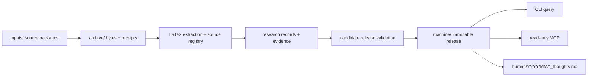
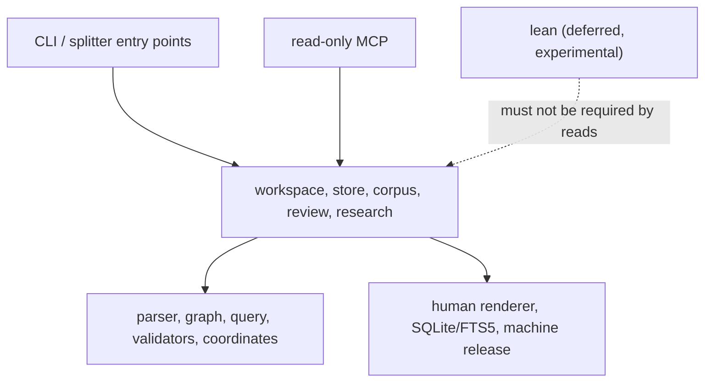

# QEC Graph — System Design

> **Status: Current authoritative design (0.6.x).** This is the only active design document.

> **English** · [中文](DESIGN.zh-CN.md)

| | |
|---|---|
| **Status** | Current authoritative design (0.6.x) |
| **Reviewed** | 2026-11-11 |
| **Supersedes** | The earlier architecture, graph-contract, data-formats, incremental, MCP and CodeGraph design pages. Lean is deferred; see §10. |
| **Implementation** | `qecgraph/`, `tests/`, `tools/`, `validation/` |

This document is the single source of truth for the system's architecture, data contracts, evidence semantics, publication protocol, query/MCP surface, human view, and the deferred Lean boundary. If code, tests, and this document disagree, the executable behavior and its verification are the current state; update this document in the same change that alters the design. Do not create a second design page for a new idea: extend this document or record a superseding decision here.

| Status | Meaning |
|---|---|
| **Implemented** | Present in the package and covered by tests or recorded verification. |
| **Partial** | The mechanism exists but a documented part is missing or limited. |
| **Not implemented** | A design goal with no executable implementation. Never describe it as available. |
| **Historical** | Superseded material is available in Git history only, not in the current documentation tree. |

---

## On this page

- [1. Scope and non-goals](#1-scope-and-non-goals)
- [2. System overview](#2-system-overview)
- [3. Authority, storage, and publication](#3-authority-storage-and-publication)
- [4. Data contracts](#4-data-contracts)
- [5. Source extraction](#5-source-extraction)
- [6. Review, evidence, and query eligibility](#6-review-evidence-and-query-eligibility)
- [7. Workspace transaction and publication protocol](#7-workspace-transaction-and-publication-protocol)
- [8. Query, CLI, and MCP contract](#8-query-cli-and-mcp-contract)
- [9. Human view](#9-human-view)
- [10. Lean: deferred, not supported](#10-lean-deferred-not-supported)
- [11. CodeGraph reference and third-party attribution](#11-codegraph-reference-and-third-party-attribution)
- [12. Invariants and failure cases](#12-invariants-and-failure-cases)
- [13. Current limits and non-goals](#13-current-limits-and-non-goals)
- [14. Verification and change rules](#14-verification-and-change-rules)
- [15. AI integration](#15-ai-integration)
- [16. Searchable knowledge and implementation roadmap](#16-searchable-knowledge-and-implementation-roadmap)
- [Appendix A — Decision record (supersedes the standalone ADRs for current behavior)](#appendix-a--decision-record-supersedes-the-standalone-adrs-for-current-behavior)
- [Appendix B — Primary references](#appendix-b--primary-references)

## 1. Scope and non-goals

QEC Graph turns LaTeX papers and explicit QEC research records into a provenance-preserving local workspace. It is designed for five questions:

1. Where exactly was a statement, definition, proof, table, or parameter written?
2. What does the source claim, what is explicitly recorded, what was reviewed, and what was computed?
3. Which codes, check-matrix representations, circuits, noise models, decoders, experiments, and software versions are connected to a result?
4. What can be handed to a read-only agent without silently turning candidates, upper bounds, or author claims into facts?
5. Which problems, motivations, approaches and open questions does a paper express, and how do they connect to its results and prior work?

**It is not:**

- a TeX engine, PDF/OCR pipeline, or a replacement for reading the paper;
- a mathematical proof assistant or a distance solver for large codes;
- a claim that a paper's theorem is true, that a Lean declaration matches the prose, or that a reported LER is reproducible;
- a multi-writer or distributed database; or
- a service that executes source code, TeX, or Lean on read.

The executable scope is the Python package, CLI, local MCP server, Obsidian renderer, and the store/corpus surfaces. Lean code and fixtures exist only as deferred experimental material and are not part of the supported 0.6.x workflow.

---

## 2. System overview

### 2.1 Primary flow: workspace



A workspace is a local directory with a single writer. `init` creates the layout; `sync` archives and processes inbox packages; `rebuild` rechecks the complete archive; `status`, `validate`, and `doctor` are read-mostly inspection commands. A successful transaction publishes an immutable machine release and then renders a separate human view. Query and MCP sessions pin a release and never read a moving `CURRENT` mid-session.

### 2.2 Compatibility surfaces

Three storage/query generations exist, deliberately:

| Surface | Purpose | Status |
|---|---|---|
| **Workspace** (`qecgraph/workspace.py`, `machine/`, `archive/`) | Primary product: source packages, research records, human view, workspace MCP | Current |
| **Corpus** (`qecgraph/registry.py`, `corpus.py`) | Multi-document identity, review/apply, corpus queries, corpus MCP | Supported corpus surface |
| **Store** (`qecgraph/store.py`, `query.py`) | Single-paper immutable extraction snapshot and SQLite/FTS5 queries | Supported store surface |

New work should target the workspace surface. Store and corpus remain available for existing commands, migrations, Lean imports, and tests. When a feature exists in more than one surface, the workspace implementation defines current semantics; the older surfaces must not silently diverge on evidence or state filtering.

### 2.3 Runtime and deployment

- Python 3.11+ on a POSIX filesystem; SQLite with FTS5.
- `pylatexenc==2.10` and `jsonschema==4.26.0` are runtime dependencies.
- Installation: standalone executable from GitHub Releases, local wheel/sdist, or `pip install -e .` from a checkout.
- The research Compose profile and the macOS read-only MCP isolation profile are release checks; re-run them with the commands in `validation/README.md`. The Linux profile uses an alternate local Ubuntu base because the default Docker Hub lookup timed out. Do not claim a generic Docker Hub build or Windows support without a new verification.
- The package is versioned independently from graph/record schemas and the Lean toolchain. `qec-graph --version` is authoritative for the installed package version.

### 2.4 Module boundaries



| Layer | Modules | Rule |
|---|---|---|
| Entry points | `qecgraph/cli`, `qecgraph/mcp/server.py`, `qecgraph/source/splitter.py` | May import application modules; package import must not load the CLI |
| Application | `store.py`, `workspace.py`, `workspace_*.py`, `corpus.py`, `registry.py`, `review.py`, `query.py`, `domain/*` | Own transactions and policy; do not import development layers |
| Kernel | `core/graph.py`, `core/transactions.py`, `core/coordinates.py`, `source/*`, `validators/*` | Pure or local side effects; no tests/tools/validation imports |
| Output | `render/human.py`, `domain/status.py`, `domain/software.py`, `mcp/*` | Render/read from a pinned release; never write back through `human/` |
| Deferred | `lean/*` | Experimental only; never required by database, query or MCP reads |

The architecture test in `tests/contracts/tooling/test_architecture.py` enforces the import boundary.
Implementation now lives under `core/`, `source/`, `domain/`, `render/`, `mcp/` and `lean/`;
`store.py`, `workspace.py` and `corpus.py` remain cohesive service modules pending a later
split. `qecgraph/splitter.py` and `qecgraph/mcp_server.py` are thin compatibility shims for
the documented module entry points.

---

## 3. Authority, storage, and publication

### 3.1 One editable owner per field

| Layer | Authoritative content | May be edited? | Rebuildable? |
|---|---|---|---|
| Raw assets | Original paper/TeX packages, PDFs, matrices, certificates, Lean source at a fixed commit | No (append a new version) | No |
| Human records | `research` JSON, review bindings, explicit relations, assets manifest | Yes, through explicit records/transactions | No |
| Execution evidence | Build logs, exports, computed checks, run outputs | No after publication | No |
| Query projections | `graph.json`, views, SQLite/FTS5, human pages | No | Yes |

Markdown explains decisions; it does not own QEC facts. YAML is an import/template format, not a second editable truth. SQLite and generated graph views are rebuildable and must never be patched to change a fact.

The machine release is the only authoritative state a query or MCP session may consume. The human view is a rendering of a pinned release, not a new knowledge source. A reviewer or agent must not write back through the human view.

### 3.2 Workspace layout

```text
workspace/
├── qecgraph.toml                 # workspace id, limits, explicit source metadata
├── inputs/                       # claimed inbox; successful packages are consumed
│   └── .processing/              # durable claims for crash recovery
├── archive/
│   ├── blobs/sha256/<hash>       # original package bytes
│   └── receipts/<job>.json       # claim/archive receipt
├── sources/<tree-hash>/          # verified expanded source tree
├── machine/
│   ├── CURRENT.json              # published release pointer
│   ├── states/<release>.json     # immutable registry state
│   ├── operational/status.json   # sanitized operational projection
│   └── .writer.lock              # single-writer lock
├── human/
│   └── YYYY/MM/
│       └── Surname_First_Two_thoughts.md
└── .qecgraph/                    # claim/rotation/staging internals
```

Store and corpus have their own managed roots. Do not merge their pointer formats or edit their state by hand. Migrations copy into a new location and reserve the destination name before copying; they do not rewrite the old store in place.

### 3.3 Identity is not a hash, title, or parameter tuple

| Concept | Meaning | Not interchangeable with |
|---|---|---|
| `work_id` | A paper/work identity | source version, file, title |
| `source_version_id` | A specific version of a work | package archive hash |
| source occurrence | A parser block at an exact span in a source version | normalized claim |
| entity `id` | Stable domain object identity | `[[n,k,d]]`, label, file name |
| `revision` | A content state of an entity | package release |
| `content_sha256` | Exact serialized content | object identity |
| `snapshot_id` / `release_id` | One extraction or publication state | paper version |
| asset ID | Content-addressed managed bytes | source file path |

Duplicate labels are ambiguous and must be resolved with an exact ID. Missing records do not prove that an object does not exist. `[n,k,d]` equality does not prove code identity; construction, check-matrix representation, logical basis, and evidence stay separate.

---

## 4. Data contracts

### 4.1 Schema families

| Schema | Use | Location |
|---|---|---|
| `qecgraph.research` | Current workspace research records (27 kinds, 47 typed relations) | `qecgraph/validators/schemas/research.schema.json` |
| `qecgraph.record` | Corpus records (current format) | `qecgraph/validators/schemas/record.schema.json` |
| `qecgraph.graph` | Extraction graph and SourceGraph/LemmaGraph/DataGraph projections | `qecgraph/validators/schemas/graph.schema.json` |
| `qecgraph.annotations` | Human/AI additions to an extraction store | packaged schema |
| `qecgraph.proposal`, `qecgraph.review` | Review envelopes | packaged schemas |
| `qecgraph.lean-export` | Experimental/deferred Lean export envelope | packaged schema |

Unknown schemas are rejected; no older format is reinterpreted with the current fields. Package version and data format move independently. The canonical schemas are packaged resources; do not create a second editable copy at the repository root.

### 4.2 Research record envelope

A `research` record carries:

- `schema`, `id`, `revision`, `kind`, `is_synthetic`;
- `data` with kind-specific fields;
- `field_evidence` mapping each field pointer (`/data/<field>`) to evidence status and provenance;
- optional review/envelope fields as defined by the schema.

Rules:

- A missing value is `null` with an explicit unknown status/reason; it is not `false`, `0`, or an empty list.
- A known value must not silently replace a conflicting source claim. Preserve the conflict and its conditions.
- `source_reported`, `computed_exact`, `certificate_checked`, and `lean_build` are distinct evidence kinds.
- A field-level source locator must resolve to a registered version and a verbatim span.
- Structural/schema validation is not mathematical verification, and neither is a passing test or a Lean build.
- AI/provider output is a draft/proposal by default; only an explicit review decision can publish it.

### 4.3 Domain objects and required distinctions

The domain model is intentionally split; these are not interchangeable:

| Concept | Distinction |
|---|---|
| `code_family` / `construction` / `quantum_code` | A family or construction rule is not a concrete `[n,k,d]` instance |
| `classical_code` | A classical code/seed is not the quantum code derived from it |
| `check_matrix` | A stabilizer space and a particular check matrix/generator set are different objects |
| `distance_estimate` | Subject, check-matrix representation, metric, sector, direction, assumptions, method, conditions, evidence |
| `syndrome_measurement_circuit` | Circuit distance and code distance are different; depth must state its counting definition |
| `noise_model` / `noise_model_instance` | A channel model template is not a resolved probability point |
| `decoder` | Algorithm, software/release, parameters, and version are distinct |
| `experiment` | A paper-reported result is not an `execution_run` performed locally |
| `performance_curve` / `performance_data_point` | A point belongs to one experiment/curve/metric revision; no cross-experiment ranking |
| `hardware_model` / `execution_environment` | Hardware claims and simulation CPU/GPU environments are separate |
| `software_usage` | Mention, citation, source-reported use, and locally observed use are different evidence levels |
| `catalog_source` | A software catalog entry is not an installed/tested release |
| `research_thought` | A quoted author statement or attributed interpretation is not a verified result or inferred proof dependency |

Required minimums include:

- `quantum_code`: code type and `n`/`k` (or explicit unknown reason), construction reference, check-matrix representations.
- `check_matrix`: parent code, check matrices/assets, index/bit-order conventions, reconstruction status.
- `distance_estimate`: exact subject/metric/sector, relation (`exact`/`lower_bound`/`upper_bound`/`interval`), bounds, assumptions, method, evidence.
- `syndrome_measurement_circuit`: representation, scheduling, ancillas, rounds, boundaries, observables; depth metrics with explicit units/definitions.
- `noise_model`: channels, locations, probability parameters, temporal/spatial correlations, boundaries; idle/loss/erasure/leakage are separate and `unknown` when unevidenced.
- `experiment`: exact code/check-matrix representation/circuit/noise-model instance/decoder/metric/source revisions.
- `performance_data_point`: experiment, noise-model instance, metric, value, coordinates, shots/discards/uncertainty, selection policy; no interpolation across curves.
- `software_usage`: usage kind, project, release (or explicit unknown), and source/experiment binding.
- `research_thought`: category, statement, attribution, exact source quotation and paper-version reference; real records bind statement and quotation to the same source span.

Check weight always binds to the actual check-matrix representation and check set, including sector (`X`/`Z`/`mixed`), scope (`stabilizer`/`gauge`/`measured`), and min/max/mean/histogram. In a symplectic representation, a `Y` contributes one support position.

### 4.4 Relations and edge states

The canonical relation registry is `qecgraph.research.RELATIONS` / graph validation, not this prose. Common edges:

- structural: `contains`, `defined_in`, `includes`, `uses_resource`;
- textual: `references`, `cites`, `describes`;
- mathematical: `depends_on_declared`, `depends_on_candidate`, `depends_on_reviewed`, `proof_of`, `proof_of_candidate`, `normalizes_to`;
- data: `has_check_matrix`, `has_matrix`, `instance_of`, `generated_by`;
- experiments: `uses_circuit`, `uses_noise`, `uses_decoder`, `reports`, `supports`, `contradicts`;
- Lean: `formalizes`, `maps_declaration`, `maps_source_occurrence`, `has_build_evidence`, `lean_type_depends_on`, `lean_proof_depends_on` (and transitive variants);
- catalogs: `catalog:*` preserve imported meaning; they do not become proof edges.
- thoughts: `addresses_refs`, `motivated_by_refs`, `extends_refs`, `contradicts_refs` link thoughts; `related_refs` links research objects. Each target includes its exact revision.

Each edge keeps `source`, `target`, `relation`, `status`, and `evidence`.

- `observed` — syntax/parse observation.
- `declared` — author or metadata claim.
- `candidate` — a hypothesis; not a confirmed dependency.
- `reviewed` — bound to an explicit review and exact inputs.
- `stale`, `unbound_review`, `unresolved` — not eligible for default dependency/context answers.

`references` is not a proof dependency. A proof's `uses` may be promoted only when the proof target is explicit; if the target is a candidate, the promoted edge is candidate too. Default traversal filters inactive states; explicit audit `show` may display them. Citation cycles are legal; only active reviewed logical-dependency SCCs are reported for judgment. Include cycles are a parser diagnostic, not a mathematical cycle.

### 4.5 Source coordinates and hashes

- File identity and asset identity use SHA-256 of the original bytes.
- Text spans use decoded Unicode code points, half-open `[char_start, char_end)`; lines are 1-based and inclusive at the end.
- Byte offsets, character offsets, PDF page numbers, and source line numbers are never mixed.
- Parent and child fragments may overlap; do not concatenate fragments to reconstruct the source.
- JSON canonicalization keeps an explicit protocol label. Existing protocols are not silently relabeled as RFC 8785/JCS. Array order is semantic unless the schema declares a set.
- A changed source or asset invalidates a bound review; `stale` evidence is retained, not refreshed to hide the change.

---

## 5. Source extraction

### 5.1 Parser

`qecgraph/source/parser.py` uses `pylatexenc==2.10` to recognize structural declarations without running TeX. It records:

- file bytes/hash and exact source spans;
- sections, definitions, lemmas, theorems, propositions, corollaries, conjectures, proofs, equations, tables, figures, remarks, examples;
- labels/references, literal includes/resources, macro/environment declarations;
- diagnostics for missing/ambiguous includes, unsupported syntax, path escapes, dynamic paths, and parse failures.

Braced `\href`, `\url`, and `\nolinkurl` targets preserve literal percent escapes. The visible text of a link still uses ordinary TeX parsing.

It does not expand arbitrary macros, evaluate conditionals, execute TeX, or infer mathematical truth. A partial extraction is a valid, explicitly marked snapshot; `--strict` keeps it in staging without advancing `CURRENT`.

`\lean` and `\uses` outside a mathematical block are preserved as `describes` / `references` associations with a diagnostic; they do not become typed proof dependencies. `\def` and `\let` mark a name as defined for a later statically decidable `\ifdefined`, while their replacement text stays opaque.

### 5.2 Source block vs normalized claim

A parser theorem/lemma is a **source block**: what the document says at a fixed span. A normalized `claim` is a separate revisioned domain object with explicit statement, quantifiers, hypotheses, definitions, subject, and evidence. The two may be many-to-many; similar text or parameters never merge identities. `proof_of` points at the intended target and does not assert that the proof is valid.

### 5.3 Rules and provider proposals

The offline extractor performs two passes: locate notation/structures, then apply local wording/column rules. It produces `code_parameters_mention` proposals with exact locators and a rule version; it does not promote a table parameter into a verified quantum code, infer a distance bound, or guess code class from bracket shape.

An optional local provider handoff exports bounded source excerpts, validates the provider/model/prompt hash and cited spans, and queues a draft. It never calls an external model automatically and never approves its own draft. A human decision binds the exact draft and source projection; changed inputs make the decision stale.

---

## 6. Review, evidence, and query eligibility

A review decision is an object with actor/kind, time, scope, rationale, decision, and exact input bindings (record IDs/revisions/content hashes, source versions, assets, proposal). Bindings cover the changed records and their explicit reference closure; an unrelated record revision does not invalidate a decision, while a changed dependency does. `apply` publishes a new revision atomically after checking those bindings; repeated application is idempotent. A review does not become true because a test passed, and a schema pass does not become mathematical verification.

A `claim.subject_id` must resolve to a registered subject. A dangling subject is a validation error; a wrong subject kind (for a distance estimate, not a quantum code, check-matrix representation, circuit, family, construction or classical code) is a warning rather than silent disappearance.

Evidence policy:

- Hard distance filters require an exact subject/check-matrix representation/metric/sector, a qualifying relation (`exact`, `lower_bound`, `interval`), sufficient lower bound, and current evidence bound to the claim's exact revisions.
- An upper bound alone never satisfies `distance >= d`.
- Source-reported results are selected only in an explicit policy; they are not silently treated as mathematically verified.
- An `execution_run` may support a locally performed result; it does not overwrite a paper-reported value.
- Lean is deferred; if experimental Lean evidence is ever evaluated, it is not semantic equivalence and is not part of default filters.
- Missing/no-result means no match in the fixed scope; it is not proof of nonexistence.

Default query behavior excludes inactive edges (`stale`, `unbound_review`, `unresolved`) and candidate/proposed/`needs_review` edge or annotation information unless explicitly requested. Research record rows are not hidden merely because they are proposed; each row carries `review_status`, and hard filters use the evidence policy rather than silently promoting a draft. `show` is the audit view and keeps all states. Any truncation is explicit; source statements/hypotheses are not silently shortened.

---

## 7. Workspace transaction and publication protocol

### 7.1 Claim → archive → stage → validate → publish → consume

1. **Claim** an inbox file under `inputs/.processing/<job>` with a durable job record.
2. **Archive** original bytes under `archive/blobs/sha256/`; write an immutable receipt with size/hash/name.
3. **Unpack** by content (TeX, gzip, tar, tar.gz, ZIP), with path/link/special-file/member/size/depth limits. Reject traversal, links, case collisions, forged ZIP counts, encrypted/unsupported members and oversized inputs. Preserve original bytes and a hashed expanded tree.
4. **Select the entry point** only from evidence: explicit config override or a unique TeX file with `\documentclass` and `\begin{document}`. Ambiguity stays `needs_entrypoint`; do not guess by longest filename.
5. **Extract** into a store, then stage source/research records and proposals. A structural partial is not published as complete; the source remains visible with `semantic_pending`/`parse_failed` state.
6. **Build a candidate machine release** from all active state. Reused projections are reverified before publication.
7. **Validate** the candidate (source hashes/spans, record references, review bindings, assets, graph endpoints, SQLite, project identity). A failed candidate leaves `CURRENT` unchanged.
8. **Publish** by atomically replacing the pointer under the writer lock.
9. **Consume** only the claimed input copies of the successful transaction; retain failed packages and receipts. A restored name must not overwrite a newer file. `--keep-inputs` preserves copies.

Any failure must leave the old release readable, the original package recoverable, and no duplicate facts. A successful batch may contain failures; the result is `partial_batch`. `rebuild` inspects the complete archive and receipts, including previously failed/unresolved packages; it does not treat a manifest as a paper allowlist. `inputs quarantine` moves a persistently bad package aside without deleting bytes; `inputs restore` refuses to overwrite a replacement. A successful claim directory is removed after its commit receipt; failed or retained claims remain recoverable, and empty claim directories are cleaned under the writer lock.

### 7.2 Locking, atomicity, and recovery

- One workspace writer; `transactions.writer_lock` uses a POSIX advisory lock and rejects linked/special lock files.
- Immutable objects may remain after a crash; only the pointer publication makes a release current.
- The store/workspace publications are crash-recoverable: a pointer switch followed by claim cleanup is replayed from the exact claim; a SIGKILL test covers this window.
- The lock protects local processes, not NFS or distributed writers. Do not claim power-loss durability or multi-writer support.
- `recover-store`/`doctor` validate the pointer and inventory tool-owned abandoned builds; unknown or user-owned directories are not deleted. Removal is explicit.
- `human_stale` is a derived-view failure, not a machine-release rollback. Re-render from the pinned release.

### 7.3 Incremental and watch

- Per-file pylatexenc AST caching is content-addressed and validated; no pickle/arbitrary loading. Parse errors are not cached.
- Every run re-discovers includes/resources and rebuilds semantic projections, graph views, review status, and SQLite. A cache hit never revives a stale review.
- Macro/environment/include-set/config/processor changes conservatively fall back to full parsing; mtime is not trusted.
- `watch` is content polling around the same ingest. Temporary files, output stores and caches are ignored; batch saves are debounced. It does not introduce a second extractor.
- Incremental and full runs must produce identical semantic output for the same final input. Performance claims are measurements, not guarantees.

### 7.4 Exit behavior

- `0` — requested work completed (or no change).
- `1` — fatal failure; no new release.
- `2` — partial batch/unresolved input/derived view stale, with a readable report.
- `4` — a required file or exact query target is missing.
- `5` — the writer lock or an input destination is held by another owner.
- `64` — command usage error.
- `130` — interrupted.
- Machine JSON errors carry a stable error code/message/details; human errors go to stderr. Automation should read the structured status, not infer semantics from `2` alone.

---

## 8. Query, CLI, and MCP contract

### 8.1 Scopes

Every read is fixed to one scope:

- `--workspace` + optional `--release` (workspace machine release);
- `--machine` (strict read-only machine mount, no workspace/human access);
- `--store` + optional `--snapshot`;
- `--corpus` + optional `--registry-revision` and source-version restriction.

Returned results include the scope identity, source/evidence status, and truncation/absence notes. A session pins its release/snapshot at startup; changing `CURRENT` does not change an existing session. Reconnect/re-pin to read a new release.

### 8.2 CLI

The CLI is grouped by noun (`workspace`, `query`, `review`, `mcp`, `human`, `software`, `maintain`, `snapshot`, `inputs`, `doctor`, `version`, `help`, plus an experimental/deferred `lean` group). Flat legacy names remain available with deprecation notices. Global options include `--json`, `--quiet`, `--verbose`, `--debug`, `--color`, and `--version`.

Human output is concise and stateful: workspace/release, indexed/pending/failed/quarantined counts, human-view state, and a next action. `--json` is the only machine-output switch; TTY detection affects styling, not the data model. Errors are actionable and never raw Python/OS/TOML tracebacks unless `--debug` is requested.

### 8.3 MCP

- Local stdio, protocol `2025-06-18`; stdout carries only JSON-RPC, logs go to stderr.
- Store/corpus sessions expose the five `qecgraph_*` read tools.
- Workspace sessions add research/source tools and `qec://source/...` resources, plus status/coverage projections.
- A session is pinned to one fixed release; tool arguments cannot pass arbitrary paths/SQL/shell or change scope.
- Budgets: depth/nodes/results/characters; truncated results state omitted content; a too-small budget returns an explicit error rather than a partial root statement.
- Read tools never write, run TeX/paper code, or trigger Lean builds.
- Strict deployment mounts only the machine directory. `human/`, `inputs/`, and personal notes must not be readable. MCP roots are not an access-control mechanism.

The typed JSON envelope (`ok/data` or `error/code/message/details/scope`) is shared by Python, CLI, and MCP where applicable. MCP protocol errors and business-query errors remain distinguishable.

---

## 9. Human view

`human/` contains only one generated ThoughtsGraph Markdown note per registered
paper (`work_id`), under `human/YYYY/MM/Surname_First_Two_thoughts.md`.
This layout is **Unreleased on main**; the published v0.6.2 uses the earlier vault.

- Each note contains the nine questions from [Human.md](Human.md), AI answers,
  verbatim supporting quotations and source-version/line references. Missing
  answers are explicitly unavailable. Matching `research_thought` records are
  also shown with their actual review status. AI proposals remain `proposed`.
- YAML front matter is the very first content, in this order: `tags`, `link`,
  `title`, `author`. Tags are the paper's main topics; spaces become hyphens.
  `author` is an ordered list, `link` is a public HTTP(S) URL or null, and missing
  lists are empty. These follow [Obsidian properties](https://obsidian.md/help/properties)
  and [tags](https://obsidian.md/help/tags). No graph/release/status tags are added.
- Registered title and canonical URL take precedence. Source-bound AI `paper`
  metadata supplies title, ordered authors, date, link and topics; literal TeX
  title-block commands (including RevTeX metadata after `\begin{document}`)
  provide a fallback without evaluating macros. Without topic
  metadata, recognized QEC phrases in the title supply tags. Missing information
  stays unknown; dates are never taken from the import time or `\today`.
- Folder year/month comes first from the modern arXiv identifier in the original
  package name: `arXiv-2611.12971v2.tar.gz` gives `2026/11/`. The `YYMM` prefix
  identifies the initial submission month, including for later versions; see
  [arXiv identifier format](https://info.arxiv.org/help/arxiv_identifier.html).
  Filename parsing is local and does not establish a paper identity or version.
  Non-arXiv names fall back to the source date. Conflicting package months stay
  unknown instead of choosing a filename arbitrarily.
- Sync/rebuild copies receipt filenames into `materials[*].original_names` in
  the machine release. An empty sync backfills older workspaces without needing
  source re-extraction. Rendering reads only this fixed snapshot, not live receipts.
- The first author's surname and the title's first two whitespace-delimited
  words form the filename; `author` in YAML keeps the full ordered author list.
  Comma-separated surname-first names retain their first component; otherwise
  use the final word with common family-name particles (e.g. `van Loock`),
  preserving hyphens and excluding `Jr.`/`Sr.`/generational suffixes. Unsegmented
  single-word names stay intact. Unsafe characters become underscores. Unknown author
  and title use `UnknownAuthor` and `Untitled_Paper`; missing year/month use
  `unknown`, including `YYYY/unknown/` when only a year is known. Collisions add a
  short work-ID hash before `_thoughts.md`.
- Multiple versions of one work share one file, with answers labeled by source
  version. Bibliographic metadata uses the lowest explicit numeric `vN`; when
  none exists, a deterministic source-ID order applies, without claiming recency.
- No index, entity pages, source previews, manifest, tombstones or private-notes
  directory are generated in `human/`. Renderer state and pending publication
  journals live in `.qecgraph/human-{published,pending}.json`. Keep personal notes
  outside `human/`; generated notes are replaced on rebuild.
- Migration recognizes the old renderer's history and **deletes the entire old
  `human/` tree, including old `notes/`, without reading their contents or making
  a backup**. All new content is prepared first. An unrelated, unregistered vault
  is refused. Subsequent builds remove only obsolete managed notes and empty
  year/month directories; unowned destination collisions are refused.
- Publication remains per-file atomic, not a vault-wide transaction. A failure
  reports `human_stale`; rerunning `qec-graph human build` completes publication
  and cleanup without rolling back the machine release. Rendering does not call AI.
- Notes are a one-way reading view, never query/MCP/embedding input or an
  authority. Corrections belong in explicit structured machine revisions.

---

## 10. Lean: deferred, not supported

> [!WARNING]
> **Lean is deferred in 0.6.x.** It is not part of the supported database,
> query, or MCP workflow. The `lean` CLI group, `qecgraph/lean/`, `lean/`
> project, and `tests/fixtures/lean/` remain only as experimental regression
> material. They are not a verification claim and must not be presented as a
> finished product capability.

**Current status:** deferred. The previous Lean experiments answered some
engineering questions (toolchain pinning, export shape, axiom visibility), but
they are not a supported semantic contract. They are intentionally excluded
from the supported release scope until a new design is written and approved.

### What exists today, and what it means

| Artifact | Status |
|---|---|
| `qecgraph/lean/core.py`, `qecgraph/lean/integration.py`, `qecgraph/cli/commands/lean.py` | Experimental code retained so historical regressions remain testable; not covered by the support contract |
| `lean/` project and `lean/axiom-policy.json` | Pinned experimental fixture; no toolchain is installed in the normal Python environment |
| `tests/fixtures/lean/` | Recorded experimental Lean artifacts; not a current verification claim |
| Query/MCP path | Does not import, execute, or require Lean; database construction and MCP are unaffected |

### What is explicitly not claimed

- no “Lean verified” status for any paper theorem;
- no semantic equivalence between prose and a Lean type;
- no general CSS/HGP distance formalization or certificate bridge;
- no support for third-party package manifests, custom axioms, `sorry`, or
  `native_decide` trust beyond explicit experimental checks;
- no reproducible Lean acceptance in the current release.

### Before Lean is implemented again, a new design must specify

1. the exact source statement → normalized claim → Lean declaration mapping,
   including quantifiers, hypotheses, definitions, and scope;
2. declaration/type/proof-dependency export and the proof-term trust model;
3. an explicit axiom/`sorry`/native-computation policy, with failure evidence;
4. a reproducible toolchain, project commit, dependency lock, build command,
   and log/export format;
5. independent semantic review, freshness/invalidations, and query exposure;
6. the boundary with the database and MCP: read tools must never execute Lean,
   and Lean absence must not break workspace or MCP operation.

---

## 11. CodeGraph reference and third-party attribution

This project independently implements its Python architecture. It references [colbymchenry/codegraph](https://github.com/colbymchenry/codegraph) at commit `f72c9d2efb14454ff4f9fd7b8460abd82f19a287` (MIT, Copyright (c) 2026 Colby Mchenry) for extraction/storage/resolution/query/watch boundaries. No upstream code is copied and no upstream performance number applies. The decision record below summarizes the reference; the detailed check, including `6560052a6f856855d3f71eee838fd66ccfa4285d`, remains in Git history.

Mapping summary:

- code symbol graph → source spans, claims, entities, evidence and typed relations;
- tree-sitter/AST → `pylatexenc` structural extraction (not a TeX engine);
- reference resolution → labels/includes/citations plus explicit typed edges;
- graph query/context → bounded, evidence-filtered traversal;
- watch/sync → content polling around the same ingestion pipeline;
- AI tools → one read-only query layer exposed through CLI, Python and MCP.

[leanblueprint](https://github.com/PatrickMassot/leanblueprint) annotations (`uses`, `proves`, `lean`, `leanok`) are preserved as author observations/claims; they are not proof-term dependencies, build evidence or semantic equivalence.

---

## 12. Invariants and failure cases

### 12.1 Testable invariants

| ID | Invariant |
|---|---|
| G01 | Every source block is exactly the archived source slice for its span. |
| G02 | Comments/verbatim labels and commented includes never enter the real index. |
| G03 | Nested labels remain distinct; duplicate labels are ambiguous and never silently resolved. |
| G04 | `references`, declared dependencies, candidates and reviewed dependencies stay distinct. |
| G05 | An inactive input edge cannot be revived by promotion or query. |
| G06 | Resource hashes are fixed before review matching; content changes stale the review. |
| G07 | `\leanok`/`formalizes` never produce Lean-verified or semantic-equivalence status. |
| G08 | A table parameter is not promoted to a verified quantum code by extraction. |
| G09 | Rebuilding the same input/tool state is idempotent and does not modify source bytes. |
| G10 | Graph, views and SQLite point to the same snapshot; all edges have valid endpoints. |
| G11 | Explicit data relations can expand matrix, check-matrix, metric and evidence context. |
| G12 | Partial extraction, truncation, unresolved targets and stale reviews are observable. |
| G13 | A failed publication leaves the previous release readable and inputs recoverable. |
| G14 | Human/private notes are never knowledge inputs. Legacy human files are deleted without reading them during the documented migration (§9). |
| G15 | A workspace/MCP session cannot mix two releases. |

### 12.2 Required failure cases

- A proof mentions a background theorem without a declared dependency: keep `references`; only candidate edges.
- A duplicate label: return ambiguity; require an exact ID.
- A distance estimate has only an upper bound: it must not satisfy a lower-bound filter.
- A source/asset/review input changes: mark stale, preserve old evidence, exclude from default answers.
- An archive contains traversal, links, special files, a forged ZIP count or an unsupported member: reject before materialization.
- A package is permanently unsupported: retain it, report it, and allow quarantine; never delete it or fake an extraction.
- `CURRENT` is corrupt or the writer lock is held: report the exact path/owner state and do not write.
- A renderer fails after publication: keep the machine release, report `human_stale`, re-render.
- A Lean build has `sorry`/an unlisted axiom or a changed type/toolchain: reject the evidence binding; keep the historical report.
- An MCP request asks for a path/SQL/shell or a different scope: reject; do not reinterpret as a query.
- A query has no result: state the fixed scope and absence semantics; do not say the theorem does not exist.

---

## 13. Current limits and non-goals

| Area | Status |
|---|---|
| Real-paper corpus | Six versioned arXiv sources in the pinned replay; not a comprehensive literature corpus |
| LLM extraction | Configured providers for normalization, eligible structure recovery and default-enabled proposals; requires credentials, schema/evidence validation, no quality claim |
| Chart/curve digitization | Not implemented; values require explicit evidence |
| PDF/OCR | Not implemented; LaTeX source is the supported input |
| Vector/semantic retrieval | Optional local lexical vectors or OpenAI-compatible embeddings; BM25/cosine hybrid retrieval; quality requires corpus-specific evaluation |
| Distance algorithms | Small-code enumeration/validation; no general large-code solver or certificate bridge |
| Lean formalization | **Deferred.** Experimental code/fixtures only; no supported verification claim; DB/MCP unaffected |
| Platforms | POSIX (macOS/Linux verified); Windows not supported/verified |
| Distribution | Standalone GitHub Releases and local wheel/sdist; public PyPI publication is gated/manual and not assumed |
| Concurrency | Single writer, local POSIX filesystem; no multi-writer/distributed transactions |
| Docker | Linux Compose and macOS isolation verified with recorded caveats; no claim of a universal image build |

These are limits of the current release, not permission to fill gaps with plausible values.

---

## 14. Verification and change rules

- The test suite and `tools/reproduce*.py` are the executable checks; `validation/README.md` lists the current checks.
- `python -m unittest discover -s tests -v`, `python tools/reproduce.py --out build/reproduce`, and the CLI/MCP checks are the standard local gates.
- CI runs ruff, mypy, advisory pyright and the unit-test layer only. Integration/contract tests, coverage, distribution, installed-wheel, Docker and isolation checks are local/manual checks.
- Any change to identity, source coordinates, evidence semantics, review binding, publication order, or MCP scope requires a new invariant test and a migration note when compatibility is affected.
- A design change is complete only when this document, the implementation, the tests and the validation claim agree. Do not leave a second contradictory design page in the active tree.

---

## 15. AI integration

AI is an optional, local orchestration layer under `qecgraph/llm/`. `init` writes
provider templates, and the local parser handles ordinary packages during
`sync`. A configured provider can help resolve a multi-root package or recover
an eligible structural parser failure. Routine semantic proposals default to
enabled, with OpenRouter and `deepseek/deepseek-v4.1-flash-1017` selected. The
template leaves API keys empty for the user; a missing key leaves local imports
available without AI requests. Explicit existing settings are preserved, while
omitted provider/model/proposal fields use the same defaults as new configurations.

The normalizer receives a bounded inventory and source excerpts, returns a
normalization plan, and the assembler copies the selected original bytes into a
derived `main.tex`. The original archive and source tree remain authoritative;
a plan that needs review leaves the package archived pending an entry point.
The release binds the normalized TeX and its source map by hash. Source reads
identify projection coordinates and return original paths and ranges separately.
AI extraction writes
reviewable `qecgraph.ai.proposal` artifacts; it never promotes them to verified
records.

Providers are selected in `qecgraph.toml` (OpenAI, Anthropic, OpenRouter or a
local CLI adapter). Requests are schema-bound, retried only on transient errors,
budgeted, cached by content hash and logged with model/prompt/run provenance.
`[ai].max_parallel_packages` bounds concurrent extraction of structurally registered packages; registry staging,
publication and input consumption remain serial.
API keys are redacted and the configuration file is created mode `0600`.

| Component | Status |
|---|---|
| Init and provider configuration | Implemented; no network call in `init` |
| Provider/client retries, schema and cache | Implemented |
| Versioned skill packs | Implemented |
| Source-mapped normalization | Implemented for ambiguous packages |
| Parser-first structure recovery | Implemented for eligible original TeX entries, with proposed block kinds |
| Theorem/assumption/data/thought proposals | Enabled by default when credentials are configured; written as `machine/ai/proposals`; explicit review decisions are recorded, conversion to canonical research records is not automatic |

### 15.1 Parser-first body extraction rollout

**Status: Implemented.** The table records the implementation and acceptance sequence.

| Step | Change | Acceptance |
|---|---|---|
| 1 | Record eligibility, evidence, publication and migration rules | Preserve archive authority, fixed release reads and existing raw query behavior |
| 2 | Add the shared reading projection | Both extraction methods use the existing source-block graph; derived text hides recognized formatting and citations, preserves math, and separates bibliography while the raw view retains every original slice |
| 3 | Add the versioned structure fallback skill and local verifier | A fake provider can classify exact, numbered body ranges; reject gaps, overlaps, fabricated fields, bad anchors, and uncertain plans |
| 4 | Integrate the fallback with strict workspace publication | Call the provider only after an eligible parser failure. Bind accepted plans to source bytes and snapshot identity, preserve proposed classification, and reuse verified plans on rebuild |
| 5 | Expose reading search, source status and operator controls | CLI and MCP agree on the fixed release. Existing raw search stays available; ordinary imports have zero provider calls when semantic proposals are disabled |
| 6 | Run full, installed-CLI and real-archive checks, then integrate | Keep each step reviewable in Git, push the branch, and merge into `main` after checks |

The fallback starts after archive verification and entry selection. The first
supported scope is an original UTF-8 entry with unambiguous, standalone
document delimiters and no external TeX body inputs. Structural tokenization or
parse failures can trigger recovery. Unresolved entry points, archive and path
violations, missing dependencies, ambiguous boundaries, or evidence beyond the
configured budget remain recoverable workspace failures. Multi-root
normalization keeps its existing independent approval and source-map rules.

The provider sees a bounded, numbered body and returns ordered ranges and block
kinds. The program requires complete body coverage, validates literal section
and bibliography anchors, and copies each slice from the archived source.
The fallback recovers literal citation keys and section titles. Label commands
and other unsupported metadata remain available in the verbatim source.
Unknown classifications remain visible as source text.
The snapshot binds the validated plan, source digest, skill version, model and
prompt hash. A proposed block classification carries its origin in reads and
cannot create a reviewed claim or logical dependency.

The structural retry runs under the existing writer and publish protocol.
A missing provider, refusal, invalid plan or failed validation retains the
archive, prior projection and claim for retry. A committed plan can be reused
offline against its exact source. A parser or input change re-runs the local
parser first, so parser improvements can replace a fallback. Single-paper
store commands continue to use the local parser.

`[ai].structure_fallback` governs new fallback calls and respects the existing
enabled, provider, credentials and source-upload settings. Routine semantic
extraction is controlled by `[ai].extract_proposals`, which defaults to `true`.
An explicit `false` skips these skills. Model output remains proposed. The implementation must cover
successful, declined, disabled, malformed, tampered and rebuilt cases with
offline fixtures.

## 16. Searchable knowledge and implementation roadmap

This section integrates the 2026-11-11 `QEC_KNOWLEDGE_MCP_SUMMARY.md` and
[Guangqi's retained requirements](Human.md). The original summary is preserved
in Git history. It is engineering input, not evidence that a feature exists.
The existing workspace, IDs, schemas, review flow and CLI remain the foundation.

### 16.1 Research questions and four graph views

The service must preserve all registered source content while organizing QEC
assumptions, definitions, theorems, constructions, matrices, distance claims,
syndrome circuits, noise (including idle/loss), decoders, hardware fidelities,
and experimental performance. The existing research kinds cover these objects;
missing values and unextracted fields remain explicit.

| View | Contents | Boundary |
|---|---|---|
| SourceGraph | Documents, sections, order, source spans, citations, versions | A citation is not proof or support for a specific claim |
| LemmaGraph | Definitions, assumptions, statements, proofs and typed dependencies | Declared, candidate, reviewed and formal dependencies remain distinct |
| DataGraph | Codes, presentations, distance, circuits, noise, decoders, experiments and software | Co-occurrence does not establish a shared experiment |
| ThoughtsGraph | Problem, motivation, approach/outcome, intuition, assumptions, conclusion, open questions, surprises, side results | Author statements and interpretations remain distinct, with exact source evidence |

These are four views of shared identities, not four independent databases.
The extraction snapshot retains its three named source/lemma/data projections.
ThoughtsGraph is implemented through revisioned `research_thought` records,
typed queries and generated pages; no separate `thoughtsgraph.json` snapshot
is currently emitted. Source spans connect these records to the original paper.

#### ThoughtsGraph contract

ThoughtsGraph preserves source-grounded research intent and interpretation.
The nine categories and reading workflow are described in the
[research thoughts reference](../user/data-and-search.md#research-thoughts--thoughtsgraph).
One record captures one thought; multiple categories or different source claims
remain separate records so their evidence and revisions can evolve independently.

| Field or relation | Contract |
|---|---|
| `category` | One of the nine supported research-thought categories |
| `statement`, `source_quote` | Nonempty statement and verbatim quotation; `author_explicit` requires them to be identical |
| `attribution` | `author_explicit` or `editorial_inference`; attribution does not establish review or mathematical validity |
| `source_ref`, `field_evidence` | Exact `paper_version` revision; real statements and quotations bind the same registered source span, whose text is checked at publication |
| `relation_to_prior` | `extends`, `strengthens`, `contradicts`, `unrelated` or null; a recorded interpretation, not an automatically established scientific result |
| `addresses_refs`, `motivated_by_refs`, `extends_refs`, `contradicts_refs` | Exact revisions of other `research_thought` records, with field-level evidence |
| `related_refs` | Exact revisions of allowed research kinds, such as a construction, experiment or decoder; parser occurrences remain accessible through source evidence |

`extract_thoughts` v3 produces `qecgraph.ai.proposal` packages, exposed for opt-in
search as `research_thought_proposal` items. These are distinct from published
research records. Explicit review and record import remain separate steps; no
AI result or approval automatically creates a canonical record. Both records
and proposals retain their actual review status. Candidate interpretation links
require opt-in traversal; citations and thought links do not become proof edges.

The [skill](../../qecgraph/llm/skills/extract_thoughts/SKILL.md) defines category
boundaries, source-reading steps, attribution and exact line references with a
worked example. Conditions remain attached to outcomes and missing categories
are explicit in `unresolved`. Skill v3 prefers Chinese editorial answers and
adds optional `paper` metadata: title, ordered authors, date, public link and
main topics. Each value carries a verbatim quotation and source line references;
dates and URLs receive additional checks. Old packages without `paper` still
validate. Cross-record relations require separate curation. Validation checks
format and quotations, not scientific correctness or the truth of metadata.
v0.6.2 shipped v1; v2 refined instructions and v3 extends the output schema.
Upgrading a skill affects new or missing extraction jobs, not completed batches, whose versioned proposals
remain unchanged during sync/rebuild.

Current, source-bound proposals and registered records render together in one
paper note at `human/YYYY/MM/*_thoughts.md` (see §9), showing answers, quotations,
attribution and provenance. The generator and all
query paths never read private notes. An absent category means coverage is
missing; it does not establish that the paper lacks such a thought. Do not
manufacture authors' unreported reasoning.

### 16.2 Storage, retrieval and reading units

Store immutable papers/records/assets; retrieve small evidence units; read the
unit together with its definitions, assumptions, caption and methods. A paper
entry exposes a document outline and source files; a section exposes continuous
text with its children. Retain parent IDs, ordering, source-version/snapshot
identity and codepoint ranges. Do not rebuild full text by concatenating
potentially overlapping fragments. Raw TeX remains available alongside derived
reading text, including for sources without semantic records.

Exact version requests never silently fall back. Missing versions report the
available bindings. Internal `qec://` resource IDs and public citation URLs are
separate; only registered public URLs may be returned as canonical citations.
A local paper without a public URL remains available through research tools.

### 16.3 Retrieval, enumeration and coverage

Keyword retrieval, optional vector candidates and typed field/relationship
queries share one pinned release. Hybrid ranking merges candidates and avoids
duplicate IDs; hard kind/source filters run before ranking. Similarity cannot
satisfy a parameter or distance bound. Structured queries enumerate all matches
through explicit pagination; top-k discovery is never called exhaustive.
Empty structured results retain a source-search route and report missing field
coverage, failed parsing, unavailable versions and unknown evidence.

Use exact/lower/interval evidence for distance lower thresholds; an upper bound
alone does not qualify. Keep code and circuit distance separate. Performance
comparisons bind code, presentation, circuit, noise instance, decoder, metric,
source, selection method and uncertainty. Missing target points stay missing;
reported, digitized, interpolated and simulated values are separate records.
Unknown, unreported, unextracted, excluded, failed and inapplicable stay distinct.
Software version means the reported version, never today's latest version.

Vector projections are rebuildable, optional and bound to source text hashes,
release, model identity/revision, dimension and normalization configuration.
Equal dimensions do not make models interchangeable. Index construction is an
offline writer operation; reads never rebuild or extract papers. A local lexical
vector baseline can run offline; external embeddings require explicit provider
configuration and must disclose their identity and coverage. No semantic quality
claim follows merely from computing vectors.

### 16.4 Small stable interfaces and task context

Keep the existing 13 workspace tools and store/corpus tools compatible. Add a
compact research profile and a generic compatibility profile on the same core:

| Research tool | Responsibility |
|---|---|
| `qec_search` | Keyword/vector/hybrid discovery with kind and exact source filters |
| `qec_fetch` | Read a paper outline, source file, section, occurrence or record |
| `qec_get_context` | Assemble bounded context for theorem, performance, construction, thought or Lean preparation |
| `qec_query_codes` | Enumerate exact code/parameter/distance conditions |
| `qec_query_performance` | Enumerate experiment-bound reported points |
| `qec_trace` | Bounded typed relationships with evidence/state filters |
| `qec_status` | Registered sources, processing states, record/field/search coverage |

The generic profile provides `search(query)` → `{results:[{id,title,url}]}` and
`fetch(id)` → `{id,title,text,url,metadata}` in MCP text JSON. It exposes complete
registered evidence units with real public citation URLs. A result exceeding the
budget fails explicitly; it is never labeled full text after truncation.
Research tools additionally expose source/revision/snapshot identity, evidence,
unknowns, conflicts, scope, pagination and truncation. Declare output schemas
and validate successful tool results. Keep the deployed stdio protocol pinned to
`2025-06-18`; a newer reference link is not permission to change the protocol.

Context purposes identify missing components: theorem → definitions, assumptions,
proof and dependencies; performance → metric and experiment bindings;
construction → parameters, conventions, matrices/assets; thought → author
statements and linked evidence; Lean → original statement, quantifiers,
hypotheses and existing mappings. Context selection is structural and explicit,
not a claim that all mathematical prerequisites have been inferred.

### 16.5 Maintenance, isolation and scale

Register all materials without publication/quality admission gates. Parse failures
retain their archive identity and searchable metadata; coverage must say that
full text is unavailable. `init` remains configuration-only; `sync` imports and
`rebuild` reconciles the archive. Publish before consuming claimed inputs.
Hash-bound caches include parser/schema/skill/model/index configuration; changes
invalidate the affected projections without overwriting older releases.

All indexing and context paths consume registered machine content only.
`human/YYYY/MM/*_thoughts.md` is a one-way view; personal notes live outside `human/`. A strict
service mounts only machine data; shell access to the whole workspace defeats
that operating-system boundary.

Keep Python/files/SQLite/FTS5 as the local starting point. PostgreSQL/pgvector,
shared HTTP transport and separate workers are future deployment choices, not
current requirements. At 10,000 papers and an assumed 25–100 units per paper,
768–1536-dimensional float32 vectors alone occupy about 0.77–6.14 GB (decimal),
excluding text, indexes, assets, versions and backups. This is a planning
calculation, not a capacity/latency result. Measure unit/asset distributions,
filtered recall, p50/p95 latency, concurrency, incremental/rebuild cost and peak
disk before choosing another backend. Do not emit a Markdown file per search unit.

### 16.6 Incremental delivery and acceptance

| Stage | Current status | Delivery |
|---|---|---|
| 1. Design integration | Complete | Retained Human.md, integrated summary and committed implementation contract |
| 2. Source reading | Implemented | Outline/full-file/section reads, strict versions, coverage and generic search/fetch |
| 3. ThoughtsGraph | Implemented | Nine categories, typed evidence, validated AI proposals, retrieval and human rendering |
| 4. Retrieval | Implemented; semantic quality unmeasured | Offline versioned vector projection, hybrid ranking and source fallback |
| 5. Task contexts | Implemented; structural selection | Purpose-aware context, typed trace, exact query aliases and missing-component reports |
| 6. Evaluation | Mechanics checked; scientific QA pending | Reproducible retrieval/context baselines, available real-source checks and documented limits |

Each stage is tested and committed separately; update its actual status with the
implementation. Do not treat a roadmap or generated fixture as a finished
scientific result. PDF/OCR, chart digitization, automatic theorem proving and
thousand/ten-thousand-paper production validation remain outside this iteration.

Stage 2 is implemented: document/file/section reads, strict version selection, field/source coverage and selectable MCP profiles. Full source files are read from registered snapshots with hash verification, including text outside parsed blocks.

Stage 3 is implemented: nine thought categories, quotation-bound records and relations, `extract_thoughts` proposals and generated thought pages. With `[ai].extract_proposals = true`, sync runs four extraction skills (including thoughts); batches missing a skill obtain it on the next sync. Completed skills are not automatically rerun on version changes. `qec_search(include_proposals=true, kind="research_thought_proposal")` discovers proposed thoughts without promoting them to records; exact `qec_fetch` retains their proposed state.

Stage 4 is implemented: `[retrieval].enabled = true` builds a hash-bound projection during sync/rebuild before publication. The local model is an offline lexical baseline; `openai_compatible` supports explicit remote embeddings with environment credentials and upload permission. Model revision, dimension, tokenizer and chunk configuration bind caches. New source text reuses unchanged chunk vectors; failed validation leaves the previous release. Research search supports keyword/vector/hybrid modes, pre-ranking filters, pagination, visible fallback and integrity-checked rebuild. Vector offsets refer to derived search text; authoritative citation coordinates come from fetch.

Stage 5 is implemented: purpose-aware context and typed directional tracing, current-evidence classification/check-weight/noise filters, comparison-condition grouping, missing/unknown/conflict reporting and separate source candidates. Record enumeration retains pagination; source candidates cannot satisfy hard conditions.

Stage 6 is implemented: `tools/reproduce_knowledge.py` records A/B/C tool calls, evidence passage coverage, returned size, missing components, errors and timings against a pinned release. The 2026-11-11 run passed 339 tests and core reproduction; the synthetic comparison recovered 2/2 required passages with full reading and task context, versus 1/2 with block reading. Six read-only probes over the three locally registered real sources passed with all requested source passages present. Those sources had no vector index or domain records beyond paper versions, so their hybrid requests explicitly used lexical fallback. These are source/evidence mechanics, not a curated scientific QA or semantic retrieval benchmark. Reports remain local under `build/`; the [validation index](../../validation/README.md) records repeatable commands.

Distribution checks also passed for wheel/sdist metadata and bundled schemas/skills, 16 installed CLI commands, workspace acceptance and the three synthetic knowledge cases from an independent Python 3.12.2 wheel installation. Ruff, mypy, documentation contracts and Markdown lint passed. Docker, Lean, live AI/embedding providers and the six pinned golden archives were not run in this iteration.

### 16.7 Evidence of benefit

Compare A (direct reading where it fits), B (source search plus reading) and C
(B plus domain fields, relationships and task context) with the same corpus,
model and cost budget. Record the actual tool inputs/outputs, evidence locations,
correctness, filtered recall, context completeness, unknown/conflict handling,
returned characters/tokens, latency, failures and maintenance cost. Synthetic
offline regressions establish mechanics only; they cannot establish model answer
quality. A future curated set of 50–100 real QEC questions is a useful starting
point, not an industry standard or an already completed benchmark.

## Appendix A — Decision record (supersedes the standalone ADRs for current behavior)

| Decision | Current resolution |
|---|---|
| **D1 — One workspace, one writer** | Immutable release + POSIX lock + atomic pointer; no distributed writer. |
| **D2 — Evidence is layered, not a score** | Source/claim/review/computation/build states remain separate; default filtering excludes inactive states. |
| **D3 — Read-only agents** | Fixed-scope, budgeted CLI/Python/MCP reads; no path/SQL/shell access; stdout protocol only. |
| **D4 — Human view isolation** | One thoughts note per paper from a pinned release; no human content used as input; per-file atomic publication and legacy cleanup; `human_stale` recovery. |
| **D5 — Lean is deferred** | No supported verification claim in 0.6.x. Experimental fixtures remain for regression; a new design is required before implementation, and read paths never execute Lean. |
| **D6 — CodeGraph is reference only** | Architecture comparison, no copied code, no imported performance claims; attribution retained. |
| **D7 — Compatibility over a rewrite** | Store/corpus remain supported; machine migrations preserve data. The human layout reset is explicitly documented in §9. |
| **D8 — Schema ownership is singular** | Packaged schemas are canonical; unknown schemas are rejected, not reinterpreted. |

## Appendix B — Primary references

1. [SQLite: appropriate uses](https://www.sqlite.org/whentouse.html)
2. [SQLite FTS5](https://www.sqlite.org/fts5.html)
3. [DuckDB Parquet](https://duckdb.org/docs/stable/data/parquet/overview)
4. [Docker storage](https://docs.docker.com/engine/storage/)
5. [pylatexenc 2.10 LatexWalker](https://pylatexenc.readthedocs.io/en/v2.10/latexwalker/)
6. [CodeGraph](https://github.com/colbymchenry/codegraph)
7. [leanblueprint](https://github.com/PatrickMassot/leanblueprint)
8. [Error Correction Zoo data](https://github.com/errorcorrectionzoo/eczoo_data)
9. [OpenAI MCP search/fetch](https://developers.openai.com/api/docs/mcp)
10. [MCP tools (deployed protocol)](https://modelcontextprotocol.io/specification/2025-06-18/server/tools)
11. [Microsoft Learn MCP](https://learn.microsoft.com/en-us/training/support/mcp-developer-reference)
12. [Context7 clients](https://context7.com/docs/resources/all-clients)
13. [DeepWiki MCP](https://docs.devin.ai/work-with-devin/deepwiki-mcp)
14. [Anthropic tool design](https://www.anthropic.com/research/writing-tools-for-agents)
15. [PostgreSQL text search](https://www.postgresql.org/docs/current/textsearch-controls.html)
16. [pgvector](https://github.com/pgvector/pgvector)

Historical rationale and superseded pages are available in Git history only; they are not part of the current documentation tree.
