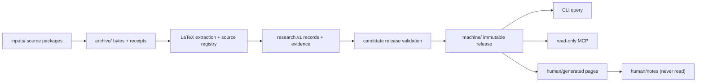
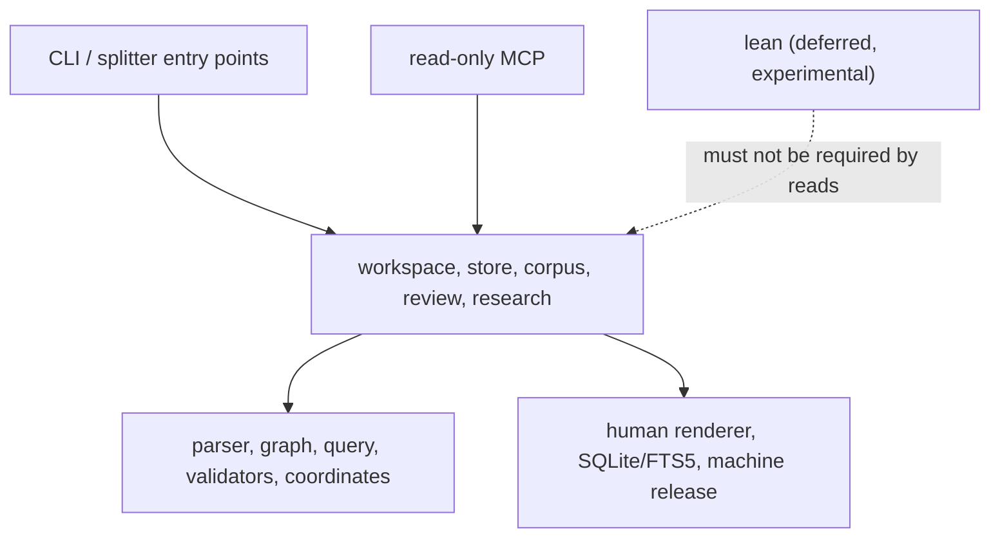

# QEC Graph — System Design

> **Status: Current authoritative design (0.4.x).** This is the only active design document.

> **English** · [中文](DESIGN.zh-CN.md)

| | |
|---|---|
| **Status** | Current authoritative design (0.4.x) |
| **Reviewed** | 2026-11-10 |
| **Supersedes** | The earlier architecture, graph-contract, data-formats, incremental, MCP and CodeGraph design pages. Lean is deferred; see §10. |
| **Implementation** | `qecgraph/`, `tests/`, `tools/`, `validation/` |

This document is the single source of truth for the system's architecture, data contracts, evidence semantics, publication protocol, query/MCP surface, human view, and the deferred Lean boundary. If code, tests, and this document disagree, the executable behavior and its verification are the current state; update this document in the same change that alters the design. Do not create a second design page for a new idea: extend this document or record a superseding decision here.

| Status | Meaning |
|---|---|
| **Implemented** | Present in the package and covered by tests or recorded verification. |
| **Partial** | The mechanism exists but a documented part is missing or limited. |
| **Not implemented** | A design goal with no executable implementation. Never describe it as available. |
| **Historical** | Superseded material is available in Git history only, not in the current documentation tree. |

---

## On this page

- [1. Scope and non-goals](#1-scope-and-non-goals)
- [2. System overview](#2-system-overview)
- [3. Authority, storage, and publication](#3-authority-storage-and-publication)
- [4. Data contracts](#4-data-contracts)
- [5. Source extraction](#5-source-extraction)
- [6. Review, evidence, and query eligibility](#6-review-evidence-and-query-eligibility)
- [7. Workspace transaction and publication protocol](#7-workspace-transaction-and-publication-protocol)
- [8. Query, CLI, and MCP contract](#8-query-cli-and-mcp-contract)
- [9. Human view](#9-human-view)
- [10. Lean: deferred, not supported](#10-lean-deferred-not-supported)
- [11. CodeGraph reference and third-party attribution](#11-codegraph-reference-and-third-party-attribution)
- [12. Invariants and failure cases](#12-invariants-and-failure-cases)
- [13. Current limits and non-goals](#13-current-limits-and-non-goals)
- [14. Verification and change rules](#14-verification-and-change-rules)
- [Appendix A — Decision record (supersedes the standalone ADRs for current behavior)](#appendix-a--decision-record-supersedes-the-standalone-adrs-for-current-behavior)
- [Appendix B — Primary references](#appendix-b--primary-references)

## 1. Scope and non-goals

QEC Graph turns LaTeX papers and explicit QEC research records into a provenance-preserving local workspace. It is designed for four questions:

1. Where exactly was a statement, definition, proof, table, or parameter written?
2. What does the source claim, what is explicitly recorded, what was reviewed, and what was computed?
3. Which codes, presentations, circuits, noise models, decoders, experiments, and software versions are connected to a result?
4. What can be handed to a read-only agent without silently turning candidates, upper bounds, or author claims into facts?

**It is not:**

- a TeX engine, PDF/OCR pipeline, or a replacement for reading the paper;
- a mathematical proof assistant or a distance solver for large codes;
- a claim that a paper's theorem is true, that a Lean declaration matches the prose, or that a reported LER is reproducible;
- a multi-writer or distributed database; or
- a service that executes source code, TeX, or Lean on read.

The executable scope is the Python package, CLI, local MCP server, Obsidian renderer, and the legacy store/corpus compatibility layer. Lean code and fixtures exist only as deferred experimental material and are not part of the supported 0.4.x workflow.

---

## 2. System overview

### 2.1 Primary flow: workspace



A workspace is a local directory with a single writer. `init` creates the layout; `sync` archives and processes inbox packages; `rebuild` rechecks the complete archive; `status`, `validate`, and `doctor` are read-mostly inspection commands. A successful transaction publishes an immutable machine release and then renders a separate human view. Query and MCP sessions pin a release and never read a moving `CURRENT` mid-session.

### 2.2 Compatibility surfaces

Three storage/query generations exist, deliberately:

| Surface | Purpose | Status |
|---|---|---|
| **Workspace** (`qecgraph/workspace.py`, `machine/`, `archive/`) | Primary product: source packages, research records, human view, workspace MCP | Current |
| **Corpus** (`qecgraph/registry.py`, `corpus.py`) | Multi-document identity, review/apply, corpus queries, legacy MCP | Supported compatibility surface |
| **Store** (`qecgraph/store.py`, `query.py`) | Single-paper immutable extraction snapshot and SQLite/FTS5 queries | Supported compatibility surface |

New work should target the workspace surface. Store and corpus remain available for existing commands, migrations, Lean imports, and tests. When a feature exists in more than one surface, the workspace implementation defines current semantics; the older surfaces must not silently diverge on evidence or state filtering.

### 2.3 Runtime and deployment

- Python 3.11+ on a POSIX filesystem; SQLite with FTS5.
- `pylatexenc==2.10` and `jsonschema==4.26.0` are runtime dependencies.
- Installation: standalone executable from GitHub Releases, local wheel/sdist, or `pip install -e .` from a checkout.
- The research Compose profile and the macOS read-only MCP isolation profile are verified locally; see `validation/README.md`. The Linux profile uses an alternate local Ubuntu base because the default Docker Hub lookup timed out. Do not claim a generic Docker Hub build or Windows support without a new verification.
- The package is versioned independently from graph/record schemas and the Lean toolchain. `qec-graph --version` is authoritative for the installed package version.

### 2.4 Module boundaries



| Layer | Modules | Rule |
|---|---|---|
| Entry points | `qecgraph/cli`, `qecgraph/mcp/server.py`, `qecgraph/source/splitter.py` | May import application modules; package import must not load the CLI |
| Application | `store.py`, `workspace.py`, `workspace_*.py`, `corpus.py`, `registry.py`, `review.py`, `query.py`, `domain/*` | Own transactions and policy; do not import development layers |
| Kernel | `core/graph.py`, `core/transactions.py`, `core/coordinates.py`, `source/*`, `validators/*` | Pure or local side effects; no tests/tools/legacy/validation imports |
| Output | `render/human.py`, `domain/status.py`, `domain/software.py`, `mcp/*` | Render/read from a pinned release; never write back through `human/` |
| Deferred | `lean/*` | Experimental only; never required by database, query or MCP reads |

The architecture test in `tests/contracts/tooling/test_architecture.py` enforces the import boundary.
Implementation now lives under `core/`, `source/`, `domain/`, `render/`, `mcp/` and `lean/`;
`store.py`, `workspace.py` and `corpus.py` remain cohesive service modules pending a later
split. `qecgraph/splitter.py` and `qecgraph/mcp_server.py` are thin compatibility shims for
the documented module entry points.

---

## 3. Authority, storage, and publication

### 3.1 One editable owner per field

| Layer | Authoritative content | May be edited? | Rebuildable? |
|---|---|---|---|
| Raw assets | Original paper/TeX packages, PDFs, matrices, certificates, Lean source at a fixed commit | No (append a new version) | No |
| Human records | `research.v1` JSON, review bindings, explicit relations, assets manifest | Yes, through explicit records/transactions | No |
| Execution evidence | Build logs, exports, computed checks, run outputs | No after publication | No |
| Query projections | `graph.json`, views, SQLite/FTS5, human pages | No | Yes |

Markdown explains decisions; it does not own QEC facts. YAML is an import/template format, not a second editable truth. SQLite and generated graph views are rebuildable and must never be patched to change a fact.

The machine release is the only authoritative state a query or MCP session may consume. The human view is a rendering of a pinned release, not a new knowledge source. A reviewer or agent must not write back through the human view.

### 3.2 Workspace layout

```text
workspace/
├── qecgraph.toml                 # workspace id, limits, explicit source metadata
├── inputs/                       # claimed inbox; successful packages are consumed
│   └── .processing/              # durable claims for crash recovery
├── archive/
│   ├── blobs/sha256/<hash>       # original package bytes
│   └── receipts/<job>.json       # claim/archive receipt
├── sources/<tree-hash>/          # verified expanded source tree
├── machine/
│   ├── CURRENT.json              # published release pointer
│   ├── states/<release>.json     # immutable registry state
│   ├── operational/status.json   # sanitized operational projection
│   └── .writer.lock              # single-writer lock
├── human/
│   ├── Index.md
│   ├── generated/                # rebuildable pages
│   └── notes/                    # private; never read by generators/MCP
└── .qecgraph/                    # claim/rotation/staging internals
```

Store and corpus have their own managed roots. Do not merge their pointer formats or edit their state by hand. Migrations copy into a new location; they do not rewrite the old store in place.

### 3.3 Identity is not a hash, title, or parameter tuple

| Concept | Meaning | Not interchangeable with |
|---|---|---|
| `work_id` | A paper/work identity | source version, file, title |
| `source_version_id` | A specific version of a work | package archive hash |
| source occurrence | A parser block at an exact span in a source version | normalized claim |
| entity `id` | Stable domain object identity | `[[n,k,d]]`, label, file name |
| `revision` | A content state of an entity | package release |
| `content_sha256` | Exact serialized content | object identity |
| `snapshot_id` / `release_id` | One extraction or publication state | paper version |
| asset ID | Content-addressed managed bytes | source file path |

Duplicate labels are ambiguous and must be resolved with an exact ID. Missing records do not prove that an object does not exist. `[n,k,d]` equality does not prove code identity; construction, presentation, logical basis, and evidence stay separate.

---

## 4. Data contracts

### 4.1 Schema families

| Schema | Use | Location |
|---|---|---|
| `qecgraph.research.v1` | Current workspace research records (26 kinds, 41 typed relations) | `qecgraph/validators/schemas/research.v1.schema.json` |
| `qecgraph.record.v3` | Legacy corpus records, still readable and migrated explicitly | `qecgraph/validators/schemas/record.v3.schema.json` |
| `qecgraph.record.v2` | Older legacy records, read-only compatibility | packaged schema |
| `qecgraph.graph.v1` | Extraction graph and three views | `qecgraph/validators/schemas/graph.schema.json` |
| `qecgraph.annotations.v1` | Human/AI additions to an extraction store | packaged schema |
| `proposal.v1`, `review.v1` | Review envelopes | packaged schemas |
| `lean-export.v1` | Experimental/deferred Lean export envelope | packaged schema |

Unknown schema versions are rejected or preserved as opaque historical input; never reinterpret them with the latest fields. Package version and data-schema version move independently. The canonical schemas are packaged resources; do not create a second editable copy at the repository root.

### 4.2 Research record envelope

A `research.v1` record carries:

- `schema_version`, `id`, `revision`, `kind`, `is_synthetic`;
- `data` with kind-specific fields;
- `field_evidence` mapping each field pointer (`/data/<field>`) to evidence status and provenance;
- optional review/envelope fields as defined by the schema.

Rules:

- A missing value is `null` with an explicit unknown status/reason; it is not `false`, `0`, or an empty list.
- A known value must not silently replace a conflicting source claim. Preserve the conflict and its conditions.
- `source_reported`, `computed_exact`, `certificate_checked`, and `lean_build` are distinct evidence kinds.
- A field-level source locator must resolve to a registered version and a verbatim span.
- Structural/schema validation is not mathematical verification, and neither is a passing test or a Lean build.
- AI/provider output is a draft/proposal by default; only an explicit review decision can publish it.

### 4.3 Domain objects and required distinctions

The domain model is intentionally split; these are not interchangeable:

| Concept | Distinction |
|---|---|
| `code_family` / `construction` / `code_instance` | A family or construction rule is not a concrete `[n,k,d]` instance |
| `classical_seed` | A classical code/seed is not the quantum code derived from it |
| `code_presentation` | A stabilizer space and a particular check matrix/generator set are different objects |
| `distance_claim` | Subject, presentation, metric, sector, direction, assumptions, method, conditions, evidence |
| `circuit_protocol` | Circuit distance and code distance are different; depth must state its counting definition |
| `noise_model` / `noise_instantiation` | A channel model template is not a resolved probability point |
| `decoder_configuration` | Algorithm, software/release, parameters, and version are distinct |
| `reported_experiment` | A paper-reported result is not an `execution_run` performed locally |
| `performance_series` / `performance_point` | A point belongs to one experiment/curve/metric revision; no cross-experiment ranking |
| `hardware_assumptions` / `execution_environment` | Hardware claims and simulation CPU/GPU environments are separate |
| `software_usage` | Mention, citation, source-reported use, and locally observed use are different evidence levels |
| `catalog_source` | A software catalog entry is not an installed/tested release |

Required minimums include:

- `code_instance`: coding domain and `n`/`k` (or explicit unknown reason), construction reference, presentations.
- `code_presentation`: parent code, check matrices/assets, index/bit-order conventions, reconstruction status.
- `distance_claim`: exact subject/metric/sector, relation (`exact`/`lower_bound`/`upper_bound`/`interval`), bounds, assumptions, method, evidence.
- `circuit_protocol`: representation, scheduling, ancillas, rounds, boundaries, observables; depth metrics with explicit units/definitions.
- `noise_model`: channels, locations, probability parameters, temporal/spatial correlations, boundaries; idle/loss/erasure/leakage are separate and `unknown` when unevidenced.
- `reported_experiment`: exact code/presentation/circuit/noise instance/decoder/metric/source revisions.
- `performance_point`: experiment, noise instantiation, metric, value, coordinates, shots/discards/uncertainty, selection policy; no interpolation across curves.
- `software_usage`: usage kind, project, release (or explicit unknown), and source/experiment binding.

Check weight always binds to the actual presentation and check set, including sector (`X`/`Z`/`mixed`), scope (`stabilizer`/`gauge`/`measured`), and min/max/mean/histogram. In a symplectic representation, a `Y` contributes one support position.

### 4.4 Relations and edge states

The canonical relation registry is `qecgraph.research.RELATIONS` / graph validation, not this prose. Common edges:

- structural: `contains`, `defined_in`, `includes`, `uses_resource`;
- textual: `references`, `cites`, `describes`;
- mathematical: `depends_on_declared`, `depends_on_candidate`, `depends_on_reviewed`, `proof_of`, `proof_of_candidate`, `normalizes_to`;
- data: `has_presentation`, `has_matrix`, `instance_of`, `generated_by`;
- experiments: `uses_circuit`, `uses_noise`, `uses_decoder`, `reports`, `supports`, `contradicts`;
- Lean: `formalizes`, `maps_declaration`, `maps_source_occurrence`, `has_build_evidence`, `lean_type_depends_on`, `lean_proof_depends_on` (and transitive variants);
- catalogs: `catalog:*` preserve imported meaning; they do not become proof edges.

Each edge keeps `source`, `target`, `relation`, `status`, and `evidence`.

- `observed` — syntax/parse observation.
- `declared` — author or metadata claim.
- `candidate` — a hypothesis; not a confirmed dependency.
- `reviewed` — bound to an explicit review and exact inputs.
- `stale`, `unbound_review`, `unresolved` — not eligible for default dependency/context answers.

`references` is not a proof dependency. A proof's `uses` may be promoted only when the proof target is explicit; if the target is a candidate, the promoted edge is candidate too. Default traversal filters inactive states; explicit audit `show` may display them. Citation cycles are legal; only active reviewed logical-dependency SCCs are reported for judgment. Include cycles are a parser diagnostic, not a mathematical cycle.

### 4.5 Source coordinates and hashes

- File identity and asset identity use SHA-256 of the original bytes.
- Text spans use decoded Unicode code points, half-open `[char_start, char_end)`; lines are 1-based and inclusive at the end.
- Byte offsets, character offsets, PDF page numbers, and source line numbers are never mixed.
- Parent and child fragments may overlap; do not concatenate fragments to reconstruct the source.
- JSON canonicalization keeps an explicit protocol label. Existing protocols are not silently relabeled as RFC 8785/JCS. Array order is semantic unless the schema declares a set.
- A changed source or asset invalidates a bound review; `stale` evidence is retained, not refreshed to hide the change.

---

## 5. Source extraction

### 5.1 Parser

`qecgraph/source/parser.py` uses `pylatexenc==2.10` to recognize structural declarations without running TeX. It records:

- file bytes/hash and exact source spans;
- sections, definitions, lemmas, theorems, propositions, corollaries, conjectures, proofs, equations, tables, figures, remarks, examples;
- labels/references, literal includes/resources, macro/environment declarations;
- diagnostics for missing/ambiguous includes, unsupported syntax, path escapes, dynamic paths, and parse failures.

It does not expand arbitrary macros, evaluate conditionals, execute TeX, or infer mathematical truth. A partial extraction is a valid, explicitly marked snapshot; `--strict` keeps it in staging without advancing `CURRENT`.

`\lean` and `\uses` outside a mathematical block are preserved as `describes` / `references` associations with a diagnostic; they do not become typed proof dependencies. `\def` and `\let` mark a name as defined for a later statically decidable `\ifdefined`, while their replacement text stays opaque.

### 5.2 Source block vs normalized claim

A parser theorem/lemma is a **source block**: what the document says at a fixed span. A normalized `claim` is a separate revisioned domain object with explicit statement, quantifiers, hypotheses, definitions, subject, and evidence. The two may be many-to-many; similar text or parameters never merge identities. `proof_of` points at the intended target and does not assert that the proof is valid.

### 5.3 Rules and provider proposals

The offline extractor performs two passes: locate notation/structures, then apply local wording/column rules. It produces `code_mention` proposals with exact locators and a rule version; it does not promote a table parameter into a verified code instance, infer a distance bound, or guess code class from bracket shape.

An optional local provider handoff exports bounded source excerpts, validates the provider/model/prompt hash and cited spans, and queues a draft. It never calls an external model automatically and never approves its own draft. A human decision binds the exact draft and source projection; changed inputs make the decision stale.

---

## 6. Review, evidence, and query eligibility

A review decision is an object with actor/kind, time, scope, rationale, decision, and exact input bindings (record IDs/revisions/content hashes, source versions, assets, proposal). Bindings cover the changed records and their explicit reference closure; an unrelated record revision does not invalidate a decision, while a changed dependency does. `apply` publishes a new revision atomically after checking those bindings; repeated application is idempotent. A review does not become true because a test passed, and a schema pass does not become mathematical verification.

Evidence policy:

- Hard distance filters require an exact subject/presentation/metric/sector, a qualifying relation (`exact`, `lower_bound`, `interval`), sufficient lower bound, and current evidence bound to the claim's exact revisions.
- An upper bound alone never satisfies `distance >= d`.
- Source-reported results are selected only in an explicit policy; they are not silently treated as mathematically verified.
- An `execution_run` may support a locally performed result; it does not overwrite a paper-reported value.
- Lean is deferred; if experimental Lean evidence is ever evaluated, it is not semantic equivalence and is not part of default filters.
- Missing/no-result means no match in the fixed scope; it is not proof of nonexistence.

Default query behavior excludes inactive edges (`stale`, `unbound_review`, `unresolved`) and candidate/proposed/`needs_review` information unless explicitly requested. `show` is the audit view and keeps all states. Any truncation is explicit; source statements/hypotheses are not silently shortened.

---

## 7. Workspace transaction and publication protocol

### 7.1 Claim → archive → stage → validate → publish → consume

1. **Claim** an inbox file under `inputs/.processing/<job>` with a durable job record.
2. **Archive** original bytes under `archive/blobs/sha256/`; write an immutable receipt with size/hash/name.
3. **Unpack** by content (TeX, gzip, tar, tar.gz, ZIP), with path/link/special-file/member/size/depth limits. Reject traversal, links, case collisions, forged ZIP counts, encrypted/unsupported members and oversized inputs. Preserve original bytes and a hashed expanded tree.
4. **Select the entry point** only from evidence: explicit config override or a unique TeX file with `\documentclass` and `\begin{document}`. Ambiguity stays `needs_entrypoint`; do not guess by longest filename.
5. **Extract** into a store, then stage source/research records and proposals. A structural partial is not published as complete; the source remains visible with `semantic_pending`/`parse_failed` state.
6. **Build a candidate machine release** from all active state. Reused projections are reverified before publication.
7. **Validate** the candidate (source hashes/spans, record references, review bindings, assets, graph endpoints, SQLite, project identity). A failed candidate leaves `CURRENT` unchanged.
8. **Publish** by atomically replacing the pointer under the writer lock.
9. **Consume** only the claimed input copies of the successful transaction; retain failed packages and receipts. A restored name must not overwrite a newer file. `--keep-inputs` preserves copies.

Any failure must leave the old release readable, the original package recoverable, and no duplicate facts. A successful batch may contain failures; the result is `partial_batch`. `rebuild` inspects the complete archive and receipts, including previously failed/unresolved packages; it does not treat a manifest as a paper allowlist. `inputs quarantine` moves a persistently bad package aside without deleting bytes; `inputs restore` refuses to overwrite a replacement.

### 7.2 Locking, atomicity, and recovery

- One workspace writer; `transactions.writer_lock` uses a POSIX advisory lock and rejects linked/special lock files.
- Immutable objects may remain after a crash; only the pointer publication makes a release current.
- The store/workspace publications are crash-recoverable: a pointer switch followed by claim cleanup is replayed from the exact claim; a SIGKILL test covers this window.
- The lock protects local processes, not NFS or distributed writers. Do not claim power-loss durability or multi-writer support.
- `recover-store`/`doctor` validate the pointer and inventory tool-owned abandoned builds; unknown or user-owned directories are not deleted. Removal is explicit.
- `human_stale` is a derived-view failure, not a machine-release rollback. Re-render from the pinned release.

### 7.3 Incremental and watch

- Per-file pylatexenc AST caching is content-addressed and validated; no pickle/arbitrary loading. Parse errors are not cached.
- Every run re-discovers includes/resources and rebuilds semantic projections, graph views, review status, and SQLite. A cache hit never revives a stale review.
- Macro/environment/include-set/config/processor changes conservatively fall back to full parsing; mtime is not trusted.
- `watch` is content polling around the same ingest. Temporary files, output stores and caches are ignored; batch saves are debounced. It does not introduce a second extractor.
- Incremental and full runs must produce identical semantic output for the same final input. Performance claims are measurements, not guarantees.

### 7.4 Exit behavior

- `0` — requested work completed (or no change).
- `1` — fatal failure; no new release.
- `2` — partial batch/unresolved input/derived view stale, with a readable report.
- `4` — a required file or exact query target is missing.
- `5` — the writer lock or an input destination is held by another owner.
- `64` — command usage error.
- `130` — interrupted.
- Machine JSON errors carry a stable error code/message/details; human errors go to stderr. Automation should read the structured status, not infer semantics from `2` alone.

---

## 8. Query, CLI, and MCP contract

### 8.1 Scopes

Every read is fixed to one scope:

- `--workspace` + optional `--release` (workspace machine release);
- `--machine` (strict read-only machine mount, no workspace/human access);
- `--store` + optional `--snapshot`;
- `--corpus` + optional `--registry-revision` and source-version restriction.

Returned results include the scope identity, source/evidence status, and truncation/absence notes. A session pins its release/snapshot at startup; changing `CURRENT` does not change an existing session. Reconnect/re-pin to read a new release.

### 8.2 CLI

The CLI is grouped by noun (`workspace`, `query`, `review`, `mcp`, `human`, `software`, `maintain`, `snapshot`, `inputs`, `doctor`, `version`, `help`, plus an experimental/deferred `lean` group). Flat legacy names remain available with deprecation notices. Global options include `--json`, `--quiet`, `--verbose`, `--debug`, `--color`, and `--version`.

Human output is concise and stateful: workspace/release, indexed/pending/failed/quarantined counts, human-view state, and a next action. `--json` is the only machine-output switch; TTY detection affects styling, not the data model. Errors are actionable and never raw Python/OS/TOML tracebacks unless `--debug` is requested.

### 8.3 MCP

- Local stdio, protocol `2025-06-18`; stdout carries only JSON-RPC, logs go to stderr.
- Store/corpus sessions expose the five legacy `qecgraph_*` read tools.
- Workspace sessions add research/source tools and `qec://source/...` resources, plus status/coverage projections.
- A session is pinned to one fixed release; tool arguments cannot pass arbitrary paths/SQL/shell or change scope.
- Budgets: depth/nodes/results/characters; truncated results state omitted content; a too-small budget returns an explicit error rather than a partial root statement.
- Read tools never write, run TeX/paper code, or trigger Lean builds.
- Strict deployment mounts only the machine directory. `human/`, `inputs/`, and `human/notes/` must not be readable. MCP roots are not an access-control mechanism.

The typed JSON envelope (`ok/data` or `error/code/message/details/scope`) is shared by Python, CLI, and MCP where applicable. MCP protocol errors and business-query errors remain distinguishable.

---

## 9. Human view

`human/` is an independently openable Obsidian vault rendered from one machine release.

- `human/generated/` is rebuildable; stable page paths, aliases, front matter, tags, indexes and tombstones are generated deterministically.
- `human/notes/` is private human content. Generators, queries, MCP, embeddings, logging and renderers never read it. Do not add automation that scans the vault root indiscriminately.
- Page publication is per-file atomic inside the target directory; it is not a global vault transaction. A interrupted render reports `human_stale`; re-render from the same release. Do not claim multi-file atomicity.
- A renamed/removed entity keeps a stable tombstone page for incoming links.
- The human view is a reading aid, not an authority; corrections must be written as explicit structured revisions in the machine layer.
- The machine layer never reads the human view.

---

## 10. Lean: deferred, not supported

> [!WARNING]
> **Lean is deferred in 0.4.x.** It is not part of the supported database,
> query, or MCP workflow. The `lean` CLI group, `qecgraph/lean/`, `lean/`
> project, and `validation/lean-experimental` fixtures remain only as experimental regression
> material. They are not a verification claim and must not be presented as a
> finished product capability.

**Current status:** deferred. The previous Lean experiments answered some
engineering questions (toolchain pinning, export shape, axiom visibility), but
they are not a supported semantic contract. They are intentionally excluded
from the supported release scope until a new design is written and approved.

### What exists today, and what it means

| Artifact | Status |
|---|---|
| `qecgraph/lean/core.py`, `qecgraph/lean/integration.py`, `qecgraph/cli/commands/lean.py` | Experimental code retained so historical regressions remain testable; not covered by the support contract |
| `lean/` project and `lean/axiom-policy.json` | Pinned experimental fixture; no toolchain is installed in the normal Python environment |
| `validation/lean-experimental/` and Lean test fixtures | Historical/experimental evidence; not a current verification claim |
| Query/MCP path | Does not import, execute, or require Lean; database construction and MCP are unaffected |

### What is explicitly not claimed

- no “Lean verified” status for any paper theorem;
- no semantic equivalence between prose and a Lean type;
- no general CSS/HGP distance formalization or certificate bridge;
- no support for third-party package manifests, custom axioms, `sorry`, or
  `native_decide` trust beyond explicit experimental checks;
- no reproducible Lean acceptance in the current release.

### Before Lean is implemented again, a new design must specify

1. the exact source statement → normalized claim → Lean declaration mapping,
   including quantifiers, hypotheses, definitions, and scope;
2. declaration/type/proof-dependency export and the proof-term trust model;
3. an explicit axiom/`sorry`/native-computation policy, with failure evidence;
4. a reproducible toolchain, project commit, dependency lock, build command,
   and log/export format;
5. independent semantic review, freshness/invalidations, and query exposure;
6. the boundary with the database and MCP: read tools must never execute Lean,
   and Lean absence must not break workspace or MCP operation.

---

## 11. CodeGraph reference and third-party attribution

This project independently implements its Python architecture. It references [colbymchenry/codegraph](https://github.com/colbymchenry/codegraph) at commit `f72c9d2efb14454ff4f9fd7b8460abd82f19a287` (MIT, Copyright (c) 2026 Colby Mchenry) for extraction/storage/resolution/query/watch boundaries. No upstream code is copied and no upstream performance number applies. The decision record below summarizes the reference; the detailed check, including `6560052a6f856855d3f71eee838fd66ccfa4285d`, remains in Git history.

Mapping summary:

- code symbol graph → source spans, claims, entities, evidence and typed relations;
- tree-sitter/AST → `pylatexenc` structural extraction (not a TeX engine);
- reference resolution → labels/includes/citations plus explicit typed edges;
- graph query/context → bounded, evidence-filtered traversal;
- watch/sync → content polling around the same ingestion pipeline;
- AI tools → one read-only query layer exposed through CLI, Python and MCP.

[leanblueprint](https://github.com/PatrickMassot/leanblueprint) annotations (`uses`, `proves`, `lean`, `leanok`) are preserved as author observations/claims; they are not proof-term dependencies, build evidence or semantic equivalence.

---

## 12. Invariants and failure cases

### 12.1 Testable invariants

| ID | Invariant |
|---|---|
| G01 | Every source block is exactly the archived source slice for its span. |
| G02 | Comments/verbatim labels and commented includes never enter the real index. |
| G03 | Nested labels remain distinct; duplicate labels are ambiguous and never silently resolved. |
| G04 | `references`, declared dependencies, candidates and reviewed dependencies stay distinct. |
| G05 | An inactive input edge cannot be revived by promotion or query. |
| G06 | Resource hashes are fixed before review matching; content changes stale the review. |
| G07 | `\leanok`/`formalizes` never produce Lean-verified or semantic-equivalence status. |
| G08 | A table parameter is not promoted to a verified code instance by extraction. |
| G09 | Rebuilding the same input/tool state is idempotent and does not modify source bytes. |
| G10 | Graph, views and SQLite point to the same snapshot; all edges have valid endpoints. |
| G11 | Explicit data relations can expand matrix/presentation/metric/evidence context. |
| G12 | Partial extraction, truncation, unresolved targets and stale reviews are observable. |
| G13 | A failed publication leaves the previous release readable and inputs recoverable. |
| G14 | `human/notes/` is never read or overwritten by generation/query/MCP. |
| G15 | A workspace/MCP session cannot mix two releases. |

### 12.2 Required failure cases

- A proof mentions a background theorem without a declared dependency: keep `references`; only candidate edges.
- A duplicate label: return ambiguity; require an exact ID.
- A distance claim has only an upper bound: it must not satisfy a lower-bound filter.
- A source/asset/review input changes: mark stale, preserve old evidence, exclude from default answers.
- An archive contains traversal, links, special files, a forged ZIP count or an unsupported member: reject before materialization.
- A package is permanently unsupported: retain it, report it, and allow quarantine; never delete it or fake an extraction.
- `CURRENT` is corrupt or the writer lock is held: report the exact path/owner state and do not write.
- A renderer fails after publication: keep the machine release, report `human_stale`, re-render.
- A Lean build has `sorry`/an unlisted axiom or a changed type/toolchain: reject the evidence binding; keep the historical report.
- An MCP request asks for a path/SQL/shell or a different scope: reject; do not reinterpret as a query.
- A query has no result: state the fixed scope and absence semantics; do not say the theorem does not exist.

---

## 13. Current limits and non-goals

| Area | Status |
|---|---|
| Real-paper corpus | Six versioned arXiv sources in the pinned replay; not a comprehensive literature corpus |
| LLM extraction | Optional local handoff only; no automatic provider call or quality claim |
| Chart/curve digitization | Not implemented; values require explicit evidence |
| PDF/OCR | Not implemented; LaTeX source is the supported input |
| Vector/semantic retrieval | Not implemented; lexical/substring + structured filters only |
| Distance algorithms | Small-code enumeration/validation; no general large-code solver or certificate bridge |
| Lean formalization | **Deferred.** Experimental code/fixtures only; no supported verification claim; DB/MCP unaffected |
| Platforms | POSIX (macOS/Linux verified); Windows not supported/verified |
| Distribution | Standalone GitHub Releases and local wheel/sdist; public PyPI publication is gated/manual and not assumed |
| Concurrency | Single writer, local POSIX filesystem; no multi-writer/distributed transactions |
| Docker | Linux Compose and macOS isolation verified with recorded caveats; no claim of a universal image build |

These are limits of the current release, not permission to fill gaps with plausible values.

---

## 14. Verification and change rules

- The test suite and `tools/reproduce*.py` are the executable checks; `validation/README.md` indexes recorded runs and their source revisions.
- `python -m unittest discover -s tests -v`, `python tools/reproduce.py --out build/reproduce`, and the CLI/MCP checks are the standard local gates.
- CI runs ruff, mypy, advisory pyright and the unit-test layer only. Integration/contract tests, coverage, distribution, installed-wheel, Docker and isolation checks are local/manual checks.
- Any change to identity, source coordinates, evidence semantics, review binding, publication order, or MCP scope requires a new invariant test and a migration note when compatibility is affected.
- A design change is complete only when this document, the implementation, the tests and the validation claim agree. Do not leave a second contradictory design page in the active tree.

---

## Appendix A — Decision record (supersedes the standalone ADRs for current behavior)

| Decision | Current resolution |
|---|---|
| **D1 — One workspace, one writer** | Immutable release + POSIX lock + atomic pointer; no distributed writer. |
| **D2 — Evidence is layered, not a score** | Source/claim/review/computation/build states remain separate; default filtering excludes inactive states. |
| **D3 — Read-only agents** | Fixed-scope, budgeted CLI/Python/MCP reads; no path/SQL/shell access; stdout protocol only. |
| **D4 — Human view isolation** | Generated pages from a pinned machine release; `human/notes/` never read; per-page atomic publication; `human_stale` recovery. |
| **D5 — Lean is deferred** | No supported verification claim in 0.4.x. Experimental fixtures remain for regression; a new design is required before implementation, and read paths never execute Lean. |
| **D6 — CodeGraph is reference only** | Architecture comparison, no copied code, no imported performance claims; attribution retained. |
| **D7 — Compatibility over a rewrite** | Store/corpus remain supported; workspace is current; migrations are explicit and non-destructive. |
| **D8 — Schema ownership is singular** | Packaged schemas are canonical; root copies are compatibility artifacts checked for equality; unknown versions are not reinterpreted. |

## Appendix B — Primary references

1. [SQLite: appropriate uses](https://www.sqlite.org/whentouse.html)
2. [SQLite FTS5](https://www.sqlite.org/fts5.html)
3. [DuckDB Parquet](https://duckdb.org/docs/stable/data/parquet/overview)
4. [Docker storage](https://docs.docker.com/engine/storage/)
5. [pylatexenc 2.10 LatexWalker](https://pylatexenc.readthedocs.io/en/v2.10/latexwalker/)
6. [CodeGraph](https://github.com/colbymchenry/codegraph)
7. [leanblueprint](https://github.com/PatrickMassot/leanblueprint)
8. [Error Correction Zoo data](https://github.com/errorcorrectionzoo/eczoo_data)

Historical rationale and superseded pages are available in Git history only; they are not part of the current documentation tree.
