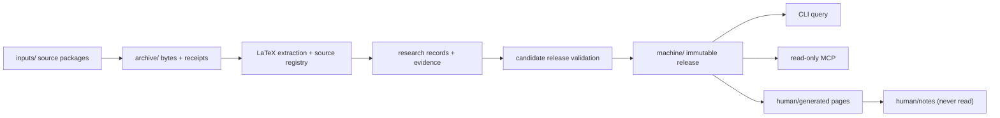
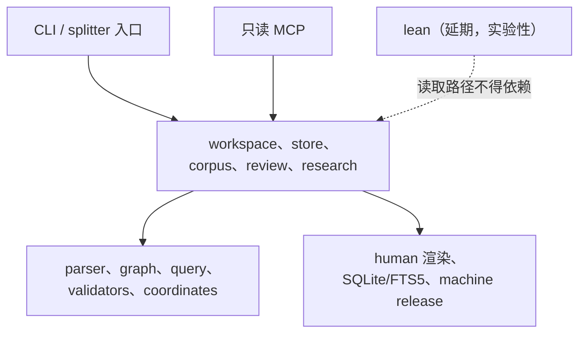

# QEC Graph — 系统设计

> **状态：当前权威设计（0.6.x）。** 这是唯一有效的设计文档。

> **中文** · [English](DESIGN.md)

| | |
|---|---|
| **状态** | 当前权威设计（0.6.x） |
| **评审日期** | 2026-11-11 |
| **替代** | 此前的 architecture、graph-contract、data-formats、incremental、MCP 和 CodeGraph 设计页。Lean 延期；见 §10。 |
| **实现** | `qecgraph/`、`tests/`、`tools/`、`validation/` |

本文是系统架构、数据契约、证据语义、发布协议、查询/MCP 接口、人类视图和延期
Lean 边界的唯一权威来源。如果代码、测试和本文不一致，以可执行行为及其验证为
当前状态；修改设计的同一个变更必须更新本文。不要为新想法创建第二份设计页：
扩展本文，或在这里记录替代决策。

| 状态 | 含义 |
|---|---|
| **Implemented** | 已存在于包中，并由测试或记录的验证覆盖。 |
| **Partial** | 机制存在，但记录了缺失或有局限的部分。 |
| **Not implemented** | 设计目标没有可执行实现。绝不要把它描述为可用。 |
| **Historical** | 被替代的材料只保留在 Git history 中，不在当前文档树。 |

---

## 本页目录

- [1. 范围与非目标](#1-范围与非目标)
- [2. 系统总览](#2-系统总览)
- [3. 权威、存储和发布](#3-权威存储和发布)
- [4. 数据契约](#4-数据契约)
- [5. 来源抽取](#5-来源抽取)
- [6. 审核、证据和查询资格](#6-审核证据和查询资格)
- [7. 工作区事务与发布协议](#7-工作区事务与发布协议)
- [8. 查询、CLI 和 MCP 契约](#8-查询cli-和-mcp-契约)
- [9. 人类视图](#9-人类视图)
- [10. Lean：延期，不支持](#10-lean延期不支持)
- [11. CodeGraph 参考与第三方归属](#11-codegraph-参考与第三方归属)
- [12. 不变量和失败案例](#12-不变量和失败案例)
- [13. 当前限制和非目标](#13-当前限制和非目标)
- [14. 验证和变更规则](#14-验证和变更规则)
- [15. AI 接入](#15-ai-接入)
- [16. 可搜索知识体系与实施路线](#16-可搜索知识体系与实施路线)
- [附录 A — 决策记录（替代当前行为的独立 ADR）](#附录-a--决策记录替代当前行为的独立-adr)
- [附录 B — 主要参考](#附录-b--主要参考)

## 1. 范围与非目标

QEC Graph 把 LaTeX 论文和显式 QEC 研究记录变成保留来源的本地工作区。它面向五个问题：

1. 一个陈述、定义、证明、表格或参数究竟写在哪里？
2. 来源声称什么、显式记录了什么、审核了什么、计算了什么？
3. 哪些码、表示、电路、噪声模型、解码器、实验和软件版本与一个结果相连？
4. 什么可以交给只读 agent，而不会把候选、上界或作者声明悄悄变成事实？
5. 论文表达了哪些问题、动机、方法与开放问题，它们如何联系具体结果和前人工作？

**它不是：**

- TeX 引擎、PDF/OCR 流水线，或阅读论文的替代品；
- 数学证明助手或大规模码的距离求解器；
- 对论文定理为真、Lean 声明与 prose 匹配、报告 LER 可复现的声称；
- 多写者或分布式数据库；或
- 在读取时执行源码、TeX 或 Lean 的服务。

可执行范围是 Python 包、CLI、本地 MCP 服务、Obsidian 渲染器和 store/corpus
兼容层。Lean 代码和 fixtures 只作为延期实验材料存在，不属于受支持的 0.6.x 流程。

---

## 2. 系统总览

### 2.1 主流程：工作区



工作区是只有一个写者的本地目录。`init` 创建布局；`sync` 归档并处理收件箱包；
`rebuild` 重新检查整个归档；`status`、`validate` 和 `doctor` 是偏只读的检查命令。
成功事务发布不可变机器 release，然后渲染独立的人类视图。查询和 MCP 会话固定
release，绝不在会话中途读取移动的 `CURRENT`。

### 2.2 兼容接口

有意保留三代存储/查询：

| 接口 | 用途 | 状态 |
|---|---|---|
| **Workspace**（`qecgraph/workspace.py`、`machine/`、`archive/`） | 主产品：源包、研究记录、人类视图、工作区 MCP | Current |
| **Corpus**（`qecgraph/registry.py`、`corpus.py`） | 多文档身份、review/apply、corpus 查询、旧 MCP | 受支持兼容接口 |
| **Store**（`qecgraph/store.py`、`query.py`） | 单篇不可变抽取快照和 SQLite/FTS5 查询 | 受支持兼容接口 |

新工作应面向 workspace 接口。Store 和 corpus 继续支持既有命令、迁移、Lean 导入
和测试。当功能存在于多个接口时，workspace 实现定义当前语义；旧接口不得在证据
或状态过滤上悄悄分叉。

### 2.3 运行时与部署

- Python 3.11+，POSIX 文件系统；SQLite 带 FTS5。
- 运行时依赖 `pylatexenc==2.10` 和 `jsonschema==4.26.0`。
- 安装：GitHub Releases 的单文件可执行程序、本地 wheel/sdist，或从 checkout
  执行 `pip install -e .`。
- research Compose profile 和 macOS 只读 MCP 隔离 profile 是发布检查；用
  `validation/README.md` 中的命令重新运行。Linux profile 使用替代的本地 Ubuntu base，因为默认
  Docker Hub 查询超时。没有新验证时，不要声称通用 Docker Hub 构建或 Windows 支持。
- 包版本与 graph/record schema、Lean toolchain 独立。`qec-graph --version` 是
  已安装包版本的权威来源。

### 2.4 模块边界



| 层 | 模块 | 规则 |
|---|---|---|
| 入口 | `qecgraph/cli`、`qecgraph/mcp/server.py`、`qecgraph/source/splitter.py` | 可导入应用模块；包导入不得加载 CLI |
| 应用 | `store.py`、`workspace.py`、`workspace_*.py`、`corpus.py`、`registry.py`、`review.py`、`query.py`、`domain/*` | 拥有事务和策略；不得导入开发层 |
| 内核 | `core/graph.py`、`core/transactions.py`、`core/coordinates.py`、`source/*`、`validators/*` | 纯逻辑或本地副作用；不得导入 tests/tools/validation |
| 输出 | `render/human.py`、`domain/status.py`、`domain/software.py`、`mcp/*` | 从固定 release 渲染/读取；不得通过 `human/` 写回 |
| 延期 | `lean/*` | 仅实验；数据库、查询或 MCP 读取绝不依赖 |

`tests/contracts/tooling/test_architecture.py` 强制执行导入边界。实现现在位于
`core/`、`source/`、`domain/`、`render/`、`mcp/` 和 `lean/`；`store.py`、
`workspace.py`、`corpus.py` 继续保持为内聚服务模块，后续再拆。
`qecgraph/splitter.py` 和 `qecgraph/mcp_server.py` 是文档化模块入口的薄兼容 shim。

---

## 3. 权威、存储和发布

### 3.1 每个字段只有一个可编辑所有者

| 层 | 权威内容 | 可编辑？ | 可重建？ |
|---|---|---|---|
| 原始资产 | 固定 commit 的原始论文/TeX 包、PDF、矩阵、证书、Lean 源码 | 否（追加新版本） | 否 |
| 人工记录 | `research` JSON、审核绑定、显式关系、资产清单 | 是，通过显式记录/事务 | 否 |
| 执行证据 | 构建日志、导出、计算检查、运行输出 | 发布后否 | 否 |
| 查询投影 | `graph.json`、视图、SQLite/FTS5、人类页面 | 否 | 是 |

Markdown 解释决策，不拥有 QEC 事实。YAML 是导入/模板格式，不是第二份可编辑真相。
SQLite 和生成图视图可重建，绝不能被修补以改变事实。

机器 release 是查询或 MCP 会话唯一可消费的权威状态。人类视图是固定 release 的
渲染，不是新的知识来源。审核者或 agent 不得通过人类视图写回。

### 3.2 工作区布局

```text
workspace/
├── qecgraph.toml                 # workspace id, limits, explicit source metadata
├── inputs/                       # claimed inbox; successful packages are consumed
│   └── .processing/              # durable claims for crash recovery
├── archive/
│   ├── blobs/sha256/<hash>       # original package bytes
│   └── receipts/<job>.json       # claim/archive receipt
├── sources/<tree-hash>/          # verified expanded source tree
├── machine/
│   ├── CURRENT.json              # published release pointer
│   ├── states/<release>.json     # immutable registry state
│   ├── operational/status.json   # sanitized operational projection
│   └── .writer.lock              # single-writer lock
├── human/
│   ├── Index.md
│   ├── generated/                # rebuildable pages
│   └── notes/                    # private; never read by generators/MCP
└── .qecgraph/                    # claim/rotation/staging internals
```

Store 和 corpus 有各自受管理根目录。不要合并它们的 pointer 格式或手工编辑状态。
迁移复制到新位置，并在复制前以原子方式保留目标名，不原地改写旧 store。

### 3.3 身份不是哈希、标题或参数元组

| 概念 | 含义 | 不等同于 |
|---|---|---|
| `work_id` | 论文/work 身份 | 来源版本、文件、标题 |
| `source_version_id` | work 的特定版本 | 包归档哈希 |
| 来源 occurrence | 来源版本中精确区间的 parser block | 规范化 claim |
| 实体 `id` | 稳定领域对象身份 | `[[n,k,d]]`、标签、文件名 |
| `revision` | 实体的内容状态 | 包 release |
| `content_sha256` | 精确序列化内容 | 对象身份 |
| `snapshot_id` / `release_id` | 一次抽取或发布状态 | 论文版本 |
| 资产 ID | 内容寻址的受管理字节 | 源文件路径 |

重复标签有歧义，必须用精确 ID 消解。缺少记录不能证明对象不存在。`[n,k,d]`
相等不能证明码身份；construction、check-matrix representation、logical basis 和 evidence 保持分离。

---

## 4. 数据契约

### 4.1 Schema family

| Schema | 用途 | 位置 |
|---|---|---|
| `qecgraph.research` | 当前 workspace 研究记录（27 kinds、47 typed relations） | `qecgraph/validators/schemas/research.schema.json` |
| `qecgraph.record` | corpus 记录（当前格式） | `qecgraph/validators/schemas/record.schema.json` |
| `qecgraph.graph` | 抽取图及 SourceGraph/LemmaGraph/DataGraph 投影 | `qecgraph/validators/schemas/graph.schema.json` |
| `qecgraph.annotations` | 对抽取 store 的人工/AI 增补 | packaged schema |
| `qecgraph.proposal`、`qecgraph.review` | 审核信封 | packaged schemas |
| `qecgraph.lean-export` | 实验性/延期 Lean 导出信封 | packaged schema |

未知 schema 版本被拒绝或作为不透明历史输入保留；绝不用最新字段重新解释。
包版本和数据 schema 版本独立演进。规范 schema 是打包资源；不要在仓库根创建
第二份可编辑副本。

### 4.2 Research 记录信封

`research` 记录携带：

- `schema`、`id`、`revision`、`kind`、`is_synthetic`；
- 带 kind 专属字段的 `data`；
- 把每个字段指针（`/data/<field>`）映射到证据状态和来源的 `field_evidence`；
- schema 定义的可选审核/信封字段。

规则：

- 缺失值是 `null` 并带显式 unknown 状态/原因；不是 `false`、`0` 或空列表。
- 已知值不得悄悄替换冲突的来源主张。保留冲突及其条件。
- `source_reported`、`computed_exact`、`certificate_checked` 和 `lean_build` 是不同证据类型。
- 字段级来源定位必须解析到已登记版本和逐字区间。
- 结构/schema 验证不是数学验证；通过的测试或 Lean 构建也不是。
- AI/provider 输出默认是 draft/proposal；只有显式审核决定才能发布。

### 4.3 领域对象和必需区分

领域模型有意拆分；这些概念不可互换：

| 概念 | 区分 |
|---|---|
| `code_family` / `construction` / `quantum_code` | family 或 construction 规则不是具体 `[n,k,d]` 实例 |
| `classical_code` | 经典码/seed 不是由它导出的量子码 |
| `check_matrix` | stabilizer space 与特定校验矩阵/生成元集是不同对象 |
| `distance_estimate` | 对象、check-matrix representation、metric、sector、方向、假设、方法、条件、证据 |
| `syndrome_measurement_circuit` | 电路距离和码距离不同；深度必须说明计数定义 |
| `noise_model` / `noise_model_instance` | channel 模型模板不是解析后的概率点 |
| `decoder` | 算法、软件/release、参数和版本彼此不同 |
| `experiment` | 论文报告结果不是本地执行的 `execution_run` |
| `performance_curve` / `performance_data_point` | 点属于一个 experiment/curve/metric revision；不做跨实验排名 |
| `hardware_model` / `execution_environment` | 硬件声称与模拟 CPU/GPU 环境分开 |
| `software_usage` | 提及、引用、来源报告使用和本地观察使用是不同证据等级 |
| `catalog_source` | 软件 catalog 条目不是已安装/测试的 release |
| `research_thought` | 作者原文或注明归属的解读不等于已验证结果，也不自动建立证明依赖 |

必需最低字段包括：

- `quantum_code`：code type 和 `n`/`k`（或显式 unknown 原因）、construction 引用、check-matrix representations。
- `check_matrix`：父码、校验矩阵/资产、索引/bit-order 约定、重建状态。
- `distance_estimate`：精确 subject/metric/sector、relation（`exact`/`lower_bound`/`upper_bound`/`interval`）、bounds、assumptions、method、evidence。
- `syndrome_measurement_circuit`：representation、scheduling、ancillas、rounds、boundaries、observables；带显式单位/定义的 depth metrics。
- `noise_model`：channels、locations、probability parameters、temporal/spatial correlations、boundaries；idle/loss/erasure/leakage 分开，无证据时 `unknown`。
- `experiment`：精确 code/check-matrix representation/circuit/noise-model instance/decoder/metric/source revisions。
- `performance_data_point`：experiment、noise-model instance、metric、value、coordinates、shots/discards/uncertainty、selection policy；不跨曲线插值。
- `software_usage`：usage kind、project、release（或显式 unknown），以及 source/experiment 绑定。
- `research_thought`：类别、陈述、归属、精确原文引用和论文版本引用；真实记录的陈述与引用绑定同一来源区间。

Check weight 始终绑定实际 check-matrix representation 和 check 集，包括 sector（`X`/`Z`/`mixed`）、
scope（`stabilizer`/`gauge`/`measured`）和 min/max/mean/histogram。在 symplectic
表示中，一个 `Y` 贡献一个 support 位置。

### 4.4 关系和边状态

规范关系 registry 是 `qecgraph.research.RELATIONS` / graph validation，不是这段 prose。
常见边：

- 结构：`contains`、`defined_in`、`includes`、`uses_resource`；
- 文本：`references`、`cites`、`describes`；
- 数学：`depends_on_declared`、`depends_on_candidate`、`depends_on_reviewed`、`proof_of`、`proof_of_candidate`、`normalizes_to`；
- 数据：`has_check_matrix`、`has_matrix`、`instance_of`、`generated_by`；
- 实验：`uses_circuit`、`uses_noise`、`uses_decoder`、`reports`、`supports`、`contradicts`；
- Lean：`formalizes`、`maps_declaration`、`maps_source_occurrence`、`has_build_evidence`、`lean_type_depends_on`、`lean_proof_depends_on`（及传递变体）；
- catalog：`catalog:*` 保留导入含义；它们不变成证明边。
- 思路：`addresses_refs`、`motivated_by_refs`、`extends_refs`、`contradicts_refs` 关联思路；`related_refs` 关联研究对象，目标均包含精确修订。

每条边保留 `source`、`target`、`relation`、`status` 和 `evidence`。

- `observed` — 语法/解析观察。
- `declared` — 作者或元数据声称。
- `candidate` — 假设；不是确认依赖。
- `reviewed` — 绑定显式审核和精确输入。
- `stale`、`unbound_review`、`unresolved` — 不进入默认依赖/上下文答案。

`references` 不是证明依赖。只有当证明目标显式时，证明的 `uses` 才能提升；目标是
candidate 时，提升边也是 candidate。默认遍历过滤非活动状态；显式 audit `show`
可以显示它们。引用环合法；只报告活动 reviewed 逻辑依赖 SCC 供判断。include 环是
parser diagnostic，不是数学环。

### 4.5 来源坐标和哈希

- 文件身份和资产身份使用原始 bytes 的 SHA-256。
- 文本区间使用解码后的 Unicode codepoints，半开 `[char_start, char_end)`；行号从 1 开始，末尾包含。
- 字节偏移、字符偏移、PDF 页码和源码行号绝不混用。
- 父子片段可以重叠；不要拼接片段重建原文。
- JSON canonicalization 保留显式协议标签。既有协议不被静默改标为 RFC 8785/JCS。除非 schema 声明 set，数组顺序有语义。
- 来源或资产变化使绑定审核失效；`stale` 证据保留，不通过刷新哈希隐藏变化。

---

## 5. 来源抽取

### 5.1 Parser

`qecgraph/source/parser.py` 使用 `pylatexenc==2.10` 识别结构声明，不运行 TeX。它记录：

- 文件 bytes/hash 和精确来源区间；
- sections、definitions、lemmas、theorems、propositions、corollaries、conjectures、proofs、equations、tables、figures、remarks、examples；
- labels/references、literal includes/resources、macro/environment declarations；
- 缺失/歧义 include、unsupported syntax、path escape、dynamic path 和 parse failure 的 diagnostics。

它不展开任意宏、不判断条件、不执行 TeX、不推断数学真值。partial 抽取是有效且
显式标记的快照；`--strict` 把它留在 staging，不推进 `CURRENT`。

数学块之外的 `\lean` 和 `\uses` 作为带诊断的 `describes` / `references` 关联保留，
不升级为类型化证明依赖。`\def` 和 `\let` 仅为后续可静态判定的 `\ifdefined` 标记
已定义，替换文本保持不透明。

带花括号的 `\href`、`\url` 和 `\nolinkurl` 目标保留 URL 中的百分号编码。
链接的可见文本仍按常规 TeX 解析。

### 5.2 来源块与规范化 claim

parser 的 theorem/lemma 是 **source block**：文档在固定区间说了什么。规范化
`claim` 是独立且带修订的领域对象，带显式 statement、quantifiers、hypotheses、
definitions、subject 和 evidence。两者可以多对多；相似文本或参数绝不合并身份。
`proof_of` 指向预期目标，不断言证明有效。

### 5.3 规则和 provider 提案

离线抽取器执行两遍：定位记法/结构，再应用本地措辞/列规则。它生成带精确定位和
规则版本的 `code_parameters_mention` 提案；不把表格参数提升为已验证码实例、不推断距离界、
不根据括号形状猜码类。

可选的本地 provider 交接导出有界来源摘录，验证 provider/model/prompt hash 和
引用区间，并排队草稿。它绝不自动调用外部模型，也绝不批准自己的草稿。人工决定
绑定精确草稿和来源投影；输入变化使决定 stale。

---

## 6. 审核、证据和查询资格

审核决定是一个对象，带 actor/kind、time、scope、rationale、decision 和精确输入
绑定（record IDs/revisions/content hashes、source versions、assets、proposal）。
绑定覆盖被改动记录及其显式引用闭包；无关记录的修订不会使决定失效，依赖记录变化会。
`apply` 在检查这些绑定后原子发布新修订；重复 apply 幂等。测试通过不会使审核
变成真，schema 通过也不会变成数学验证。

`claim.subject_id` 必须解析到已注册主体。悬空 subject 是验证错误；错误的主体 kind
（对距离论断而言，不是 quantum code、check-matrix representation、circuit、family、construction 或
classical code）是 warning，而不是静默消失。

证据策略：

- 硬距离过滤要求精确 subject/check-matrix representation/metric/sector、合格 relation（`exact`、
  `lower_bound`、`interval`）、足够下界，以及绑定到 claim 精确修订的当前证据。
- 只有上界绝不满足 `distance >= d`。
- 来源报告结果只在显式策略下选择；不被静默视为数学验证。
- `execution_run` 可支持本地执行结果；不覆盖论文报告值。
- Lean 延期；即使实验 Lean 证据被评估，也不是语义等价，不属于默认过滤。
- 缺失/无结果表示固定范围内无匹配；不是不存在证明。

默认查询排除非活动边（`stale`、`unbound_review`、`unresolved`）和 candidate/
proposed/`needs_review` 的边或注释信息，除非显式请求。research 记录不会仅因
proposed 而被隐藏；每行携带 `review_status`，硬过滤按证据策略执行，不把草稿静默
升级为已验证。`show` 是 audit 视图，保留所有状态。任何截断都显式；来源陈述/假设
不被静默缩短。

---

## 7. 工作区事务与发布协议

### 7.1 Claim → archive → stage → validate → publish → consume

1. 在 `inputs/.processing/<job>` 下 **Claim** 收件箱文件，并写持久 job 记录。
2. 把原始 bytes **Archive** 到 `archive/blobs/sha256/`；写不可变收据（size/hash/name）。
3. 按内容 **Unpack**（TeX、gzip、tar、tar.gz、ZIP），限制 path/link/special-file/member/size/depth。拒绝 traversal、links、case collisions、forged ZIP counts、encrypted/unsupported members 和 oversized inputs。保留原始 bytes 和带哈希的展开树。
4. 只从证据 **Select entry point**：显式 config override，或唯一的带 `\documentclass` 和 `\begin{document}` 的 TeX 文件。歧义保持 `needs_entrypoint`；不按最长文件名猜。
5. **Extract** 到 store，然后 stage source/research records 和 proposals。结构性 partial 不发布为 complete；来源以 `semantic_pending`/`parse_failed` 状态可见。
6. 从所有活动状态 **Build candidate machine release**。复用的 projection 在发布前重新验证。
7. **Validate** candidate（source hashes/spans、record references、review bindings、assets、graph endpoints、SQLite、project identity）。失败 candidate 保持 `CURRENT` 不变。
8. 在 writer lock 下原子替换 pointer 来 **Publish**。
9. 只 **Consume** 成功事务的 claimed input copies；保留失败包和 receipts。恢复的名字不得覆盖更新文件。`--keep-inputs` 保留副本。

任何失败都必须让旧 release 可读、原包可恢复、没有重复事实。成功批次可包含失败；
结果是 `partial_batch`。`rebuild` 检查完整归档和 receipts，包括此前失败/未解决的包；
不把 manifest 当作论文白名单。`inputs quarantine` 把持续失败的包移到一边，不删除 bytes；
`inputs restore` 拒绝覆盖替代文件。成功提交后对应 claim 目录会被清理；失败或保留的
claim 仍可恢复，空 claim 目录在 writer lock 下清理。

### 7.2 锁、原子性和恢复

- 一个 workspace writer；`transactions.writer_lock` 使用 POSIX advisory lock，并拒绝 linked/special lock files。
- 崩溃后可留下不可变对象；只有 pointer 发布使 release current。
- store/workspace 发布可崩溃恢复：pointer switch 后的 claim cleanup 从精确 claim 重放；SIGKILL 测试覆盖该窗口。
- 锁保护本地进程，不保护 NFS 或分布式 writer。不声称掉电持久性或 multi-writer 支持。
- `recover-store`/`doctor` 验证 pointer，并盘点工具拥有的废弃 build；未知或用户目录不删除。删除是显式操作。
- `human_stale` 是派生视图失败，不是机器 release 回滚。从固定 release 重新渲染。

### 7.3 增量和 watch

- 每文件 pylatexenc AST 缓存按内容寻址并验证；不使用 pickle/任意加载。parse error 不缓存。
- 每次运行重新发现 includes/resources，并重建 semantic projections、graph views、review status 和 SQLite。缓存命中绝不复活 stale review。
- macro/environment/include-set/config/processor 变化保守回退到完整解析；不信任 mtime。
- `watch` 是同一 ingest 外的内容轮询。临时文件、输出 store 和缓存被忽略；批量保存去抖。它不引入第二个 extractor。
- 对同一最终输入，增量和全量运行必须产生相同语义输出。性能声称是测量，不是保证。

### 7.4 退出行为

- `0` — 请求工作完成（或无变化）。
- `1` — 致命失败；没有新 release。
- `2` — partial batch/未解决输入/派生视图 stale，带可读报告。
- `4` — 缺少必需文件或精确查询目标。
- `5` — writer lock 或输入目标已被其他所有者占用。
- `64` — 命令用法错误。
- `130` — 被中断。
- 机器 JSON 错误带稳定 error code/message/details；人类错误写到 stderr。自动化应读结构化状态，不只从 `2` 推断语义。

---

## 8. 查询、CLI 和 MCP 契约

### 8.1 作用域

每次读取固定到一个 scope：

- `--workspace` + 可选 `--release`（workspace machine release）；
- `--machine`（严格只读 machine mount，无 workspace/human 访问）；
- `--store` + 可选 `--snapshot`；
- `--corpus` + 可选 `--registry-revision` 和 source-version restriction。

返回结果包含 scope identity、source/evidence status 和 truncation/absence notes。
会话在启动时固定 release/snapshot；改变 `CURRENT` 不改变现有会话。要读取新
release，重新连接/固定。

### 8.2 CLI

CLI 按名词分组（`workspace`、`query`、`review`、`mcp`、`human`、`software`、
`maintain`、`snapshot`、`inputs`、`doctor`、`version`、`help`，以及实验性/延期
`lean` 组）。扁平旧名称仍可用，带弃用提示。全局选项包括 `--json`、`--quiet`、
`--verbose`、`--debug`、`--color` 和 `--version`。

人类输出简洁且有状态：workspace/release、indexed/pending/failed/quarantined
计数、human-view 状态和下一步动作。`--json` 是唯一机器输出开关；TTY 检测影响
样式，不影响数据模型。错误可操作，除非请求 `--debug`，绝不输出原始 Python/OS/TOML traceback。

### 8.3 MCP

- 本地 stdio，protocol `2025-06-18`；stdout 只承载 JSON-RPC，日志到 stderr。
- Store/corpus 会话暴露五个旧 `qecgraph_*` read tools。
- Workspace 会话增加 research/source tools 和 `qec://source/...` resources，以及 status/coverage projections。
- 会话固定一个 release；工具参数不能传任意 paths/SQL/shell 或改变 scope。
- 预算：depth/nodes/results/characters；截断结果说明省略内容；预算过小返回显式错误，而不是部分根陈述。
- Read tools 绝不写、运行 TeX/paper code 或触发 Lean builds。
- 严格部署只挂载 machine 目录。`human/`、`inputs/` 和 `human/notes/` 必须不可读。MCP roots 不是访问控制机制。

类型化 JSON envelope（`ok/data` 或 `error/code/message/details/scope`）在适用处由
Python、CLI 和 MCP 共享。MCP protocol errors 和 business-query errors 保持可区分。

---

## 9. 人类视图

`human/` 是从一个机器 release 渲染、可独立打开的 Obsidian vault。

- `human/generated/` 可重建；稳定页面路径、aliases、front matter、tags、indexes 和 tombstones 确定性生成。
- `human/notes/` 是私有人类内容。生成器、查询、MCP、embeddings、日志和渲染器绝不读取它。不要添加不加区分扫描 vault 根的自动化。
- 页面发布在目标目录内逐文件原子；不是全局 vault 事务。渲染中断报告 `human_stale`；从同一 release 重新渲染。不声称多文件原子性。
- 重命名/删除的实体保留稳定 tombstone 页面以支持入链。
- 人类视图是阅读辅助，不是权威；更正必须写成 machine 层的显式结构化修订。
- machine 层绝不读取人类视图。

---

## 10. Lean：延期，不支持

> [!WARNING]
> **Lean 在 0.6.x 中延期。** 它不是受支持的数据库、查询或 MCP 流程的一部分。
> `lean` CLI 组、`qecgraph/lean/`、`lean/` 项目和
> `tests/fixtures/lean/` 只作为实验性回归材料保留。它们不是
> 验证声明，不得被呈现为已完成的产品能力。

**当前状态：** 延期。此前的 Lean 实验回答了一些工程问题（toolchain pinning、
export shape、axiom visibility），但它们不是受支持的语义契约。在新设计被编写
并批准之前，它们被有意排除在受支持 release scope 之外。

### 今天存在什么，以及它意味着什么

| 产物 | 状态 |
|---|---|
| `qecgraph/lean/core.py`、`qecgraph/lean/integration.py`、`qecgraph/cli/commands/lean.py` | 保留实验代码，使历史回归仍可测试；不在支持契约内 |
| `lean/` 项目和 `lean/axiom-policy.json` | 固定实验 fixture；普通 Python 环境不安装 toolchain |
| `tests/fixtures/lean/` | 记录下来的实验性 Lean 产物；不是当前验证声明 |
| Query/MCP 路径 | 不导入、不执行、不要求 Lean；数据库构建和 MCP 不受影响 |

### 明确不声称什么

- 不为任何论文定理声称“Lean verified”状态；
- 不声称 prose 与 Lean 类型语义等价；
- 不声称通用 CSS/HGP 距离形式化或 certificate bridge；
- 不支持第三方 package manifests、自定义 axioms、`sorry`，或超出显式实验检查的
  `native_decide` trust；
- 当前 release 没有可复现的 Lean acceptance。

### 在重新实现 Lean 之前，新设计必须说明

1. 精确的 source statement → normalized claim → Lean declaration 映射，包括
   quantifiers、hypotheses、definitions 和 scope；
2. declaration/type/proof-dependency export 和 proof-term trust model；
3. 显式 axiom/`sorry`/native-computation 政策，以及失败证据；
4. 可复现 toolchain、project commit、dependency lock、build command 和 log/export format；
5. 独立语义审核、freshness/invalidations 和 query exposure；
6. 与数据库和 MCP 的边界：read tools 绝不执行 Lean，Lean 缺失不得破坏 workspace 或 MCP 操作。

---

## 11. CodeGraph 参考与第三方归属

本项目独立实现其 Python 架构。它参考 [colbymchenry/codegraph](https://github.com/colbymchenry/codegraph)
的 commit `f72c9d2efb14454ff4f9fd7b8460abd82f19a287`（MIT，Copyright (c) 2026
Colby Mchenry），用于 extraction/storage/resolution/query/watch 边界。没有复制
上游代码，也没有上游性能数字适用于本项目。下面的决策记录总结该参考；详细检查
（包括 `6560052a6f856855d3f71eee838fd66ccfa4285d`）保留在 Git history 中。

映射摘要：

- code symbol graph → source spans、claims、entities、evidence 和 typed relations；
- tree-sitter/AST → `pylatexenc` structural extraction（不是 TeX 引擎）；
- reference resolution → labels/includes/citations 加显式 typed edges；
- graph query/context → 有界、证据过滤的 traversal；
- watch/sync → 同一 ingestion pipeline 外的内容轮询；
- AI tools → 一个只读 query layer，通过 CLI、Python 和 MCP 暴露。

[leanblueprint](https://github.com/PatrickMassot/leanblueprint) 注解（`uses`、
`proves`、`lean`、`leanok`）保留为作者观察/声称；它们不是 proof-term dependencies、
build evidence 或 semantic equivalence。

---

## 12. 不变量和失败案例

### 12.1 可测试不变量

| ID | 不变量 |
|---|---|
| G01 | 每个 source block 精确等于其区间的归档源码切片。 |
| G02 | 注释/verbatim labels 和 commented includes 绝不进入真实索引。 |
| G03 | 嵌套 labels 保持不同；重复 labels 有歧义，绝不静默消解。 |
| G04 | `references`、declared dependencies、candidates 和 reviewed dependencies 保持不同。 |
| G05 | 非活动 input edge 不能被 promotion 或 query 复活。 |
| G06 | resource hashes 在 review matching 前固定；内容变化使 review stale。 |
| G07 | `\leanok`/`formalizes` 绝不产生 Lean-verified 或 semantic-equivalence 状态。 |
| G08 | 表格参数不被抽取提升为已验证码实例。 |
| G09 | 重建相同 input/tool state 幂等，且不修改 source bytes。 |
| G10 | Graph、views 和 SQLite 指向同一 snapshot；所有边端点有效。 |
| G11 | 显式 data relations 可扩展 matrix, check-matrix, metric and evidence context。 |
| G12 | Partial extraction、truncation、unresolved targets 和 stale reviews 可观察。 |
| G13 | 失败发布保持旧 release 可读、输入可恢复。 |
| G14 | `human/notes/` 绝不被 generation/query/MCP 读取或覆盖。 |
| G15 | Workspace/MCP 会话不能混用两个 releases。 |

### 12.2 必需失败案例

- 证明提到背景定理但没有声明依赖：保留 `references`；只有 candidate edges。
- 重复 label：返回歧义；要求精确 ID。
- distance estimate 只有上界：不得满足 lower-bound filter。
- source/asset/review input 变化：标 stale，保留旧证据，从默认答案排除。
- 归档包含 traversal、links、special files、forged ZIP count 或不支持的 member：在 materialization 前拒绝。
- 包永久不受支持：保留、报告并允许 quarantine；绝不删除或伪造抽取。
- `CURRENT` 损坏或 writer lock 被持有：报告精确路径/所有者状态，不写入。
- 渲染器在发布后失败：保留 machine release，报告 `human_stale`，重新渲染。
- Lean build 有 `sorry`/未列出的 axiom 或改变的 type/toolchain：拒绝 evidence binding；保留历史报告。
- MCP 请求要求 path/SQL/shell 或不同 scope：拒绝；不要重新解释为 query。
- 查询无结果：说明固定 scope 和 absence semantics；不要说定理不存在。

---

## 13. 当前限制和非目标

| 领域 | 状态 |
|---|---|
| 真实论文 corpus | 固定 replay 中有六个带版本 arXiv 来源；不是全面文献 corpus |
| LLM extraction | 可选配置 provider，用于规范化、符合条件的结构恢复和显式启用的提案；校验 schema/证据，不声称质量 |
| Chart/curve digitization | 未实现；值需要显式证据 |
| PDF/OCR | 未实现；LaTeX 源是受支持输入 |
| Vector/semantic retrieval | 可选本地词法向量或 OpenAI-compatible embedding，BM25/cosine 混合检索；质量须按语料实测 |
| Distance algorithms | 小码枚举/验证；没有通用大码 solver 或 certificate bridge |
| Lean formalization | **延期。** 只有实验代码/fixtures；没有受支持验证声明；DB/MCP 不受影响 |
| Platforms | POSIX（macOS/Linux 已验证）；Windows 不支持/未验证 |
| Distribution | 独立 GitHub Releases 和本地 wheel/sdist；公开 PyPI 发布受门控/手动，不假设 |
| Concurrency | 单 writer，本地 POSIX 文件系统；没有 multi-writer/distributed transactions |
| Docker | Linux Compose 和 macOS isolation 已验证并记录 caveats；不声称通用 image build |

这些是当前 release 的限制，不是用看似合理的值填补缺口的许可。

---

## 14. 验证和变更规则

- 测试套件和 `tools/reproduce*.py` 是可执行检查；`validation/README.md` 列出当前检查。
- `python -m unittest discover -s tests -v`、`python tools/reproduce.py --out build/reproduce` 和 CLI/MCP 检查是标准本地门禁。
- CI 只运行 ruff、mypy、advisory pyright 和 unit 测试层。integration/contract 测试、覆盖率、distribution、installed-wheel、Docker 和隔离检查是本地/手动检查。
- 任何 identity、source coordinates、evidence semantics、review binding、publication order 或 MCP scope 变化都要求新 invariant test，并在兼容性受影响时写迁移说明。
- 只有本文、实现、测试和 validation claim 一致时，设计变更才算完成。不要把第二份矛盾设计页留在活动文档树中。

---

## 15. AI 接入

AI 是 `qecgraph/llm/` 下的可选本地编排层。`init` 只写 provider 模板，不调用模型、
不抽取文献包。`sync` 由本地解析器处理普通包。配置 provider 后可协助解决多入口歧义，
或恢复符合条件的结构解析失败。日常语义提案需显式开启。

normalizer 接收有界 inventory 和原文片段，返回 normalization plan；assembler
按计划复制原始字节生成派生 `main.tex`。原始压缩包和 source tree 仍是权威来源，
需要审核的方案会保留归档包并等待入口。发布版本通过哈希绑定归一化 TeX 和来源映射。
来源读取会标注派生坐标，并单独返回对应的原始路径和区间。AI 抽取写出可审核的
`qecgraph.ai.proposal` 产物，绝不自动提升为 verified 记录。

Provider 在 `qecgraph.toml` 中选择（OpenAI、Anthropic、OpenRouter 或本地 CLI
适配器）。请求经过 schema 校验，仅对瞬时错误重试，受预算约束，按内容哈希缓存，
并记录 model/prompt/run 来源。`[ai].max_parallel_packages` 限制已登记文献包的并发抽取，
登记、发布和收件箱清理仍串行执行。API key 会脱敏，配置文件以 `0600` 创建。

| 组件 | 状态 |
|---|---|
| Init 与 provider 配置 | 已实现；`init` 不联网 |
| Provider/client 重试、schema、缓存 | 已实现 |
| 版本化 skill packs | 已实现 |
| 来源映射规范化 | 已实现于歧义文献包 |
| 软件优先的结构回退 | 已实现于符合条件的原始 TeX 入口，块分类保留为 proposed |
| 定理/假设/数据/思路 proposal | 显式启用后写入 `machine/ai/proposals`；审核决定会记录，但不会自动转换为权威研究记录 |

### 15.1 软件优先的正文抽取实施计划

**状态：已实现。** 下表记录实施与验收顺序。

| 步骤 | 改动 | 验收条件 |
|---|---|---|
| 1 | 记录触发条件、来源证据、发布与迁移规则 | 保留归档权威、固定发布读取和现有原文查询行为 |
| 2 | 增加共用阅读投影 | 两种抽取共用来源块图谱；阅读文本隐藏已识别的排版和引文，保留公式并隔离参考文献，原文视图保留逐字切片 |
| 3 | 增加带版本的结构回退 skill 和程序校验 | 离线假 provider 能标注有行号的正文区间；拒绝遗漏、重叠、虚构字段、错误锚点和不确定计划 |
| 4 | 接入工作区的严格发布流程 | 仅在符合条件的解析失败后调用模型；方案绑定原始字节和快照身份，分类保留 proposed，重建复用已校验方案 |
| 5 | 接入阅读搜索、来源状态和配置 | CLI 与 MCP 读取同一固定发布。原文搜索继续可用，普通导入默认调用模型零次 |
| 6 | 跑完整、安装版 CLI 与真实归档验收，再合并 | Git 中逐步可审阅，推送分支并在检查通过后合并到 `main` |

回退在归档校验和入口选择之后执行。首版处理原始 UTF-8 入口，要求正文边界独占行且唯一，
并且没有外部 TeX 正文输入。结构扫描或解析失败可触发回退。入口未定、归档或路径不合法、
依赖缺失、边界歧义或证据超过预算时，保留为可恢复的工作区失败。多入口归一化沿用独立的
方案校验和来源映射规则。

模型只读取有界的带行号正文，返回有序区间和块类型。程序检查正文完整覆盖，校验章节与
参考文献的字面锚点，并从归档复制每个切片。回退能提取字面引用键和章节标题，标签命令及
其他未支持的元数据保留在原文中。未分类内容仍然可见。快照绑定已校验方案、来源摘要、skill 版本、模型和 prompt 哈希。
读取时标明 AI 建议的分类及其来源，禁止由此产生已审核主张或逻辑依赖。

结构重试遵循现有的单写者和发布协议。provider 缺失、拒绝、方案无效或验证失败时保留归档、
旧投影和待重试认领。已提交的方案可以针对同一份原文离线复用。解析器或输入变化后先重跑
本地解析，使解析器修复可以取代回退投影。单论文 store 命令继续使用现有解析器。

`[ai].structure_fallback` 控制新的回退调用，并遵循已有的启用、provider、凭据和来源上传配置。
日常语义抽取改为通过 `[ai].extract_proposals` 显式启用。已有工作区可以设置为 `true`
来延续自动提案流程。模型结果仍为 proposed。实现用离线夹具覆盖成功、拒绝、禁用、格式错误、
篡改和重建。

## 16. 可搜索知识体系与实施路线

本节整合 2026-11-11 的 `QEC_KNOWLEDGE_MCP_SUMMARY.md` 和
[Guangqi 保留的需求](Human.md)。原始总结保存在 Git 历史中，它是工程输入，
不是功能已经实现的证据。沿用现有工作区、ID、Schema、审核流程和 CLI。

### 16.1 研究问题与四种图视图

服务保留全部登记来源，同时组织 QEC 假设、定义、定理、构造、矩阵、距离声明、
syndrome 电路、噪声（包括 idle/loss）、decoder、硬件保真度与实验表现。
已有研究类型覆盖这些对象；缺失值与尚未提取的字段必须明确标注。

| 视图 | 内容 | 边界 |
|---|---|---|
| SourceGraph | 文档、章节、顺序、来源区间、引用、版本 | 引用不等于证明或支持某个具体结论 |
| LemmaGraph | 定义、假设、陈述、证明与类型化依赖 | 作者声明、候选、审核与形式化依赖分开 |
| DataGraph | 码、呈现、距离、电路、噪声、decoder、实验与软件 | 同文出现不代表属于同一实验 |
| ThoughtsGraph | 问题、动机、方法/结果、直觉、假设、结论、开放问题、反直觉发现、支线结论 | 作者陈述与解读分开，绑定确切来源证据 |

四种图共享身份与来源，不是四个独立数据库。抽取快照仍保留 source/lemma/data
三个命名投影；ThoughtsGraph 由版本化 `research_thought` 记录、类型化查询和生成页面
实现，当前不会另行输出 `thoughtsgraph.json` 快照。来源区间将这些记录连接回论文原文。

#### ThoughtsGraph 契约

ThoughtsGraph 保存有来源依据的研究意图与解读。九个类别和阅读流程见
[研究思路参考](../user/data-and-search.zh-CN.md#研究思路--thoughtsgraph)。
每条记录表达一项思路；不同类别或不同来源主张分别保存，使证据和修订可以独立演进。

| 字段或关系 | 契约 |
|---|---|
| `category` | 九个受支持研究思路类别之一 |
| `statement`、`source_quote` | 非空陈述和逐字原文引用；`author_explicit` 要求二者相同 |
| `attribution` | `author_explicit` 或 `editorial_inference`；归属不代表审核通过或数学有效 |
| `source_ref`、`field_evidence` | 精确 `paper_version` 修订；真实陈述与引用绑定同一登记来源区间，发布时核对原文 |
| `relation_to_prior` | `extends`、`strengthens`、`contradicts`、`unrelated` 或 null；是记录的解读，不是自动确立的科学结论 |
| `addresses_refs`、`motivated_by_refs`、`extends_refs`、`contradicts_refs` | 其他 `research_thought` 记录的精确修订，附字段证据 |
| `related_refs` | 允许的研究类型的精确修订，如构造、实验或 decoder；解析块仍通过来源证据访问 |

`extract_thoughts` v1 产生 `qecgraph.ai.proposal` 包，显式开启搜索后以
`research_thought_proposal` 条目暴露，与已发布研究记录分开。明确审核与记录导入是
两个步骤，AI 结果或批准都不会自动创建规范记录。记录和提案保留实际审核状态；
候选解读关系需显式开启遍历，引用和思路关联不会转为证明依赖。

已登记记录渲染到 `human/generated/thoughts/`，展示陈述、作者原文、归属和来源。
生成器与查询从不读取私人笔记。某个类别没有记录表示覆盖缺失，不代表论文不存在该类
思路；不得捏造作者未披露的推理过程。

### 16.2 存储、检索与阅读单位

存储不可变论文/记录/资产，用小证据单元定位，阅读时补齐定义、假设、图注与方法。
论文入口提供目录和源文件；章节提供连续文本及子节点。保留父 ID、顺序、来源版本、
快照和 codepoint 区间。不拼接可能重叠的片段来重建全文。原始 TeX 与派生阅读文本
同时可用，尚无语义记录的来源也能检索与阅读。

指定版本不得静默回退；缺失时报告可用绑定。内部 `qec://` 资源 ID 与公开引用 URL
分开，canonical citation 只能使用登记的真实公开 URL。
没有公开 URL 的本地论文仍能通过研究工具访问。

### 16.3 检索、枚举与覆盖

关键词、可选向量候选、类型化字段/关系查询共用固定 release。
混合排序合并候选并去重，类型和来源硬过滤先于排序。相似度不能满足参数或距离条件。
结构化查询通过明确分页枚举所有匹配，top-k 发现不能称为穷尽。
结构化结果为空时仍提供原文检索路径，报告字段缺失、解析失败、版本缺失与未知证据。

距离下限查询只使用 exact/lower/interval 证据，单独上界不满足要求。
码距与电路距离分开。性能比较绑定码、呈现、电路、噪声实例、decoder、指标、来源、
选择方法和不确定性。缺失目标点不能补造；报告值、读图、插值和模拟值分别记录。
未知、未报告、未提取、排除、失败和不适用不混淆。软件版本只记录论文实际报告的版本。

向量投影可重建、可选，并绑定文本哈希、release、模型身份/版本、维度和归一化配置。
同维度不代表模型可互换。索引构建属于离线写事务；查询不重建索引或抽取论文。
本地词法向量基线可离线运行，外部 embedding 要显式配置 provider，披露身份和覆盖。
计算出向量不意味着已证明语义检索质量。

### 16.4 少量稳定接口与任务上下文

兼容已有 13 个工作区工具以及 store/corpus 工具。同一核心增加精简研究 profile
与通用兼容 profile：

| 研究工具 | 职责 |
|---|---|
| `qec_search` | 关键词/向量/混合发现，支持类型和精确来源过滤 |
| `qec_fetch` | 读取论文目录、源文件、章节、occurrence 或记录 |
| `qec_get_context` | 为定理、性能、构造、思路或 Lean 准备组装有界上下文 |
| `qec_query_codes` | 枚举精确码/参数/距离条件 |
| `qec_query_performance` | 枚举绑定实验的报告点 |
| `qec_trace` | 按证据/状态过滤的有界类型化关系 |
| `qec_status` | 来源登记、处理状态、记录/字段/检索覆盖 |

通用 profile 提供 `search(query)` → `{results:[{id,title,url}]}` 和
`fetch(id)` → `{id,title,text,url,metadata}`，用 MCP text JSON 返回。
它暴露带真实公开引用 URL 的完整登记证据单元。超出预算明确失败，不能截断后宣称全文。
研究工具额外返回来源/修订/快照、证据、未知项、冲突、范围、分页和截断。
声明输出 Schema 并校验成功结果。stdio 协议继续固定为 `2025-06-18`，
参考链接里更新的版本不自动改变实际协议。

上下文用途标明缺失组成：定理 → 定义、假设、证明、依赖；性能 → 指标和实验绑定；
构造 → 参数、约定、矩阵/资产；思路 → 作者陈述和关联证据；
Lean → 原始陈述、量词、假设和已有映射。上下文选择是结构化与显式的，
不宣称推断出了全部数学前提。

### 16.5 维护、隔离与规模

全部材料默认登记，不设发表/质量门槛。解析失败保留归档身份和可检索元数据，
覆盖信息注明全文不可用。`init` 仍只初始化配置，`sync` 导入，`rebuild` 核对归档。
发布后才消费认领输入。哈希缓存包含 parser/schema/skill/model/index 配置，
变化只使受影响的投影失效，不覆盖旧 release。

索引和上下文只消费登记的机器数据。`human/generated/` 是单向视图，
`human/notes/` 保持私有。严格服务只挂载机器数据；整个工作区的 shell 访问会破坏该隔离。

本地仍以 Python/文件/SQLite/FTS5 起步。PostgreSQL/pgvector、共享 HTTP 与独立 worker
是未来部署选择，不是当前要求。假设一万篇、每篇 25–100 单元、768–1536 维 float32，
仅向量数值约为 0.77–6.14 GB（十进制），不含正文、索引、资产、多版本和备份。
这是规划计算，不是容量或延迟实测。先测单元/资产分布、带过滤召回、p50/p95 延迟、
并发、增量/重建成本和磁盘峰值，再决定后端。不为每个检索单元生成 Markdown 文件。

### 16.6 分阶段交付与验收

| 阶段 | 当前状态 | 交付内容 |
|---|---|---|
| 1. 设计整合 | 已完成 | 保留 Human.md，整合总结，提交实现契约 |
| 2. 原文阅读 | 已实现 | 目录/完整源文件/章节、严格版本、覆盖、通用 search/fetch |
| 3. ThoughtsGraph | 已实现 | 九类思路、类型化证据、校验 AI 提议、检索、人类视图 |
| 4. 检索 | 已实现；语义质量未测 | 离线版本化向量投影、混合排序、原文回退 |
| 5. 任务上下文 | 已实现；结构性选择 | 按用途组装、类型化 trace、精确查询别名、缺失组成报告 |
| 6. 评测 | 机制已验证；科学问答待评测 | 可复现检索/上下文基线、可得真实来源检查、明确记录限制 |

每阶段单独测试并提交，随实现更新真实状态。不把路线图或生成 fixture 当成科学结果。
PDF/OCR、读图提取、自动证明和千篇/万篇生产验证不属于本轮实现。

阶段 2 已实现：论文/文件/章节读取、严格版本选择、字段/来源覆盖和可选 MCP profiles。完整源文件从登记快照读取并核验哈希，包含解析块之外的文本。

阶段 3 已实现：九类思路、精确引用记录及关系、`extract_thoughts` v1 提议和人类思路页面。启用 `[ai].extract_proposals = true` 时 sync 运行四个抽取 skill（含思路）；已有完整批次在下次 sync 补提取缺失 skill。`qec_search(include_proposals=true, kind="research_thought_proposal")` 发现候选思路而不提升为记录；精确 `qec_fetch` 保留 proposed 状态。

阶段 4 已实现：`[retrieval].enabled = true` 在 sync/rebuild 发布前生成哈希绑定投影。本地模型为离线词法基线；`openai_compatible` 支持明确配置的外部 embedding，使用环境变量凭据和上传授权。模型版本、维度、分词与分块配置绑定缓存；新增来源复用未变化分块向量，校验失败保留旧 release。研究搜索支持 keyword/vector/hybrid、排序前过滤、分页、显式回退与校验重建。向量区间属于派生检索文本，权威引用坐标来自 fetch。

阶段 5 已实现：按用途组装上下文、类型化双向追踪、当前证据绑定的分类/校验权重/噪声过滤、比较条件分组、缺失/未知/冲突报告和分开的原文候选。记录枚举保留分页；原文候选不能满足硬条件。

阶段 6 已实现：`tools/reproduce_knowledge.py` 记录固定 release 的 A/B/C 工具调用、证据段落覆盖、返回大小、缺失组件、错误和耗时。2026-11-11 运行通过 339 项测试和核心复现；合成对照中全文与任务上下文找回 2/2 所需段落，单块阅读为 1/2。对本地三份已登记真实来源的六个只读探针均找回所请求的原文。该真实库尚无向量索引，也没有论文版本以外的领域记录，因此混合请求显式采用词法回退。这些结果验证来源与证据机制，不是经过整理的科学问答或语义检索基准。报告保留在本地 `build/`；[验证索引](../../validation/README.zh-CN.md) 给出可重复运行的命令。

分发验证也已通过：wheel/sdist 元数据和随包 schema/skill、16 条已安装 CLI 命令、工作区验收，以及在独立 Python 3.12.2 wheel 安装中运行的三个合成知识用例。Ruff、mypy、文档契约和 Markdown 检查通过。本轮未运行 Docker、Lean、真实 AI/embedding provider 或六份固定 golden 归档。

### 16.7 收益证据

在同语料、同模型、同预算下比较 A（能放进上下文的直接阅读）、B（原文搜索加阅读）、
C（B 加领域字段、关系和任务上下文）。记录实际工具输入输出、证据位置、正确性、
带过滤召回、上下文完整性、未知/冲突处理、返回字符/token、延迟、失败和维护成本。
合成离线回归只验证机制，不能证明模型回答质量。未来整理 50–100 个真实 QEC 问题
可作起点，不是行业标准，也不是已完成的 benchmark。

## 附录 A — 决策记录（替代当前行为的独立 ADR）

| 决策 | 当前解决 |
|---|---|
| **D1 — 一个 workspace，一个 writer** | Immutable release + POSIX lock + atomic pointer；没有 distributed writer。 |
| **D2 — 证据分层，不是评分** | Source/claim/review/computation/build 状态保持分离；默认过滤排除非活动状态。 |
| **D3 — 只读 agents** | 固定 scope、有预算的 CLI/Python/MCP reads；没有 path/SQL/shell 访问；只有 stdout protocol。 |
| **D4 — 人类视图隔离** | 从固定 machine release 生成页面；`human/notes/` 永不读取；逐页原子发布；`human_stale` 恢复。 |
| **D5 — Lean 延期** | 0.6.x 没有受支持验证声明。实验 fixtures 保留用于回归；实现前需要新设计，read paths 绝不执行 Lean。 |
| **D6 — CodeGraph 仅供参考** | 架构比较，不复制代码，不导入性能声称；保留归属。 |
| **D7 — 兼容优先于重写** | Store/corpus 继续受支持；workspace 是当前；迁移显式且非破坏。 |
| **D8 — Schema 所有权单一** | Packaged schemas 是规范；根副本是兼容性产物并检查相等；未知版本不重新解释。 |

## 附录 B — 主要参考

1. [SQLite: appropriate uses](https://www.sqlite.org/whentouse.html)
2. [SQLite FTS5](https://www.sqlite.org/fts5.html)
3. [DuckDB Parquet](https://duckdb.org/docs/stable/data/parquet/overview)
4. [Docker storage](https://docs.docker.com/engine/storage/)
5. [pylatexenc 2.10 LatexWalker](https://pylatexenc.readthedocs.io/en/v2.10/latexwalker/)
6. [CodeGraph](https://github.com/colbymchenry/codegraph)
7. [leanblueprint](https://github.com/PatrickMassot/leanblueprint)
8. [Error Correction Zoo data](https://github.com/errorcorrectionzoo/eczoo_data)
9. [OpenAI MCP search/fetch](https://developers.openai.com/api/docs/mcp)
10. [MCP tools (deployed protocol)](https://modelcontextprotocol.io/specification/2025-06-18/server/tools)
11. [Microsoft Learn MCP](https://learn.microsoft.com/en-us/training/support/mcp-developer-reference)
12. [Context7 clients](https://context7.com/docs/resources/all-clients)
13. [DeepWiki MCP](https://docs.devin.ai/work-with-devin/deepwiki-mcp)
14. [Anthropic tool design](https://www.anthropic.com/research/writing-tools-for-agents)
15. [PostgreSQL text search](https://www.postgresql.org/docs/current/textsearch-controls.html)
16. [pgvector](https://github.com/pgvector/pgvector)

历史理由和替代页面只在 Git history 中保留；不属于当前文档树。
