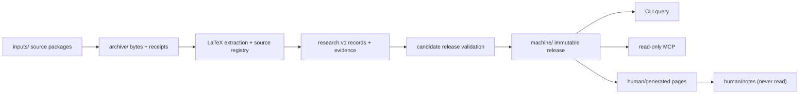

# QEC Graph — 系统设计

> **状态：当前权威设计（0.4.x）。** 这是唯一有效的设计文档。

> **中文** · [English](DESIGN.md)

| | |
|---|---|
| **状态** | 当前权威设计（0.4.x） |
| **评审日期** | 2026-11-10 |
| **替代** | 此前的 architecture、graph-contract、data-formats、incremental、MCP 和 CodeGraph 设计页。Lean 延期；见 §10。 |
| **实现** | `qecgraph/`、`tests/`、`tools/`、`validation/` |

本文是系统架构、数据契约、证据语义、发布协议、查询/MCP 接口、人类视图和延期
Lean 边界的唯一权威来源。如果代码、测试和本文不一致，以可执行行为及其验证为
当前状态；修改设计的同一个变更必须更新本文。不要为新想法创建第二份设计页：
扩展本文，或在这里记录替代决策。

| 状态 | 含义 |
|---|---|
| **Implemented** | 已存在于包中，并由测试或记录的验证覆盖。 |
| **Partial** | 机制存在，但记录了缺失或有局限的部分。 |
| **Not implemented** | 设计目标没有可执行实现。绝不要把它描述为可用。 |
| **Historical** | 被替代的材料只保留在 Git history 中，不在当前文档树。 |

---

## 本页目录

- [1. 范围与非目标](#1-范围与非目标)
- [2. 系统总览](#2-系统总览)
- [3. 权威、存储和发布](#3-权威存储和发布)
- [4. 数据契约](#4-数据契约)
- [5. 来源抽取](#5-来源抽取)
- [6. 审核、证据和查询资格](#6-审核证据和查询资格)
- [7. 工作区事务与发布协议](#7-工作区事务与发布协议)
- [8. 查询、CLI 和 MCP 契约](#8-查询cli-和-mcp-契约)
- [9. 人类视图](#9-人类视图)
- [10. Lean：延期，不支持](#10-lean延期不支持)
- [11. CodeGraph 参考与第三方归属](#11-codegraph-参考与第三方归属)
- [12. 不变量和失败案例](#12-不变量和失败案例)
- [13. 当前限制和非目标](#13-当前限制和非目标)
- [14. 验证和变更规则](#14-验证和变更规则)
- [附录 A — 决策记录（替代当前行为的独立 ADR）](#附录-a--决策记录替代当前行为的独立-adr)
- [附录 B — 主要参考](#附录-b--主要参考)

## 1. 范围与非目标

QEC Graph 把 LaTeX 论文和显式 QEC 研究记录变成保留来源的本地工作区。它面向四个问题：

1. 一个陈述、定义、证明、表格或参数究竟写在哪里？
2. 来源声称什么、显式记录了什么、审核了什么、计算了什么？
3. 哪些码、表示、电路、噪声模型、解码器、实验和软件版本与一个结果相连？
4. 什么可以交给只读 agent，而不会把候选、上界或作者声明悄悄变成事实？

**它不是：**

- TeX 引擎、PDF/OCR 流水线，或阅读论文的替代品；
- 数学证明助手或大规模码的距离求解器；
- 对论文定理为真、Lean 声明与 prose 匹配、报告 LER 可复现的声称；
- 多写者或分布式数据库；或
- 在读取时执行源码、TeX 或 Lean 的服务。

可执行范围是 Python 包、CLI、本地 MCP 服务、Obsidian 渲染器和旧 store/corpus
兼容层。Lean 代码和 fixtures 只作为延期实验材料存在，不属于受支持的 0.4.x 流程。

---

## 2. 系统总览

### 2.1 主流程：工作区



工作区是只有一个写者的本地目录。`init` 创建布局；`sync` 归档并处理收件箱包；
`rebuild` 重新检查整个归档；`status`、`validate` 和 `doctor` 是偏只读的检查命令。
成功事务发布不可变机器 release，然后渲染独立的人类视图。查询和 MCP 会话固定
release，绝不在会话中途读取移动的 `CURRENT`。

### 2.2 兼容接口

有意保留三代存储/查询：

| 接口 | 用途 | 状态 |
|---|---|---|
| **Workspace**（`qecgraph/workspace.py`、`machine/`、`archive/`） | 主产品：源包、研究记录、人类视图、工作区 MCP | Current |
| **Corpus**（`qecgraph/registry.py`、`corpus.py`） | 多文档身份、review/apply、corpus 查询、旧 MCP | 受支持兼容接口 |
| **Store**（`qecgraph/store.py`、`query.py`） | 单篇不可变抽取快照和 SQLite/FTS5 查询 | 受支持兼容接口 |

新工作应面向 workspace 接口。Store 和 corpus 继续支持既有命令、迁移、Lean 导入
和测试。当功能存在于多个接口时，workspace 实现定义当前语义；旧接口不得在证据
或状态过滤上悄悄分叉。

### 2.3 运行时与部署

- Python 3.11+，POSIX 文件系统；SQLite 带 FTS5。
- 运行时依赖 `pylatexenc==2.10` 和 `jsonschema==4.26.0`。
- 安装：GitHub Releases 的单文件可执行程序、本地 wheel/sdist，或从 checkout
  执行 `pip install -e .`。
- research Compose profile 和 macOS 只读 MCP 隔离 profile 已在本地验证；见
  `validation/README.md`。Linux profile 使用替代的本地 Ubuntu base，因为默认
  Docker Hub 查询超时。没有新验证时，不要声称通用 Docker Hub 构建或 Windows 支持。
- 包版本与 graph/record schema、Lean toolchain 独立。`qec-graph --version` 是
  已安装包版本的权威来源。

---

## 3. 权威、存储和发布

### 3.1 每个字段只有一个可编辑所有者

| 层 | 权威内容 | 可编辑？ | 可重建？ |
|---|---|---|---|
| 原始资产 | 固定 commit 的原始论文/TeX 包、PDF、矩阵、证书、Lean 源码 | 否（追加新版本） | 否 |
| 人工记录 | `research.v1` JSON、审核绑定、显式关系、资产清单 | 是，通过显式记录/事务 | 否 |
| 执行证据 | 构建日志、导出、计算检查、运行输出 | 发布后否 | 否 |
| 查询投影 | `graph.json`、视图、SQLite/FTS5、人类页面 | 否 | 是 |

Markdown 解释决策，不拥有 QEC 事实。YAML 是导入/模板格式，不是第二份可编辑真相。
SQLite 和生成图视图可重建，绝不能被修补以改变事实。

机器 release 是查询或 MCP 会话唯一可消费的权威状态。人类视图是固定 release 的
渲染，不是新的知识来源。审核者或 agent 不得通过人类视图写回。

### 3.2 工作区布局

```text
workspace/
├── qecgraph.toml                 # workspace id, limits, explicit source metadata
├── inputs/                       # claimed inbox; successful packages are consumed
│   └── .processing/              # durable claims for crash recovery
├── archive/
│   ├── blobs/sha256/<hash>       # original package bytes
│   └── receipts/<job>.json       # claim/archive receipt
├── sources/<tree-hash>/          # verified expanded source tree
├── machine/
│   ├── CURRENT.json              # published release pointer
│   ├── states/<release>.json     # immutable registry state
│   ├── operational/status.json   # sanitized operational projection
│   └── .writer.lock              # single-writer lock
├── human/
│   ├── Index.md
│   ├── generated/                # rebuildable pages
│   └── notes/                    # private; never read by generators/MCP
└── .qecgraph/                    # claim/rotation/staging internals
```

Store 和 corpus 有各自受管理根目录。不要合并它们的 pointer 格式或手工编辑状态。
迁移复制到新位置，不原地改写旧 store。

### 3.3 身份不是哈希、标题或参数元组

| 概念 | 含义 | 不等同于 |
|---|---|---|
| `work_id` | 论文/work 身份 | 来源版本、文件、标题 |
| `source_version_id` | work 的特定版本 | 包归档哈希 |
| 来源 occurrence | 来源版本中精确区间的 parser block | 规范化 claim |
| 实体 `id` | 稳定领域对象身份 | `[[n,k,d]]`、标签、文件名 |
| `revision` | 实体的内容状态 | 包 release |
| `content_sha256` | 精确序列化内容 | 对象身份 |
| `snapshot_id` / `release_id` | 一次抽取或发布状态 | 论文版本 |
| 资产 ID | 内容寻址的受管理字节 | 源文件路径 |

重复标签有歧义，必须用精确 ID 消解。缺少记录不能证明对象不存在。`[n,k,d]`
相等不能证明码身份；construction、presentation、logical basis 和 evidence 保持分离。

---

## 4. 数据契约

### 4.1 Schema family

| Schema | 用途 | 位置 |
|---|---|---|
| `qecgraph.research.v1` | 当前 workspace 研究记录（26 kinds、41 typed relations） | `qecgraph/validators/schemas/research.v1.schema.json` |
| `qecgraph.record.v3` | 旧 corpus 记录，仍可读并显式迁移 | `qecgraph/validators/schemas/record.v3.schema.json` |
| `qecgraph.record.v2` | 更旧记录，只读兼容 | packaged schema |
| `qecgraph.graph.v1` | 抽取图和三种视图 | `qecgraph/validators/schemas/graph.schema.json` |
| `qecgraph.annotations.v1` | 对抽取 store 的人工/AI 增补 | packaged schema |
| `proposal.v1`、`review.v1` | 审核信封 | packaged schemas |
| `lean-export.v1` | 实验性/延期 Lean 导出信封 | packaged schema |

未知 schema 版本被拒绝或作为不透明历史输入保留；绝不用最新字段重新解释。
包版本和数据 schema 版本独立演进。规范 schema 是打包资源；仓库根 `schemas/`
只指向它们，不能成为第二份可编辑来源。

### 4.2 Research 记录信封

`research.v1` 记录携带：

- `schema_version`、`id`、`revision`、`kind`、`is_synthetic`；
- 带 kind 专属字段的 `data`；
- 把每个字段指针（`/data/<field>`）映射到证据状态和来源的 `field_evidence`；
- schema 定义的可选审核/信封字段。

规则：

- 缺失值是 `null` 并带显式 unknown 状态/原因；不是 `false`、`0` 或空列表。
- 已知值不得悄悄替换冲突的来源主张。保留冲突及其条件。
- `source_reported`、`computed_exact`、`certificate_checked` 和 `lean_build` 是不同证据类型。
- 字段级来源定位必须解析到已登记版本和逐字区间。
- 结构/schema 验证不是数学验证；通过的测试或 Lean 构建也不是。
- AI/provider 输出默认是 draft/proposal；只有显式审核决定才能发布。

### 4.3 领域对象和必需区分

领域模型有意拆分；这些概念不可互换：

| 概念 | 区分 |
|---|---|
| `code_family` / `construction` / `code_instance` | family 或 construction 规则不是具体 `[n,k,d]` 实例 |
| `classical_seed` | 经典码/seed 不是由它导出的量子码 |
| `code_presentation` | stabilizer space 与特定校验矩阵/生成元集是不同对象 |
| `distance_claim` | 对象、presentation、metric、sector、方向、假设、方法、条件、证据 |
| `circuit_protocol` | 电路距离和码距离不同；深度必须说明计数定义 |
| `noise_model` / `noise_instantiation` | channel 模型模板不是解析后的概率点 |
| `decoder_configuration` | 算法、软件/release、参数和版本彼此不同 |
| `reported_experiment` | 论文报告结果不是本地执行的 `execution_run` |
| `performance_series` / `performance_point` | 点属于一个 experiment/curve/metric revision；不做跨实验排名 |
| `hardware_assumptions` / `execution_environment` | 硬件声称与模拟 CPU/GPU 环境分开 |
| `software_usage` | 提及、引用、来源报告使用和本地观察使用是不同证据等级 |
| `catalog_source` | 软件 catalog 条目不是已安装/测试的 release |

必需最低字段包括：

- `code_instance`：coding domain 和 `n`/`k`（或显式 unknown 原因）、construction 引用、presentations。
- `code_presentation`：父码、校验矩阵/资产、索引/bit-order 约定、重建状态。
- `distance_claim`：精确 subject/metric/sector、relation（`exact`/`lower_bound`/`upper_bound`/`interval`）、bounds、assumptions、method、evidence。
- `circuit_protocol`：representation、scheduling、ancillas、rounds、boundaries、observables；带显式单位/定义的 depth metrics。
- `noise_model`：channels、locations、probability parameters、temporal/spatial correlations、boundaries；idle/loss/erasure/leakage 分开，无证据时 `unknown`。
- `reported_experiment`：精确 code/presentation/circuit/noise instance/decoder/metric/source revisions。
- `performance_point`：experiment、noise instantiation、metric、value、coordinates、shots/discards/uncertainty、selection policy；不跨曲线插值。
- `software_usage`：usage kind、project、release（或显式 unknown），以及 source/experiment 绑定。

Check weight 始终绑定实际 presentation 和 check 集，包括 sector（`X`/`Z`/`mixed`）、
scope（`stabilizer`/`gauge`/`measured`）和 min/max/mean/histogram。在 symplectic
表示中，一个 `Y` 贡献一个 support 位置。

### 4.4 关系和边状态

规范关系 registry 是 `qecgraph.relations.KNOWN_RELATIONS`、`qecgraph.research.RELATIONS` 和 graph validation，不是这段 prose。
常见边：

- 结构：`contains`、`defined_in`、`includes`、`uses_resource`；
- 文本：`references`、`cites`、`describes`；
- 数学：`depends_on_declared`、`depends_on_candidate`、`depends_on_reviewed`、`proof_of`、`proof_of_candidate`、`normalizes_to`；
- 数据：`has_presentation`、`has_matrix`、`instance_of`、`generated_by`；
- 实验：`uses_circuit`、`uses_noise`、`uses_decoder`、`reports`、`supports`、`contradicts`；
- Lean：`formalizes`、`maps_declaration`、`maps_source_occurrence`、`has_build_evidence`、`lean_type_depends_on`、`lean_proof_depends_on`（及传递变体）；
- catalog：`catalog:*` 保留导入含义；它们不变成证明边。

每条边保留 `source`、`target`、`relation`、`status` 和 `evidence`。

- `observed` — 语法/解析观察。
- `declared` — 作者或元数据声称。
- `candidate` — 假设；不是确认依赖。
- `reviewed` — 绑定显式审核和精确输入。
- `stale`、`unbound_review`、`unresolved` — 不进入默认依赖/上下文答案。

`references` 不是证明依赖。只有当证明目标显式时，证明的 `uses` 才能提升；目标是
candidate 时，提升边也是 candidate。默认遍历过滤非活动状态；显式 audit `show`
可以显示它们。引用环合法；只报告活动 reviewed 逻辑依赖 SCC 供判断。include 环是
parser diagnostic，不是数学环。

### 4.5 来源坐标和哈希

- 文件身份和资产身份使用原始 bytes 的 SHA-256。
- 文本区间使用解码后的 Unicode codepoints，半开 `[char_start, char_end)`；行号从 1 开始，末尾包含。
- 字节偏移、字符偏移、PDF 页码和源码行号绝不混用。
- 父子片段可以重叠；不要拼接片段重建原文。
- JSON canonicalization 保留显式协议标签。既有协议不被静默改标为 RFC 8785/JCS。除非 schema 声明 set，数组顺序有语义。
- 来源或资产变化使绑定审核失效；`stale` 证据保留，不通过刷新哈希隐藏变化。

---

## 5. 来源抽取

### 5.1 Parser

`qecgraph/parser.py` 使用 `pylatexenc==2.10` 识别结构声明，不运行 TeX。它记录：

- 文件 bytes/hash 和精确来源区间；
- sections、definitions、lemmas、theorems、propositions、corollaries、conjectures、proofs、equations、tables、figures、remarks、examples；
- labels/references、literal includes/resources、macro/environment declarations；
- 缺失/歧义 include、unsupported syntax、path escape、dynamic path 和 parse failure 的 diagnostics。

它不展开任意宏、不判断条件、不执行 TeX、不推断数学真值。partial 抽取是有效且
显式标记的快照；`--strict` 把它留在 staging，不推进 `CURRENT`。

### 5.2 来源块与规范化 claim

parser 的 theorem/lemma 是 **source block**：文档在固定区间说了什么。规范化
`claim` 是独立且带修订的领域对象，带显式 statement、quantifiers、hypotheses、
definitions、subject 和 evidence。两者可以多对多；相似文本或参数绝不合并身份。
`proof_of` 指向预期目标，不断言证明有效。

### 5.3 规则和 provider 提案

离线抽取器执行两遍：定位记法/结构，再应用本地措辞/列规则。它生成带精确定位和
规则版本的 `code_mention` 提案；不把表格参数提升为已验证码实例、不推断距离界、
不根据括号形状猜码类。

可选的本地 provider 交接导出有界来源摘录，验证 provider/model/prompt hash 和
引用区间，并排队草稿。它绝不自动调用外部模型，也绝不批准自己的草稿。人工决定
绑定精确草稿和来源投影；输入变化使决定 stale。

---

## 6. 审核、证据和查询资格

审核决定是一个对象，带 actor/kind、time、scope、rationale、decision 和精确输入
绑定（record IDs/revisions/content hashes、source versions、assets、proposal）。
`apply` 在检查这些绑定后原子发布新修订；重复 apply 幂等。测试通过不会使审核
变成真，schema 通过也不会变成数学验证。

证据策略：

- 硬距离过滤要求精确 subject/presentation/metric/sector、合格 relation（`exact`、
  `lower_bound`、`interval`）、足够下界，以及绑定到 claim 精确修订的当前证据。
- 只有上界绝不满足 `distance >= d`。
- 来源报告结果只在显式策略下选择；不被静默视为数学验证。
- `execution_run` 可支持本地执行结果；不覆盖论文报告值。
- Lean 延期；即使实验 Lean 证据被评估，也不是语义等价，不属于默认过滤。
- 缺失/无结果表示固定范围内无匹配；不是不存在证明。

默认查询排除非活动边（`stale`、`unbound_review`、`unresolved`）和 candidate/
proposed 信息，除非显式请求。`show` 是 audit 视图，保留所有状态。任何截断都
显式；来源陈述/假设不被静默缩短。

---

## 7. 工作区事务与发布协议

### 7.1 Claim → archive → stage → validate → publish → consume

1. 在 `inputs/.processing/<job>` 下 **Claim** 收件箱文件，并写持久 job 记录。
2. 把原始 bytes **Archive** 到 `archive/blobs/sha256/`；写不可变收据（size/hash/name）。
3. 按内容 **Unpack**（TeX、gzip、tar、tar.gz、ZIP），限制 path/link/special-file/member/size/depth。拒绝 traversal、links、case collisions、forged ZIP counts、encrypted/unsupported members 和 oversized inputs。保留原始 bytes 和带哈希的展开树。
4. 只从证据 **Select entry point**：显式 config override，或唯一的带 `\documentclass` 和 `\begin{document}` 的 TeX 文件。歧义保持 `needs_entrypoint`；不按最长文件名猜。
5. **Extract** 到 store，然后 stage source/research records 和 proposals。结构性 partial 不发布为 complete；来源以 `semantic_pending`/`parse_failed` 状态可见。
6. 从所有活动状态 **Build candidate machine release**。复用的 projection 在发布前重新验证。
7. **Validate** candidate（source hashes/spans、record references、review bindings、assets、graph endpoints、SQLite、project identity）。失败 candidate 保持 `CURRENT` 不变。
8. 在 writer lock 下原子替换 pointer 来 **Publish**。
9. 只 **Consume** 成功事务的 claimed input copies；保留失败包和 receipts。恢复的名字不得覆盖更新文件。`--keep-inputs` 保留副本。

任何失败都必须让旧 release 可读、原包可恢复、没有重复事实。成功批次可包含失败；
结果是 `partial_batch`。`rebuild` 检查完整归档和 receipts，包括此前失败/未解决的包；
不把 manifest 当作论文白名单。`inputs quarantine` 把持续失败的包移到一边，不删除 bytes；
`inputs restore` 拒绝覆盖替代文件。

### 7.2 锁、原子性和恢复

- 一个 workspace writer；`transactions.writer_lock` 使用 POSIX advisory lock，并拒绝 linked/special lock files。
- 崩溃后可留下不可变对象；只有 pointer 发布使 release current。
- store/workspace 发布可崩溃恢复：pointer switch 后的 claim cleanup 从精确 claim 重放；SIGKILL 测试覆盖该窗口。
- 锁保护本地进程，不保护 NFS 或分布式 writer。不声称掉电持久性或 multi-writer 支持。
- `recover-store`/`doctor` 验证 pointer，并盘点工具拥有的废弃 build；未知或用户目录不删除。删除是显式操作。
- `human_stale` 是派生视图失败，不是机器 release 回滚。从固定 release 重新渲染。

### 7.3 增量和 watch

- 每文件 pylatexenc AST 缓存按内容寻址并验证；不使用 pickle/任意加载。parse error 不缓存。
- 每次运行重新发现 includes/resources，并重建 semantic projections、graph views、review status 和 SQLite。缓存命中绝不复活 stale review。
- macro/environment/include-set/config/processor 变化保守回退到完整解析；不信任 mtime。
- `watch` 是同一 ingest 外的内容轮询。临时文件、输出 store 和缓存被忽略；批量保存去抖。它不引入第二个 extractor。
- 对同一最终输入，增量和全量运行必须产生相同语义输出。性能声称是测量，不是保证。

### 7.4 退出行为

- `0` — 请求工作完成（或无变化）。
- `1` — 致命失败；没有新 release。
- `2` — partial batch/未解决输入/派生视图 stale，带可读报告。
- `64` — 命令用法错误。
- `130` — 被中断。
- 机器 JSON 错误带稳定 error code/message/details；人类错误写到 stderr。自动化应读结构化状态，不只从 `2` 推断语义。

---

## 8. 查询、CLI 和 MCP 契约

### 8.1 作用域

每次读取固定到一个 scope：

- `--workspace` + 可选 `--release`（workspace machine release）；
- `--machine`（严格只读 machine mount，无 workspace/human 访问）；
- `--store` + 可选 `--snapshot`；
- `--corpus` + 可选 `--registry-revision` 和 source-version restriction。

返回结果包含 scope identity、source/evidence status 和 truncation/absence notes。
会话在启动时固定 release/snapshot；改变 `CURRENT` 不改变现有会话。要读取新
release，重新连接/固定。

### 8.2 CLI

CLI 按名词分组（`workspace`、`query`、`review`、`mcp`、`human`、`software`、
`maintain`、`snapshot`、`inputs`、`doctor`、`version`、`help`，以及实验性/延期
`lean` 组）。扁平旧名称仍可用，带弃用提示。全局选项包括 `--json`、`--quiet`、
`--verbose`、`--debug`、`--color` 和 `--version`。

人类输出简洁且有状态：workspace/release、indexed/pending/failed/quarantined
计数、human-view 状态和下一步动作。`--json` 是唯一机器输出开关；TTY 检测影响
样式，不影响数据模型。错误可操作，除非请求 `--debug`，绝不输出原始 Python/OS/TOML traceback。

### 8.3 MCP

- 本地 stdio，protocol `2025-06-18`；stdout 只承载 JSON-RPC，日志到 stderr。
- Store/corpus 会话暴露五个旧 `qecgraph_*` read tools。
- Workspace 会话增加 research/source tools 和 `qec://source/...` resources，以及 status/coverage projections。
- 会话固定一个 release；工具参数不能传任意 paths/SQL/shell 或改变 scope。
- 预算：depth/nodes/results/characters；截断结果说明省略内容；预算过小返回显式错误，而不是部分根陈述。
- Read tools 绝不写、运行 TeX/paper code 或触发 Lean builds。
- 严格部署只挂载 machine 目录。`human/`、`inputs/` 和 `human/notes/` 必须不可读。MCP roots 不是访问控制机制。

类型化 JSON envelope（`ok/data` 或 `error/code/message/details/scope`）在适用处由
Python、CLI 和 MCP 共享。MCP protocol errors 和 business-query errors 保持可区分。

---

## 9. 人类视图

`human/` 是从一个机器 release 渲染、可独立打开的 Obsidian vault。

- `human/generated/` 可重建；稳定页面路径、aliases、front matter、tags、indexes 和 tombstones 确定性生成。
- `human/notes/` 是私有人类内容。生成器、查询、MCP、embeddings、日志和渲染器绝不读取它。不要添加不加区分扫描 vault 根的自动化。
- 页面发布在目标目录内逐文件原子；不是全局 vault 事务。渲染中断报告 `human_stale`；从同一 release 重新渲染。不声称多文件原子性。
- 重命名/删除的实体保留稳定 tombstone 页面以支持入链。
- 人类视图是阅读辅助，不是权威；更正必须写成 machine 层的显式结构化修订。
- machine 层绝不读取人类视图。

---

## 10. Lean：延期，不支持

> [!WARNING]
> **Lean 在 0.4.x 中延期。** 它不是受支持的数据库、查询或 MCP 流程的一部分。
> `lean` CLI 组、`qecgraph/lean*.py`、`lean/` 项目和
> `validation/lean-experimental` fixtures 只作为实验性回归材料保留。它们不是
> 验证声明，不得被呈现为已完成的产品能力。

**当前状态：** 延期。此前的 Lean 实验回答了一些工程问题（toolchain pinning、
export shape、axiom visibility），但它们不是受支持的语义契约。在新设计被编写
并批准之前，它们被有意排除在受支持 release scope 之外。

### 今天存在什么，以及它意味着什么

| 产物 | 状态 |
|---|---|
| `qecgraph/lean.py`、`lean_integration.py`、`qecgraph/cli/commands/lean.py` | 保留实验代码，使历史回归仍可测试；不在支持契约内 |
| `lean/` 项目和 `lean/axiom-policy.json` | 固定实验 fixture；普通 Python 环境不安装 toolchain |
| `validation/lean-experimental/` 和 Lean test fixtures | 历史/实验证据；不是当前验证声明 |
| Query/MCP 路径 | 不导入、不执行、不要求 Lean；数据库构建和 MCP 不受影响 |

### 明确不声称什么

- 不为任何论文定理声称“Lean verified”状态；
- 不声称 prose 与 Lean 类型语义等价；
- 不声称通用 CSS/HGP 距离形式化或 certificate bridge；
- 不支持第三方 package manifests、自定义 axioms、`sorry`，或超出显式实验检查的
  `native_decide` trust；
- 当前 release 没有可复现的 Lean acceptance。

### 在重新实现 Lean 之前，新设计必须说明

1. 精确的 source statement → normalized claim → Lean declaration 映射，包括
   quantifiers、hypotheses、definitions 和 scope；
2. declaration/type/proof-dependency export 和 proof-term trust model；
3. 显式 axiom/`sorry`/native-computation 政策，以及失败证据；
4. 可复现 toolchain、project commit、dependency lock、build command 和 log/export format；
5. 独立语义审核、freshness/invalidations 和 query exposure；
6. 与数据库和 MCP 的边界：read tools 绝不执行 Lean，Lean 缺失不得破坏 workspace 或 MCP 操作。

---

## 11. CodeGraph 参考与第三方归属

本项目独立实现其 Python 架构。它参考 [colbymchenry/codegraph](https://github.com/colbymchenry/codegraph)
的 commit `f72c9d2efb14454ff4f9fd7b8460abd82f19a287`（MIT，Copyright (c) 2026
Colby Mchenry），用于 extraction/storage/resolution/query/watch 边界。没有复制
上游代码，也没有上游性能数字适用于本项目。下面的决策记录总结该参考；详细检查
（包括 `6560052a6f856855d3f71eee838fd66ccfa4285d`）保留在 Git history 中。

映射摘要：

- code symbol graph → source spans、claims、entities、evidence 和 typed relations；
- tree-sitter/AST → `pylatexenc` structural extraction（不是 TeX 引擎）；
- reference resolution → labels/includes/citations 加显式 typed edges；
- graph query/context → 有界、证据过滤的 traversal；
- watch/sync → 同一 ingestion pipeline 外的内容轮询；
- AI tools → 一个只读 query layer，通过 CLI、Python 和 MCP 暴露。

[leanblueprint](https://github.com/PatrickMassot/leanblueprint) 注解（`uses`、
`proves`、`lean`、`leanok`）保留为作者观察/声称；它们不是 proof-term dependencies、
build evidence 或 semantic equivalence。

---

## 12. 不变量和失败案例

### 12.1 可测试不变量

| ID | 不变量 |
|---|---|
| G01 | 每个 source block 精确等于其区间的归档源码切片。 |
| G02 | 注释/verbatim labels 和 commented includes 绝不进入真实索引。 |
| G03 | 嵌套 labels 保持不同；重复 labels 有歧义，绝不静默消解。 |
| G04 | `references`、declared dependencies、candidates 和 reviewed dependencies 保持不同。 |
| G05 | 非活动 input edge 不能被 promotion 或 query 复活。 |
| G06 | resource hashes 在 review matching 前固定；内容变化使 review stale。 |
| G07 | `\leanok`/`formalizes` 绝不产生 Lean-verified 或 semantic-equivalence 状态。 |
| G08 | 表格参数不被抽取提升为已验证码实例。 |
| G09 | 重建相同 input/tool state 幂等，且不修改 source bytes。 |
| G10 | Graph、views 和 SQLite 指向同一 snapshot；所有边端点有效。 |
| G11 | 显式 data relations 可扩展 matrix/presentation/metric/evidence context。 |
| G12 | Partial extraction、truncation、unresolved targets 和 stale reviews 可观察。 |
| G13 | 失败发布保持旧 release 可读、输入可恢复。 |
| G14 | `human/notes/` 绝不被 generation/query/MCP 读取或覆盖。 |
| G15 | Workspace/MCP 会话不能混用两个 releases。 |

### 12.2 必需失败案例

- 证明提到背景定理但没有声明依赖：保留 `references`；只有 candidate edges。
- 重复 label：返回歧义；要求精确 ID。
- Distance claim 只有上界：不得满足 lower-bound filter。
- source/asset/review input 变化：标 stale，保留旧证据，从默认答案排除。
- 归档包含 traversal、links、special files、forged ZIP count 或不支持的 member：在 materialization 前拒绝。
- 包永久不受支持：保留、报告并允许 quarantine；绝不删除或伪造抽取。
- `CURRENT` 损坏或 writer lock 被持有：报告精确路径/所有者状态，不写入。
- 渲染器在发布后失败：保留 machine release，报告 `human_stale`，重新渲染。
- Lean build 有 `sorry`/未列出的 axiom 或改变的 type/toolchain：拒绝 evidence binding；保留历史报告。
- MCP 请求要求 path/SQL/shell 或不同 scope：拒绝；不要重新解释为 query。
- 查询无结果：说明固定 scope 和 absence semantics；不要说定理不存在。

---

## 13. 当前限制和非目标

| 领域 | 状态 |
|---|---|
| 真实论文 corpus | 固定 replay 中有六个带版本 arXiv 来源；不是全面文献 corpus |
| LLM extraction | 仅可选本地 handoff；不自动调用 provider，不声称质量 |
| Chart/curve digitization | 未实现；值需要显式证据 |
| PDF/OCR | 未实现；LaTeX 源是受支持输入 |
| Vector/semantic retrieval | 未实现；只有 lexical/substring + structured filters |
| Distance algorithms | 小码枚举/验证；没有通用大码 solver 或 certificate bridge |
| Lean formalization | **延期。** 只有实验代码/fixtures；没有受支持验证声明；DB/MCP 不受影响 |
| Platforms | POSIX（macOS/Linux 已验证）；Windows 不支持/未验证 |
| Distribution | 独立 GitHub Releases 和本地 wheel/sdist；公开 PyPI 发布受门控/手动，不假设 |
| Concurrency | 单 writer，本地 POSIX 文件系统；没有 multi-writer/distributed transactions |
| Docker | Linux Compose 和 macOS isolation 已验证并记录 caveats；不声称通用 image build |

这些是当前 release 的限制，不是用看似合理的值填补缺口的许可。

---

## 14. 验证和变更规则

- 测试套件和 `tools/reproduce*.py` 是可执行检查；`validation/README.md` 索引记录运行及其源码修订。
- `python -m unittest discover -s tests -v`、`python tools/reproduce.py --out build/reproduce` 和 CLI/MCP 检查是标准本地门禁。
- CI 运行 lint、渐进 mypy、分支覆盖率（80% gate）、测试、distribution checks、installed-wheel workspace replay 和平台隔离检查。
- 任何 identity、source coordinates、evidence semantics、review binding、publication order 或 MCP scope 变化都要求新 invariant test，并在兼容性受影响时写迁移说明。
- 只有本文、实现、测试和 validation claim 一致时，设计变更才算完成。不要把第二份矛盾设计页留在活动文档树中。

---

## 附录 A — 决策记录（替代当前行为的独立 ADR）

| 决策 | 当前解决 |
|---|---|
| **D1 — 一个 workspace，一个 writer** | Immutable release + POSIX lock + atomic pointer；没有 distributed writer。 |
| **D2 — 证据分层，不是评分** | Source/claim/review/computation/build 状态保持分离；默认过滤排除非活动状态。 |
| **D3 — 只读 agents** | 固定 scope、有预算的 CLI/Python/MCP reads；没有 path/SQL/shell 访问；只有 stdout protocol。 |
| **D4 — 人类视图隔离** | 从固定 machine release 生成页面；`human/notes/` 永不读取；逐页原子发布；`human_stale` 恢复。 |
| **D5 — Lean 延期** | 0.4.x 没有受支持验证声明。实验 fixtures 保留用于回归；实现前需要新设计，read paths 绝不执行 Lean。 |
| **D6 — CodeGraph 仅供参考** | 架构比较，不复制代码，不导入性能声称；保留归属。 |
| **D7 — 兼容优先于重写** | Store/corpus 继续受支持；workspace 是当前；迁移显式且非破坏。 |
| **D8 — Schema 所有权单一** | Packaged schemas 是规范；根副本是兼容性产物并检查相等；未知版本不重新解释。 |

## 附录 B — 主要参考

1. [SQLite: appropriate uses](https://www.sqlite.org/whentouse.html)
2. [SQLite FTS5](https://www.sqlite.org/fts5.html)
3. [DuckDB Parquet](https://duckdb.org/docs/stable/data/parquet/overview)
4. [Docker storage](https://docs.docker.com/engine/storage/)
5. [pylatexenc 2.10 LatexWalker](https://pylatexenc.readthedocs.io/en/v2.10/latexwalker/)
6. [CodeGraph](https://github.com/colbymchenry/codegraph)
7. [leanblueprint](https://github.com/PatrickMassot/leanblueprint)
8. [Error Correction Zoo data](https://github.com/errorcorrectionzoo/eczoo_data)

历史理由和替代页面只在 Git history 中保留；不属于当前文档树。
