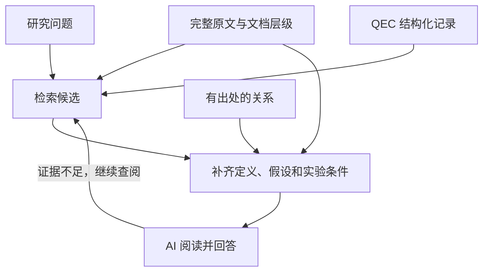

# Guangqi 的 QEC 知识库想法

> 状态：保留的人类需求与思考笔记（2026-11-11）。实现契约和进度以
> [系统设计](DESIGN.zh-CN.md#16-可搜索知识体系与实施路线)为准。
> 本文件是仓库里的产品需求，不是工作区的人类阅读输出或私人笔记。

<!-- 这里是人类(Guangqi)的设计与思考空间 -->

## 我想要得到的内容以及数据

我想要做的事是把QEC(Quantum error correction)方向的文章整理成为LLM可以更好去用，去检索的数据库，建立一个MCP服务。之后可能会用这些整理到位的信息去做LEAN形式化以得到新的结果。

### 第一个要回答的问题是：我想要什么样的数据？

#### 总体上，我想要保留文章的所有内容，在于科学产出上面，我想要保留的是类似于

1. QEC基本假设，定义，以及定理。
2. 实验相关的假设， Error model的设置， idle, loss的机制与引入
3. Decoder的设计原理以及表现，和其他decoder的对比
4. QEC code 的构造以及表现：a. 构造使用的数学结构。 b. code rate， distance的bound。 c.具体code [n,k,d], parity check matrix。 d. syndrome extraction circuit 设计。e. 特定error model，decoder下的 circuit level distance, logical error rate。
5. 具体实验参数以及code在真实实验里的表现，实验上的参数主要有：各种操作的保真度，error model具体细节与可能的归因。

#### 在科学思维方面，对于每一篇文章，我想要保存的是

1. 他们想解决什么问题？
2. 为什么这个要解决的问题重要？
3. 他们解决了吗？是怎么解决的？
4. 这个解决方案中是用了什么直觉，想法？
5. 文章里面有什么重要的假设？
6. 整篇文章的结论是什么？是对于之前结论的补充还是加强还是推翻？
7. 遗留下的问题是什么？有什么引发的后续提问？
8. 文章中有什么不同寻常，反直觉的发现？
9. 有什么不在主线上，但是有意思的结论？

### 第二个要回答的问题是：LLM喜欢什么样的数据结构？

这个问题应该让LLM回答，我也正是这么做的，在这里总结一下LLM的答案：
首先我们应该保留不同层级的知识，从原子化，到段落，再到整篇文章，最后到相关文章的集合，这样才能让AI更好的帮我们检索，直到理解文章。因为不同层级的"理解"需要不同层级的上下文，举例：

| 单位 | 目的 | 合适的内容 |
|---|---|---|
| **存储单位** | 维护、版本管理、更新 | 一篇来源、一条记录、一个资产 |
| **检索单位** | 快速找到相关位置 | 一段文字、一个定理、表格中的一组行、图注 |
| **阅读单位** | 让 AI 正确理解和回答 | 检索命中的内容，加上必要定义、假设和上下文 |

一个短段落可能很适合搜索，却不足以单独理解。一个完整定理也可能依赖前面几页的符号定义和全局假设。

假设检索命中了：
“该电路的距离上界为 12。”

AI 真正需要阅读的可能是：

1. 这句话及所在段落；
2. 电路的定义与调度；
3. “距离”的度量定义；
4. 使用的故障模型；
5. 搜索方法与限制；
6. 表格或图注中关于 upper bound 的说明。
如果系统只返回一句话，信息太少；如果每次都返回几十篇论文全文，又失去了定位的作用。

因此，建议用较小的内容定位，用较完整的上下文理解，并允许继续展开到整节或全文。

以下是职责示意，实际沿用项目现有路径，不要求改名。

| 路径或接口 | 作用 |
|---|---|
| `AGENTS.md` | 简短说明如何搜索、如何取得上下文、如何解释未知项，以及 `human/` 的访问边界 |
| `archive/` | 原始包与归档信息 |
| `sources/<version>/` | 完整原文工程，包括附件、图表和宏定义 |
| `sources/<version>/document.json` | 解析出的章节顺序、父子关系、标签、引用及原文定位 |
| `records/<kind>/<id>.json` | 码、距离主张、噪声、实验点等结构化记录 |
| `records/relations/` 或等价关系表 | 有类型、有出处的对象关系 |
| `assets/` | 矩阵、电路、数据表、运行与证明材料 |
| `machine/snapshots/<release>/catalog.json` | 当前来源目录、对象目录、处理状态和覆盖信息 |
| `machine/snapshots/<release>/search.sqlite` | 全文、字段与关系查询投影 |
| `qec_get_context(...)` | 按问题组合可直接阅读的上下文；可实时生成，也可缓存 |
| `human/YYYY/MM/一作姓_文章前两个词_thoughts.md` | 每篇论文一份九问与 AI 回答，独立的人类阅读区 |

有四点核心要求：

1. 原文始终是一条完整可用的查询路径
2. 保留文档层级，而不只是片段列表
3. JSON 用于精确查询，阅读文本用于理解
4. 提供一个小而明确的入口

MCP 很适合把这些能力统一提供给不同 agent。它的作用是使调用方式稳定；回答质量仍然取决于数据、检索和上下文。

#### 需要补强的是查询流程



| 问题 | 主要路线 |
|---|---|
| “解释这篇论文的思路” | 目录、摘要、相关章节，必要时全文 |
| “哪些码满足这些参数？” | 结构化筛选，加原文核对及未解析候选 |
| “这个术语在哪里出现？” | 名称、别名、全文搜索，必要时语义检索 |
| “这两条 LER 能比较吗？” | 获取完整实验条件，逐项检查差异 |
| “这个定理依赖什么？” | 关系展开，加定义、假设和证明原文 |
| “整个方向有哪些路线？” | 多论文检索与综合阅读，明确覆盖范围 |

最重要的回退规则：字段没有结果，就继续查原文

## 我想要实现的功能

原文归档 + 可追溯的 QEC 结构化记录 + 全文与向量检索 + 上下文组装 + 少量稳定的 MCP 工具。

### 四种 Graph 分别保留什么

我希望用 SourceGraph、LemmaGraph、DataGraph、ThoughtsGraph 从四个角度组织同一套论文知识。
它们共享论文版本、对象身份和来源位置，查询时可以一起使用。

| Graph | 我最想回答的问题 | 主要内容 |
|---|---|---|
| SourceGraph（来源图） | 这句话出自哪里，前后文是什么？ | 论文版本、源文件、章节、段落、公式、图表、标签和引用 |
| LemmaGraph（陈述与依赖图） | 这个结论在什么假设下成立，依赖哪些定义和结果？ | 定义、假设、引理、定理、证明文字和有状态的依赖关系 |
| DataGraph（领域数据图） | 具体研究了哪个码、哪套实验条件，结果是什么？ | 码族、构造、码实例、校验矩阵、电路、噪声、decoder、硬件和性能数据 |
| ThoughtsGraph（研究思路图） | 为什么研究这个问题，采用什么思路，留下了什么？ | 上面九类科学思维内容，以及它们与前人工作、具体结果的联系 |

#### SourceGraph：让每条知识都能回到原文

SourceGraph 保存文章的层级、顺序和精确位置，让我可以从一个搜索片段继续读到所在章节、
源文件或全文，也可以检查图注、公式和参考文献。论文不同版本分别保留，不能用 v3 的内容
替代请求的 v2。引用只表示原文中的引用关系，不自动表示支持某个结论或构成证明依赖。

#### LemmaGraph：保留结论的适用条件与依赖

LemmaGraph 组织定义、假设、陈述与证明文字。我希望沿着一个定理找到它使用的符号、
前提和已有结果，也能看出某个前提变化会影响哪些结论。作者声明的依赖、待确认依赖、
人工审核和形式化证据要分别标明；“这里有一段证明”不代表系统已经确认它正确。

#### DataGraph：让参数和表现有明确的对象与条件

DataGraph 保存具体 QEC 对象及其关系。例如，一个逻辑错误率点要能追到对应的码实例、
校验呈现、syndrome 电路、噪声实例、decoder、度量定义与实验来源。
相同 `[n,k,d]` 不代表同一个码；不同噪声、idle/loss 设置或统计口径下的性能不能直接混排。
缺少条件时应保留未知，并允许回到 SourceGraph 查原文。

#### ThoughtsGraph：保留论文明确表达的科学思维

ThoughtsGraph 对应前面九个问题：研究问题、重要性、方法、直觉、关键假设、结论、
开放问题、反直觉发现和支线结果。“解决了吗”结合方法和结论阅读；“补充、加强还是推翻”
需要保留与前人工作的关系及适用条件。记录既能关联另一条思路，也能关联具体构造、
实验或性能记录，方便跨论文比较研究路线。

每条思路保留原文引用、论文版本和具体位置。作者明确陈述与人工/AI 解读分别标记；
AI 提议即使引用准确也仍是 proposed，不自动成为已审核记录。这里保存的是论文中有依据的
表达，不补写作者未披露的思考过程，也不读取我的私人笔记。私人笔记放在 `human/` 之外。

例如，要理解“某种 decoder 为什么改善了表现”，我希望先在 ThoughtsGraph 找动机与方法，
再到 DataGraph 核对实验条件；需要数学论证时展开 LemmaGraph，最后都能用 SourceGraph
回到原文。实际字段与使用方法见[四种图与 ThoughtsGraph](../user/data-and-search.zh-CN.md#四种图如何配合)。

### 我想要的 human 文件布局

`human/` 里每篇文章只保留一个文件：
`human/YYYY/MM/一作姓_文章前两个词_thoughts.md`，不用再加“文章”这层目录。
正文放上面的九个 ThoughtsGraph 问题和 AI 的回答，回答附原文依据；缺少证据就明确留空说明。
引用不用长篇摘抄，只给出能在论文中找到的关键短句；完整解释和适用条件放在 AI 回答里。
由主文件通过 `\input` / `\include` 引入正文、附录的多文件 TeX 论文，也默认让 AI
抽取全部已登记的正文文件，不能只读主文件而遗漏实际内容。
文件最前面按 Obsidian 格式放：

```yaml
---
tags:
  - surface-codes
  - erasure-decoding
link: "https://example.org/paper"
title: "Surface codes under erasure"
author:
  - "Ada Lovelace"
---
```

这只是格式示例，实际 tags 使用文章主要讨论的主题词；title 放完整标题，author 按论文顺序
列出完整作者，文件名只取第一作者的姓（last name），不要名。例如 `Diego Ruiz`
使用 `Ruiz_…_thoughts.md`。年月直接取 arXiv 包名的编号前四位：
`arXiv-2611.12971v2.tar.gz` 就放到 `human/2026/11/`，不取论文里的 `\date` 或导入时间。
没有可用 arXiv 编号时才回退到明确的来源日期，仍缺失的信息不要猜。
`human/` 不存索引、实体页、原文副本、状态文件或其他内容。旧版内容直接删除，不做备份。
生成状态放在 `.qecgraph/`；私人笔记另放。实现细节与迁移规则见
[系统设计的人类视图](DESIGN.zh-CN.md#9-人类视图)。

### 知识服务与 MCP 入口

知识服务本身：存什么、怎么检索、怎么关联、如何返回证据。
MCP 接口：AI 可以调用哪些工具、每次得到多少内容、如何继续读取。

| 团队 / 服务 | 官方公开的做法 | 对 qec-graph 的启发 |
|---|---|---|
| **OpenAI 的知识接入指南** | 针对 ChatGPT deep research 和 company knowledge，定义只读的 `search`、`fetch` 接口：先定位结果，再读取内容。([OpenAI API][1]) | 保留一个简单的通用检索入口，让客户端不必先理解整个 QEC 数据模型。 |
| **Microsoft Learn MCP** | 提供 `microsoft_docs_search`、`microsoft_docs_fetch`、`microsoft_code_sample_search`。文档检索、内容读取、代码示例检索分别有明确用途。([Microsoft Learn][2]) | 按研究任务设计工具。论文检索和性能条件查询可以有不同入口，共用同一后端。 |
| **Context7** | MCP 工具是 `resolve-library-id` 和 `query-docs`：先把名称解析为确定的库 ID，再针对该对象查询文档。([Context7 MCP][3]) | 查询前先确定对象：到底是哪一种 code family、哪个具体实例、哪个软件包、哪篇论文的哪个版本。 |
| **DeepWiki / Cognition** | 提供 `read_wiki_structure`、`read_wiki_contents`、`ask_question`，支持先查看结构，再阅读内容或提问。([Devin Docs][4]) | 让 agent 可以获取论文目录、定理列表、实验列表，再按需展开；不能只提供零散的搜索片段。 |
| **Anthropic 的工具设计建议** | 强调任务清晰、输入输出明确、返回有用上下文，并用分页、范围选择、过滤等控制返回量，通过真实任务评测工具效果。([anthropic.com][5]) | 给 agent 少量用途明确的工具；工具描述、结果格式、错误信息和上下文预算都应作为产品设计的一部分。 |

[1]: https://developers.openai.com/api/docs/mcp?utm_source=chatgpt.com "Building MCP servers for plugins and API integrations"

[2]: https://learn.microsoft.com/en-us/training/support/mcp-developer-reference?utm_source=chatgpt.com "Microsoft Learn MCP Server developer reference documentation"

[3]: https://context7.com/docs/resources/all-clients?utm_source=chatgpt.com "MCP Clients"

[4]: https://docs.devin.ai/work-with-devin/deepwiki-mcp?utm_source=chatgpt.com "DeepWiki MCP"

[5]: https://www.anthropic.com/research/writing-tools-for-agents?utm_source=chatgpt.com "Writing effective tools for AI agents \ Anthropic"

### 从这些公开接口中，我认为最值得借鉴的组合是

先定位对象 → 返回少量候选 → 读取完整证据单元 → 按需要展开上下文。

这也是为什么我不建议把一万篇论文分别变成一万个 MCP 工具。论文数量应该体现在后端数据中，MCP 工具数量可以长期保持稳定。

### 研究知识库需要更严格的版本语义

Context7 的文档 API 在指定版本尚未索引时，可能返回其他可用版本，并明确报告请求版本和实际提供版本。这个机制在软件文档服务中有实用价值。

QEC 知识库应采取更严格的策略：
如果用户要求论文 v2 的距离界或某个实验结果，系统必须返回 v2 的证据；没有 v2 时应报告缺失，并列出其他可用版本供选择。

同样，DeepWiki 式的问答接口可以作为辅助，但我会让 QEC MCP 的核心接口始终能够直接返回原文、公式、图表位置和实验条件。这样，外层 agent 能够核查答案，也方便以后进行 Lean 构建。

实现顺序：先贯通原文检索与分层阅读，再补齐 ThoughtsGraph、混合检索和任务上下文，最后通过可复现评测验证。Lean 先准备来源与假设映射，实际形式化构建继续延期；不把代码测试当成数学证明。
