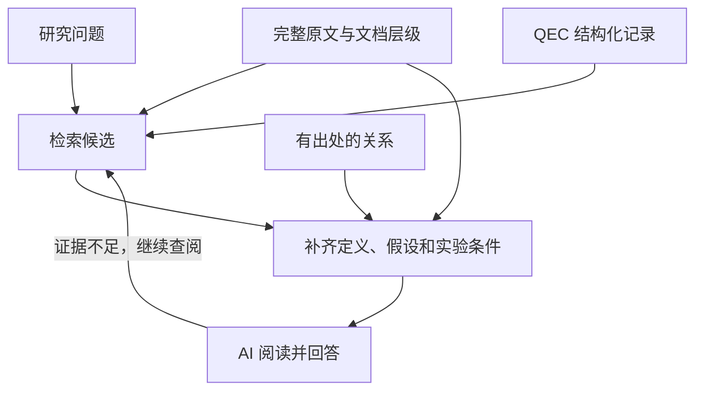

# Guangqi 的 QEC 知识库想法

> 状态：保留的人类需求与思考笔记（2026-11-11）。实现契约和进度以
> [系统设计](DESIGN.zh-CN.md#16-可搜索知识体系与实施路线)为准。
> 本文件是仓库里的产品需求，不是工作区中禁止读取的 `human/notes/`。

<!-- 这里是人类(Guangqi)的设计与思考空间 -->

## 我想要得到的内容以及数据

我想要做的事是把QEC(Quantum error correction)方向的文章整理成为LLM可以更好去用，去检索的数据库，建立一个MCP服务。之后可能会用这些整理到位的信息去做LEAN形式化以得到新的结果。

### 第一个要回答的问题是：我想要什么样的数据？

#### 总体上，我想要保留文章的所有内容，在于科学产出上面，我想要保留的是类似于：
1. QEC基本假设，定义，以及定理。
2. 实验相关的假设， Error model的设置， idle, loss的机制与引入
3. Decoder的设计原理以及表现，和其他decoder的对比
4. QEC code 的构造以及表现：a. 构造使用的数学结构。 b. code rate， distance的bound。 c.具体code [n,k,d], parity check matrix。 d. syndrome extraction circuit 设计。e. 特定error model，decoder下的 circuit level distance, logical error rate。
5. 具体实验参数以及code在真实实验里的表现，实验上的参数主要有：各种操作的保真度，error model具体细节与可能的归因。
#### 在科学思维方面，对于每一篇文章，我想要保存的是：
1. 他们想解决什么问题？
2. 为什么这个要解决的问题重要？
3. 他们解决了吗？是怎么解决的？
4. 这个解决方案中是用了什么直觉，想法？
5. 文章里面有什么重要的假设？
6. 整篇文章的结论是什么？是对于之前结论的补充还是加强还是推翻？
7. 遗留下的问题是什么？有什么引发的后续提问？
8. 文章中有什么不同寻常，反直觉的发现？
9. 有什么不在主线上，但是有意思的结论？

   

### 第二个要回答的问题是：LLM喜欢什么样的数据结构？
这个问题应该让LLM回答，我也正是这么做的，在这里总结一下LLM的答案：
首先我们应该保留不同层级的知识，从原子化，到段落，再到整篇文章，最后到相关文章的集合，这样才能让AI更好的帮我们检索，直到理解文章。因为不同层级的"理解"需要不同层级的上下文，举例：

| 单位 | 目的 | 合适的内容 |
|---|---|---|
| **存储单位** | 维护、版本管理、更新 | 一篇来源、一条记录、一个资产 |
| **检索单位** | 快速找到相关位置 | 一段文字、一个定理、表格中的一组行、图注 |
| **阅读单位** | 让 AI 正确理解和回答 | 检索命中的内容，加上必要定义、假设和上下文 |

一个短段落可能很适合搜索，却不足以单独理解。一个完整定理也可能依赖前面几页的符号定义和全局假设。

假设检索命中了：
“该电路的距离上界为 12。”

AI 真正需要阅读的可能是：
1. 这句话及所在段落；
2. 电路的定义与调度；
3. “距离”的度量定义；
4. 使用的故障模型；
5. 搜索方法与限制；
6. 表格或图注中关于 upper bound 的说明。
如果系统只返回一句话，信息太少；如果每次都返回几十篇论文全文，又失去了定位的作用。

因此，建议用较小的内容定位，用较完整的上下文理解，并允许继续展开到整节或全文。

以下是职责示意，实际沿用项目现有路径，不要求改名。

| 路径或接口 | 作用 |
|---|---|
| `AGENTS.md` | 简短说明如何搜索、如何取得上下文、如何解释未知项，以及 `human/` 的访问边界 |
| `archive/` | 原始包与归档信息 |
| `sources/<version>/` | 完整原文工程，包括附件、图表和宏定义 |
| `sources/<version>/document.json` | 解析出的章节顺序、父子关系、标签、引用及原文定位 |
| `records/<kind>/<id>.json` | 码、距离主张、噪声、实验点等结构化记录 |
| `records/relations/` 或等价关系表 | 有类型、有出处的对象关系 |
| `assets/` | 矩阵、电路、数据表、运行与证明材料 |
| `machine/snapshots/<release>/catalog.json` | 当前来源目录、对象目录、处理状态和覆盖信息 |
| `machine/snapshots/<release>/search.sqlite` | 全文、字段与关系查询投影 |
| `qec_get_context(...)` | 按问题组合可直接阅读的上下文；可实时生成，也可缓存 |
| `human/generated/`、`human/notes/` | 保留你要求的独立人类阅读区 |

有四点核心要求：

1. 原文始终是一条完整可用的查询路径
2. 保留文档层级，而不只是片段列表
3. JSON 用于精确查询，阅读文本用于理解
4. 提供一个小而明确的入口

MCP 很适合把这些能力统一提供给不同 agent。它的作用是使调用方式稳定；回答质量仍然取决于数据、检索和上下文。

#### 需要补强的是查询流程

| 问题 | 主要路线 |
|---|---|
| “解释这篇论文的思路” | 目录、摘要、相关章节，必要时全文 |
| “哪些码满足这些参数？” | 结构化筛选，加原文核对及未解析候选 |
| “这个术语在哪里出现？” | 名称、别名、全文搜索，必要时语义检索 |
| “这两条 LER 能比较吗？” | 获取完整实验条件，逐项检查差异 |
| “这个定理依赖什么？” | 关系展开，加定义、假设和证明原文 |
| “整个方向有哪些路线？” | 多论文检索与综合阅读，明确覆盖范围 |

最重要的回退规则：字段没有结果，就继续查原文

## 我想要实现的功能

原文归档 + 可追溯的 QEC 结构化记录 + 全文与向量检索 + 上下文组装 + 少量稳定的 MCP 工具。

SourceGraph、LemmaGraph、DataGraph、ThoughtsGraph

ThoughtsGraph 保留上面九类科学思维内容；作者明确陈述与 AI 的解读分开，后者默认 proposed，所有内容都要能追溯到原文。

知识服务本身：存什么、怎么检索、怎么关联、如何返回证据。
MCP 接口：AI 可以调用哪些工具、每次得到多少内容、如何继续读取。

| 团队 / 服务 | 官方公开的做法 | 对 qec-graph 的启发 |
|---|---|---|
| **OpenAI 的知识接入指南** | 针对 ChatGPT deep research 和 company knowledge，定义只读的 `search`、`fetch` 接口：先定位结果，再读取内容。([OpenAI API][1]) | 保留一个简单的通用检索入口，让客户端不必先理解整个 QEC 数据模型。 |
| **Microsoft Learn MCP** | 提供 `microsoft_docs_search`、`microsoft_docs_fetch`、`microsoft_code_sample_search`。文档检索、内容读取、代码示例检索分别有明确用途。([Microsoft Learn][2]) | 按研究任务设计工具。论文检索和性能条件查询可以有不同入口，共用同一后端。 |
| **Context7** | MCP 工具是 `resolve-library-id` 和 `query-docs`：先把名称解析为确定的库 ID，再针对该对象查询文档。([Context7 MCP][3]) | 查询前先确定对象：到底是哪一种 code family、哪个具体实例、哪个软件包、哪篇论文的哪个版本。 |
| **DeepWiki / Cognition** | 提供 `read_wiki_structure`、`read_wiki_contents`、`ask_question`，支持先查看结构，再阅读内容或提问。([Devin Docs][4]) | 让 agent 可以获取论文目录、定理列表、实验列表，再按需展开；不能只提供零散的搜索片段。 |
| **Anthropic 的工具设计建议** | 强调任务清晰、输入输出明确、返回有用上下文，并用分页、范围选择、过滤等控制返回量，通过真实任务评测工具效果。([anthropic.com][5]) | 给 agent 少量用途明确的工具；工具描述、结果格式、错误信息和上下文预算都应作为产品设计的一部分。 |

[1]: https://developers.openai.com/api/docs/mcp?utm_source=chatgpt.com "Building MCP servers for plugins and API integrations"

[2]: https://learn.microsoft.com/en-us/training/support/mcp-developer-reference?utm_source=chatgpt.com "Microsoft Learn MCP Server developer reference documentation"

[3]: https://context7.com/docs/resources/all-clients?utm_source=chatgpt.com "MCP Clients"

[4]: https://docs.devin.ai/work-with-devin/deepwiki-mcp?utm_source=chatgpt.com "DeepWiki MCP"

[5]: https://www.anthropic.com/research/writing-tools-for-agents?utm_source=chatgpt.com "Writing effective tools for AI agents \ Anthropic"

### 从这些公开接口中，我认为最值得借鉴的组合是：

先定位对象 → 返回少量候选 → 读取完整证据单元 → 按需要展开上下文。

这也是为什么我不建议把一万篇论文分别变成一万个 MCP 工具。论文数量应该体现在后端数据中，MCP 工具数量可以长期保持稳定。
### 研究知识库需要更严格的版本语义

Context7 的文档 API 在指定版本尚未索引时，可能返回其他可用版本，并明确报告请求版本和实际提供版本。这个机制在软件文档服务中有实用价值。

QEC 知识库应采取更严格的策略：
如果用户要求论文 v2 的距离界或某个实验结果，系统必须返回 v2 的证据；没有 v2 时应报告缺失，并列出其他可用版本供选择。

同样，DeepWiki 式的问答接口可以作为辅助，但我会让 QEC MCP 的核心接口始终能够直接返回原文、公式、图表位置和实验条件。这样，外层 agent 能够核查答案，也方便以后进行 Lean 构建。

实现顺序：先贯通原文检索与分层阅读，再补齐 ThoughtsGraph、混合检索和任务上下文，最后通过可复现评测验证。Lean 先准备来源与假设映射，实际形式化构建继续延期；不把代码测试当成数学证明。
