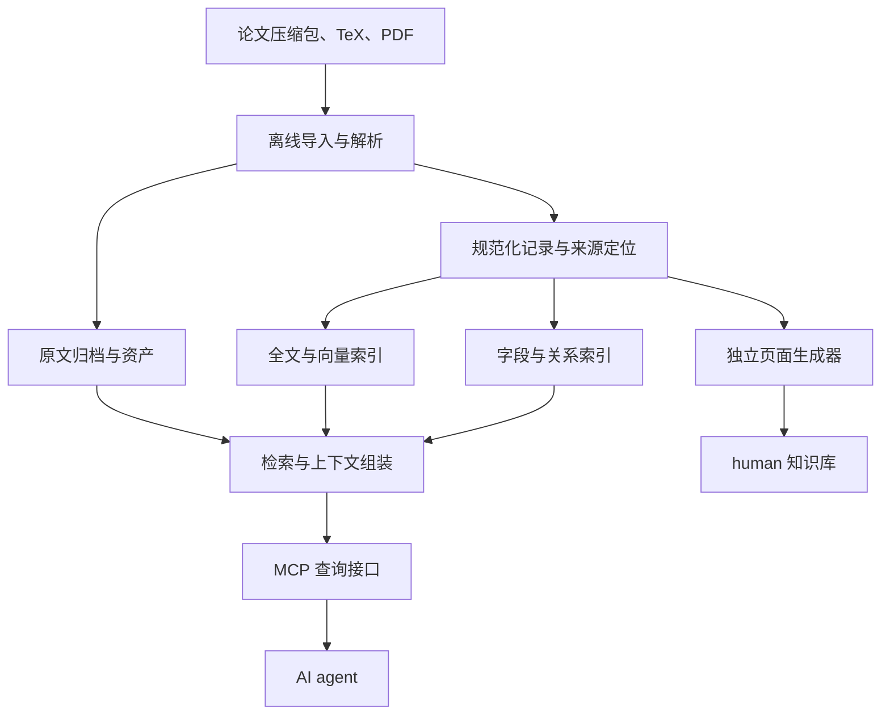

# QEC 知识库与 MCP：价值判断、架构与实施路线

日期：2026-11-11  
适用规模：几千至一万篇论文，支持持续增量维护  
用途：合并前两次讨论，供项目维护者和 Agents 参考

> 本文是一份设计总结。接口名、目录和实施阶段均为建议，不代表当前代码已经实现；没有对现有仓库进行实现审计，也没有完成容量或查询性能实测。公开案例用于说明接口与工作方式，不用于推断厂商未公开的内部架构。

## 1. 总体判断：值得做，但需要验证收益

建议继续建设 qec-graph，并把重点放在“准确找到证据、保留研究条件、支持反复查询和维护”上。

推荐组合为：**原文归档 + 可追溯的 QEC 结构化记录 + 全文与向量检索 + 类型化关系 + 上下文组装 + 少量稳定的 MCP 工具**。

### 1.1 什么时候比直接把论文交给 AI 更有价值？

| 任务 | 更合适的起点 | 建设知识库的主要收益 |
| --- | --- | --- |
| 阅读少量指定论文、解释一个章节 | 直接提供原文 | 额外结构化的收益可能有限 |
| 在大量论文中寻找相关材料 | 原文检索，再读取上下文 | 减少反复浏览和上下文装载 |
| 跨论文查询码参数、距离界、构造和实验结果 | 原文检索与结构化查询结合 | 精确筛选条件，减少错误拼接 |
| 比较 circuit-level LER | 绑定实验条件的性能记录 | 同时检查噪声、电路、decoder 和指标定义 |
| 长期更新、追踪论文版本和软件使用 | 版本化记录与来源定位 | 支持增量处理、修正和可重复查询 |
| 为 Lean 构建准备材料 | 定义、假设、依赖和原文映射 | 更容易组织形式化任务和核查出处 |

“把论文交给支持文件检索的 AI”本身是合理的基线。只有当领域结构改善了实际任务中的正确性、覆盖率、证据质量或维护成本，额外复杂度才有依据。

### 1.2 哪些做法不会自动带来收益？

- 切出更多文件、建立更多节点，并不保证检索更准。
- 摘要或模型提取的字段可能遗漏限定条件，不能替代原文。
- 过细切片可能把结论与定义、假设、图注分开。
- 向量相似不等于参数满足，也不等于数学依赖。
- 如果只查询已提取字段，尚未完成提取的论文会被静默漏掉。

因此，**原文检索和直接阅读应始终可用**；图关系与领域字段作为补充能力。不要预先假定复杂 GraphRAG 一定优于简单的检索加阅读。

## 2. 主流知识型 MCP 的公开实践

MCP 定义工具调用和资源访问等接口；切片、数据建模、检索、排序、版本与证据处理仍由知识服务实现。[工具规范][1]与[资源规范][2]可作为协议层参考。

| 团队 / 服务 | 可从官方资料确认的做法 | 对 qec-graph 的启发 |
| --- | --- | --- |
| [OpenAI 知识接入指南][3] | 特定知识工作流使用只读的 `search` 和 `fetch` | 先搜索，再读取完整条目，提供可引用来源 |
| [Microsoft Learn MCP][4] | 文档搜索、文档读取、代码示例搜索各有明确入口 | 按任务设计工具，共享查询后端 |
| [Context7][5] | `resolve-library-id` 确定对象，`query-docs` 查询该对象的文档 | 先消除码、软件、论文和版本的歧义 |
| [DeepWiki][6] | 提供结构读取、内容读取和问答工具 | 允许 agent 先看目录与对象列表，再展开内容 |
| [Anthropic 工具设计建议][7] | 强调清晰的输入输出、上下文效率和真实任务评测 | 控制返回量，提供分页、过滤、明确错误和有效描述 |

可借鉴的共同流程是：**定位对象 → 获取少量候选 → 阅读完整证据单元 → 按需展开上下文**。

注意边界：

- `search/fetch` 是特定兼容接口的约定，并非所有 MCP 必须使用的工具名。
- 一万篇论文不对应一万个工具；数据规模增长，任务工具数量可以保持稳定。
- Context7 的文档 API 在指定版本未索引时可能显式回退，并报告实际提供的版本，见[版本行为说明][8]。QEC 证据建议更严格：指定论文 v2 时，缺失就报告缺失，不静默改用 v3。
- 问答工具可以辅助使用，但定理和数值结果仍应提供可直接读取的原文证据。

## 3. 面向万篇论文的架构与技术选择

### 3.1 总体架构

三项职责要分开：

1. **离线入库**：归档、解析、切片、字段提取、关系构建和索引更新。
2. **在线查询**：搜索、精确过滤、证据读取、有限关系展开和上下文组装。
3. **人类阅读视图**：由独立程序生成，保持单向的数据来源。

普通查询不应同步触发全库重建或长时间论文提取。查询向量生成、可选重排可以在线执行，但要有预算和耗时记录。MCP 服务不必在内部再运行一个负责回答所有问题的 LLM。

### 3.2 用检索单元估算规模

以下仅为规划假设，需用真实语料校准，也不代表应强制每篇切成固定数量：

| 项目 | 示例假设 |
| --- | --- |
| 论文数 | 10,000 |
| 每篇检索单元数 | 平均 25–100 |
| 总检索单元数 | 250,000–1,000,000 |
| 向量维数 | 768–1536 |
| 数值类型 | float32，每维 4 bytes |

纯向量数值大小为：

$$
S = N_{\mathrm{units}}\times d_{\mathrm{embedding}}\times 4
\approx 0.77\text{–}6.14\ \mathrm{GB}.
$$

该估算不含向量索引、文本、数据库开销、图片、矩阵、多版本和备份，不能据此承诺内存需求或查询延迟。需要先测量片段数量分布、资产体积、查询并发和重建成本。

### 3.3 技术栈建议

| 场景 | 建议起点 |
| --- | --- |
| 个人安装、本地维护 | Python package、文件归档、SQLite、FTS5，以及可选的本地向量检索模块 |
| 研究组共享 | 查询服务与入库 worker 分开，根据写入并发和运维需求选择 SQLite 或 PostgreSQL |
| 稳定多人服务 | PostgreSQL、pgvector、全文检索；大型资产保存在文件或对象存储中 |

SQLite 同一数据库文件同一时刻只支持一个写入者，但应用服务器和数据库位于同一机器时仍可能适用，见[官方适用场景][9]。SQLite FTS5 提供 BM25 等全文检索能力；PostgreSQL 原生全文排序提供 `ts_rank` 和 `ts_rank_cd`，不能直接称为原生 BM25，分别见[FTS5][10]和[PostgreSQL 文档][11]。

建议先实现当前需要的后端，稳定共享查询接口；不要仅因目标达到万篇就要求同时部署专用图数据库、独立向量数据库、Redis 和 Kubernetes。

本地可通过 stdio 启动 MCP 进程；共享部署可通过 Streamable HTTP 提供服务，这两种方式均由[官方传输规范][13]定义。容器按职责拆分为查询服务、入库 worker 和可选数据库；人类页面生成器独立运行。SDK 和协议版本需要与实际客户端验证兼容。

## 4. 知识与文件应该如何组织？

### 4.1 三种访问粒度

| 粒度 | 保存内容 | 使用目的 |
| --- | --- | --- |
| 论文 | 标题、作者、版本、摘要、目录、对象和实验列表 | 判断相关性、选择阅读入口 |
| 章节 | 连续正文、段落顺序、局部定义、公式与图表引用 | 恢复语境 |
| 证据单元 | 定义、定理、构造、参数声明、图表、实验结果及来源位置 | 精确检索、引用、比较 |

**检索单元与阅读上下文分开**：可以用小单元定位，但阅读一个结果时，应能补齐相关定义、假设、图注、实验方法和依赖。

每个单元保留稳定 ID、所属论文版本、父章节、顺序、原文定位、原始 LaTeX 与适合检索的文本。用于搜索的规范化表示不能覆盖原始公式和符号约定。

### 4.2 三个 Graph 的职责

| Graph | 关系内容 | 语义要求 |
| --- | --- | --- |
| SourceGraph | 章节包含、文档顺序、引用、来源支持、版本关系 | 论文引用另一篇，不自动构成某个具体结论的支持 |
| LemmaGraph | 使用定义、假设依赖、作者明确引用、候选依赖、形式化依赖 | 模型推测、作者陈述与实际形式化依赖分别记录 |
| DataGraph | 码实例、呈现、距离声明、电路、噪声、decoder、实验、性能点、软件使用 | 同一篇论文中出现的对象，不自动属于同一个实验 |

三者共用实体 ID、来源体系和类型化关系，不必对应三个 MCP 服务或三个数据库。关系至少记录起点、终点、类型、证据、状态和版本。

### 4.3 重点保存“带条件的结论”

| 对象 | 最低限度的重要内容 |
| --- | --- |
| Code / Presentation | 量子码参数、分类、具体实例与呈现、构造、校验矩阵或资产、check weight 及其定义 |
| DistanceClaim | 数值或表达式、exact/lower/upper/interval、计算或证明方法、作用对象、来源 |
| NoiseModel / Instantiation | 精确定义、参数含义、作用位置、idling 与 loss 的处理、已知与未知条件 |
| CircuitProtocol | syndrome extraction 方式、调度、深度及计数约定、辅助比特、轮数、相关距离声明 |
| ReportedExperiment / PerformancePoint | 实验配置、噪声实例、decoder、指标、选定点、数据来源与不确定性 |
| SoftwareUsage | 软件身份、仓库与文档、论文中的使用方式、实际已知版本或 commit、实验关联 |
| HardwareAssumptions | 论文报告的连接、门集合、移动与并行限制、时序和误差假设；缺失明确保留 |
| Lemma / Formalization | 原陈述、定义、量词、假设、依赖、来源；已有形式化的声明名、版本和检查结果 |

关键约束：

- 查询 $d\geq12$ 时，精确值或足够大的下界可以支持匹配；仅有上界不能支持该判断。
- code distance 和 circuit-level distance 分别记录。
- LER 必须绑定码、电路、噪声、decoder 和指标定义；每轮错误率与整次实验失败率不能直接混用。
- 论文直接报告、图中读数、插值、重新模拟的结果分别标注方法和来源。
- `未提取`、`未报告`、`明确排除`、`解析失败`、`不适用`不能合并为 `false` 或 0。
- 不用软件当前最新版反填论文使用版本；不知道就记录未知。

### 4.4 文件组织

下表表达职责分工，已有路径不必照此重命名。

| 位置 | 内容 | 定位 |
| --- | --- | --- |
| `inputs/` | 待导入的压缩包 | 临时入口 |
| `sources/` | 原包、展开的 TeX、PDF、原始图片与资产 | 按论文与版本归档 |
| `records/` | 规范化论文、码、定理、实验等记录 | 主记录 |
| `annotations/` | 修正、补充和冲突处理记录 | 保留维护历史 |
| `indexes/` | 查询数据库、全文和向量索引 | 可重建的投影 |
| `releases/` | 记录修订、资产和索引引用清单 | 固定查询版本 |
| `human/` | 阅读页面与个人笔记 | 独立的人类视图 |

一百万个片段不必生成一百万个 Markdown 文件。派生正文块可按论文版本保存为 `blocks.jsonl` 等批量文件，或保存于可重建查询投影；适合人工维护的实体可保留为独立 JSON。Agent 正常通过索引和 ID 读取，无需每次遍历全部文件。

明确一套主数据：如果继续采用文件优先设计，数据库应由记录和修正生成；未来切换为数据库主数据时，需要明确迁移。避免两套可独立修改、互相覆盖的“最终版本”。

## 5. 检索与上下文组装

建议查询核心同时支持：

1. **关键词检索**：处理术语、软件名、标签、编号和精确短语。
2. **向量检索**：补充表述不同但语义相关的候选。
3. **结构化查询**：处理参数、距离界、噪声条件、实验关系。
4. **关系展开与原文读取**：恢复定义、假设、图注、方法和证据链。

候选合并后按任务重排，并控制同一论文、版本或实验的重复结果。未完成领域提取的论文仍保留原文候选路径；确认匹配与待核查候选分别返回。

### 5.1 两种查询语义

- **找相关材料**：允许 top-k 检索，目标是发现有用证据。
- **找所有符合条件的记录**：使用明确范围内的字段筛选、关系连接和完整分页，报告覆盖情况。

不能把向量检索前几十条称为“所有结果”。[pgvector 官方文档][12]也说明，近似索引结合过滤可能因扫描后过滤而减少返回结果；迭代扫描仍有预算限制。因此需要测试真实筛选条件下的召回，不能只测无过滤搜索。

### 5.2 示例工作流

问题：“找到 $n\leq1000$、$d\geq12$、考虑 idling error 的 CSS 码，并比较在 $p=10^{-3}$ 时的 circuit-level LER。”

应依次完成：

1. 明确 $n$、$d$、$p$ 和 LER 的含义；无法确定的条件显式呈现。
2. 从已提取记录中进行参数、距离声明和实验条件筛选。
3. 同时搜索原文，补充尚未结构化的候选。
4. 为性能点补齐噪声、电路、decoder、图注和指标定义。
5. 返回可比较的分组、原文证据、版本、未知项和查询范围。

论文没有报告目标物理错误率处的结果时，不自动创造一个点；任何读图、插值或新模拟结果必须单独说明。

## 6. MCP 接口建议

### 6.1 通用兼容配置

针对 [OpenAI 文档所述知识工作流][3]，遵循其 `search(query)`、`fetch(id)` 兼容格式：前者返回条目 ID、标题、canonical URL，后者读取该条目的完整文本。

条目可以是论文、章节或明确定义的证据单元。若条目是一节，返回完整章节并标明范围；不要把截断内容称为整篇全文。内部资源 URI 与对外引用 URL 分开：`qec://...` 可以作为内部标识，对外提供真实的论文或证据页面链接。

### 6.2 QEC 研究配置

建议第一版采用以下七个工具，共用一套查询核心；名称是建议，不代表已实现。

| 工具 | 职责 |
| --- | --- |
| `qec_search` | 混合检索，支持对象类型、来源范围和结果数量 |
| `qec_fetch` | 按 ID、版本和视图读取记录、原文、章节或目录 |
| `qec_get_context` | 按用途和预算组装完整研究上下文 |
| `qec_query_codes` | 精确查询码参数、分类、距离声明和 check weight |
| `qec_query_performance` | 连接实验条件并查询性能数据 |
| `qec_trace` | 按关系类型进行有界来源或依赖展开 |
| `qec_status` | 返回语料、处理状态、快照和字段覆盖信息 |

软件检索可先由 `qec_search(kind="software")` 承担。不要为每篇论文、每种码或每个字段新增工具。

研究结果建议包含：`entity_id`、`revision`、`source_version`、`snapshot_id`、`evidence`、`unknown_fields`、`conflicts`、`coverage`，以及适用时的 `next_cursor`、`has_more` 和截断说明。

按 [MCP 工具规范][1]声明输出 schema 并校验结果。业务结果分页需要自行实现，协议的资源列表分页不会自动提供完整实验枚举。通用兼容接口保持其规定形状，丰富查询参数放在研究工具中。

### 6.3 上下文工具的重点

| 用途 | 应组装的内容 |
| --- | --- |
| 理解定理 | 陈述、假设、符号定义、相关引理、证明段落与来源 |
| 比较 LER | 性能点、指标定义、完整实验条件、图注和方法 |
| 重建校验矩阵 | 构造、参数、约定、算法、资产或代码引用 |
| 准备 Lean | 定义、类型与量词、假设、依赖、原始 LaTeX、已有形式化映射 |

MCP 返回预算应围绕任务设置，分页和截断必须可见。大矩阵或完整数据集通过资产读取方式提供，不在每次搜索中展开。

## 7. 增量维护与 human 边界

### 7.1 所有用户材料都可登记

不设置“正式接纳论文”或人工批准后才可检索的门槛。预印本、论文、用户资料均可登记；提取状态和证据性质作为元数据，供用户自行判断。

先完成全库的登记、归档、基础解析与搜索，再逐步完善高成本的实验提取和形式化映射。解析失败的材料仍保留原包、身份和状态；只能检索元数据时，应明确说明全文尚不可搜索。

### 7.2 建议命令职责

| 命令 | 建议语义 |
| --- | --- |
| `qec-graph init` | 创建工作区，并可处理已有 `inputs/` |
| `qec-graph sync` | 增量导入新材料与新版本 |
| `qec-graph rebuild` | 根据已归档来源重建所需派生结果，并复用有效缓存 |

如现有实现已有不同名称，可保持兼容；关键是区分导入新材料与重建索引。成功归档、验证和提交后才消费对应输入压缩包；失败输入保留并报告状态。

缓存判断绑定源内容哈希、解析器、schema、提取模型与提示、embedding 模型及索引配置。变化只重算受影响内容。同维数的不同 embedding 模型也不能无声混用。

查询固定快照，原始论文版本不被覆盖。发布清单可以引用未变化资产，不需要每次复制全部原文和向量。

### 7.3 human 只供人类阅读

- `human/` 不进入全文、向量或图索引，不通过 MCP 暴露。
- 查询进程只挂载允许的机器数据目录。
- 独立页面生成器写入人类视图；个人笔记不自动回流为事实。
- 如需把人类修正纳入知识库，使用明确的修正入口和来源记录。

如果 agent 还拥有整个工作区的 shell 权限，MCP 排除 `human/` 并不能阻止直接读文件；需要实际的目录挂载、账户权限或隔离环境。文字约定本身不足以实现访问限制。

## 8. 如何判断知识库确实更好？

### 8.1 公平比较三个基线

| 方案 | 做法 | 要回答的问题 |
| --- | --- | --- |
| A | 对适合上下文范围的任务，直接提供原文阅读 | 小规模指定论文任务是否需要额外结构？ |
| B | 在原文上搜索，再读取相关内容 | 简单检索加阅读已经能解决多少问题？ |
| C | 在 B 上加入 QEC 字段、关系与上下文组装 | 领域结构增加了多少可验证收益？ |

使用同一语料版本、模型和明确的成本预算，记录各方案得到的输入。A 不适合装入全部万篇时应说明边界，而不是用不可能完成的设置故意削弱它；B 也应允许合理的全文阅读和检索优化。

### 8.2 重点评测指标

- **正确性**：距离界、码距与电路距离、实验条件、指标是否混淆。
- **证据质量**：引用能否定位，来源是否支持结论，版本是否一致。
- **覆盖与召回**：相关论文和关键证据是否找到，未结构化材料是否仍可发现。
- **上下文完整性**：定理的假设、性能点的条件是否齐全。
- **不确定性处理**：未报告、未提取、冲突和缺失是否明确。
- **使用成本**：调用次数、返回 token、查询耗时和失败率。
- **维护成本**：新论文、新版本、修正字段和全量重建所需时间。

可先准备 50–100 个真实 QEC 问题作为评测起点，再随项目增长。这是实施建议，不是行业标准。记录可观察的工具调用和结果，不需要依赖模型隐藏推理过程。

## 9. 实施优先级与 Codex 交付要求

### 阶段一：完成原文检索闭环

选取代表性论文，完成归档、版本定位、结构切分、全文搜索、读取、上下文展开和来源引用，提供通用兼容接口。首先验证 agent 能否准确找到和读到证据。

### 阶段二：增加 QEC 精确查询

优先完成距离声明、实验条件绑定、性能点、软件使用和定理上下文。保留原文候选路径，以 B 与 C 的比较验证领域建模收益。

### 阶段三：扩展到千篇和万篇

测量切片和资产分布、带条件召回、并发、p50/p95 延迟、增量耗时、重建时间及磁盘峰值，再决定是否增加独立搜索引擎、向量服务或图数据库。

### 给 Codex 的验收重点

1. 先阅读现有代码，区分已实现、部分实现和缺失功能，不因本文目录示例盲目重构。
2. 保留现有原文归档、领域模型、增量导入和人类视图中有效的设计。
3. 优先补齐混合检索、原文读取、上下文组装、精确查询语义与覆盖报告。
4. 验证结构化记录、证据和版本之间的一致性；搜索接口不能静默排除未完成字段提取的来源。
5. 用代表性真实任务测试关键语义、增量幂等、失败恢复和 human 访问边界。
6. 交付时列出实际实现、已通过验证、已知限制和后续工作，不把设计目标写成测试结果。

第一版的可交付目标是：**agent 从研究问题出发，找到相关材料，按条件筛选记录，读取完整证据，并明确报告尚未覆盖的部分。**

## 10. 参考资料

以下为前次调研所使用的官方资料。它们支持公开接口、协议和软件能力的描述；本文的 QEC 架构、工具命名、容量假设和阶段安排属于工程建议。

1. [MCP：Tools][1]
2. [MCP：Resources][2]
3. [OpenAI：Building MCP servers for plugins and API integrations][3]
4. [Microsoft Learn MCP：Developer reference][4]
5. [Context7：MCP Clients 与工具说明][5]
6. [DeepWiki MCP：Devin Docs][6]
7. [Anthropic：Writing effective tools for agents][7]
8. [Context7：Get documentation context 与版本行为][8]
9. [SQLite：Appropriate Uses For SQLite][9]
10. [SQLite：FTS5 Extension][10]
11. [PostgreSQL：Controlling Text Search][11]
12. [pgvector：官方仓库与过滤行为说明][12]
13. [MCP：Transports][13]

[1]: https://modelcontextprotocol.io/specification/2026-07-28/server/tools
[2]: https://modelcontextprotocol.io/specification/2026-07-28/server/resources
[3]: https://developers.openai.com/api/docs/mcp
[4]: https://learn.microsoft.com/en-us/training/support/mcp-developer-reference
[5]: https://context7.com/docs/resources/all-clients
[6]: https://docs.devin.ai/work-with-devin/deepwiki-mcp
[7]: https://www.anthropic.com/research/writing-tools-for-agents
[8]: https://context7.com/docs/api-reference/context/get-documentation-context
[9]: https://www.sqlite.org/whentouse.html
[10]: https://www.sqlite.org/fts5.html
[11]: https://www.postgresql.org/docs/current/textsearch-controls.html
[12]: https://github.com/pgvector/pgvector
[13]: https://modelcontextprotocol.io/specification/2026-07-28/basic/transports
