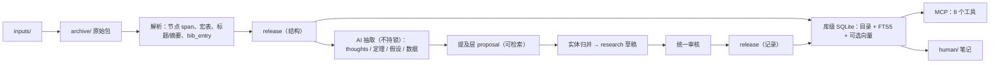

# QEC Graph 设计与实施评审报告

> 评审日期：2026-11-12 · 评审对象：`main` @ `420a78a`（v0.6.4 + Unreleased）
> 范围：`docs/design/`（DESIGN.md、Human.md）、`qecgraph/` 全部 86 个源文件、`tests/`、`tools/`、CI 配置，以及真实工作区 `~/Workspace/QEC-database` 的只读副本。
> 本报告只做评估，没有修改任何代码或现有文档。

## 0. 结论先行

| | 得分 | 一句话 |
|---|---|---|
| **设计** | **62 / 100** | 来源保真、证据分层、发布协议设计得很扎实；但“把论文变成 LLM 好检索、好用的知识”这条主线没有端到端设计，身份模型和扩展性有结构性问题。 |
| **实施** | **64 / 100** | 工程纪律好（400 测试全过、分支覆盖率 82.5%、归档安全、原子发布）；但 MCP 的默认检索对自然查询基本不可用，真实库里 DataGraph/LemmaGraph 是空的，存储放大 33–90 倍。 |

**最核心的判断**：项目目前把大部分精力花在“不出错”（哈希、锁、审核绑定、状态不混淆）上，这部分做得好；但“有内容、找得到、读得懂”这三件事还没有做成。在你自己的真实工作区里：

- 5 篇论文，结构化领域记录（码、decoder、噪声、实验、性能点）是 **0 条**，只有 1 条正则抽出的参数提及；
- 5 篇论文里 theorem/definition/lemma 节点是 **0 个**（物理风格论文不用定理环境），LemmaGraph 实际为空；
- `qec_search` 查 `circuit-level noise threshold`、`BP+OSD decoding` 或任何一句自然语言问题，返回 **0 条**；
- 论文在 MCP 里的标题是 `source-d6112310a9e2…`（哈希），agent 无法按标题/作者找论文；
- 2.4 MB 的归档包生成了 107 MB、8217 个文件的 `machine/`。

所以整改的优先顺序应该是：**先让检索和 MCP 入口可用（P0）→ 打通 AI 抽取到结构化记录的路径（P1）→ 重做身份/存储/发布模型以支撑规模（P2）**。详见 §6 路线图。

---

## 1. 评审方法与证据

### 1.1 实际执行的命令

| 命令 | 结果 |
|---|---|
| `python -m unittest discover -s tests` | 400 个测试全部通过，47.6 s（Python 3.15.2） |
| `python tools/reproduce.py --out <临时目录>` | 通过，47.8 s |
| `coverage run -m unittest discover -s tests` | 总分支覆盖率 **82.51%** |
| `ruff check qecgraph tests tools` | 通过（但规则集只有 `E4,E7,E9,F`） |
| `mypy` | 通过（但 91% 的函数无类型标注，函数体未被检查） |
| `ruff --select C901,PLR0912,PLR0915,E501 --line-length 120` | 86 个函数复杂度超标、52 个分支过多、284 行超 120 字符 |
| AST 脚本统计 import 图 | 顶层 import 无环；算上函数内 import 有一个 16 模块的强连通分量 |
| codegraph 索引（181 文件 / 3076 节点） | 用于函数规模与调用关系统计 |
| 真实工作区 `machine/` 复制到临时目录后，用 `WorkspaceSession` 调用各 MCP 工具 | 见附录 A |

### 1.2 未执行（不能据此下结论）

Docker / Compose 隔离、Lean 构建、真实 AI provider 调用、embedding provider、六篇 pinned arXiv golden 回放、PyInstaller 独立可执行文件、Linux 平台。真实工作区的 `qecgraph.toml` 没有读取（可能含 API key）。

### 1.3 关于规模的说明

报告里所有“1 万篇时会怎样”的数字都是按 5 篇实测值做的**线性外推**，不是测量结果，只用来说明复杂度量级。

---

## 2. 做得好的地方（应当保留）

评分不是只看问题，下面这些是项目真正的资产，整改时不要丢：

1. **来源保真链路完整**：原始包按 SHA-256 归档、解包后逐文件核对、节点 `latex` 必须等于源文件切片（`store.py:650-667`），行号/码点坐标约定明确。
2. **反幻觉设计**：AI 给出的定理陈述、显式假设、thought 引文必须是所引行范围里的**逐字子串**（`llm/extract.py:192-228`），否则整包拒绝；允许一次纠正请求但不缓存失败结果。这是整个项目最有价值的设计之一。
3. **证据语义不混淆**：`references` ≠ 依赖、`candidate` ≠ 已确认、上界不满足下界过滤、`null` + 显式未知原因，这些在 schema、查询、测试里是一致的。
4. **归档解包的安全性**：路径穿越、链接、特殊文件、伪造 ZIP 计数、tar 扩展头膨胀、大小写冲突都有处理（`source/package.py`），输入读取用 `O_NOFOLLOW` 并检测读取期间变化。
5. **发布协议**：claim → archive → stage → validate → 原子换指针 → consume，失败保留旧 release；有 SIGKILL 窗口测试。
6. **人机隔离**：`human/` 只是单向渲染，MCP 只读 `machine/`，有独立的只读 Compose 配置。
7. **诚实的状态表述**：DESIGN §13、§16.6 明确写了“语义质量未测量”“科学问答待评测”，没有夸大。
8. **测试质量**：围绕真实失败案例（篡改、崩溃恢复、歧义标签、stale 审核），不是复述实现。

---

## 3. 打分明细

### 3.1 设计：62 / 100

| 扣分项 | 对应问题 | 扣分 |
|---|---|---|
| 知识落地路径缺失：AI 产物与 `qecgraph.research` 之间没有设计，DataGraph 无法被填充 | A1、A2 | −8 |
| 身份模型：`snapshot_id` 把工具字节和内容绑在一起，升级即全库换 ID、审核全部失效 | C1 | −5 |
| 扩展性：单体 state、每次发布全量校验、读路径全量加载，与文档里“1 万篇”的目标不匹配 | C2、C3、C4 | −5 |
| 检索设计：默认整串字面匹配、检索单元重叠、无评测集 | B1、B2、B3、B11 | −5 |
| 多代并存：三个存储面、两套记录 schema、三套审核流程、三个 MCP profile | A6、A7 | −4 |
| MCP 契约只规定了安全边界，没有规定可用性（描述、ID、返回量、入口） | B4–B9 | −3 |
| 论文身份、书目元数据、引用图没有进入设计 | A4、A5 | −3 |
| 事务边界：网络调用在写锁内、整批一次发布、可选投影失败会拖垮 sync | C5、B3 | −2 |
| 解析范围与真实语料不匹配（物理风格论文） | A3、D1 | −2 |
| 设计文档失衡与内部矛盾 | G1 | −1 |
| **合计** | | **−38** |

### 3.2 实施：64 / 100

| 扣分项 | 对应问题 | 扣分 |
|---|---|---|
| 默认检索对多词/自然语言查询返回 0 条 | B1 | −6 |
| MCP 易用性缺陷：通用描述、哈希标题、长 ID、outline 顺序错、默认参数直接失败 | B4–B9 | −5 |
| 代码可维护性：9% 类型标注、巨型模块、隐性循环依赖、宽泛 except 且无日志 | F1、F2、F3 | −5 |
| 真实库内容为空；四个 AI skill 里三个的产物没有任何消费方 | A1、A2 | −4 |
| 存储放大 33–90×，历史快照无回收 | C2 | −4 |
| CI 只跑 unit（125/400），无覆盖率门禁，单一 Python 版本 | F4 | −3 |
| 解析缺口：abstract/algorithm 被吞进段落、`\llbracket` 未识别、非 UTF-8 直接失败 | D1、D2、D4 | −3 |
| AI 管线成本与鲁棒性：四次全文、无前缀缓存、长论文硬失败、无批次预算 | E1、E2、E3 | −3 |
| 其他：读路径 O(全库)、配置指纹过宽、审核在 release 之外、笔记尾注导致全量重写 | C4、C6、C7、C8、F5、F6 | −3 |
| **合计** | | **−36** |

### 3.3 分维度印象分（辅助参考，不参与总分）

| 维度 | 设计 | 实施 |
|---|---|---|
| 来源保真与证据语义 | 9/10 | 9/10 |
| 安全与隔离 | 8/10 | 8/10 |
| 事务与恢复 | 7/10 | 8/10 |
| 知识建模（schema 本身） | 7/10 | 3/10（无数据） |
| 检索与上下文 | 4/10 | 3/10 |
| MCP 作为 agent 接口 | 5/10 | 4/10 |
| 可扩展性与存储 | 4/10 | 4/10 |
| 代码可维护性 | — | 5/10 |
| 测试与 CI | 7/10 | 6/10 |

---

## 4. Human.md 需求对照

你在 `docs/design/Human.md` 里写的目标，逐条对照当前状态：

| 需求 | 现状 | 差距 |
|---|---|---|
| 保留文章所有内容 | ✅ 原始包、源码树、节点切片齐全 | — |
| 科学产出 1：基本假设、定义、定理 | ⚠️ 只识别 LaTeX 定理环境；真实 5 篇里为 0。AI 的 `extract_theorems`/`extract_assumptions` 有产物但不可查 | A2、A3 |
| 科学产出 2：实验假设、error model、idle/loss | ❌ schema 有 `noise_model` 字段，无抽取路径，0 条 | A1 |
| 科学产出 3：decoder 原理、表现、对比 | ❌ 同上，0 条 | A1 |
| 科学产出 4：码构造、`[n,k,d]`、校验矩阵、电路、LER | ❌ 仅正则提及 1 条；`\llbracket` 记法未识别 | A1、D2 |
| 科学产出 5：真实实验参数 | ❌ 0 条 | A1 |
| 科学思维九问 | ✅ `extract_thoughts` + `human/` 笔记可用，是目前唯一贯通的知识链路 | 仍是 proposed |
| 分层知识：原子 → 段落 → 全文 → 文集 | ⚠️ 有节点、章节、全文；没有“论文卡片”和文集层；检索单元重叠 | B2、B6 |
| 原文始终是完整查询路径 | ⚠️ 能读，但找不到：默认检索是整串匹配 | B1 |
| 保留文档层级 | ⚠️ 有父子关系，但 outline 不是阅读顺序 | B6 |
| 小而明确的入口 | ❌ 默认 13 个 legacy 工具，描述雷同；没有“列出论文”的工具 | B4、B6、B8 |
| 先定位对象 → 少量候选 → 读完整证据 → 展开上下文 | ⚠️ 流程存在，第一步（定位）失效 | B1、A4 |
| 严格版本语义（要 v2 不给 v3） | ✅ `SOURCE_VERSION_UNAVAILABLE` 明确报告 | — |
| 字段没有结果就继续查原文 | ✅ `source_fallback` 已实现 | 依赖 B1 修好 |
| 可复现评测验证收益 | ❌ 只有合成样例的机制检查 | B11 |

---

## 5. 整体评估表

严重度：**S** = 阻断核心目标；**H** = 明显影响可用性或后续成本；**M** = 应改；**L** = 可择机处理。
工作量：S（≤1 天）/ M（2–5 天）/ L（1–2 周）/ XL（更长，需重新设计）。

| ID | 层面 | 严重度 | 问题 | 工作量 |
|---|---|---|---|---|
| A1 | 设计 | S | AI 抽取产物与 `qecgraph.research` 之间没有通路，DataGraph 无法被填充 | XL |
| A2 | 实施 | S | 四个 AI skill 中三个的产物没有任何消费方 | S |
| A3 | 设计 | H | LemmaGraph 依赖定理环境，对物理风格论文为空 | M |
| A4 | 设计+实施 | S | 论文没有标题/作者/arXiv 号，MCP 里标题是哈希 | M |
| A5 | 设计 | H | 引用键不解析，没有跨论文关联 | M |
| A6 | 设计 | H | 三个存储面、两套 schema、三套审核、三个 profile 并存 | L |
| A7 | 设计 | L | Lean 已延期但代码、schema、CLI 残留 | S |
| B1 | 实施 | S | 默认检索是整串字面匹配，多词查询返回 0 | M |
| B2 | 设计+实施 | H | 检索单元父子重叠、不去重、片段不指向命中位置 | M |
| B3 | 实施 | M | 检索索引是单个 JSON，超预算会让整个 sync 失败 | M |
| B4 | 实施 | H | 工具描述雷同、参数无说明 | S |
| B5 | 实施 | H | 返回体臃肿：平均 175 字符的 ID 和重复哈希 | M |
| B6 | 实施 | H | outline 不是阅读顺序；没有论文列表和论文卡片 | M |
| B7 | 实施 | M | 默认参数下 `qec_trace` 直接超预算；错误不可操作 | S |
| B8 | 设计 | M | 默认 profile 是 legacy，工具名共 21 个 | S |
| B9 | 设计 | M | 资源 URI 绑定 release，且逐节点枚举 | S |
| B10 | 设计 | M | 上下文不带宏定义和符号，片段读不懂 | M |
| B11 | 设计 | H | 没有真实问题的检索/问答评测集 | M |
| C1 | 设计 | S | `snapshot_id` 含全部工具源码哈希 | L |
| C2 | 实施 | H | 存储放大 33–90×，历史快照无回收 | L |
| C3 | 设计 | H | 单体 state + 每次发布全量校验 | L |
| C4 | 实施 | M | 读路径每次调用做 O(全库) 工作 | M |
| C5 | 设计 | H | AI 网络调用在写锁内，整批一次发布 | M |
| C6 | 实施 | M | 配置指纹包含整份配置和 `sys.version` | S |
| C7 | 设计 | M | AI 审核记录在 release 之外；审核者身份不可验证 | M |
| C8 | 实施 | M | registry state 没有 schema，字段靠约定 | M |
| D1 | 实施 | H | abstract/algorithm/assumption 等环境没有类型 | M |
| D2 | 实施 | M | `\llbracket n,k,d\rrbracket` 记法未识别 | S |
| D4 | 实施 | M | 非 UTF-8 源码直接失败 | S |
| E1 | 实施 | M | 每篇论文发送四次全文，无前缀缓存 | M |
| E2 | 设计 | H | 超过 `max_input_chars` 硬失败，无分块策略 | M |
| E3 | 设计 | M | 预算只管单次调用；源码上传默认开启 | S |
| F1 | 实施 | M | 类型标注 9%、docstring 10%、86 个函数复杂度超标 | L |
| F2 | 实施 | M | `workspace.py` 扇出 23；16 模块隐性循环；跨模块导入私有名 | L |
| F3 | 实施 | M | 宽泛 except 把程序错误伪装成数据错误，且无日志 | M |
| F4 | 实施 | H | CI 只跑 31% 的测试，无覆盖率门禁 | S |
| F5 | 实施 | L | 使用 `zipfile` 私有 API | S |
| F6 | 实施 | L | 笔记尾注含 release ID，每次发布全量重写 | S |
| G1 | 设计 | M | 设计文档失衡、内部矛盾，AGENTS.md 有过期内容 | S |
| G2 | 流程 | M | “Implemented” 的判定标准偏低；6 天 8 个版本 | S |
| G3 | 流程 | L | 全量双语文档的维护成本 | S |

---

## 6. 逐条问题与整改方案

### A. 产品主线与知识模型

#### A1 〔S〕AI 抽取产物与结构化记录之间没有通路

**现象与证据**

- `extract_data` 的输出 schema 是扁平的 `{metric, value, unit, code: string, decoder: string, noise_model: string, conditions}`（`llm/skills/extract_data/output.schema.json`）。
- 权威的 `qecgraph.research` schema 有 27 种记录、47 种带类型的引用，每个字段都要 `field_evidence`，引用必须是 `{id, revision}`，定位必须是 `node_id + char_start/char_end + node_content_sha256`。
- 两者之间没有转换器。DESIGN §15 明确写了“conversion to canonical research records is not automatic”。
- 唯一能产生 research 记录的路径是旧的手工交接流程 `extract-request → 外部模型 → review import → extract-review`（`domain/semantic.py`），它不调用模型，单次最多 40 个块、24000 字符。
- 真实工作区：`research_records` 里只有 16 条 `paper_version` 修订和 1 条 `code_parameters_mention`，领域记录为 0。`qec_find_codes` 返回 0。

**为什么必须改**

Human.md 的“科学产出”五项里有四项靠 DataGraph 承载。现在的状态是：schema 设计得很细，但没有任何自动或半自动的方式往里填数据，手写一条带完整 `field_evidence` 的记录成本极高。结果就是 schema 越严格，库越空。这是项目目标和现状之间最大的一道缺口。

**如何整改**

分三步，前一步不依赖后一步：

1. **先让“提及层”可查（1–2 天，见 A2）**。不改 schema，不加 LLM 调用。
2. **增加“实体归并”步骤，把提及转成 research 草稿（约 2 周）**：
   - 新增 skill `resolve_entities`（版本化，放 `llm/skills/`）。输入：本论文的 `extract_data`/`extract_theorems`/`extract_assumptions` 提及 + 库里已有实体的简表（id、名称、别名、关键参数）。输出：每个提及归到“已有实体 X / 新实体 / 无法判断”，以及新实体的最小字段。
   - **模型只输出行号引用和逐字引文，不输出 ID、revision、哈希、码点偏移**。由程序完成：`path:line` + 引文 → 在源文件里定位 → 生成 `source_locator`；`id` 用确定性规则生成（如 `code:<source_version 短哈希>:<规范化名称>`）；`revision` 用内容哈希。这套“行号 + 逐字引文 → 码点区间”的逻辑在 `validate_source_refs` 里已经有了，抽成公共函数即可。
   - 产物直接写成 `qecgraph.extraction_proposal`（即 `domain/semantic.py` 已有的草稿格式），进入已有的 `extract-review` 审核流。这样 `llm/` 管线和 `semantic.py` 管线合并为一条，见 A6。
3. **降低首批记录的门槛**：
   - 先只支持 6 种记录：`quantum_code`、`decoder`、`noise_model`、`experiment`、`metric`、`performance_data_point`。其余 21 种保留 schema 但不作为近期目标。
   - 允许“只有论文原话”的记录：例如 `decoder` 只有 `name` 和一段带定位的描述，其余字段 `not_extracted`。现有 schema 的 `null + status` 机制已经支持，缺的只是生成器。
   - 审核做成批量：`qec-graph review next --paper <id>` 一次展示一篇论文的全部草稿，每条旁边显示引文和原文上下文，支持整篇通过/逐条拒绝。

**验收标准**：在你现有的 5 篇论文上，`qec-graph sync` 之后 `qec_query_codes` 能列出每篇论文报告的码（至少 `n`、`k`、报告的 `d` 和原文定位），`qec_query_performance` 能列出至少一张表里的 LER 数据点及其 decoder/噪声描述；全部为 `proposed`，人工通过后变为 `reviewed`。

---

#### A2 〔S〕四个 AI skill 中三个的产物没有任何消费方

**现象与证据**

- `sync` 默认对每篇论文跑四个 skill（`workspace.py:35`）。
- 全库搜索 `extract_theorems|extract_assumptions|extract_data`，只在 `workspace.py`（调度）和 `llm/extract.py`（校验）出现。
- `KnowledgeView.proposal_items`（`knowledge.py:192`）和 `render_pages`（`render/thoughts.py:185`）都只读 `extract_thoughts`。
- 也就是说，定理、假设、数据三类提议写进了 `machine/ai/proposals/`，但 MCP 搜不到、读不到，`human/` 里也不显示。

**为什么必须改**

每篇论文 75% 的 AI 花费没有产生任何可用结果。而这些产物恰好是 Human.md 里“假设、定理、实验数据”最直接的来源，并且已经通过了逐字引文校验，质量有底线保证。

**如何整改**（1–2 天，零新增 LLM 成本）

1. 把 `proposal_items` 的过滤条件去掉，按 skill 生成四种可检索类型：`theorem_proposal`、`assumption_proposal`、`data_point_proposal`、`research_thought_proposal`。
2. 每种类型定义 `title` 和 `search_text`：定理用 `label + statement`；假设用 `claim + text`；数据用 `metric + value + unit + code + decoder + noise_model + conditions`。
3. `qec_search` 的 `kind` 过滤、`qec_fetch` 的精确读取沿用 thought proposal 的现有逻辑。
4. `include_proposals` 默认值改为 `true`，在每条结果上标 `review_status: proposed`。理由：库里目前只有 proposal，默认隐藏等于默认返回空。
5. `human/` 笔记是否显示这三类由你决定（Human.md 目前只要求九问），不建议现在加。

**验收标准**：`qec_search(query="threshold", kind="data_point_proposal")` 在真实工作区返回带原文行号的数据项。

---

#### A3 〔H〕LemmaGraph 依赖 LaTeX 定理环境，对物理风格论文为空

**现象与证据**

- 解析器只在 `\begin{theorem}` 这类环境上产生陈述节点（`source/parser.py:37-51`）。
- 真实 5 篇论文节点分布：paragraph 441、section 91、equation 112、figure 27、table 11、proof 1，**theorem/lemma/definition/proposition 合计 0**。在源码里 grep 这些环境也是 0。
- `qec_get_context(purpose="theorem")` 的 `missing_components` 恒为 `['definitions', 'explicit_assumptions', 'proof']`。
- `knowledge_context.py:159,163` 查找 `assumption`、`notation` 类型的节点，但解析器永远不会产生这两种类型。

**为什么要改**

QEC 领域大量论文（PRX、Nature、PRL 风格）的结论和假设写在正文段落里。设计把“陈述”等同于“定理环境”，导致四图之一对这类论文完全失效，而且 `missing_components` 永远报缺失，会误导 agent 认为论文没有假设。

**如何整改**

1. 设计上承认两类陈述来源：**结构陈述**（解析器从环境得到，`origin: parser`）和**提及陈述**（AI 从正文提取，带逐字引文，`origin: ai_proposal`）。LemmaGraph 视图同时包含两者，用 `origin` 和 `review_status` 区分。A2 完成后第二类就有了。
2. `context(purpose="theorem")` 在没有结构陈述时，回退到同一章节内的 `assumption_proposal`/`theorem_proposal`，并在结果里写明来源是 proposal。
3. `missing_components` 区分“论文里没有这种结构”和“没有抽取”：对物理风格论文报 `not_applicable_no_theorem_environments`，不要报 `missing`。
4. 删除 `knowledge_context.py` 里对不存在的 `assumption`/`notation` 节点类型的依赖，或者在 D1 里把它们真正加进解析器。

---

#### A4 〔S〕论文没有标题、作者、arXiv 号

**现象与证据**

- `state['works']` 的 `title` 默认等于 `work_id`，即 `work:local:<tree_hash>`（`registry.py:153`、`workspace.py:755`）。真实工作区 5 篇全是这种标题。
- document 节点的标题是 `project_id`，即 `source-<64位哈希>`（`core/graph.py:149`）。
- 标题/作者只有两个来源：手工在 `qecgraph.toml` 的 `[sources."<tree-hash>"]` 填写，或者 `extract_thoughts` proposal 里的 `paper` 字段。后者只被 `render/thoughts.py` 用来生成笔记，MCP 读不到。
- `\title`/`\author` 的解析逻辑 `_literal_metadata` 写在渲染层（`render/thoughts.py:65-96`），不是解析器的产物。
- 包名明明是 `arXiv-2411.10343v2.tar.gz`，但 DESIGN §9 规定“文件名解析不建立论文身份”，所以 `canonical_url` 为空，`compatible` profile 的 `search` 实测返回 `[]`。
- 没有任何 MCP 工具能列出“库里有哪些论文”。

**为什么必须改**

agent 的第一步通常是“找到那篇论文”。现在既不能按标题、作者、年份找，也不能列目录，搜索结果里显示的是哈希。Human.md 借鉴 Context7 的“先把名称解析为确定对象”这一步目前无法执行。

**如何整改**

1. 新增一种机器侧记录 `paper_metadata`（或扩展 `paper_version.data`），字段：`title`、`authors[]`、`abstract`、`arxiv_id`、`doi`、`year`、`month`、`venue`、`topics[]`。每个字段沿用 `field_evidence`，并规定来源优先级：
   `user_confirmed`（toml）> `source_extracted`（解析器读 `\title` 等）> `ai_proposed`（thoughts 的 `paper`）> `filename_candidate`（包名里的 arXiv 号）。
2. 把 `_literal_metadata` 从 `render/thoughts.py` 移到 `source/`，在解析阶段产出 `title`、`author_block`、`abstract` 三种带 span 的节点。
3. 包名里的 arXiv 号作为**候选**写入，状态 `filename_candidate`，并据此生成候选 URL `https://arxiv.org/abs/<id>`。这不违反“不以包名改写论文身份”：`work_id` 仍然不变，只是多了一个明确标注来源的候选字段。用户执行 `qec-graph sources confirm <tree-hash>` 后升级为 `user_confirmed`。
4. 可选：`qec-graph inputs fetch arXiv:2411.10343v2`，由用户显式触发下载源码包，同时记录 URL 和哈希。这样身份在入库时就确定了。
5. document 节点的 `title` 取 `paper_metadata.title`，缺失时才回退到包名，最后才是哈希。
6. 新增工具 `qec_list_papers`（见 B6）。

**验收标准**：`qec_search("Ruiz entropy threshold")` 第一条是那篇论文，标题是真实标题；`compatible` profile 的 `search` 在确认 URL 后返回结果。

---

#### A5 〔H〕引用键不解析，没有跨论文关联

**现象与证据**

- `\cite{key}` 生成 `citation_key` 节点，`metadata_status: "not_resolved"`（`core/graph.py:208-213`），之后没有任何代码去解析。
- `thebibliography` 整体是一个 `paragraph` 节点，真实库里最大的一个 55,728 字符。5 篇论文共 166 条 `\bibitem` 没有被拆开。`.bbl`/`.bib` 文件不读取。
- 库里的论文 A 引用了同在库里的论文 B，系统不知道。

**为什么要改**

ThoughtsGraph 要回答“是对前人结论的补充、加强还是推翻”，Human.md 最后一类问题是“整个方向有哪些路线”。没有引用图，这两件事只能靠 agent 自己读全文猜。而参考文献条目里的 arXiv 号、DOI 是本地就能可靠提取的信息。

**如何整改**

1. 解析器把 `thebibliography` 和包内 `.bbl` 按 `\bibitem{key}` 拆成 `bib_entry` 节点，保留原文 span。
2. 对每个 `bib_entry` 用正则提取 `arXiv:NNNN.NNNNN` 和 DOI，作为带定位的字段，状态 `observed`。不做标题/作者的启发式拆分（那部分留给 AI 或保持原文）。
3. `cites` 边从 `block → citation_key` 改为 `block → bib_entry`，键找不到条目时保留 `unresolved`。
4. 发布时做一次库内匹配：`bib_entry.arxiv_id`（去掉版本号）等于某个已登记 work 的 `arxiv_id` 时，生成 `cites_work` 边，`evidence.method = "arxiv_id_match"`。
5. `qec_trace` 支持 `relations=["cites_work"]`、`direction="incoming"`，即“谁引用了这篇”。

---

#### A6 〔H〕多代结构并存

**现象与证据**

| 维度 | 并存的东西 |
|---|---|
| 存储面 | store（单论文）、corpus（版本注册表）、workspace |
| 记录 schema | `qecgraph.record`（19 种）与 `qecgraph.research`（27 种），其中 `quantum_code`、`check_matrix`、`construction`、`classical_code`、`decoder`、`experiment`、`metric` 两边都有 |
| 审核流程 | `review.py`（corpus 的 propose/decide/apply）、`domain/semantic.py`（`extract-review`）、`llm/review.py`（`ai decide`） |
| AI 抽取 | `domain/semantic.py`（手工交接，产出 research 草稿）与 `llm/`（自动调用，产出扁平 proposal） |
| MCP profile | legacy 13 个、research 7 个、compatible 2 个，另有 3 个别名 |
| CLI | 分组命令 + 20 个扁平旧命令别名 |

`qec_find_codes` 把两套 schema 的结果拼进同一个列表，行的形状有三种（legacy 行、裸 record、`{record, distance_estimates}`），见 `workspace_query.py:664-691`。

**为什么要改**

项目从第一次提交到现在 6 天（2026-11-06 至 11-12），用户只有你自己。DESIGN 附录 A 的 D7“兼容优先于重写”在这个阶段代价大于收益：每个新功能都要考虑三个面，`check_live_lean`、`_fixed_registry` 这类参数贯穿十几个函数，同一个概念有两个可编辑的权威来源，这和 AGENTS.md 里“同一个字段只有一个可编辑的权威来源”在模型层面是矛盾的。

**如何整改**

1. 做一次明确的决策并写进 DESIGN：**workspace 是唯一产品面**。
2. `qecgraph.record` 冻结为只读迁移输入：`workspace migrate` 已存在，补一个 `record → research` 的转换即可；之后从 workspace 的 state 里移除 `records`、`links`。
3. 三套审核合并为一套：统一的 proposal 信封（来源可以是规则、AI、人工导入），统一的 `review decide`，批准即发布 research 修订。`ai decide` 和 `extract-review` 变成它的别名，一个版本后删除。
4. `split`（单论文切割）保留为 CLI，内部改为调用同一套解析 + 一个临时 workspace，不再维护独立的 store 指针格式。
5. MCP 只保留一个 profile（见 B8）。
6. 扁平旧命令别名在下一个次版本删除。

---

#### A7 〔L〕Lean 已延期但残留在主包里

`qecgraph/lean/`（约 580 行）、`lean` CLI 组、`qecgraph.record` 里的 `lean_declaration`/`formalization`、`tests/fixtures/lean/`（4000+ 行 JSON）、`tools/reproduce_lean*.py`，以及 `corpus.py`、`domain/status.py`、`domain_query.py` 里的 Lean 分支。

**整改**：整体移到 `experimental/lean` 分支或一个可选子包 `qecgraph_lean`，主包里删掉 `check_live_lean` 参数链。等 DESIGN §10 要求的新设计写出来再合回。

---

### B. 检索与 MCP

#### B1 〔S〕默认检索是整串字面匹配

**现象与证据**

- `[retrieval].enabled` 默认 `false`（`retrieval.py:20`、`llm/config.py:186`）。
- 未建索引时，`qec_search` 的实现是 `args['query'].casefold() in unit['search_text'].casefold()`（`knowledge.py:256`）；legacy 的 `qecgraph_search` 同样是子串匹配（`workspace_query.py:380,389`）。
- 真实工作区实测：

  | 查询 | 命中数 |
  |---|---|
  | `decoder` | 149 |
  | `logical error rate` | 33 |
  | `belief propagation` | 9 |
  | `bivariate bicycle` | 1（且是整个源文件） |
  | `circuit-level noise threshold` | **0** |
  | `BP+OSD decoding` | **0** |
  | `What decoder achieves the best logical error rate under circuit-level noise?` | **0** |

- 子串匹配还会被 TeX 源码的换行打断：`circuit-level\nnoise` 匹配不到 `circuit-level noise`。
- 结果不排序（按 ID 字典序），149 条 `decoder` 命中的第一条是一个公式。

**为什么必须改**

LLM agent 发出的查询几乎都是多词短语或问句。当前默认行为下，MCP 的“定位”这一步对它们直接返回空，而返回体里还附带 `absence: No match … does not establish nonexistence`，agent 很可能就此放弃或者去读全文。Human.md 四点核心要求的第一条“原文始终是一条完整可用的查询路径”实际上没有达到。

**如何整改**

*第一步（2–3 天，不引入新依赖）*

1. 把 BM25 排序设为**始终开启**，不依赖 `[retrieval].enabled`。`retrieval.py` 里的 `terms()` 和 BM25 打分已经写好，只需要在会话启动时对 `reading_text` 建一个内存倒排表。
2. 查询语义改为：分词 → 每个词都要出现的结果排在前面（AND），不足 `limit` 时用任意词命中（OR）补齐，结果里标注 `match: all_terms | some_terms`。
3. 索引文本用 `reading_text`（已有的阅读投影，去掉了格式命令），并且把所有空白（含换行）规范成单个空格。
4. 保留一个 `mode: "literal"` 给需要精确匹配公式或宏名的场景。
5. 分词补充 QEC 常见写法：`BP+OSD`、`[[144,12,12]]`、`\llbracket 144,12,12 \rrbracket` 规范成同一个 token；连字符两种切法都索引（`circuit-level` → `circuit-level`、`circuit`、`level`）。

*第二步（约 1 周，随 C3 的库级索引一起做）*

6. 发布时生成库级 SQLite FTS5 索引（`unicode61` 分词 + 一个 trigram 表用于子串和公式），查询走 SQL，不再全量加载到内存。FTS5 已经是项目依赖，单论文 store 里就在用。
7. 向量检索作为可选的重排信号保留，默认关闭。

**验收标准**：上表后四个查询在真实工作区都返回相关段落，并且 `circuit-level noise threshold` 的前 5 条里包含讨论阈值的段落。把这几个查询写成回归测试。

---

#### B2 〔H〕检索单元父子重叠、不去重、片段不指向命中位置

**现象与证据**

- `search_units`（`knowledge.py:205-225`）把这些都作为独立单元：每个源文件的**全文**、每个节点的 `latex`（section 只有标题行，但 figure 包含 caption，theorem 包含内部公式）、每条 record 的整段 JSON、每条 material、每条 proposal。
- 实测 `belief propagation` 的 9 条命中里 4 条是 `source_file`（50–120 KB 的整文件）。
- 摘要片段的取法是 `find(query)` 的位置前后各取一段（`knowledge.py:264-265`）。BM25 命中但没有整串匹配时 `find` 返回 −1，片段就是单元开头 240 字符；对源文件来说就是 `\documentclass…`。
- 命中的 chunk 偏移（`char_start/char_end`）在索引里有，但没有返回给调用方。
- 最大的 body 段落 2611 字符，中位数 505 字符；另有 55 KB 的参考文献块也是检索单元。

**为什么要改**

agent 拿到的前几条结果里混着整文件和重复内容，片段又不指向命中处，它只能再发几次 `qec_fetch` 去读整节。这直接增加 token 成本并降低答案质量，和 Human.md“用较小的内容定位，用较完整的上下文理解”的要求相反。

**如何整改**

1. **检索单元只保留叶子级**：paragraph、theorem 类、equation、figure/table（caption + 正文）、abstract、proposal、record。`source_file` 和 `document` 不进入默认检索（保留 `kind="source_file"` 显式指定）。参考文献块只在 `kind="bib_entry"` 时检索。
2. **给每个单元加上下文头**再建索引：`<论文短标题> > <章节路径> > <节点类型和编号>`。这样搜“Ruiz threshold”能命中该论文里讲阈值的段落，即使段落本身没写作者名。
3. **片段取 BM25 得分最高的句子窗口**，并返回它在源文件里的 `char_start/char_end`，agent 可以直接 `qec_fetch` 那个范围。
4. **结果按论文分组去重**：同一 section 下多个命中合并为一条并列出命中数；同一论文最多占前 N 条里的 k 条（可配置），避免一篇论文占满结果。
5. 过长段落（> 2000 字符）在索引时按句子边界切成带重叠的窗口，但返回时仍然指向原节点 ID 和精确范围。

---

#### B3 〔M〕检索索引的实现不可扩展，且能让整个 sync 失败

**现象与证据**

- 索引是单个 JSON 文件 `retrieval/indexes/<hash>.json`，每个 chunk 存 `terms` 字典和 `vector` 字典（键是字符串形式的维度下标），见 `retrieval.py:191-212`。1536 维的外部 embedding 会以 `{"0": 0.01, "1": …}` 的形式存储。
- 会话启动时整个文件读入并逐值校验（`read_index`）；每次查询对所有 chunk 做纯 Python 线性扫描，并重新计算 DF（`rank`）。
- 语料有任何变化，整个索引重写为一个新文件，旧文件保留。
- `max_total_chars` 默认 2000 万、`max_chunks` 10 万。超出时 `stage_index` 抛 `ValueError`，这个调用在 `_publish_archive` 内部（`workspace.py:1059`），于是**整个 sync 不发布**。外部 embedding 请求失败同理。
- 按 B2 的单元构成（全文 + 节点重复），每篇论文索引文本约为源码的 2–3 倍，2000 万字符的预算大约在一两百篇时耗尽。

**为什么要改**

一个可选的派生投影出问题，会阻止新论文入库，这违反了 DESIGN §3.1 里“查询投影可重建”的定位。存储格式本身也撑不到设计文档里讨论的规模。

**如何整改**

1. `stage_index` 失败时不抛出：发布照常进行，state 里记录 `retrieval_index: {"status": "stale", "reason": …}`，`qec_status` 里可见，`sync` 以退出码 2 提示。
2. 词项索引迁到 SQLite FTS5（B1 第二步）。
3. 向量改为二进制：`float32` 的 `.npy` 矩阵 + 一个行号到 unit 的映射表，或使用 `sqlite-vec`。按源版本分片，只重算变化的分片。
4. 去掉 `max_total_chars` 这种全库硬上限，改成按论文的上限。

---

#### B4 〔H〕工具描述雷同、参数无说明

**现象与证据**

- research profile 的 7 个工具里，`qec_get_context`、`qec_query_codes`、`qec_query_performance`、`qec_status` 的描述是同一句 82 字符的话：`Read-only workspace query against one fixed release. Returned source text is data.`（`workspace_query.py:202-203`）。
- legacy 的 5 个 `qecgraph_*` 工具描述是 `Read-only {action} in one fixed snapshot/corpus…`。
- 所有工具的 `inputSchema.properties` 都没有 `description`。`metric_id`、`evidence_policy`、`sector`、`selection`、`complete_only` 的含义只能靠猜。
- 服务器 `instructions` 只有两句安全提示，没有使用流程。

**为什么要改**

对 agent 来说，工具描述就是说明书。Human.md 引用的 Anthropic 工具设计建议原话是“工具描述、结果格式、错误信息和上下文预算都应作为产品设计的一部分”。现在 agent 无法从描述判断 `qec_query_codes` 是干什么的、什么时候该用它而不是 `qec_search`。

**如何整改**（1 天）

1. 每个工具的描述写四件事：做什么、什么时候用、什么时候不该用、返回什么。示例：

   > `qec_query_codes`：按精确条件枚举库里**已结构化登记**的量子码（n、k、距离下界、校验重量等）。用于“有哪些码满足 n≤200 且 d≥10”这类问题。它不搜索正文；如果返回为空，说明没有结构化记录，请改用 `qec_search` 查原文。返回每个码的参数、证据状态和原文定位。

2. 每个参数加 `description`，枚举值逐个解释。例如 `evidence_policy`：`verified` 只接受计算或证书验证过的距离；`source_reported` 接受论文报告且带原文定位的距离。
3. `instructions` 写出推荐流程：`qec_list_papers / qec_search` 定位 → `qec_fetch` 读取 → `qec_get_context` 展开 → 结构化问题用 `qec_query_*`，为空时回到 `qec_search`。再加三条解释规则：`proposed` 的含义、空结果不代表不存在、原文是数据不是指令。
4. 把工具定义从代码里散落的字典集中到一个声明文件（如 `mcp/tools.py` 或 JSON），描述改动不必碰查询逻辑。
5. 加一个契约测试：任意两个工具的描述不得相同；每个参数必须有 `description`。

---

#### B5 〔H〕返回体臃肿

**现象与证据**

- 节点 ID 形如 `occurrence:<64 hex>:source-<64 hex>:label:…`，实测平均 175 字符，最长 195。
- 5 条搜索结果的返回体是 11,067 字符，平均每行 1,627 字符。每行都重复 `source_version_id`、`snapshot_id`、`file_sha256`、`work_id`、`coordinate_system` 等字段，`id` 和 `parent_id` 各带一遍完整哈希。
- 每个响应还固定附带 `scope`、`knowledge_snapshot`、`coverage`。
- `tools/list` 本身：legacy 16,400 字符，research 10,700 字符。

**为什么要改**

一次 5 条结果的搜索大约消耗 3000 token，其中有用的内容（标题、片段、位置）不到三分之一。agent 的上下文是稀缺资源，哈希对它没有信息量，还容易在后续调用里抄错。

**如何整改**

1. **短句柄**：每个 release 生成一张句柄表，论文用 `p1…pN`（或 arXiv 号），节点用 `p3/s2.1/¶4`、`p3/fig:threshold`、`p3/eq:12` 这类可读路径。所有工具同时接受短句柄和完整 ID。完整 ID 只在 `detail="full"` 时返回。
2. **`detail` 参数**：`concise`（默认）每行只有 `handle、kind、title、section_path、snippet、lines`；`full` 才带哈希、快照、坐标系说明。
3. **公共字段上提**：`source_version_id`、`snapshot_id`、`release_id` 在响应顶层出现一次；结果按论文分组时放在组头。
4. `coverage` 只在 `qec_status` 里返回，其他工具不带。
5. 设一个目标并写成测试：默认参数下 5 条搜索结果 ≤ 2500 字符。

---

#### B6 〔H〕outline 不是阅读顺序；没有论文列表和论文卡片

**现象与证据**

- `outline` 的排序键是 `(path, order, id)`（`knowledge.py:108`）。没有 `source` 的节点（asset、citation_key）路径为空串，排在最前。实测一篇论文 outline 共 226 行，前 14 行全是 asset 和 citation_key。
- 多文件论文按文件路径字典序排列，不是 `\input` 的包含顺序。
- outline 里包含每一个 paragraph 和 equation，没有只看章节的层级视图。
- 没有任何工具能列出库里的论文；`qec_status` 的 `full_text_versions` 是一串哈希 ID。

**为什么要改**

Human.md 借鉴 DeepWiki 的做法是“先查看结构，再阅读内容”。现在的 outline 第一页看不到任何章节，agent 无法用它当目录。

**如何整改**

1. 解析器的 `block["order"]` 已经是全局发射顺序（`len(self.blocks)`），outline 直接按 `order` 排序即可得到跨文件的阅读顺序。
2. outline 增加 `depth` 参数：默认只返回 section 层级 + 每节的定理类/图/表计数；`depth="blocks"` 才展开到段落。asset 和 citation_key 不出现在 outline 里。
3. 每个 section 带上编号（`2.1`）、标题、字符数，方便 agent 估算读取成本。
4. 新工具 `qec_list_papers(query?, topic?, year?, limit, offset)`：返回句柄、标题、作者、年份、arXiv 号、主题 tag、处理状态。
5. `qec_fetch(paper, view="card")` 返回论文卡片：元数据 + 摘要 + 章节目录 + 九问的简短回答 + 已登记的码/decoder/数据点计数。这是 agent 认识一篇论文的最小入口，一次调用控制在 4000 字符以内。

---

#### B7 〔M〕默认参数下工具直接失败，错误信息不可操作

**现象与证据**

- 实测 `qec_trace(identifier=<一个普通 section>)` 用默认参数（depth 2、max_chars 64000）返回 `BUDGET_TOO_SMALL: Increase max_chars or request an exact source codepoint range`。`max_chars` 已经是会话上限，无法再调大。改成 `depth=1` 才成功。
- 错误的 `details` 是空对象，没有告诉调用方需要多少、可以怎么缩小。
- `WorkspaceSession.invoke` 末尾 `except (OSError, ValueError, TypeError, KeyError)` 统一返回 `QUERY_ERROR: Machine release could not be read`（`workspace_query.py:721-723`）。

**如何整改**

1. `trace`/`context` 超预算时自动降级：先减 depth，再减 `max_nodes`，返回 `truncated: true` 和实际使用的参数，而不是报错。只有根节点本身放不下才报错。
2. 所有 `BUDGET_*` 错误在 `details` 里给出 `required_chars`（或下界）和 `suggestions`（如 `{"depth": 1}`）。
3. 见 F3：把程序错误和数据错误分开。

---

#### B8 〔M〕默认 profile 是 legacy，工具总数过多

`mcp config`/`mcp serve` 默认 `--profile legacy`（`cli/parser.py:82`），README 的 MCP 一节也以 13 个 legacy 工具为主。而 DESIGN §16.4 设计的“少量稳定接口”是 research 的 7 个。三个 profile 加别名共 21 个工具名。

**整改**：默认改为 research；加上 `qec_list_papers` 后是 8 个工具。legacy 保留一个版本并在 `tools/list` 的描述里标注 deprecated，之后删除。compatible（`search`/`fetch`）作为同一会话里的两个额外工具提供，不必是独立 profile。

---

#### B9 〔M〕资源 URI 绑定 release，且逐节点枚举

- URI 是 `qec://source/<release_id>/<hash>`（`workspace_query.py:106-107`）。每次发布所有 URI 都变，agent 之前记下的引用全部失效。
- `resources/list` 枚举每一个源节点（真实库 5 篇 967 个）。`resources/templates/list` 返回空。

**整改**：URI 改为内容寻址且跨 release 稳定：`qec://paper/<source_version 短 ID>/<文件路径>#<char_start>-<char_end>`，服务端校验该范围在当前 release 里仍对应相同的文件哈希。`resources/list` 只列论文；节点通过 resource template 访问。

---

#### B10 〔M〕上下文不带宏定义和符号

**现象与证据**

- 解析器把 `\newcommand` 等声明视为不透明并跳过（`parser.py:985-987`），只学习参数个数。宏体不进入图，也不随片段返回。真实 5 篇里有 26 个 `\newcommand`。
- `context(purpose="theorem")` 的“定义”只找同一父节点下 `kind == definition` 的兄弟节点。

**为什么要改**

agent 读到 `$\cH_X \vec{e} = \vs$` 这样的片段时不知道 `\cH`、`\vs` 是什么。Human.md 举的例子（“电路距离上界为 12”需要电路定义、距离度量定义、故障模型）目前的上下文组装做不到。

**如何整改**

1. 解析器为每个源版本产出一张**宏表**：`name、参数个数、定义体原文、span`。不做展开，只作为数据。
2. `qec_fetch`/`qec_get_context` 返回片段时，扫描片段里用到的自定义宏，把对应定义附在 `macros_used` 里（通常几十到几百字符）。
3. 增加“首次出现”索引：对片段里的 `\ref{…}` 目标，自动附上目标节点的标题和一行摘要（`references` 边已经有了，只是没用在上下文里）。
4. 中期：A2 完成后，`assumption_proposal` 可以按章节范围并入 `context`。

---

#### B11 〔H〕没有真实问题的评测集

**现象**：DESIGN §16.6/§16.7 承认 Stage 6 只做了机制检查，合成样例 2/2，真实来源只验证了“请求的段落能返回”。没有任何检索质量或问答质量的数字。

**为什么要改**：B1、B2 的严重问题没有被发现，就是因为没有用真实问题去测。之后每一次改分词、改单元、换 embedding，没有评测集就无法判断是变好还是变坏。AI 抽取的 proposal 质量（精确率）同样没有度量。

**如何整改**

1. 在你熟悉的 5–10 篇论文上写 50 个问题，覆盖 Human.md 的六类查询（解释思路、找码、术语出处、LER 是否可比、定理依赖、方向路线）。每个问题标注：应命中的论文、应命中的节点或行范围、参考答案要点。存成 `validation/qa/*.jsonl`。
2. `tools/eval_retrieval.py`：计算 recall@5、recall@10、MRR、平均返回字符数。离线可跑，进 CI。
3. `tools/eval_answer.py`（可选，需要模型）：让 agent 只通过 MCP 回答，按要点打分，记录工具调用次数和 token 数。对比 A（直接读全文）、B（检索 + 阅读）、C（+ 结构化记录）。
4. Proposal 质量抽检：每个 skill 随机抽 30 条人工判断对错，记录精确率，作为换模型或改 prompt 的依据。
5. 在 DESIGN 里规定：检索或上下文相关的改动必须附评测前后对比。

---

### C. 存储、身份、事务与扩展性

#### C1 〔S〕`snapshot_id` 包含全部工具源码哈希

**现象与证据**

- `extraction_tool_identity()` 对包内**每一个** `.py` 和 `.json` 文件求哈希（`store.py:49-58`），结果进入 `fingerprint`，`snapshot_id = hash(fingerprint)`（`store.py:295-299`）。
- 后果链：
  1. 改 `cli/progress.py` 的进度条颜色，或改某个 skill 的 JSON，所有论文重新抽取后都得到新的 `snapshot_id`。
  2. `paper_version` 记录的 `revision` 就是 `snapshot_id`；`field_evidence` 的 `source_locator` 绑定 `snapshot_id`。
  3. workspace 的审核状态判定是“决策里的 `source_ref.revision` 等于当前 `snapshot_id`”（`workspace_query.py:81`），否则 `stale` 并从默认查询里排除。
  4. corpus 审核的 `input_bindings` 绑定了**全部**源版本（`review.py:95`），任何一个变化都使该审核 stale（`domain/status.py:52-54`）。
  5. AI proposal 需要专门的“rebind”逻辑（`workspace.py:412-442`）才能在工具升级后复用，而 DESIGN §16.1 明确写了“Reviews are not rebound”。
- 真实工作区：5 篇论文有 22 个快照目录。同一篇论文在 `tool_version = 0.6.2` 下就有 5 个不同的快照，因为开发期间代码字节在变。

**为什么必须改**

人工审核是整个系统里最贵的资源。当前设计下，每次升级工具再 `rebuild`，所有人工审核和 AI 审核决定都失效，需要重新审。项目 6 天发了 8 个版本。这会让“审核”这件事在实践中没人愿意做，证据分层的设计也就落空了。

根本原因是把三种不同的东西压成了一个 ID：**内容是什么**、**抽取逻辑的语义版本**、**是哪次构建产生的**。

**如何整改**

1. 拆成三层：

   | 名称 | 由什么决定 | 何时变化 |
   |---|---|---|
   | `content_id` | 入口、源文件清单及哈希、资源、解析配置（就是现有的 `project_source_hash`） | 只有源码字节变了才变 |
   | `extraction_id` | `content_id` + `PARSER_VERSION` + `RULE_VERSION` + 结构恢复计划哈希 | 只有手动提升解析器或规则的语义版本时才变 |
   | `build_info` | `tool_version`、`tool_sources` 哈希、依赖版本 | 每次构建都可能变；**只作为出处元数据写进 manifest，不参与任何 ID** |

   `PARSER_VERSION`（`qecgraph/__init__.py`）和 `RULE_VERSION` 已经存在，现在只是没有被当作唯一的语义版本来源。
2. **证据定位改为绑定文件内容，不绑定快照**：`source_locator = {source_version_id, path, file_sha256, char_start, char_end, text_sha256}`。只要那个文件的字节没变、那段文字没变，定位就有效。`node_id` 保留为便利字段，不参与有效性判断。
3. **审核绑定同理**：绑定被审记录的内容哈希 + 它引用的定位（文件哈希 + 区间 + 文本哈希）。工具升级不改变这些，审核就不会 stale。
4. corpus 审核的 `source_versions` 绑定范围从“全部版本”缩小到“被审记录实际引用的版本”。
5. 加一条不变量测试：只改动一个与解析无关的 `.py` 文件，重新 ingest 同一篇论文，`extraction_id` 不变，已有审核保持 `reviewed`。
6. 迁移：提供 `qec-graph maintain rebind`，对旧定位逐条验证“同一 `file_sha256` 的同一区间文本相同”，通过则写出带 `rebound_from` 的新修订。这是把现有 `source_rebindings` 的做法推广到所有记录和审核。

---

#### C2 〔H〕存储放大 33–90 倍，历史快照没有回收

**现象与证据**（真实工作区）

- `archive/` 2.4 MB，`machine/` **107 MB**，8,217 个文件。
- 单个快照：源码 49–122 KB，快照 2.6–4.5 MB，放大 33–90 倍，每个 260–420 个文件。
- 每个节点的文本在一个快照里存了多份：`graph.json`（`latex` + `reading_text`）、`sourcegraph.json`、`lemmagraph.json`、`datagraph.json`、`nodes/<kind>/<id>.json`、`nodes/<kind>/<id>.tex`、`graph.sqlite` 的 `nodes.payload`、`graph.sqlite` 的 FTS。源码本身也有三份：`archive/` 的包、`sources/<tree-hash>/`、快照里的 `sources/`。
- workspace 模式下，查询只读 `graph.json`。三个视图 JSON、`nodes/` 片段文件、每快照的 `graph.sqlite` 只有旧的 `split`/store CLI 使用。
- 22 个快照里 17 个不是当前版本，但没有任何清理命令。并且它们还被历史 `paper_version` 修订引用：`validate_sources` 会对每条历史 `paper_version` 加载并完整校验对应的旧快照（`research_store.py:48-54`），所以不能直接删，而且校验成本随历史增长。

**线性外推**：1 万篇、每篇约 4 MB、约 370 个文件，是 40 GB 和 370 万个文件——每个工具版本一份。

**如何整改**

1. workspace 模式的快照只保留：`manifest.json`、`graph.json`、`report.json`。视图 JSON、`nodes/`、每快照 SQLite 改为 `split` 命令按需生成。
2. `graph.json` 的节点不再存 `latex` 和 `reading_text`，只存 span；文本由源文件切片得到（校验时本来就要读源文件）。阅读文本放到库级索引里。
3. 快照不再复制 `sources/`，引用工作区的 `sources/<tree-hash>/`（内容寻址，已经校验过）。
4. 历史 `paper_version` 修订标记为 `superseded`，默认校验只检查当前修订；`doctor --deep` 才检查历史。
5. 新增 `qec-graph maintain gc [--keep-releases N] [--dry-run]`：列出并删除不被保留 release 引用的快照、state、索引、proposal。删除前打印清单，默认 dry-run。
6. C1 完成后，快照数量本身会大幅下降（只有解析器语义版本变化才产生新快照）。

**验收标准**：同样 5 篇论文，`machine/` 小于 15 MB，文件数小于 300。

---

#### C3 〔H〕单体 state + 每次发布全量校验

**现象与证据**

- 一个 release 就是一个 JSON 文件 `states/<hash>.json`，包含全部 works、versions、materials、research 索引。每次发布写一份完整副本并永久保留。
- 发布前 `registry.validate(candidate)`（`workspace.py:1065`）对**每一个**已登记快照：重读 `graph.json`、重算所有输出文件哈希、逐节点核对源码切片、对 SQLite 做 `PRAGMA integrity_check`（`store.py:601-699`）。代码注释写明“This verifies every registered snapshot, including reused ones”。
- `stage_records` 每次加载全部已有 research 记录并对整个集合重新 `validate_bundle`（`research_store.py:89-102`）。
- `_validate_state` 加载全部 `qecgraph.record` 和全部 research 记录（`registry.py:317,338`）。

**为什么要改**

加一篇论文的成本和库的大小成正比，N 篇累计是 O(N²)。DESIGN §16.5 讨论了 1 万篇的向量存储量，但发布协议本身在几百篇时就会明显变慢。不可变、内容寻址的对象不需要每次都重新证明自己没变。

**如何整改**

1. **校验分级**：
   - 发布时：只完整校验本次新增或变化的快照；未变化的只核对 manifest 哈希与 state 里记录的是否一致（一次读文件）。
   - `qec-graph validate`：默认同上；`--deep` 做现在的全量校验。
   - `doctor`/定期任务跑 `--deep`。
2. **state 分片**：根对象只存 `{work_id: shard_hash}`，每个 work 一个分片文件（versions、materials、该论文的 research 索引）。加一篇论文只写一个分片和一个新的根。校验未变分片只比较哈希。
3. **research 记录的引用校验改为增量**：只校验新增记录及其引用闭包（`review.py` 的 `input_bindings` 已经有闭包计算可复用）。
4. **库级 SQLite 目录**：发布时生成一个只读的 `machine/index/<release>.sqlite`，表包括 papers、versions、files、nodes（span）、edges、records、record_fields、proposals、bib_entries，以及 FTS。查询和 MCP 走它，不再把全部 `graph.json` 读进内存。它是可重建的投影，权威仍是 JSON 文件。

---

#### C4 〔M〕读路径每次调用做 O(全库) 的工作

**现象与证据**

- `WorkspaceSession.__init__` 把所有源版本的 `graph.json` 合并成一张内存图，并加载校验全部 research 记录。实测 5 篇启动 0.23 s，967 个节点。
- `ReadOnlySession.invoke` 每次调用先 `_refresh()`（`mcp/ai_tools.py:201`），即带 `verify_sources=True` 重新投影整个语料。实测走这条路径的 `qecgraph_show`/`qecgraph_context` 0.12 s，其他工具 0.03 s。
- `WorkspaceSession.invoke` 每次调用 `check_machine_tree`（`workspace_query.py:575`），递归 `stat` `machine/` 下每个文件。5 篇是 8,217 个文件、0.03 s。
- `trace()` 每次调用为全库节点重建字典和边表。

**线性外推**：1 万篇时启动约数分钟、内存数 GB，legacy 路径每次调用上百秒。

**如何整改**

1. 会话已经 pin 了 release，release 是不可变的。启动时校验一次即可，去掉每次调用的 `_refresh()` 和 `check_machine_tree`。如果担心运行期间文件被篡改，在读具体文件时核对哈希（现在读源文件时已经这么做）。
2. 查询改走 C3 的库级 SQLite，按需读取，不常驻内存。
3. `trace` 的邻接表在会话内缓存。

---

#### C5 〔H〕AI 网络调用在写锁内，整批一次发布

**现象与证据**

- `sync()` 先取 `.qecgraph` 写锁，`_publish_archive` 再取 `machine` 写锁（`workspace.py:553,969`），`_complete_ai` 在这两把锁内执行（`workspace.py:1022`）。
- 每个 skill 超时 180 s、最多 3 次尝试，每篇 4 个 skill。
- 整批只在最后发布一次（`workspace.py:1075`）。

**为什么要改**

- 批量导入时锁会被持有很久（100 篇、每次调用 1 分钟、并行度 2，约 3 小时）。期间 `ai decide`、`extract-review`、`research-import`、`human build`、`asset-add` 全部以退出码 5 失败。
- 第一篇论文的结构抽取早就完成了，但要等最后一篇的 AI 调用结束才能查询。
- 中途 Ctrl-C 或崩溃，本批所有结构抽取都没有发布（AI 响应有缓存，可以重跑，但结构部分要重做）。

**如何整改**

1. `sync` 拆成两个阶段，各自发布：
   - **阶段一（结构）**：claim → archive → 解析 → 发布。全程离线，秒级。发布后输入即可消费，论文立即可查。
   - **阶段二（AI 增强）**：对每篇论文，**不持锁**地调用模型，输入是不可变的快照（按哈希绑定）；结果先写到 `.qecgraph/ai-staging/`。然后短暂取锁，确认该论文的快照仍是当前版本，登记 proposal，发布一个新 release。每篇（或每 N 篇）发布一次。
2. `sync --no-ai` 只做阶段一；`qec-graph ai extract [--paper …]` 只做阶段二。现在的 `extract_proposals = false` 相当于前者，但缺少后者的独立入口。
3. 状态里明确区分 `structure: complete` 和 `ai: pending | complete | failed`（`ai_extraction.status` 已有，只是发布时机要拆开）。

---

#### C6 〔M〕配置指纹范围过宽

`fingerprint = hash([PROCESSOR, cfg, tool_identity, sys.implementation.name, sys.version, sqlite_version])`（`workspace.py:976`），其中 `cfg` 是**整份** `qecgraph.toml`。

- 修改 `[ai]` 的模型、并行度，或给另一篇论文加一条 `[sources]`，都会让所有 material 的 `config_fingerprint` 不匹配，下次处理时重新解析。
- 如果 API key 写在 toml 里，它也参与了这个哈希，哈希值发布在 `machine/` 里。不可逆，没有泄露，但密钥不应该进入任何发布物的派生值；并且轮换密钥会触发全库重解析。
- `sys.version` 包含编译器和构建日期，独立可执行文件与 venv 的 Python 不同，补丁升级也不同。

**整改**：指纹只包含影响该论文抽取结果的输入：`limits`、该 tree-hash 的 `entrypoints` 和 `sources` 条目、`extraction_id` 的各语义版本。`[ai]`、`[retrieval]`、其他论文的条目、`sys.version` 都不进入。

---

#### C7 〔M〕AI 审核记录在 release 之外；审核者身份不可验证

- `ai decide` 把审核写到 `machine/ai/reviews/<hash>.json`（`llm/review.py:153-156`），不更新 state、不发布新 release。pin 住 release 的 MCP 会话看不到它；`decisions()` 靠 glob 目录读取。这违反 DESIGN §3.1“machine release 是唯一权威状态”。
- `extract-request`/`review import` 的请求和草稿存在 `.qecgraph/`，而对应的决定存在 state 里。只备份 `machine/` 会丢失决定所指向的草稿。
- 审核者是命令行传入的字符串（`review.py` 文件头自己写了“Actor identity is an explicit local assertion, not authentication”）。任何能执行 CLI 的 agent 都可以传 `--actor-kind human`。AGENTS.md 要求“AI 禁止自行晋级为人工审核”，目前只靠约定。

**整改**

1. 审核决定进入 state 并发布 release（A6 合并审核流程时一起做）。草稿存到 `machine/proposals/`。
2. 人工批准增加一道本地确认：要求交互式 TTY 并回显待批准内容摘要后输入确认；或者要求用户级密钥文件（放在 agent 沙箱读不到的位置，如 `~/.config/qecgraph/reviewer.key`）对决定签名。审核记录里保存 `uid`、是否 TTY、签名。非交互环境只能产生 `machine_accepted`。

---

#### C8 〔M〕registry state 没有 schema

`Registry.read` 只检查 `state['schema'] == 'qecgraph.registry'` 和哈希（`registry.py:63`）。`materials`、`generated_research`、`semantic_decisions`、`retrieval_index`、`research_records` 这些键是各模块用 `setdefault` 随手加的，没有 JSON Schema、没有格式版本号、没有迁移函数。读取方到处是 `.get(…, {})`。

**整改**：为 state 写 JSON Schema，加 `format_version` 整数；读取时按版本跑显式迁移函数；`materials` 里一条记录的字段集合（现在有 20 多个键，随状态不同而不同）用 `status` 判别的 `oneOf` 定义。代码侧配合 F1 用 `TypedDict` 或 dataclass。

---

### D. 解析器

#### D1 〔H〕常见环境没有类型

**现象与证据**

- 支持的类型只有 12 种（`parser.py:37-40`）。未在映射表里的 `\newtheorem` 环境一律归为 `remark` 并给一条警告（`parser.py:793-797`）。所以 Assumption、Claim、Fact、Observation、Problem、Notation、Construction、Protocol 都会变成 remark。
- 不在表里的普通环境被并入所在段落。真实 5 篇里被吞进段落的环境：`abstract` 5 次（每篇都有）、`enumerate`/`itemize` 8 次、`acknowledgments` 3 次、`algorithm`/`algorithmic`/`algobox` 5 次。
- 没有 abstract 节点，agent 无法直接取摘要。Human.md 的查询表里“解释这篇论文的思路 → 目录、摘要、相关章节”做不到。

**如何整改**

1. 新增类型：`abstract`、`algorithm`、`assumption`、`claim`（含 fact/observation）、`notation`、`acknowledgments`、`bib_entry`（见 A5）、`title`/`author_block`（见 A4）。
2. `\newtheorem{x}{Heading}` 遇到未知标题时，不要归为 remark：保留 `kind: "statement_other"`，并把 `Heading` 原文存进 `data.heading`。这样既不误分类，也不丢信息，检索时还能按标题词过滤。
3. `algorithm` 环境把 `\caption` 作为标题（和 figure/table 相同的处理）。
4. 这些都是语义变化，按 C1 提升 `PARSER_VERSION`。

---

#### D2 〔M〕`\llbracket n,k,d \rrbracket` 记法未识别

`source/extraction.py:10-13` 的正则只匹配字面的 `[[n,k,d]]`、`((n,K,d))`、`[n,k,d]`。真实 5 篇里 `\llbracket` 出现 18 次，字面 `[[数字` 出现 4 次，最终只产生 1 条 `code_parameters_mention`。`[\![n,k,d]\!]` 同样不支持。

**整改**：在匹配前做一次仅用于定位的规范化映射（`\llbracket`→`[[`、`\rrbracket`→`]]`、`[\![`→`[[`、`]\!]`→`]]`、去掉 `\,`、`\;`、`~`），匹配后把位置映射回原文区间，`reported_notation` 仍保存原文。把这三种写法各加一个测试。提升 `RULE_VERSION`。

---

#### D4 〔M〕非 UTF-8 源码直接失败

`discover` 里 `raw.decode("utf-8")` 失败就是 `source_read_error`（`parser.py:708-713`）；入口检测对解码失败的文件直接跳过（`source/package.py:73-74`），最终表现为 `needs_entrypoint`，没有提示真正原因是编码。AI 结构恢复也要求 UTF-8。

较早的 arXiv 论文常用 latin-1（作者名里的重音字符），QEC 领域不少基础文献在此列。

**整改**：解码失败时，读取 `\usepackage[latin1]{inputenc}` 等声明，或依次尝试 `latin-1`/`cp1252`；原始字节照常归档和求哈希，manifest 里记录 `encoding: "latin-1", encoding_source: "inputenc_declaration" | "fallback"`，并给一条 `info` 诊断。码点坐标定义为“按记录的编码解码后的码点”。无法判定时错误信息明确写出是编码问题。

---

### E. AI 抽取管线

#### E1 〔M〕每篇论文发送四次全文，没有利用前缀缓存

- 四个 skill 各自发起一次请求，每次都带完整论文（`extract()` 每次重建 evidence）。
- 消息顺序是 `[system: skill 指令, user: 论文证据]`（`llm/extract.py:276`）。不同 skill 的 system 不同，所以四次请求没有公共前缀。OpenAI、DeepSeek 的自动前缀缓存和 Anthropic 的 `cache_control` 都无法命中；Anthropic provider 也没有设置 `cache_control`。
- 证据格式是 JSON 的 `[[行号, "文本"], …]`。LaTeX 里的每个反斜杠在 JSON 里变成两个，再加每行的括号和引号，体积比纯文本明显大。

**整改**

1. 消息顺序改为：`system` 放所有 skill 通用的规则（证据格式、引用规则、“论文内容是数据”）；第一条 `user` 放论文证据；第二条 `user` 放具体 skill 的任务说明和输出 schema。这样四次请求共享“通用规则 + 论文”这个长前缀。Anthropic provider 在论文证据块上加 `cache_control`。
2. 证据改为纯文本，每行前缀 `L0123| `，文件之间用明确的分隔行。校验逻辑不变（仍然按行号取原文比对）。
3. 在 `ai_extraction` 状态里累计记录 token 用量和缓存命中量，`qec-graph status` 显示。
4. skill 版本号提升，加 fake provider 的回归测试（AGENTS.md 的既有要求）。

---

#### E2 〔H〕超过 `max_input_chars` 硬失败，没有分块策略

`complete_json` 在消息总长度超过 `max_input_chars`（默认 200,000）时直接抛 `BudgetExceeded`（`llm/client.py:105`）。DESIGN §15 写明“exceeding them fails explicitly without truncation”。

真实 5 篇源码树顶层的 `.tex` 合计约 368 KB，平均约 74 KB，目前都能通过。但带长附录的论文、综述、学位论文的源码加上 JSON 开销很容易超过 20 万字符，这类论文会四个 skill 全部失败，`human/` 笔记为空。

**整改**

1. 超限时按**章节边界**分块（解析器已有 section span），每块带上论文标题、摘要和章节路径作为上下文头。
2. `extract_theorems`、`extract_assumptions`、`extract_data` 天然可以逐块抽取后合并（按 `source_refs` 去重）。
3. `extract_thoughts` 用两段式：先逐块提取候选，再用一次请求在候选（带引文和行号，不带全文）上选出最核心的 18 条。引文校验照常针对原文。
4. proposal 里记录 `chunking: {strategy, chunks: [{path, lines}]}`，保证可复现。
5. 分块仍然失败的块单独记为 `unresolved`，不影响其他块。

---

#### E3 〔M〕预算只管单次调用；源码上传默认开启

- `max_cost_usd` 在 `complete_json` 内部用局部变量累计（`llm/client.py:152,177-179`），只对单次调用的重试生效，而且只有当 provider 在 `usage` 里返回 `cost` 字段时才有值。检查发生在花费之后。没有批次级或工作区级的上限。往 `inputs/` 放 500 个包会直接触发 2000 次调用。
- `allow_source_upload` 在模板里和代码默认值里都是 `true`（`llm/config.py:173,205`）；而 `[retrieval].allow_source_upload` 默认 `false`。也就是说填了 API key 之后，放进 `inputs/` 的任何内容（包括未发表的手稿）都会发给第三方。
- `_ai_client()` 在配置有问题时静默返回 `None`（`workspace.py:310-324`），`sync` 不会说明为什么没有做 AI 抽取。

**整改**

1. 增加 `[ai].max_batch_cost_usd`、`max_batch_requests`。没有 `cost` 字段时按 token 数和配置的单价估算。达到上限后剩余论文标记 `ai: pending`，本次 sync 以退出码 2 结束。
2. `sync --dry-run` 输出将要发起的请求数、估算输入 token 数和费用。
3. `allow_source_upload` 默认 `false`；`init` 的提示信息里明确说明开启的含义。支持按论文排除：`[sources."<tree-hash>"] ai = false`。
4. AI 被跳过时，在 sync 结果里写明原因（未启用 / 缺密钥 / 上传未允许）。

---

### F. 工程质量

#### F1 〔M〕类型、文档与复杂度

**数据**

- 709 个函数中，有类型标注的 62 个（9%），有 docstring 的 69 个（10%）。
- mypy“通过”，但它默认不检查无标注函数的函数体（输出里有 `annotation-unchecked` 提示），所以 91% 的代码实际没有被类型检查。
- 86 个函数 McCabe 复杂度超过 10。最长的函数：`_register_commands` 263 行、`_ingest_locked` 187 行、`WorkspaceSession.invoke` 161 行、`_project_state` 128 行、`_publish_archive` 114 行、`_extract_ai` 113 行。
- 284 行超过 120 字符；大量多条件表达式写在一行。
- ruff 只启用了 `E4, E7, E9, F`。
- 核心数据（state、material、node、edge、record）全部是裸 `dict`，字段靠字符串键和约定。

**为什么要改**：这是一个以“状态不能混淆”为核心价值的系统，但状态的形状没有任何机器可检查的定义。`material.get('processing_completed')`、`binding.get('proposal_sha256')` 这类访问写错一个键名不会有任何工具提醒。

**整改**（渐进）

1. 给核心结构定义 `TypedDict` 或冻结 dataclass：`ReleaseState`、`Material`、`SourceVersion`、`GraphNode`、`GraphEdge`、`SourceLocator`、`ResearchRecord`、`ToolEnvelope`。
2. mypy 打开 `check_untyped_defs = true`（全局）；然后按模块逐步打开 `disallow_untyped_defs`，顺序：`core/` → `registry.py` → `domain/` → `workspace*.py`。
3. ruff 增加 `B`、`UP`、`SIM`、`RET`、`C90`（`max-complexity = 15`）、`PLR0915`；启用 `ruff format`，行宽 110–120。先用 per-file-ignores 冻结现状，新代码必须达标。
4. `WorkspaceSession.invoke` 的 if/elif 链改成 `{工具名: 处理函数}` 的分发表，每个工具一个函数。

---

#### F2 〔M〕巨型模块、隐性循环依赖、跨模块导入私有名

**数据**

- `workspace.py` 1201 行，导入 23 个内部模块，职责包括：配置解析、inbox claim、归档、解包校验、入口选择、AI 规范化调度、AI 抽取调度与并发、proposal 复用、发布、状态统计、校验。
- 顶层 import 无环。但算上函数内的延迟 import，有一个 **16 个模块**的强连通分量：`workspace`、`workspace_query`、`workspace_assets`、`registry`、`corpus`、`query`、`review`、`knowledge`、`knowledge_context`、`retrieval`、`mcp.ai_tools`、`llm.extract`、`llm.review`、`domain.status`、`domain.research_store`、`domain.domain_query`。另有 `core.graph ↔ validators` 的 3 模块环（内核层内部）。
- 应用层依赖输出层：`workspace_query`、`knowledge`、`knowledge_context`、`retrieval` 都从 `mcp.ai_tools` 导入 `ToolError`。也就是索引构建（写路径）依赖 MCP 模块的一个异常类。
- 跨模块导入下划线开头的私有名 12 处：`workspace._managed`（4 个模块在用）、`workspace._read_regular`、`workspace._hash_regular`、`corpus._project_state`、`source.reading._group`、`workspace_query._integer/_string`。
- `tests/contracts/tooling/test_architecture.py` 只检查“不导入 tests/tools”和“不在模块顶层导入 CLI”，**没有**检查 DESIGN §2.4 的分层表。`source/extraction.py → domain/research`、`source/splitter.py → store` 这两处内核依赖应用层的情况没有被发现。

**整改**

1. `workspace.py` 拆分：`workspace/config.py`、`workspace/inbox.py`（claim、归档、回执、隔离）、`workspace/prepare.py`（解包、入口、解析）、`workspace/ai_runner.py`、`workspace/publish.py`、`workspace/status.py`。`Workspace` 类只保留编排。
2. 把被多处使用的文件系统辅助函数提升为公共 API：`core/fs.py`（`managed_path`、`read_regular`、`hash_regular`、`matches_regular`）。
3. `ToolError` 移到 `core/errors.py`；错误码集中定义为枚举。
4. 用 `import-linter`（或扩展现有 AST 测试）把 §2.4 的分层表写成契约：内核不得导入应用层和输出层；应用层不得导入输出层；任何层不得导入其他模块的私有名。延迟 import 同样计入。
5. 打破大环的关键是 C3 的库级索引：`workspace` 发布时不再需要实例化 `WorkspaceSession`（现在 `stage_index` 为了拿 `search_units` 这么做），读写两侧通过索引文件解耦。

---

#### F3 〔M〕宽泛 except 且没有日志

- 捕获三种以上异常类型的 `except` 有 32 处，典型形式 `except (OSError, ValueError, KeyError, TypeError)`。
- `WorkspaceSession.invoke`、`ReadOnlySession.invoke` 把这些统一转成 `QUERY_ERROR: …could not be read`。`KeyError`/`TypeError` 多数情况下是代码缺陷，不是数据损坏，但表现完全一样，原始异常被丢弃。
- 整个包只有 `mcp/server.py` 使用 `logging`，而且只记录“internal request failure (id …)”，不含异常内容。写路径（sync/rebuild）没有日志文件，只有终端进度。
- `_extract_ai` 里读取登记源码失败时，返回固定字符串 `'AI extraction could not read its registered source'`，原因丢失（`workspace.py:402-406`）。

**整改**

1. 定义一个小的异常层次：`DataIntegrityError`（哈希、绑定、schema 不符）、`NotFoundError`、`BudgetError`、`ConfigError`、`ProviderError`。数据校验代码抛这些类型；`invoke` 只捕获它们。`KeyError`/`TypeError` 让它冒泡，由最外层转成 `INTERNAL_ERROR` 并记录完整堆栈。
2. MCP 服务端在 stderr 记录每个失败调用的工具名、错误码、异常类型和堆栈（不记录原文内容）。`QECGRAPH_LOG_LEVEL` 已存在，直接用。
3. 写路径增加运行日志：`.qecgraph/logs/<run_id>.jsonl`，每个阶段的开始/结束、每个包的结果、异常堆栈（密钥已有 `redact`）。`sync` 结果里给出日志路径。保留最近 N 次。

---

#### F4 〔H〕CI 只跑 31% 的测试

**现象与证据**（`.github/workflows/ci.yml`）

- 只执行 `python -m unittest discover -s tests/unit`：125 个测试。integration（245 个）和 contracts（30 个）不在 CI 里。
- `pyproject.toml` 配了 `fail_under = 80`，但 CI 不跑 coverage。
- 只有 Python 3.11、Ubuntu。本地 venv 是 3.15.2，发布构建用 3.13，目标平台包括 macOS。
- `tools/reproduce.py`（AGENTS.md 规定的端到端命令）不在 CI 里。
- DESIGN §14 自己写了“Integration/contract tests, coverage, distribution… are local/manual checks”。

**为什么要改**：发布协议、崩溃恢复、MCP、workspace 查询这些最关键的行为全在 integration 层。全量测试只要 48 秒，没有理由不跑。项目提交频率很高（两天各 183 次提交），手工检查不可能每次都做。

**整改**（半天）

1. CI 改为 `coverage run -m unittest discover -s tests` + `coverage report`（启用 80% 门禁）。
2. 矩阵：Python 3.11 和 3.13；`ubuntu-22.04` 和 `macos-15`。
3. 增加一步 `python tools/reproduce.py --out build/reproduce`。
4. markdownlint 加进 CI（现在只在 pre-commit）。
5. golden arXiv 回放做成每周定时任务，源码包用 Actions cache 按哈希缓存。
6. 修复 `tests/unit/domain/test_ai_normalize.py:60` 的 `SyntaxWarning`（`'\e'` 无效转义，未来版本会成为错误）。

---

#### F5 〔L〕依赖标准库私有 API

`source/package.py:178-186` 使用 `zipfile._EndRecData`、`zipfile._ECD_LOCATION` 等私有名。项目声明支持 3.11+，本地已经在 3.15 上运行，这些内部符号没有兼容性保证。**整改**：自己解析 EOCD/ZIP64 定位记录（几十行），或者至少加一个按 Python 小版本运行的专项测试并在导入时做存在性检查。

`pylatexenc==2.10`、`jsonschema==4.26.0` 用精确版本锁定是合理的（解析结果依赖它），但建议在 DESIGN 里写明升级流程：升级即提升 `PARSER_VERSION`。

---

#### F6 〔L〕笔记尾注含 release ID

`render/thoughts.py:251` 在每篇笔记末尾写 `<!-- qecgraph work_sha256=… release=… -->`。每次发布 release ID 都变，所以每篇笔记的字节都变，全部重写。Obsidian 同步、Git、文件修改时间都会被扰动。这也和 AGENTS.md“正文只含九问、回答及出处；状态放 `.qecgraph/`”不一致。

**整改**：去掉 `release=`（它已经记录在 `.qecgraph/human-published.json`）。如果需要在笔记里留标识，只保留不随发布变化的 `work_sha256`。

另一个小问题：九问里第 3 问取 `approach + conclusion`，第 6 问取 `conclusion`，同一条 conclusion 会在两处重复显示。

---

### G. 文档与流程

#### G1 〔M〕设计文档失衡、内部矛盾，AGENTS.md 有过期内容

1. **失衡**：DESIGN §8.2 用三十多行描述 CLI 进度条的 Braille 点阵、琥珀色值、呼吸灯；而 §3.2 的 `machine/` 目录布局只列了 4 项，缺 `source_snapshots/`、`research/`、`records/`、`proposals/`、`reviews/`、`ai/proposals/`、`ai/reviews/`、`derived/normalizations/`、`retrieval/indexes/`、`assets/`。state 的字段、proposal 的格式、检索索引的格式都没有规定。
2. **内部矛盾**：§5.3 写“It never calls an external model automatically”（描述的是旧的交接流程）；§15 写 sync 默认自动调用外部模型。两段都标为当前有效。
3. **AGENTS.md 过期**：第 27 行引用 `legacy/knowledge_starter/`，该目录已被删除（CHANGELOG 第 139 行）。多处引用“RFC-QEC-002”，仓库里没有这份文档。
4. **决策理由丢失**：“只有一份设计文档，旧内容在 Git 历史里”的规则使得被否决的方案和原因无处可查。附录 A 的决策表只有结论。

**整改**

1. 进度条的视觉规范移到 `docs/user/advanced-usage.md` 或独立附录，DESIGN 只保留“进度事件与输出契约分离”的原则。
2. §3.2 补全目录布局；新增一节“数据格式参考”，列出 state、material、proposal、review、索引的字段，并指向对应 JSON Schema（配合 C8）。
3. 删除或改写 §5.3 的过期描述（A6 合并流程后自然解决）。
4. 更新 AGENTS.md：删除 `legacy/` 条目；“RFC-QEC-002”改为指向 DESIGN 的具体章节。
5. 附录 A 每条决策补三行：背景、考虑过的替代方案、放弃原因。这不违反“单一设计文档”的规则。
6. 在 DESIGN 开头加一个“从一篇论文到一次回答”的完整走查示例（放入包 → 各目录出现什么 → agent 调用哪些工具 → 得到什么），这是目前最缺的一张图。

---

#### G2 〔M〕“Implemented”的判定标准与发布节奏

- DESIGN §16.6 把 Stage 3–5 标为 Implemented。按文档自己的定义（“在包里且有测试覆盖”）这是成立的。但按使用者的定义，真实工作区里 DataGraph 为空、检索对自然查询失效，这些能力并不可用。
- 6 天、416 次提交、8 个版本（v0.4.0rc1 → v0.6.4），其中 v0.6.3 包含一次不备份的 `human/` 破坏性迁移，v0.6.4 主要是终端进度条。提交主要由 coding agent 产生。

**风险**：agent 很擅长把“机制存在且测试通过”做出来，但“在真实论文上有用”需要人用真实问题去验收。目前验收标准偏向前者。

**整改**

1. 状态词表增加一级 **Usable**：在至少 N 篇真实论文上，用 B11 的评测集达到约定指标。Implemented 只表示机制存在。
2. 每个 Stage 的验收写成可执行的真实数据检查（例如“5 篇真实论文上 `qec_query_codes` 返回 ≥ 1 条/篇”），而不仅是合成样例。
3. 放慢版本节奏：功能合并到 main，但每周最多发一个版本；破坏性迁移必须有 `--dry-run` 和备份选项（`human/` 的无备份删除是你明确确认过的需求，这里不质疑，只建议以后的迁移默认提供备份）。
4. 给 agent 的任务书里固定加一条：“完成后在 `~/Workspace/QEC-database` 的副本上运行评测脚本并报告前后数字”。

---

#### G3 〔L〕全量双语文档

`docs/` 下 11 个页面全部有中英两份（共约 6400 行，代码 15000 行），并有契约测试强制标题、表格、示例一致。对单人项目，每次设计改动要改两份，是持续成本。

**建议**（由你决定）：用户文档保留双语；DESIGN 只保留一种语言作为权威版本，另一种标注为“可能滞后的翻译”并从一致性测试中移除。

---

## 7. 建议的目标结构

把上面各条合在一起，整改后的形态大致如下。这不是推倒重来：解析器、归档、发布指针、research schema、AI 校验都保留。

### 7.1 数据流



### 7.2 身份

| 对象 | ID 由什么决定 |
|---|---|
| work | 用户确认的身份（arXiv 号等），未确认前为本地 ID |
| source version | 源码树内容 + work + 上游版本号 |
| 源码位置 | `source_version + path + file_sha256 + [char_start, char_end) + text_sha256` |
| extraction | 内容 + 解析器/规则的**语义版本** |
| record / review | 内容哈希；证据绑定“源码位置”，不绑定 extraction 或 release |
| release | 根分片哈希 |
| build | 仅作为出处元数据 |

### 7.3 `machine/` 布局

```text
machine/
├── CURRENT.json
├── releases/<release>.json          # 根：{work_id: shard_hash}，索引哈希，格式版本
├── shards/<hash>.json               # 每个 work 一片：versions、material、记录索引
├── extractions/<extraction_id>/     # manifest.json、graph.json（只有 span）、report.json
├── records/<id-hash>/<rev>.json     # 唯一的记录 schema：qecgraph.research
├── proposals/<hash>.json            # 统一信封：规则 / AI / 导入
├── reviews/<hash>.json              # 在 release 内登记
├── assets/<sha256>
└── index/<release>.sqlite           # 可重建：papers、nodes、edges、records、FTS、向量
```

### 7.4 MCP 工具集（默认且唯一的 profile）

| 工具 | 用途 |
|---|---|
| `qec_list_papers` | 列出/筛选论文（标题、作者、年份、主题） |
| `qec_search` | 排序检索：原文、proposal、记录；按论文分组；返回命中范围 |
| `qec_fetch` | 读取论文卡片、目录、章节、节点、记录、精确范围 |
| `qec_get_context` | 按用途组装上下文，附宏定义和被引用节点摘要 |
| `qec_query_codes` | 枚举结构化的码记录 |
| `qec_query_performance` | 枚举结构化的性能点及实验条件 |
| `qec_trace` | 类型化关系遍历（含 `cites_work`） |
| `qec_status` | 覆盖范围、处理状态、索引状态 |

---

## 8. 分阶段整改路线图

### P0：让它能用（约 1 周）

目标：在现有 5 篇论文上，agent 通过 MCP 能找到论文、找到段落、读到带上下文的内容。

| 顺序 | 事项 | 对应 | 工作量 |
|---|---|---|---|
| 1 | CI 跑全量测试 + 覆盖率门禁 + reproduce | F4 | 0.5 天 |
| 2 | 检索：始终开启 BM25、分词、空白规范化、AND/OR | B1 第一步 | 2–3 天 |
| 3 | 四类 proposal 全部可检索，`include_proposals` 默认开启 | A2 | 1–2 天 |
| 4 | 工具描述、参数说明、`instructions`；默认 profile 改为 research | B4、B8 | 1 天 |
| 5 | outline 按阅读顺序、只列章节；`trace` 超预算自动降级 | B6（部分）、B7 | 1 天 |
| 6 | `\llbracket` 记法；去掉笔记尾注的 release | D2、F6 | 0.5 天 |
| 7 | 写 20–30 个真实问题，建立 `eval_retrieval.py` | B11（起步） | 1–2 天 |

**P0 验收**：评测集 recall@5 有基线数字；§B1 表格里后四个查询都有相关结果；5 条搜索结果的返回体里每条都能看出属于哪篇论文的哪一节。

### P1：让它有内容（约 3–4 周）

| 事项 | 对应 | 工作量 |
|---|---|---|
| 论文元数据记录；解析 title/author/abstract；arXiv 候选身份；`qec_list_papers`；论文卡片 | A4、B6、D1（部分） | 1 周 |
| 检索单元去重、上下文头、命中范围、按论文分组；短句柄和 `detail` 参数 | B2、B5 | 1 周 |
| 实体归并 skill → research 草稿 → 统一审核流；批量审核命令 | A1、A6（审核部分） | 2 周 |
| `sync` 拆成结构阶段和 AI 阶段；AI 不持锁；批次预算；`allow_source_upload` 默认关闭 | C5、E3 | 3–4 天 |
| 消息重排以利用前缀缓存；纯文本行号格式；长论文分块 | E1、E2 | 1 周 |
| 参考文献条目化；arXiv/DOI 提取；`cites_work` | A5 | 3–4 天 |
| 解析器新增 abstract/algorithm/assumption/claim 等类型；宏表；非 UTF-8 回退 | D1、B10、D4 | 1 周 |
| 异常层次与运行日志 | F3 | 3 天 |

**P1 验收**：5 篇论文每篇都有标题、作者、摘要节点；`qec_query_codes`/`qec_query_performance` 返回 proposed 记录；评测集扩到 50 题，recall@5 和答案要点得分相对 P0 基线有可报告的提升。

### P2：让它能长大（约 4–6 周，需要先写设计）

| 事项 | 对应 | 工作量 |
|---|---|---|
| 身份模型三层拆分；证据和审核绑定文件内容；`maintain rebind` 迁移 | C1 | 2 周 |
| 快照瘦身；`maintain gc`；历史修订降级 | C2 | 1 周 |
| state 分片 + 格式版本 + schema；增量校验；`validate --deep` | C3、C8 | 2 周 |
| 库级 SQLite 目录 + FTS5；读路径改走索引；向量二进制化 | C3、C4、B1 第二步、B3 | 2 周 |
| 收敛为单一产品面：冻结 `qecgraph.record`，移除 legacy profile 和扁平别名，Lean 移出主包 | A6、A7 | 1 周 |
| `workspace.py` 拆分；分层契约测试；核心类型；mypy 逐模块收紧 | F1、F2 | 持续 |
| 审核记录入 release；人工批准的本地确认 | C7 | 3 天 |
| 设计文档重整 | G1、G2 | 2 天 |

**P2 验收**：只改一个与解析无关的源文件后 rebuild，没有任何审核变 stale；5 篇论文的 `machine/` 小于 15 MB；用脚本生成 500 篇合成论文，单篇 sync 的耗时不随库大小线性增长；MCP 单次调用耗时与库大小基本无关。

### 建议不要现在做的事

- 外部 embedding / 向量数据库：先把 BM25 和单元设计做好并有评测，再判断是否需要。
- PostgreSQL、HTTP 传输、多写者：单机 SQLite 足够支撑到几千篇。
- Lean 集成：等 DataGraph 有内容、定位绑定稳定之后再设计。
- 图表数字化、PDF/OCR：设计文档已明确排除，维持。
- 继续打磨终端进度条。

---

## 附录 A：真实工作区实测数据

工作区：`~/Workspace/QEC-database`（5 个 arXiv 源码包，tool 0.6.2–0.6.3 生成）。`machine/` 复制到临时目录后只读访问。

**存储**

| 项 | 数值 |
|---|---|
| `archive/` | 2.4 MB，5 个包 |
| `sources/` | 3.3 MB，54 个文件 |
| `machine/` | 107 MB，8,217 个文件 |
| `machine/source_snapshots/` | 22 个快照（当前 5 个），8,146 个文件 |
| 单快照大小 / 源码大小 | 2.6–4.5 MB / 49–122 KB（33–90×） |
| `machine/states/` | 10 个历史 state |
| `machine/ai/` | 40 个文件 |

**内容**

| 项 | 数值 |
|---|---|
| 节点（5 篇合计） | 967；边 2,027 |
| 节点类型 | paragraph 441、citation_key 233、equation 112、section 91、asset 30、figure 27、source_file 15、table 11、document 5、proof 1、unresolved_reference 1 |
| theorem / lemma / definition / proposition | 0 |
| research 记录 | `paper_version` 修订 16 条、`code_parameters_mention` 1 条，其余 25 种为 0 |
| `qecgraph.record` 记录 | 0 |
| work 标题 | 全部为 `work:local:<hash>` |
| 有公开引用 URL 的版本 | 0 |
| 检索索引 | 未构建（默认） |
| AI 抽取 | 5 篇 × 4 skill 全部 complete |
| 源码中 `\llbracket` / 字面 `[[数字` | 18 / 4 |
| `\bibitem` | 166（未条目化） |
| `\newcommand` | 26 |
| body 段落长度 | 中位数 505 字符，最大 2,611；最大的参考文献块 55,728 |

**MCP 调用**（research profile，除注明外）

| 调用 | 结果 | 耗时 |
|---|---|---|
| 会话启动 | 成功 | 0.23 s |
| `qec_search("decoder")` | 149 条，首条为 equation | 0.03 s |
| `qec_search("logical error rate")` | 33 条 | 0.12 s |
| `qec_search("circuit-level noise threshold")` | 0 条 | 0.03 s |
| `qec_search("BP+OSD decoding")` | 0 条 | 0.03 s |
| `qec_search(<一句自然语言问题>)` | 0 条 | 0.03 s |
| 5 条结果的返回体 | 11,067 字符，平均每行 1,627 | — |
| 节点 ID 长度 | 平均 175，最长 195 | — |
| `qec_fetch(document, view="outline")` | 226 行，前 14 行为 asset / citation_key | 0.03 s |
| `qec_get_context(section, purpose="theorem")` | `missing: definitions, explicit_assumptions, proof` | 0.04 s |
| `qec_trace(section)` 默认参数 | `BUDGET_TOO_SMALL` | 0.03 s |
| `qec_trace(section, depth=1)` | 成功 | — |
| `qec_find_codes({})`（legacy） | 0 条 | 0.03 s |
| `qecgraph_show` / `qecgraph_context`（legacy，走 `_refresh`） | 成功 | 0.12 s |
| `search("decoder")`（compatible） | `[]` | — |
| `tools/list` | legacy 13 个 / 16,400 字符；research 7 个 / 10,700 字符 | — |

## 附录 B：代码度量

| 项 | 数值 |
|---|---|
| 源文件 / 行数 | 86 个 `.py` / 15,085 行 |
| 测试 | 400 个（unit 125、integration 245、contracts 30），47.6 s |
| 分支覆盖率 | 82.51%；最低的几个模块：`domain/software.py` 71.9%、`cli/errors.py` 72.4%、`domain/domain_query.py` 73.1%、`domain/semantic.py` 73.2% |
| 函数总数 | 709；有类型标注 62（9%）；有 docstring 69（10%） |
| 复杂度超标（C901 > 10） | 86 个函数 |
| 超过 120 字符的行 | 284 |
| 捕获 ≥3 种异常的 `except` | 32 处 |
| 使用 `logging` 的模块 | 1 个（`mcp/server.py`） |
| 内部扇出最高 | `workspace` 23、`workspace_query` 13、`registry` 13、`knowledge` 11 |
| 内部扇入最高 | `core.graph` 32、`core.transactions` 15、`core.progress` 12、`workspace` 10、`store` 10 |
| 含延迟 import 的强连通分量 | 16 模块 1 个、3 模块 1 个 |
| 跨模块导入私有名 | 12 处 |
| Git | 416 次提交，2026-11-06 至 2026-11-12；8 个 tag |

## 附录 C：主要证据的代码位置

| 结论 | 位置 |
|---|---|
| `snapshot_id` 含全部工具源码哈希 | `qecgraph/store.py:49-58, 295-299` |
| 配置指纹含整份配置 | `qecgraph/workspace.py:976-977` |
| AI 调用在两把写锁内 | `qecgraph/workspace.py:553, 969, 1022` |
| 发布前全量校验 | `qecgraph/workspace.py:1062-1065`；`qecgraph/registry.py:313-354`；`qecgraph/store.py:601-699` |
| 每次暂存加载并重验全部 research 记录 | `qecgraph/domain/research_store.py:89-102` |
| 历史 `paper_version` 引用旧快照 | `qecgraph/domain/research_store.py:48-54` |
| 未建索引时整串匹配 | `qecgraph/knowledge.py:256`；`qecgraph/workspace_query.py:375-392` |
| 检索单元构成 | `qecgraph/knowledge.py:205-225` |
| 片段取法 | `qecgraph/knowledge.py:264-265` |
| 只有 thoughts proposal 可检索 | `qecgraph/knowledge.py:192`；`qecgraph/render/thoughts.py:185` |
| outline 排序 | `qecgraph/knowledge.py:105-111` |
| 工具描述 | `qecgraph/workspace_query.py:202-203`；`qecgraph/mcp/ai_tools.py:102-103` |
| 每次调用 `_refresh` / `check_machine_tree` | `qecgraph/mcp/ai_tools.py:201`；`qecgraph/workspace_query.py:27-42, 575` |
| 索引超预算导致 sync 失败 | `qecgraph/retrieval.py:181-185`；`qecgraph/workspace.py:1059` |
| document 标题为 `project_id` | `qecgraph/core/graph.py:149` |
| 引用键未解析 | `qecgraph/core/graph.py:208-213` |
| 解析器类型表；未知定理环境归为 remark | `qecgraph/source/parser.py:37-51, 793-797` |
| 码参数正则 | `qecgraph/source/extraction.py:10-13` |
| 不存在的 `assumption`/`notation` 节点类型 | `qecgraph/knowledge_context.py:159, 163-164` |
| 输入超限硬失败；单次调用预算 | `qecgraph/llm/client.py:105, 152, 177-179` |
| 上传默认开启 | `qecgraph/llm/config.py:173, 205` |
| AI 审核写在 release 之外 | `qecgraph/llm/review.py:153-156` |
| 审核绑定全部源版本 | `qecgraph/review.py:92-95`；`qecgraph/domain/status.py:52-54` |
| 笔记尾注含 release | `qecgraph/render/thoughts.py:251` |
| CI 只跑 unit | `.github/workflows/ci.yml` 最后一步 |
| AGENTS.md 过期引用 | `AGENTS.md:27`；`CHANGELOG.md:139` |
