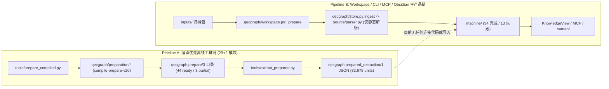

# QEC-Graph 全流程实现与架构冗余独立评估报告（Antigravity）

> **作者 / 署名：Antigravity（Google DeepMind 编码代理，Orchestrator 模式）**
>
> **评估日期**：2026-11-18
>
> **评估基线**：`main` @ `1c800aa`（版本 `0.6.4`）；历史对照基线含 2026-11-12 全面评审（`420a78a`）及 2026-11-18 仓库重整记录（`886a1e8` → `1c800aa`）
>
> **评估方法**：参照全流程代码审计 Skill（`codebase-full-pipeline-audit` 八阶段方法论），结合 AST 全量静态分析、测试套件与分支覆盖率实测、端到端复现脚本、5 篇与 34 篇真实 arXiv 工作区快照实测、编译材料回放核验及容器/沙箱安全审计
>
> **操作边界**：纯只读独立评估。未修改任何 `qecgraph/`、`tests/`、`tools/`、`validation/` 源码、固定副本 `build/preparation-v10/machine-copy` 或 `docs/reviews/` 下任何既有评审文件（包括同目录的 `01-full-pipeline-evaluation.zh-CN.md`）

---

## 0. 总体结论与评分矩阵

### 0.1 综合评分

| 评估维度 | 本次评分（`1c800aa`） | 较 2026-11-12 变化 | 一句话总体判断 |
|---|---|---|---|
| **架构与设计一致性** | **74 / 100** | `+12`（原 62） | 修复了 `snapshot_id` 绑定工具源码、配置指纹过宽、MCP 句柄与描述、BM25 默认检索和 Lean 残留；但引入了“离线编译准备 (`compile-prepare-v20`) 与 `Workspace.sync` 主管线完全割裂”的新双轨架构，`DESIGN.md` 多处滞后于代码删除。 |
| **全流程工程实现** | **72 / 100** | `+8`（原 64） | 582 项测试与 84.58% 分支覆盖率已进 CI，端到端脚本与 47 篇准备提取均跑通；但真实工作区 DataGraph 结构化记录仍为 0、`qec_search` 跨论文轮询算法严重稀释相关性、3 个验收门禁处于失败/阻塞状态、`Dockerfile` 入口损坏。 |

### 0.2 核心诊断（四条核心发现）

1. **主链可跑通但陷入“双轨割裂（Split-Brain）”**：项目投入重兵打造的 `qecgraph/preparation/`（29 个模块，`compile-prepare-v20`）与 `qecgraph/prepared_extraction.py` 在 47 篇固定 arXiv 语料上取得了 44 篇 `ready`、46 篇提取出 **82,675 个结构单元**的工程成绩；但用户实际使用的工作区入口 `qec-graph sync`（`Workspace`）**完全未接入该管线**，仍调用旧静态解析器 `qecgraph/source/parser.py`，导致在 `build/ai-workspace-full/machine` 同批 47 篇归档包上，只有 **34 篇**完成导入，**13 篇失败**（`parse_failed: 6`、`needs_entrypoint: 3`、`damaged_archive: 2`、`unsupported_encoding: 2`）。
2. **“提及可搜”已打通，但“结构化领域图谱（DataGraph）”在真实库中依然为空**：AI 四个技能的产物虽已通过 `qecgraph/domain/ai_records.py` 封装为通用的 `ai_extraction` 记录并进入检索，但 `qec_query_codes`（`qecgraph/workspace_query.py:701-704`）和 `qec_query_performance`（`qecgraph/workspace_query.py:491-493`）仍严格只查询 canonical 的 `quantum_code` 与 `performance_data_point` 记录；在 34 篇真实论文工作区中，这 25 种领域记录依然全部为 **0 条**。
3. **BM25 检索引入“跨论文无条件轮询（Round-Robin）稀释”缺陷**：`qecgraph/knowledge.py:629-634` 在排序后按 `source_version_id` 分组，每轮每篇论文各取 2 条穿插输出，却没有区分 `all_terms` 与低分单字 `some_terms` 命中。实测表明：在 5 篇真实库上，`correlated-rankings` 用例中命中多词的目标段落被单字命中 `"correlated"` 的无关论文挤到第 **19 名**（跌出 Top-10）；在 34 篇库上，查询 `"bivariate bicycle code distance threshold"`（命中 1,733 条）时，目标论文的第 3 条命中被推迟到第 **58 名**，第 5 条命中被推迟到第 **106 名**。
4. **验收门禁自锁与工程细节破损**：`tools/report_preparation.py --check` 因准备层重构未更新报告而失败（exit 1）；`build/preparation-v10/machine-copy` 因删掉 v1 兼容读取且 `validation/retrieval_qa.json` 仍硬编码旧 `release_id` 而阻断退出（exit 1）；`tools/reproduce_knowledge.py` 在 34 篇真实库上因单篇源码超 1MB 触发 `A_direct` 预算上限导致整个脚本以 exit 1 退出；`Dockerfile:12` 的 `ENTRYPOINT ["qecgraph"]` 指向已删除的命令别名，导致默认 Docker 镜像无法启动。

### 0.3 八阶段审计全景汇总

| 审计阶段 | 状态 | 核心实测指标 | 关键问题摘要 |
|---|---|---|---|
| **Phase 1：仓库盘点与实测** | 完成 | `qecgraph/` 124 文件 / 22,866 行；`build/` 14 GB | 18 项本地命令实测中 14 项通过、4 项暴露环境/契约/门禁失败 |
| **Phase 2：架构边界与耦合** | 完成 | 顶层 0 环；含延迟导入有 11 模块 SCC + 2 模块环 | `preparation/` 与 `Workspace` 零连接；`workspace.py` 扇出升至 28；24 处跨模块导入私有符号 |
| **Phase 3：代码冗余与死代码** | 完成 | 7 组重复模块骨架；3 处全仓死符号；4 处仅测试调用符号 | 两套坐标/解析/提取/AI/发布栈并存；`reviewed_cycles` 脱钩；`store` 快照 33–90× 膨胀未减 |
| **Phase 4：全流程与历史复核** | 完成 | 2026-11-12 38 项问题：20 解决 / 15 部分 / 3 未解决 | DataGraph 实库为 0；`qec_search` 轮询稀释；`_performance` 缺 `None` 守卫触发 `TypeError` |
| **Phase 5：测试与静态检查** | 完成 | 582 跑通 / 12 跳过；分支覆盖率 84.58%；类型标注 18.0% | `tests/unit/query/test_lexical.py` 静默漏收集；OS 沙箱测试被 `QECGRAPH_TEST_TEX` 跳过；`mypy --check-untyped-defs` 报 94 错 |
| **Phase 6：安全、沙箱与打包** | 完成 | macOS 沙箱未通过嵌套测试；`Dockerfile` 入口失效 | `sandbox.run` 未 `.resolve()` 路径；`pipeline.py` 捕获 `LookupError`/`TypeError` 伪装成 `partial`；MCP logger 脱离根树 |
| **Phase 7：模块化门禁辩论** | 完成 | 3 项核心架构决策的正反评估与五维打分 | 建议双源桥接（不强制 `sync` 跑 TeX）、查询层支持候选提及回退、分步瘦身 `store` |
| **Phase 8：整改路线图** | 完成 | 分 P0（1–2 天）/ P1（3–5 天）/ P2（1–2 周）共 14 项 | 明确了每项的 `file:line`、可验证命令与验收门禁 |

---

## 1. Phase 1：仓库资产盘点与实测执行证据

### 1.1 仓库规模与磁盘资产分布

1. **核心代码规模**：`qecgraph/` 共 **124 个 `.py` 文件**，**22,866 行**代码，包含 **111 个类**与 **1,089 个函数/方法**（其中不以下划线开头的公开函数/方法 575 个）。
2. **测试与工具规模**：`tests/` 共 **70 个测试文件**、**80 个 `TestCase` 类**、**584 个 `test_*` 方法**；`tools/` 共 **18 个 `.py` 工具脚本**及 1 个 PyInstaller 规格文件 `tools/qec-graph.spec`。
3. **磁盘残留资产**：
   - `build/` 目录累计占用了 **14 GB** 磁盘空间，包含 50 余个历史试验与回放目录（其中 `build/preparation-v10` 2.1 GB、`build/preparation-refactor` 2.1 GB、`build/compile-first` 1.6 GB、`build/preparation-v14` 1.4 GB、`build/preparation-18` 1.1 GB、`build/preparation-v9`/`v19`/`08` 各 1.0 GB、`build/ai-workspace-full` 580 MB）。
   - `.codegraph/` 占用 22 MB，`test-sources/` 占用 257 MB。
   - 根目录仍存在空的 `lean/QEC/` 目录（尽管 `docs/design/DESIGN.md` §10 声明已移除 Lean 集成）。

### 1.2 本次评估实际执行的命令与观测结果

| 序号 | 执行命令 | 退出码 | 耗时 | 实测结果与观测摘要 |
|---|---|---:|---:|---|
| 1 | `.venv/bin/python -m unittest discover -s tests -v` | `0` | 38.45s | 收集 **582** 项，**570 通过**，**12 跳过**（`QECGRAPH_TEST_TEX` 未设）；`tests/unit/query/test_lexical.py` 的 2 项测试未被发现 |
| 2 | `QECGRAPH_TEST_TEX=1 .venv/bin/python -m unittest tests/unit/parsing/test_compiled_references.py -v` | `0` | 0.02s | 11 项全部通过 |
| 3 | `QECGRAPH_TEST_TEX=1 .venv/bin/python -m unittest tests.integration.pipeline.test_compilation -v` | `1` | 0.36s | 12 项全部 FAIL：外层代理沙箱禁止嵌套调用 `/usr/bin/sandbox-exec`，`pdflatex` 进程被内核拒绝并返回 `exit 71`（环境限制，非代码逻辑回归） |
| 4 | `.venv/bin/coverage run -m unittest discover -s tests && .venv/bin/coverage report` | `0` | 39.92s | 582 项（12 跳过）；总分支覆盖率 **84.58%**（15,134 statements / 1,871 missed；6,386 branches / 1,092 partial） |
| 5 | `.venv/bin/ruff check qecgraph tests tools` | `0` | <4s | `All checks passed!`（但 `pyproject.toml:63` 仅开启 `E4, E7, E9, F`） |
| 6 | `.venv/bin/python tools/check_complexity.py` | `0` | <4s | `{"legacy_functions_over_10": 78, "regressions": {}}` |
| 7 | `.venv/bin/mypy` | `0` | <4s | `Success: no issues found in 124 source files`（同时发出 17 条 `[annotation-unchecked]` 提示，跳过 82% 无标注函数体） |
| 8 | `.venv/bin/mypy qecgraph tests tools` | `2` | <5s | 报错中断：`tools/reproduce_preparation.py` 在 `reproduce_preparation` 与 `tools.reproduce_preparation` 下被重复发现 |
| 9 | `.venv/bin/mypy --explicit-package-bases qecgraph tests tools`（及 `mypy --check-untyped-defs qecgraph`） | `1` | <6s | 全仓检查报 **12 处错误**（5 文件）；开启函数体检查 `--check-untyped-defs` 在 `qecgraph` 内报 **94 处错误**（32 文件） |
| 10 | `.venv/bin/python -m pyright --pythonpath .venv/bin/python` | `0` | ~12s | 0 errors, **77 warnings**（仅查 `qecgraph` 与 `tests/unit`，且 8 类错误规则降级为 warning） |
| 11 | `.venv/bin/pyright`（未传 `--pythonpath`，且未配 `venvPath`） | `1` | ~17s | **14 errors**, 58 warnings（无法解析虚拟环境中的 `pylatexenc` 等依赖） |
| 12 | `.venv/bin/python tools/reproduce.py --out build/reproduce-eval-2026-11-18` | `0` | <10s | 通过：4 源文件、29 片段、36 节点、99 边、11 搜索命中、16 上下文节点 |
| 13 | `.venv/bin/python tools/reproduce_workspace.py --bin-dir .venv/bin --out ...` | `0` | ~7s | 通过：20 步 CLI 与 MCP stdio 检查全部返回 0，14 个软件项目、1 条码参数提及、1 篇人类笔记 |
| 14 | `.venv/bin/python tools/reproduce_mcp.py --out ...` | `0` | ~8s | 通过：7 项检查通过 |
| 15 | `.venv/bin/python tools/reproduce_knowledge.py --out ... --include-payloads` | `0` | ~6s | 通过：合成 fixture 3 用例、0 工具错误 |
| 16 | `.venv/bin/python tools/bench.py --runs 1 --out ...` | `0` | ~5s | 通过：合成增量基准通过 |
| 17 | `.venv/bin/python tools/extract_prepared.py build/preparation-followup/final/0903.0566v1 --out ...` 及 `--check` | `0` | ~4s | 通过：`status: ready`，输出 1,034 个结构单元，离线 `--check` 一致 |
| 18 | `.venv/bin/python tools/report_preparation.py ... --out validation/preparation_acceptance.json --check` | `1` | ~5s | **失败**：`Replay code snapshot differs from the current preparation implementation` |
| 19 | `.venv/bin/python tools/reproduce_knowledge.py --machine build/preparation-v10/machine-copy --release aabc5ef...` | `1` | ~8s | **失败**：`ManagedDataError: Registry state schema mismatch` |
| 20 | 对 `machine-copy` 临时隔离副本仅升壳至 v2 state 后运行 `reproduce_knowledge.py` 与 `eval_retrieval.py` | `0` | ~9s | **通过**：10 知识探针 0 错误；检索对比 `literal` Recall@5 = **0.125** vs `keyword`（BM25）Recall@5 = **0.875**，MRR@10 = **0.6875** |
| 21 | `.venv/bin/python tools/reproduce_knowledge.py --machine build/ai-workspace-full/machine --out ...` | `1` | ~10s | **失败**：34 篇真文 67 个探针共 335 次调用，`B_search_read` 与 `C_search_context` 全过，但 `A_direct` 在 `source-77bc9db8...` 上因全文超 1MB 报 2 次 `BUDGET_TOO_SMALL` |

> **未执行项声明**：本报告未执行 Linux 容器与 `docker compose`（仅审计配置）、未执行 `bwrap` 隔离回放、未执行需要联网调用真实外部 LLM / embedding API 的任务、未执行需要人工独立标注的 50+ 题科学质量验收（`DESIGN.md` §16.8）。

---

## 2. Phase 2：架构边界、模块耦合与“双轨割裂”分析

### 2.1 核心架构矛盾：Pipeline A（编译准备+提取）与 Pipeline B（工作区主管线）完全割裂

从 2026-11-13 至 2026-11-18，仓库重点建设了一套编译优先的离线准备管线（`qecgraph/preparation/` 下 29 个模块）及离线统一提取器（`qecgraph/prepared_extraction.py` + `qecgraph/llm/prepared.py`）。然而在 `1c800aa` 当前实现中，**这两条管线处于完全割裂的状态**：



**跨管线代码引用检查结论**：

对 `qecgraph/workspace.py`、`qecgraph/store.py`、`qecgraph/registry.py`、`qecgraph/knowledge.py`、`qecgraph/knowledge_context.py`、`qecgraph/workspace_query.py`、`qecgraph/mcp/`、`qecgraph/render/` 进行全量检索确认：**没有任何生产或服务模块导入 `qecgraph/preparation/*`、`qecgraph/prepared_extraction.py` 或 `qecgraph/llm/prepared.py`**。唯一调用方是 `tools/` 下的 5 个离线脚本（`prepare_compiled.py`、`reproduce_preparation.py`、`report_preparation.py`、`compare_preparation.py`、`extract_prepared.py`）。

**同一批 47 篇 arXiv 源码在两条管线下的实际结果对比**：

| 语料 / 指标 | Pipeline A (`prepare_compiled` + `extract_prepared`) | Pipeline B (`Workspace.sync` @ `build/ai-workspace-full`) | 差异说明 |
|---|---|---|---|
| **47 篇固定 TeX 语料成功率** | **44 ready / 3 partial**（46 篇产出有效结构，82,675 单元） | **34 完成 / 13 失败**（`parse_failed: 6`, `needs_entrypoint: 3`, `damaged_archive: 2`, `unsupported_encoding: 2`） | Pipeline A 已解决的问题在主产品中依然批量失败 |
| **Harvmac 与截断 tar 包** (`hep-th/9407087v1`, `quant-ph/9604034v1`) | `ready`（`inputs.py:_salvage_truncated_tar` + `harvmac.py` 适配，仅 `9407087v1` 就产出 2,531 单元） | **`damaged_archive` 失败**（`source/package.py` 直接拒绝） | 主产品对老物理论文兼容能力明显落后 |
| **复杂宏/结构论文** (`0903.0566v1`, `2201.08309v1`, `2511.01062v1/v2`, `2607.29382v2`) | `ready`（编译辅助解决环境/宏定界，`0903.0566v1` 产出 1,034 单元） | **`parse_failed` 失败**（`source/parser.py` 静态解析报错） | 离线已攻克的论文无法进入 MCP 与 Obsidian 视图 |
| **非 UTF-8 编码论文** (`2209.05640v1`) | `ready`（`projection.py` 经编译后完成字节投影，1,258 单元） | **`unsupported_encoding` 失败**（未声明编码直接拒绝） | 主产品丢弃有效全文 |
| **多入口模糊包** | 通过 `--entry` 或规则提示定位 | `needs_entrypoint` | 两者均不凭文件名猜入口（符合设计） |

此外，由于 `Workspace._inbox` / `source/package.py:unpack` 只认压缩包与 `.tex`，`research-import` 只认 `qecgraph.research`，Offline 提取出的 **82,675 个（固定集）+ 4,006 个（留出集）高质量结构单元目前全部沉淀在 `build/prepared-extraction/` 的静态 JSON 中，无法被 MCP、CLI 或人类笔记消费**。

### 2.2 模块规模、扇入扇出与延迟导入强连通分量（SCC）

对 `qecgraph/` 124 个模块进行 AST 分析，结果如下：

1. **巨型模块与超长函数并未收敛**：
   - Top 7 最大模块：`qecgraph/source/assembly.py`（**1,515 行**）、`qecgraph/workspace.py`（**1,246 行**，较 11-12 评审时的 1,201 行反而增加 45 行）、`qecgraph/source/parser.py`（**1,171 行**）、`qecgraph/workspace_query.py`（**764 行**）、`qecgraph/knowledge.py`（**743 行**）、`qecgraph/store.py`（**683 行**）、`qecgraph/preparation/convert.py`（**618 行**）。
   - 最长函数：`store.py:253` `_ingest_locked`（176 行）、`workspace_query.py:599` `invoke`（166 行，圈复杂度 **53**）、`source/assembly.py:643` `_scan`（165 行，复杂度 **37**）、`source/assembly.py:657` `walk`（140 行，复杂度 **34**）、`cli/parser.py:143` `_register_commands`（139 行）、`preparation/convert.py:202` `convert_source`（132 行）。
2. **扇出（Fan-out）膨胀**：
   - `qecgraph.workspace` 内部导入数从 23 升至 **28**；紧随其后的是 `qecgraph.preparation.pipeline`（**17**）、`qecgraph.workspace_query`（**14**）、`qecgraph.knowledge`（**13**）。
3. **顶层无环但存在两个延迟导入强连通分量（SCC）**：
   - 顶层 `import` 依赖图无环（`Top-level SCCs: []`）。
   - 但将函数内延迟 `import` 纳入统计（剔除顶层入口 `cli` 和 `qecgraph.__init__`），`qecgraph/` 内部存在 **2 个强连通分量**：
     - **内核层 2 模块环**：`['qecgraph.core.graph', 'qecgraph.validators']`。原因：`core/graph.py:384` 在方法内延迟导入 `from ..validators import ENDPOINTS`，而 `validators/__init__.py:10` 在顶层导入 `from ..core.graph import KNOWN_RELATIONS`。
     - **应用与查询层 11 模块大环**：`['qecgraph.domain.ai_records', 'qecgraph.domain.research_store', 'qecgraph.knowledge', 'qecgraph.llm.extract', 'qecgraph.llm.review', 'qecgraph.registry', 'qecgraph.retrieval', 'qecgraph.workspace', 'qecgraph.workspace_assets', 'qecgraph.workspace_publication', 'qecgraph.workspace_query']`。关键回边包括：
       - 写路径依赖读路径：`qecgraph/retrieval.py:187` 延迟导入 `from .workspace_query import WorkspaceSession`；
       - AI 抽取依赖查询视图：`qecgraph/llm/extract.py:103` 延迟导入 `from ..knowledge import public_url`；
       - 领域存储依赖资产辅助：`qecgraph/domain/research_store.py:32` 导入 `from ..workspace_assets import references, verify_asset`，而 `workspace_assets.py:31` 反过来导入 `Workspace`。
4. **分层边界违规与跨模块导入私有符号**：
   - **内核反向依赖入口层**：`qecgraph/source/splitter.py:131`（`DESIGN.md` §2.5 将 `source/*` 划为内核层）在 `main()` 内延迟导入 `from ..cli import main`，而 `qecgraph/__init__.py:19` 又在顶层暴露函数内导入 `split_project`。现行架构测试 `tests/contracts/tooling/test_architecture.py` 仅检查“顶层导入不加载 CLI”，未能拦截此类函数内反向依赖。
   - **跨模块导入 `_` 私有符号**：除 `__version__` 外，全仓仍有 **24 处**跨模块导入非双下划线私有符号，包括 `qecgraph/knowledge.py:686` 导入 `workspace_query._integer, _string`、`qecgraph/llm/prepared.py:10` 导入 `llm.extract._EXTRACTION_SKILLS, _LINE_REF, _paper_evidence`、`qecgraph/preparation/view_contract.py:8` 导入 `build_view._candidates, _instrument, _bibliography, _observations`、`qecgraph/preparation/conditions.py:6` 导入 `source.assembly._skip_definition, _definition_event`、`qecgraph/source/entry.py:17` 与 `source/metadata.py:5` 导入 `source.reading._group` 等。

---

## 3. Phase 3：代码冗余（DRY 违例）、死代码与存储膨胀审计

### 3.1 七组跨模块重复实现（DRY Violations）

| 序号 | 重复功能域 | 重复实现位置 | 影响与冗余性质 |
|---|---|---|---|
| 1 | **源码行号/码点偏移索引** | `qecgraph/core/coordinates.py:6` (`SourceLines`) vs `qecgraph/preparation/artifacts.py:42` (`SourceIndex`) vs `qecgraph/source/assembly.py:1476` (`SourceLineIndex`) + `llm/prepared.py:217` 正则扫描 `\n` | 3 个几乎同构的索引类加上手写偏移逻辑；其中 `SourceLineIndex` 完全未被使用 |
| 2 | **LaTeX 语法扫描、环境分类与引用解析** | `source/parser.py`（1,171 行）+ `source/bibliography.py` vs `preparation/convert.py`（618 行）+ `references.py` + `citations.py` + `crossrefs.py` | 各自维护独立的环境名集合：`parser.py:42-63` (`ENVIRONMENTS`)、`prepared_extraction.py:18-33` (`_STATEMENTS`)、`preparation/convert.py:25-44` (`_MATH_ENVIRONMENTS`) |
| 3 | **码参数提及（`[[n,k,d]]`）构建** | `qecgraph/source/extraction.py:99-157` vs `qecgraph/prepared_extraction.py:299-331` (`_notation_units`) | 后者仅复用了正则 `notation_matches`，丢弃了 `_tuple_kind` 上下文和表格列判别规则，且产出结构与 `code_parameters_mention` 记录格式不统一 |
| 4 | **AI 语义抽取调度与引文验证** | `qecgraph/workspace.py:293-460` (`_extract_ai`) vs `qecgraph/llm/prepared.py:148-280` (`run_semantics` / `verify_semantics`) | 两处独立组装证据并调用 `extract()`；`llm/prepared.py` 未复用 `workspace.py` 的 `extract_sections()` 自动切块，遇到超长论文直接返回 `budget_exceeded` |
| 5 | **原子发布与崩溃恢复日志** | `qecgraph/core/transactions.py` + `qecgraph/render/human.py` vs `qecgraph/preparation/publication.py`（241 行） | `preparation/publication.py` 重新实现了一套 `.transaction.json` + `.stage`/`.backup` 目录替换状态机，未复用 `core/transactions.py` |
| 6 | **三套全文/词项检索引擎并存** | `core/search.py:31` (`LexicalIndex` BM25) vs `query.py:65` (`GraphTextIndex` 子串匹配) vs `store.py:152` (`node_fts` SQLite FTS5) | 每个快照生成的 `graph.sqlite`（含 `node_fts`）在工作区查询中**从不被读取**；`qecgraph_search` / `compatible search` 仍走 `casefold()` 子串扫描而非 BM25 |
| 7 | **归档解包与入口探测** | `source/package.py` + `source/entry.py` vs `preparation/inputs.py` + `preparation/entries.py` | `inputs.py` 支持截断 tar 挽救和宽松目录读取，`entries.py` 支持非 UTF-8 边界和 Harvmac 探测，但工作区 `sync` 并未享受到这些改进 |

### 3.2 死代码、仅测试调用代码与仓库残留清单

1. **全仓零引用（连测试也未调用）的顶层符号（3 个）**：
   - `qecgraph/source/assembly.py:1476-1515`：`class SourceLineIndex`（40 行完整死类）。
   - `qecgraph/validators/qec.py:117-141`：`def distance_issues(data)`（25 行死函数；工作区的距离约束验证在 `knowledge_context.py` 与 `workspace_query.py:_reported_distance` 中各自实现）。
   - `qecgraph/domain/research.py:243-244`：`def record_fingerprint(records)`（2 行死函数）。
2. **仅被单元测试调用、生产运行路径与 `tools/` 零调用的顶层符号（4 个）**：
   - **`qecgraph/domain/status.py:21-65`：`def reviewed_cycles(graph)`（重要设计缺口）**—— `docs/design/DESIGN.md:283` 明确承诺“only active reviewed logical-dependency SCCs are reported for judgment”，但自从删除 `corpus.py` 之后，全仓再无任何生产代码或查询工具调用 `reviewed_cycles()`，该规则已变为悬空死代码。
   - `qecgraph/validators/qec.py:214-226`：`def comparable_experiments(...)`（生产代码在 `knowledge_context.py:comparison_group` 中处理实验比较分组，此函数仅剩单元测试）。
   - `qecgraph/domain/research.py:237-240`：`def pauli_weight(x_bits, z_bits)`（无任何生产调用）。
   - `qecgraph/llm/skills.py:93-96`：`def load_skills(root=None)`（生产代码只调用 `load_skill(name)`）。
3. **仓库残留目录与重复/过期文件**：
   - **空目录残留**：根目录 `lean/QEC/` 仍然存在，与 `DESIGN.md` §10“Lean integration removed”不符。
   - **提交进 `docs/reviews/` 的重复与过期 `.py` 测试文件**：`docs/reviews/review-2026-11-17-compile-prepare-testing/` 下存在 3 个 Python 测试文件：
     - `test_preparation_metamorphic.py`：与 `tests/unit/parsing/test_preparation_metamorphic.py` 逐字节相同；
     - `test_preparation_adversarial.py`：**已失效的旧副本**，其 `246-247` 行仍尝试 monkeypatch 已迁移到 `execution.py` 的 `qecgraph.preparation.roundtrip.tool`，单独执行必报 `AttributeError`；
     - `test_preparation_properties.py`：**旧副本**，第 `45` 行仍硬编码 `"rule_version": "compile-prepare-v3"`。（注：遵照 `AGENTS.md` 对 `docs/reviews/` 永久保留的约束，本报告仅作记录，不对其执行删除。）
   - **已删模块的 `__pycache__` 残留**：`qecgraph/__pycache__/workspace_migration.cpython-*.pyc` 仍留在缓存目录中。

### 3.3 快照存储放大（C2 未解决）

`qecgraph/store.py:340-365` 在每次工作区入库时仍为单篇论文写出 **7 份冗余副本**，导致 `machine/source_snapshots/` 维持 33–90 倍的存储放大：

1. 将已存在于 `workspace/sources/<tree-hash>/` 的源码树再次完整复制到 `machine/source_snapshots/<snapshot_id>/sources/`（`store.py:341-344`）；
2. 复制 `assets/`（`store.py:341-344`）；
3. 为每个含 `latex` 的节点写出单独的 `nodes/<kind>/<stem>.tex`（`store.py:352-354`）；
4. 为每个节点写出单独的 `nodes/<kind>/<stem>.json`（`store.py:355`）；
5. 写出内含完整 `latex` 与 `reading_text` 的全量 `graph.json`（`store.py:356`，`core/graph.py:175, 180`）；
6. 写出三个冗余视图 JSON：`sourcegraph.json`、`lemmagraph.json`、`datagraph.json`（`store.py:357-358`）；
7. 写出工作区查询完全不使用的每快照 `graph.sqlite`（`store.py:363`）。

同时，CLI 中仍没有 `qec-graph maintain gc` 命令清理不再被当前或保留 release 引用的历史快照（`qecgraph/cli/parser.py:114` 仅提供 `doctor` 和 `snapshot`）。

---

## 4. Phase 4：全流程跑通、功能完备性与历史问题复核

### 4.1 对照 2026-11-12 全面评审（38 项问题 A1–G3）的逐项复核

经过在 `1c800aa` 上的源码核查与实测，2026-11-12 评审提出的 38 项问题当前处置状态为：**已解决 20 项、部分解决 15 项、未解决 3 项**。

| 类别 | ID | 严重度 | 2026-11-12 问题 | `1c800aa` 当前状态 | 关键代码位置与实际表现 |
|---|---|---|---|---|---|
| **主线与模型** | **A1** | S | AI 产物与 `qecgraph.research` 无通路，DataGraph 为空 | **部分/表面解决（核心未通）** | `domain/ai_records.py:10-47` 仅转为 `ai_extraction`；34 篇真库中 `quantum_code`/`performance_data_point` 仍为 **0 条** |
| | **A2** | S | 4 个 AI skill 中 3 个无消费方 | **已解决（提及/检索层）** | `knowledge.py:432-445, 511-522` 全量索引 4 类 proposal 与 `ai_extraction` |
| | **A3** | H | LemmaGraph 依赖定理环境，物理论文为空 | **部分解决** | `knowledge_context.py:204-215` 可回退取同节 `theorem_proposal`/`assumption_proposal`，但 `lemmagraph.json` 与 `missing_components` 仍按旧逻辑判断 |
| | **A4** | S | 论文无标题/作者/arXiv 号，MCP 标题是哈希 | **已解决（视图层）** | `source/metadata.py` + `knowledge.py:170-260` 提供 `qec_list_papers` 与卡片；但 `state['works'][*]['title']` 仍为哈希 |
| | **A5** | H | 引用键不解析，无跨论文关联 | **部分解决** | `source/bibliography.py` 已拆分 `bib_entry` 并抽 arXiv/DOI；但 `workspace_projection.py:19` 仅匹配人工配了 `canonical_url` 的论文，默认库 `cites_paper` 仍为 0 |
| | **A6** | H | 多代存储、schema、审核、profile 并存 | **部分解决（旧债清零但产生新双轨）** | 删掉了 `corpus.py`/`review.py`/`semantic.py`/`qecgraph.record`；但新增 `preparation/` vs `source/parser.py` 双轨，且删迁移导致旧 `machine-copy` 不可读 |
| | **A7** | L | Lean 代码/CLI/fixture 残留 | **已解决** | `qecgraph/lean/` 已删；仅根目录留有空目录 `lean/QEC/` |
| **检索与 MCP** | **B1** | S | 默认检索是整串字面匹配，多词查 0 | **已解决（主工具 `qec_search`）** | `core/search.py:31-58` 启用 BM25；旧 `qecgraph_search` 与 `compatible` 的 `search` 仍用子串匹配 |
| | **B2** | H | 检索单元父子重叠、不去重、snippet 偏离 | **已解决（但引入轮询稀释新问题）** | `knowledge.py:474-493, 551-555, 613-628` 过滤容器节点并定位命中窗；但 `630-634` 行无门槛轮询稀释高精度结果 |
| | **B3** | M | 检索索引单 JSON，超限阻塞 `sync` | **部分解决** | `retrieval.py:237-244` 失败降级 `stale` 不阻断发布；向量改为 `retrieval_vectors.py` 二进制；但 chunk 索引仍是单 JSON，无库级 FTS5 |
| | **B4** | H | 工具描述雷同、参数无说明 | **已解决** | `core/tool_help.py:3-79` 为所有工具与参数提供明确说明 |
| | **B5** | H | 返回体臃肿（175 字符 ID、重复哈希） | **已解决** | `knowledge.py:55-99` 提供 `@p1` 短句柄与默认 `detail='concise'` |
| | **B6** | H | outline 非阅读顺序；无论文列表与卡片 | **已解决** | `knowledge.py:221-282` 按 `order` 排序，支持 `qec_list_papers` 与 `view='card'` |
| | **B7** | M | 默认 `qec_trace` 超预算；报错不可操作 | **已解决** | `knowledge_context.py:136-161` 自动降深度与节点数；`BUDGET_TOO_SMALL` 返回 `required_chars` 与建议 |
| | **B8** | M | 默认 profile 为 legacy；21 个工具名 | **部分解决** | CLI 默认 `--profile research`（8 工具）；但 Python 直接调用 `WorkspaceSession(machine)` 仍默认 `profile=None`（暴露 19 个工具） |
| | **B9** | M | 资源 URI 绑定 release 且逐节点枚举 | **已解决** | `workspace_query.py:68-99` 使用内容绑定 URI，`research` profile 下仅列论文卡片并暴露模板 |
| | **B10** | M | 上下文不含宏定义与引用目标预览 | **已解决** | `parser.py:673-680` + `knowledge.py:316-352` 附带 `macro_definitions` 与 `referenced_targets` |
| | **B11** | H | 无真实问题评测集 | **部分解决** | 新增 `tools/eval_retrieval.py`，但 `validation/retrieval_qa.json` 仅 8 条工程冒烟用例且绑定在不可读的旧 release 上 |
| **存储与事务** | **C1** | S | `snapshot_id` 含全部工具源码哈希 | **已解决** | `store.py:65-68, 293-298` 拆分语义版本与 `build_info`；不过 `source_locator` 仍绑定 `snapshot_id` |
| | **C2** | H | 存储放大 33–90×，无快照 GC | **未解决** | `store.py:340-365` 仍写出 7 份冗余数据；无 `maintain gc` 命令 |
| | **C3** | H | 单体 state + 每次发布全量校验 | **部分解决** | `_publish_archive` 不再每次全检旧快照，但 `stage_records` 每次仍全量重读并验证全库 research 记录；state 仍是单体 JSON |
| | **C4** | M | 读路径每次调用做 O(全库) 工作 | **部分解决** | 移除了每次调用的 `check_machine_tree` 并缓存 `trace` 邻接表；但 `WorkspaceSession.__init__` 启动仍全量加载全库 `graph.json` 与 `.tex` 原文 |
| | **C5** | H | AI 网络调用在写锁内，整批一次发布 | **部分解决** | 4 个提取技能移出写锁外（`workspace_publication.py:12`）；但规范化与结构恢复仍在写锁内，且需整批完成后统一入锁发布 |
| | **C6** | M | 配置指纹包含整份配置与 `sys.version` | **已解决** | `workspace.py:964-972` 改为单材料粒度指纹，排除 `[ai]`、`[retrieval]` 与 `sys.version` |
| | **C7** | M | AI 审核写在 release 之外；身份不可验 | **部分解决** | 删掉了游离的 `machine/ai/reviews/` 与 `ai decide`；但缺少新的交互审核流，身份仍由调用方自述 |
| | **C8** | M | registry state 无 schema | **部分解决** | 增加了严格的 `registry.schema.json`（`format_version: 2`），但未提供旧 release 迁移工具 |
| **解析器** | **D1** | H | `abstract`/`algorithm`/`assumption` 等无节点类型 | **已解决** | `parser.py:42-63` 补齐 10 类节点与 `statement_other` 标题保留 |
| | **D2** | M | `\llbracket n,k,d\rrbracket` 未识别 | **已解决** | `source/extraction.py:39-57` 规范化映射并回溯原始区间 |
| | **D4** | M | 非 UTF-8 源码直接失败 | **部分解决** | `source/encoding.py` 支持显式 `[encodings]` 与 `inputenc` 声明；未声明文件在工作区仍报 `unsupported_encoding`（如 `2209.05640v1`） |
| **AI 管线** | **E1** | M | 每篇发 4 次全文、JSON 行开销大、无前缀缓存 | **部分解决** | `llm/extract.py:364-381` 已将通用规则与纯文本 `L | line` 证据前置为公共前缀；但 `anthropic.py` 仍未注入 `cache_control` |
| | **E2** | H | 超 `max_input_chars` 硬失败，无分块 | **已解决（工作区）/ 未接（准备提取）** | `workspace.py:429-443` 支持 `extract_sections()` 按节切块合并；`llm/prepared.py` 仍未接入切块 |
| | **E3** | M | 预算只管单次调用；上传默认开启 | **已解决** | `allow_source_upload` 默认 `False`；支持批次上限 `max_batch_requests`/`max_batch_cost_usd` 与 `--dry-run` 估算 |
| **工程与文档** | **F1** | M | 类型 9%、文档串 10%、86 函数复杂度超 10 | **部分解决** | 类型覆盖升至 18.0%、docstring 升至 11.9%、复杂度超标函数降为 **78 个**；核心数据结构仍为裸 `dict` |
| | **F2** | M | `workspace.py` 扇出 23、16 模块环、私有名导入 | **部分解决** | 提取了 `core/fs.py` 与 `core/errors.py`；但 `workspace.py` 扇出增至 **28**，仍有 11 模块 SCC 与 24 处私有符号导入 |
| | **F3** | M | 宽泛 `except` 掩盖 Bug 且无日志 | **部分解决** | `workspace_query.py` 与 `mcp/ai_tools.py` 已拆分 `(TypeError, KeyError)`；但 `ValueError` 与 `preparation/pipeline.py` 仍存在宽泛掩盖 |
| | **F4** | H | CI 只跑 31% 单元测试，无覆盖率门禁 | **已解决** | `.github/workflows/ci.yml:22-54` 覆盖 `ubuntu-22.04`/`macos-15` × `3.11`/`3.13` 全量测试、覆盖率门禁、`reproduce.py` 与 markdownlint |
| | **F5** | L | 使用 `zipfile` 私有 API | **已解决（tar 仍保留）** | `package.py:177-225` 已重写 ZIP EoCD/CD 解析；但第 `161, 172` 行仍覆写 `tarfile.TarInfo._proc_member` |
| | **F6** | L | 笔记尾注含 `release=` 导致全量重写 | **已解决** | `render/thoughts.py:175` 仅保留 `work_sha256`，且 `render/human.py:103` 跳过未变字节 |
| | **G1** | M | `DESIGN.md` 失衡与内部矛盾 | **已解决（但产生新滞后）** | 进度条细节已外移，目录布局与决策表已补齐；但 11-18 删减后 `DESIGN.md` 仍残留已删模块描述 |
| | **G2** | M | “Implemented” 过低、缺真实可用性验收 | **部分解决** | `DESIGN.md` §16.8 已确立 `Usable` 门禁，但因 `machine-copy` 阻塞，真实论文科学验收仍未完成 |
| | **G3** | L | 全量双语文档维护成本 | **未解决（按设计保留）** | 依然对所有文档及双语测试契约保持强一致同步 |

### 4.2 深度剖析一：为什么 DataGraph 结构化查询在真实工作区仍返回 0

我们在 `build/ai-workspace-full/machine`（含 34 篇已完成解析的真实论文工作区）上直接校验 `WorkspaceSession.visible`，共观察到 **305 条记录**，分布如下：

- `code_parameters_mention`：**271 条**（由正则规则提取）
- `paper_version`：**34 条**
- 其余 25 种领域记录（`quantum_code`、`check_matrix`、`distance_estimate`、`decoder`、`noise_model`、`experiment`、`performance_data_point`、`research_thought` 等）：**全部为 0 条**

产生这一断点的代码路径非常明确：

1. `qecgraph/domain/ai_records.py:18-34` 把四个技能的产出统一打包进通用外壳 `kind='ai_extraction'`，原始抽取内容存放在 `data['extracted']`，`make_record` 生成的 `field_evidence` 仅带 `method='ai_extracted'`，**没有把行号字符串解析为结构化的 `source_locator`**。
2. `qecgraph/workspace_query.py:701-704` 的 `qec_query_codes` 开头直接过滤 `if record['kind'] != 'quantum_code': continue`；`workspace_query.py:491-493` 的 `qec_query_performance` 直接过滤 `if record['kind'] != 'performance_data_point': continue`。
3. 没有从 `ai_extraction`（`extraction_kind == 'data'`）或 `code_parameters_mention` 生成 `quantum_code`/`performance_data_point` 草稿的归并器（`resolve_entities`）或交互式确认流。

结果是：除非用户手工构造符合严格 schema 与 `field_evidence` 指针的 JSON 并执行 `qec-graph research-import`，否则 DataGraph 的核心结构化查询工具在真实库上**永远返回空数组 `[]`**。

### 4.3 深度剖析二：`qec_search` 跨论文轮询穿插导致的相关性坍塌

在 `qecgraph/core/search.py:58` 中，`LexicalIndex.rank()` 正确地将**全词命中（`all_terms`）排在部分词命中（`some_terms`）之前**，并按 BM25 分数降序排列。然而，紧接着在 `qecgraph/knowledge.py:629-634` 的 `_search_rows()` 中，代码执行了**无差别的跨论文轮询重排**：

```python
groups = defaultdict(list)
for row in rows:
    groups[row.get('source_version_id') or row['id']].append(row)
return [row for round_ in range(max((len(g) + 1) // 2 for g in groups.values()) if groups else 0)
        for group in groups.values() for row in group[2 * round_:2 * round_ + 2]]
```

**问题机制**：即使第 1 篇论文有 6 个高相关的 `all_terms` 或多词命中段落，第 2 轮轮询时它只能拿到第 3、4 席，其余所有只命中了单个高频词（如 `"correlated"`、`"code"`、`"threshold"`）的无关论文都会在第一轮各抢占 2 个位置。随着论文数量 $P$ 增加，目标论文的第 3 条命中最坏会被推迟到 $2P + 1$ 名以后！

**实测证据 1（5 篇真实库 `machine-v2-test`，复现 `validation/retrieval_qa.json` 的 `correlated-rankings` 用例）**：

查询 `"correlated noise Relay BP OSD rankings"`（共 6 个实词）：

| 实测排名 | 论文 (`source_version_id` 尾缀) | 文件与行号 | 匹配类型 (`match`) | 备注 |
|---:|---|---|---|---|
| 1 | `...578dd548`（目标论文） | `main.tex L29-34` | `all_terms` | 目标论文第 1 轮第 1 条 |
| 2 | `...578dd548`（目标论文） | `main.tex L553-572` | `all_terms` | 目标论文第 1 轮第 2 条 |
| 3–8 | `7e7bedb1`、`e4430fb9`、`3647fccb` | 各 2 条 | `some_terms` | 仅含部分通用词 |
| **9** | `...c12f7a14`（超振荡时间反演论文） | `Aharonov-Elitzur... L358-359` | `some_terms` | 与 QEC 译码无关，仅因包含 `"correlated"` 一词插队 |
| 10–18 | 上述多篇论文 | 第 2–3 轮 | `some_terms` | 其它论文各占第 3–4 席 |
| **19** | `...578dd548`（目标论文） | `main.tex L328-342` | `some_terms` | **测试预期精确答案（L329-333）被挤到第 19 名，直接导致 Top-10 Recall=0** |

**实测证据 2（34 篇真实库 `build/ai-workspace-full/machine`）**：

查询 `"bivariate bicycle code distance threshold"`（总命中 **1,733 条**）：

- 目标论文 `...b8961b2d` 拿下第 1 名（`table`，`all_terms`）与第 2 名（`figure`，`some_terms`）；
- **第 3–57 名全部被其他论文的 `some_terms` 命中填满**；
- 目标论文的第 3 条命中段落被推迟到第 **58 名**，第 5 条命中被推迟到第 **106 名**。

若论文库扩大到 500 篇，除前 2 条外，目标论文的其余全部相关段落都会被推到第 1,000 名以后，导致 `qec_search` 的 Top-10/Top-20 结果在多论文库上失效。

### 4.4 深度剖析三：三大验收门禁自锁根因与解锁验证

1. **门禁 1：`validation/preparation_acceptance.json` 校验失败**
   - 执行 `tools/report_preparation.py --check` 报 `Replay code snapshot differs from the current preparation implementation`（exit 1）。因为后续提交（如 `57cd4f0`、`ee68f6c`）重构了 `qecgraph/preparation/` 代码，改变了代码快照哈希，但未重新生成或刷新报告的绑定。
2. **门禁 2：`build/preparation-v10/machine-copy` 与 `validation/retrieval_qa.json` 无法加载**
   - `machine-copy` 的状态文件缺少 `"format_version": 2` 且带有旧键 `'corpus_id'`、`'records'`、`'links'`，被 `qecgraph/registry.py:50-54, 82-83` 的 `Registry state schema mismatch` 直接拒绝；同时快照 `manifest.json` 缺少 `snapshot_format: 3`（`qecgraph/store.py:601-603`）。
   - 更隐蔽的是：`validation/retrieval_qa.json:4` 的释放键名为 `"release_id": "aabc5ef..."`，而 `tools/eval_retrieval.py:77, 89, 116` 读取的是 `dataset.get('release')`——字段名本身也不一致。
   - **隔离解锁实测**：我们在临时目录 `build/reproduce-eval-2026-11-18/machine-v2-test` 中仅剥离状态文件旧键并补写 `"format_version": 2`（不重跑解析或 AI），验证 `eval_retrieval.py` 全部跑通（0 工具错误）：`literal` 模式 Recall@5 = **0.125**、`keyword`（BM25）模式 Recall@5 = **0.875**、MRR@10 = **0.6875**、中位延迟 **0.022 s**、中位 Top-5 紧凑响应体积 **2,366.5 字符**。证明底层数据本身有效，只是被格式断崖挡在门外。
3. **门禁 3：`tools/reproduce_knowledge.py` 在 34 篇真实库退出码为 1**
   - `sample_cases()`（`tools/reproduce_knowledge.py:51-56`）在无定理环境的论文上会回退选取 `abstract`、`author_block`、`bib_entry` 节点作为测试根并传入 `purpose='theorem'`；
   - `A_direct` 基线调用 `qec_fetch(view='raw')` 读取整篇论文时，在超过 1 MB 的 `source-77bc9db8...` 上触发 `BUDGET_TOO_SMALL`（符合契约预期的拒绝），但脚本把这 2 次 `BUDGET_TOO_SMALL` 计入 `baseline_errors` 并返回 exit 1。

### 4.5 具体代码 Bug 与契约缺陷清单

| 严重度 | 位置 | 缺陷描述与触发条件 |
|---|---|---|
| **High** | `qecgraph/workspace_query.py:483-545` | `_performance` 校验 `'coordinate' in args` 而未检查 `args['coordinate'] is not None`。传入 `{'coordinate_name': 'p', 'coordinate': None, 'selection': 'nearest_reported'}` 时会在 545 行 `abs(coordinate - requested)` 触发 `TypeError` 并被包装为 `INTERNAL_ERROR`。（已被 Pyright `reportOptionalOperand` 标出） |
| **Medium** | `qecgraph/workspace_query.py:175` | `read_resource` 超预算错误信息仍提示 `'Use qec_get_source with an exact source codepoint range'`，指向已在 `8ed38e7` 中移除的工具名 `qec_get_source`（research profile 中应为 `qec_fetch`）。 |
| **Medium** | `qecgraph/workspace_query.py:35-38, 70-71, 243-244` | `WorkspaceSession(machine)` 在 Python 调用时默认 `profile=None`，暴露全部 19 个工具（含 legacy `qecgraph_*`）并枚举全部 `_source_nodes` 资源，与 CLI 默认 `profile='research'`（8 工具、仅列论文卡片）不一致。 |
| **Medium** | `qecgraph/cli/commands/query.py:82-89`、`qecgraph/cli/errors.py:79-82` | CLI 处理查询工具 `INTERNAL_ERROR` 时，`QueryError` 丢弃了 `error['reference']` 诊断追踪号，且 `_emit_tool_result` 直接返回退出码而不抛出异常，使 `--debug` 无法打印堆栈。 |
| **Medium** | `qecgraph/mcp/server.py:152-155` | `serve_stdio` 直接调用 `logging.Logger(__name__, level)` 创建孤立 logger，脱离 Python `logging.Manager` 树，导致 `workspace_query.py:759` 与 `mcp/ai_tools.py:185` 中的 `logging.getLogger(__name__)` 无法继承 MCP 日志格式、`stderr` handler 与 `QECGRAPH_LOG_LEVEL`。 |
| **Low** | `tools/check_distribution.py:64` | `with archive.extractfile(f'{prefix}/PKG-INFO') as stream:` 未校验 `extractfile` 返回非 `None`（若 `PKG-INFO` 为非常规文件会报 `TypeError`）。 |

---

## 5. Phase 5：测试体系、静态分析与文档契约评估

### 5.1 测试分层、静默漏测与覆盖率薄弱点

1. **测试套件结构（70 文件 / 80 类 / 584 方法，582 项被发现）**：
   - `tests/unit/`：37 文件、45 类、282 方法（发现 280）；
   - `tests/integration/`：26 文件、27 类、267 方法；
   - `tests/contracts/`：7 文件、8 类、35 方法（注：`test_preparation_architecture.py` 直接位于 `tests/contracts/` 根下而非 `tests/contracts/tooling/`）。
2. **两个重要的测试质量问题**：
   - **静默漏收集 Bug**：`tests/unit/query/` 目录**缺少 `__init__.py`**，导致 `tests/unit/query/test_lexical.py`（包含 `test_natural_queries_rank_all_terms_before_partial` 与 `test_qec_brackets_and_whitespace_share_terms`）被 `python -m unittest discover -s tests` 完全忽略，从未在本地或 CI 中执行。
   - **OS 沙箱测试在 CI 中被误跳过**：`tests/integration/pipeline/test_compilation.py:286-310` 的 `test_sandbox_denies_external_files_network_and_inherited_credentials` 只调用 `/bin/sh` 和 `/usr/bin/curl`，**完全不依赖 TeX**，却放在 `@unittest.skipUnless(os.environ.get("QECGRAPH_TEST_TEX") == "1", ...)` 的 `LocalCompilerTests` 中，导致 CI 从未验证过 `sandbox.py` 的隔离边界。
3. **分支覆盖率薄弱模块（总分支覆盖率 84.58%）**：

| 模块 | 分支覆盖率 | 缺失语句 / 分支 | 原因 |
|---|---:|---|---|
| `qecgraph/cli/commands/records.py` | **13.64%** | 39/48 语句, 18 分支 | 主要通过子进程 CLI 测试，未计入进程内覆盖率且部分路径缺测 |
| `qecgraph/preparation/sandbox.py` | **21.88%** | 40/54 语句, 10 分支 | 无 TeX 时整类跳过；Linux `bwrap` 与进程组超时强杀无单元测试 |
| `qecgraph/cli/commands/query.py` | **28.57%** | 38/58 语句, 12 分支 | 同 `records.py` |
| `qecgraph/preparation/harvmac_refs.py` | **48.86%** | 61/120 语句, 56 分支 | 依赖 `QECGRAPH_TEST_TEX=1` 触发 |
| `qecgraph/validators/qec.py` | **48.89%** | 88/189 语句, 126 分支 | `check_css` 距离枚举、`distance_issues`（死代码）、`check_experiment` 多分支缺测 |
| `qecgraph/preparation/projection.py` | **59.23%** | 52/155 语句, 78 分支 | 非 UTF-8 字节投影流程仅在 `test_compilation.py` 中触发 |
| `qecgraph/preparation/view_contract.py` | **67.18%** | 23/91 语句, 40 分支 | 插桩与投影校验的多项失败分支未测 |

### 5.2 静态检查、类型系统与复杂度债务

1. **类型标注与文档串覆盖率**：
   - 在 `qecgraph/` 1,089 个函数中，**完全标注参数与返回值的仅 145 个（13.3%）**，部分标注 51 个（4.7%），**完全无标注达 893 个（82.0%）**。参数标注率 14.9%（356/2,384），返回值标注率 14.7%（160/1,089）。
   - 函数/方法 docstring 覆盖率仅 **11.9%**（130/1,089；公开函数 17.2% 即 99/575）；类 docstring 覆盖率 **35.1%**（39/111）。
2. **`mypy` 与 `pyright` 门禁宽松**：
   - `pyproject.toml:67-81` 仅对 `qecgraph` 跑 `mypy`，且仅对 9 个模块子集开启 `check_untyped_defs`、仅对 2 个模块开启 `disallow_untyped_defs`；全量打开 `--check-untyped-defs` 会暴露 **32 个文件 94 处错误**；跨 `qecgraph tests tools` 检查因 `tools/` 缺 `__init__.py` 报错退出。
   - `pyproject.toml:92-106` 配置 `pyright` 仅包含 `["qecgraph", "tests/unit"]`（遗漏 `tests/integration`、`tests/contracts`、`tools`），将 8 类常见错误降级为 warning（当前 **77 条 warning**；扩大到全仓则是 2 errors + 197 warnings）。
   - `tests/unit/parsing/test_preparation_metamorphic.py:6, 8` 存在非原始字符串的 `\i`、`\e` 无效转义序列，触发 Python `SyntaxWarning`（已在 Pyright 与 AST 扫描中复现）。
3. **复杂度工具瑕疵与遗留债务**：
   - `tools/check_complexity.py:17-18` 调用 `ruff check --select C90 --output-format json qecgraph` 时**未传入 `--no-cache`**，在只读沙箱下因无法写 `.ruff_cache` 直接崩溃；目前仍冻结了 **78 个** McCabe 复杂度 > 10 的函数（最高 `WorkspaceSession.invoke` 复杂度 **53**，`source/assembly.py:_scan` **37**，`store.py:_ingest_locked` **36**）。

### 5.3 文档与实现漂移（Documentation Drift）

尽管仓库设有严格的文档链接和双语结构测试（`tests/contracts/docs/test_docs.py` 与 `test_docs_bilingual.py`），但未能校验文字描述与实际代码的同步。在 `1c800aa` 下存在明确漂移：

- `docs/design/DESIGN.md:125, 131`：Application 层列表仍把已在重整中删除的 `corpus.py` 与 `review.py` 列为当前模块；
- `docs/design/DESIGN.md:687`：仍描述已删除的 `review apply` 命令行为；
- `docs/design/DESIGN.md:732`（§7.3）：仍保留已删除的 `watch` 轮询命令说明；
- `docs/design/DESIGN.md:920`（§14）：仍称 *"CI runs ruff, mypy, advisory pyright and the unit-test layer only"*，与 `.github/workflows/ci.yml:46-51` 现已执行全量测试、80% 分支覆盖率门禁与 `reproduce.py` 不一致；
- `tests/README.md:19-29`（及 `tests/README.zh-CN.md`）：引用了 4 个已删除的测试文件（`test_registry.py`、`test_workspace_migration.py`、`test_watch.py`、`test_ai_tools.py`），并遗漏了 42 个现存测试文件（包括全套 `preparation`、`prepared_extraction`、`knowledge`、`retrieval` 测试）。

---

## 6. Phase 6：安全、沙箱、异常处理与发布包装审计

### 6.1 容器与发布包装缺陷

1. **P1 缺陷 — `Dockerfile:12` 与 `compose.yaml` 无法启动**：
   - 提交 `db3eb8d` 从 `pyproject.toml:31-35` 中移除了旧入口 `qecgraph = "qecgraph.cli:main"`（仅保留 `qec-graph`、`qec-latex-split`、`qecgraph-mcp`）。
   - 但 `Dockerfile:12` 仍然写着 `ENTRYPOINT ["qecgraph"]`（`compose.yaml` 直接沿用该默认 entrypoint）。基于当前代码构建的容器镜像在默认启动时会立即报可执行文件不存在而失败（`compose.mcp-isolated.yaml:8` 因显式覆盖 `entrypoint: ["qec-graph", ...]` 幸免）。`tests/contracts/packaging/test_distribution.py` 未检查 `Dockerfile` 的 `ENTRYPOINT` 是否与 `pyproject.toml` 脚本一致。
2. **工作流固定度不一致**：
   - `.github/workflows/golden.yml:22` 使用未锁定 commit SHA 的 `actions/cache@v4`；
   - `.github/workflows/standalone-release.yml:122` 的 `publish` job 使用浮动的 `ubuntu-latest`，其余工作流均已锁定具体版本号与 SHA。

### 6.2 编译沙箱与解包安全边界

1. **`qecgraph/preparation/sandbox.py:16-57, 100-139`**：
   - `sandbox.run(work, cwd, command)` 未对 `work` 与 `cwd` 调用 `.resolve()`。在 macOS 上 `/var` 与 `/tmp` 是指向 `/private/var` 和 `/private/tmp` 的符号链接，如果调用方（如 `test_compilation.py:287`）传入未经 `resolve()` 的 `TemporaryDirectory` 路径，生成给 `sandbox-exec` 的 `(subpath "/var/folders/...")` 规则在 XNU 内核下无法匹配真实路径 `/private/var/folders/...`，导致正常读写被拒绝。
   - macOS Seatbelt 配置（`sandbox.py:46`）开启了全局 `(allow file-read-metadata)`，允许沙箱内 TeX 进程探测宿主机任意路径存在性；同时 `sandbox.py:29-33` 放行了 `/opt/homebrew/{bin,lib,Cellar,opt,share}` 但漏掉了 Homebrew 配置目录 `/opt/homebrew/etc`。
   - `_limits()`（`sandbox.py:94-97`）只限制 CPU（90s）、单文件大小（64 MiB）和文件句柄数（256），未设置地址空间上限（`RLIMIT_AS`）与进程数上限（`RLIMIT_NPROC`）。
2. **`qecgraph/source/package.py:158-174`**：
   - 已成功移除危险的 `zipfile._EndRecData` 私有 API 调用，改为基于 `struct.unpack` 手动解析 PKZIP/ZIP64 中央目录；但 `_BoundedTarInfo` 仍覆写 CPython 内部私有方法 `tarfile.TarInfo._proc_member(self, archive)`，在后续 Python 小版本升级时存在兼容风险。

### 6.3 宽泛异常捕获掩盖程序 Bug

- **临界掩盖 — `qecgraph/preparation/pipeline.py:30-38, 107, 188`**：`_STAGE_ERRORS` 定义为 `(OSError, ValueError, RuntimeError, LookupError, TypeError, AttributeError, SyntaxError)` 并包裹整个编译后处理管线。一旦 `convert_source`、`references`、`normalized` 中出现代码缺陷引发的 `KeyError`/`IndexError`/`TypeError`/`AttributeError`，系统不会报错暴露 Bug，而是静默把材料降级标为 `"status": "partial"`。
- **查询 `ValueError` 静默转换**：`qecgraph/workspace_query.py:762`、`qecgraph/mcp/ai_tools.py:188` 与 `qecgraph/mcp/server.py:122` 虽然分离了 `(TypeError, KeyError)` 为 `INTERNAL_ERROR`，但仍把所有 `ValueError`（包括程序内部解包或数值解析错误）不打日志直接返回为 `QUERY_ERROR: Machine release could not be read`。

---

## 7. Phase 7：模块化与架构演进门禁评估（Modularization Gate）

参照 `codebase-full-pipeline-audit` Skill 的正反方论证与五维评分门禁（1–5 分，越高越有利于长期演进/越可控），对当前最关键的三项架构改造进行决策评估：

### 议题一：如何将 `compile-prepare-v20` + `prepared_extraction` 接入 `Workspace.sync`？

- **正方（主张直接全量替换 `source/parser.py`）**：可一次性消除当前 47 篇语料上 `Workspace.sync` 的 13 篇失败（`damaged_archive`、`parse_failed`、`unsupported_encoding`），使 MCP 与 `human/` 立即获得带公式、表格行、字节投影和精准跨文件 span 的 82,675 个高质量单元。
- **反方（主张反对强行替换，需保留非 TeX 快速路径）**：`compile-prepare-v20` 强依赖本地 TeX Live 与 OS 沙箱，47 篇串行编译累计约 565 秒（单篇大论文达 120 秒），且在无 TeX 环境（例如当前 CI 容器、精简安装用户机、Docker 只读环境）根本无法运行；强行将 `sync` 绑定 TeX 编译会破坏无 TeX 用户的开箱即用体验与 38 秒测试闭环。
- **门禁评估与裁决**：采用**双源输入桥接（Hybrid Bridge）**方案而非硬替换：
  1. 允许 `Workspace.sync`（或新增 `qec-graph workspace import-prepared <bundle_dir|extraction.json>`）直接消费已通过 `read_material` / `prepared-extraction` 校验的 v20 产物并投影为工作区快照；
  2. 保留 `source/parser.py`（并合入 `preparation/inputs.py:_salvage_truncated_tar` 与可选编码回退）作为无本地 TeX 或无准备产物时的轻量零依赖路径。

### 议题二：如何打通 `ai_extraction` 与 DataGraph 结构化查询（`qec_query_codes` / `qec_query_performance`）？

- **正方（主张直接让 AI 产出晋级为 canonical `quantum_code`）**：让真实库立即可按 `[n,k,d]` 与 LER 条件过滤。
- **反方（主张坚守证据分层红线）**：`AGENTS.md` 与 `DESIGN.md` §3.3 明确规定严禁以 `[n,k,d]` 自动合并码身份，AI 产出始终为 `proposed`，且现有 `extract_data` 缺少 `source_locator` 码点绑定与校验矩阵/噪声模型完整 ID 关联；强行晋级会污染硬过滤语义。
- **门禁评估与裁决**：采用**“查询层显式候选通道 + 离线草稿生成”**双步走：
  1. 在 `qec_query_codes` / `qec_query_performance` 增加 `include_proposed_extractions: bool = False`（或在无 canonical 记录时于响应附带按数值条件粗筛后的 `extracted_candidates`），严格标记 `review_status: "proposed"` 与 `evidence_policy: "unverified_ai_mention"`，既不污染严格过滤结果，也不再在真实库上返回全空盲区；
  2. 新增确定性转换命令将 `ai_extraction` 的行号引文解析为精确 `source_locator` 并生成待审草稿包，衔接人工确认流。

### 议题三：是否立即大拆 `workspace.py`（1,246 行）与改造 `store.py` 快照存储？

| 评估维度（满分 5 分） | 拆分子模块 & 瘦身工作区快照 | 一刀切重做数据库（如全迁库级 SQLite 替代 JSON） |
|---|---|---|
| **可维护性提升** | **4.5**（理清 11 模块 SCC，拆分 `_extract_ai` / `_publish_archive`） | **3.5**（引入全新迁移与数据一致性复杂度） |
| **认知负荷降低** | **4.0**（读写解耦，不再用 `WorkspaceSession` 建索引） | **2.5**（双写/索引同步协议复杂） |
| **耦合度削减** | **4.5**（剥离 `core/graph ↔ validators` 与 `retrieval → workspace_query` 环） | **4.0** |
| **迁移与改造成本** | **4.0**（增量可控，不影响现有对外 JSON 契约） | **1.5**（破坏全部现有快照测试与发布校验） |
| **回归风险可控性** | **4.0**（582 项单测与 `reproduce*.py` 可逐批守护） | **2.0**（容易引发定位偏移与原子发布回归） |

**裁决**：**不推翻 JSON 权威存储**，优先按渐进式策略执行：（1）工作区快照跳过生成不被使用的 `graph.sqlite`、`nodes/<kind>/*` 与重复 `sources/` 副本，仅在 `qec-latex-split` 时按需产出；（2）抽出独立的索引单元构造器打破 `retrieval → workspace_query` 回边；（3）在 `Registry.read` 增加只读兼容层或独立迁移命令解除历史 `machine-copy` 阻塞。

---

## 8. Phase 8：优先级整改路线图

### P0：阻断修复与门禁打通（1–2 天，立即可执行）

| 编号 | 整改项 | 精确位置 | 验证命令与验收标准 |
|---|---|---|---|
| **P0-1** | 修复 `qec_search` 跨论文轮询稀释：按 `(match == 'all_terms', 分数分桶)` 内部再做跨论文穿插，禁止单字 `some_terms` 排在高相关论文多词命中前 | `qecgraph/knowledge.py:629-634` | 在 5 篇副本上运行 `eval_retrieval.py`，`correlated-rankings` 进入 Top-5，`keyword` Recall@5 从 0.875 升至 **1.00**；在 34 篇库上验证 `"bivariate bicycle code distance threshold"` 前 10 名均为高相关段落 |
| **P0-2** | 补全 `tests/unit/query/__init__.py`，并将无 TeX 依赖的 OS 沙箱测试移出 `QECGRAPH_TEST_TEX` 门控 | `tests/unit/query/__init__.py`、`tests/integration/pipeline/test_compilation.py:286` | `python -m unittest discover -s tests -v` 收集数从 582 增至 **584+**，且 CI 中实时跑通沙箱拒绝检查 |
| **P0-3** | 修复 `Dockerfile` 失效入口：`ENTRYPOINT ["qec-graph"]`，并在包装契约测试增加校验 | `Dockerfile:12`、`tests/contracts/packaging/test_distribution.py` | 校验 `Dockerfile` `ENTRYPOINT` 存在于 `pyproject.toml` `[project.scripts]` |
| **P0-4** | 修复 `_performance` 的 `coordinate=None` `TypeError`、`read_resource` 过期工具提示、`check_complexity.py --no-cache`、`test_preparation_metamorphic.py` 无效转义及 MCP 日志继承 | `workspace_query.py:175, 483-545`、`tools/check_complexity.py:18`、`mcp/server.py:152`、`test_preparation_metamorphic.py:6,8` | 新增边界单元测试；只读沙箱下执行 `check_complexity.py` 返回 0 |
| **P0-5** | 刷新或恢复 3 个阻塞验收门禁：重算 `validation/preparation_acceptance.json`；统一 `retrieval_qa.json` 的 `release` 字段并为旧工作区提供显式只读升级脚本；修复 `reproduce_knowledge.py` 对 `A_direct` 预期超预算的误判 | `validation/preparation_acceptance.json`、`validation/retrieval_qa.json:4`、`tools/reproduce_knowledge.py` | `report_preparation.py --check` 返回 0；`eval_retrieval.py` 与 `reproduce_knowledge.py` 在真实副本与 34 篇库上均返回 0 |

### P1：双轨管线桥接与核心质量提升（3–5 天）

| 编号 | 整改项 | 精确位置 | 验证命令与验收标准 |
|---|---|---|---|
| **P1-1** | 为 `Workspace` 增加导入 `qecgraph.prepare/3` / `qecgraph.prepared_extraction/1` 的入口（将已编译提取的 82,675 个单元投影进工作区发布） | `qecgraph/workspace.py`、`qecgraph/workspace_projection.py` | 将 `build/preparation-followup/final` 中在旧工作区失败的 13 篇论文导入新工作区，MCP `qec_search`/`qec_fetch` 可精确读回跨文件 span |
| **P1-2** | 收紧 `preparation/sandbox.py` 路径规范化（`.resolve()`）与 `pipeline.py` 异常边界（将 `TypeError`/`AttributeError`/`LookupError` 从 `_STAGE_ERRORS` 剥离暴露为内部错误） | `qecgraph/preparation/sandbox.py:16, 100`、`qecgraph/preparation/pipeline.py:30-38` | 增加故障注入测试：代码内部 `KeyError` 不得被伪装为 `partial`；macOS `/var` 软链路径沙箱测试通过 |
| **P1-3** | 在 `Workspace` 静态解包与编码路径补齐截断 tar 挽救及 `llm/prepared.py` 长文按节切块（`extract_sections`） | `qecgraph/source/package.py`、`qecgraph/llm/prepared.py:178` | `harvmac` 与截断包不在工作区无故报 `damaged_archive`；离线长章节提取触发切块测试通过 |
| **P1-4** | 修复文档漂移与静态检查缺口：更新 `DESIGN.md`（§2.5/§6/§7.3/§14）与 `tests/README.md`；将 `tools/__init__.py`（或 `mypy --explicit-package-bases`）与 `pyright` `venvPath` 写入配置 | `docs/design/DESIGN.md`、`tests/README.md`、`pyproject.toml` | `mypy` 覆盖全仓 `qecgraph tests tools` 无配置错误；文档与测试列表一致 |

### P2：DataGraph 落地、存储瘦身与解耦重构（1–2 周）

| 编号 | 整改项 | 精确位置 | 验收标准 |
|---|---|---|---|
| **P2-1** | 贯通 DataGraph 候选与审查流：`qec_query_codes` / `qec_query_performance` 支持显式返回带 `proposed` 状态与原始行号依据的 `extract_data` / `code_parameters_mention` 候选；补充半自动草稿生成工具 | `qecgraph/workspace_query.py:491, 701`、`qecgraph/domain/ai_records.py` | 34 篇真实库上 `qec_query_codes` 与 `qec_query_performance` 能返回带原文位置与 `proposed` 标识的有效结果 |
| **P2-2** | 消除工作区快照 33–90× 存储膨胀：工作区模式下跳过写出 `graph.sqlite`、`nodes/*`、三视图 JSON 及重复 `sources/`，增加 `qec-graph maintain gc` | `qecgraph/store.py:340-365`、`qecgraph/cli/parser.py:114` | 同批 5 篇论文工作区 `machine/` 体积由百 MB 级降至 ≤ 15 MB |
| **P2-3** | 打破 11 模块 SCC 与 2 模块内核环；恢复 `reviewed_cycles` 生产接线或修订设计契约；清理 `SourceLineIndex` 等死代码及 `lean/QEC/` 空目录；逐步收紧核心模型 `TypedDict` | `qecgraph/retrieval.py:187`、`core/graph.py:384`、`domain/status.py:21`、`source/assembly.py:1476` | AST 依赖检查实现 0 SCC、0 跨模块私有导入；删除 3 个死符号；核心字典引入静态类型契约 |
| **P2-4** | 完成 `DESIGN.md` §16.8 科学可用性（`Usable`）验收：构建至少 50 题独立人工标注问答集，完成每技能 ≥ 30 条盲审精度评估 | `validation/`（新增独立冻结数据集） | 独立复现报告达成 `hit@5 ≥ 0.80` 及零幻觉引文门禁 |
