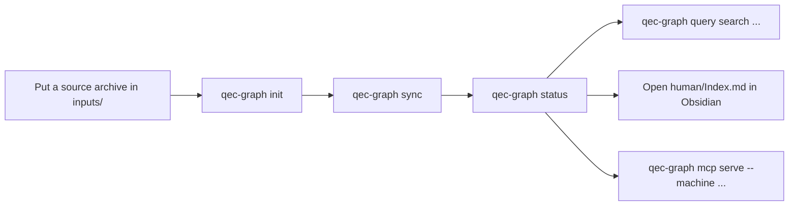

# User guides

> **Status: Current (0.6.x).**

> **English** · [中文](README.zh-CN.md)

> [!TIP]
> If you have never run QEC Graph, use the [quick start](quickstart.md).
> If you already have a workspace, jump straight to the task table below.

## On this page

- [Choose by task](#choose-by-task)
- [Guide map](#guide-map)
- [Common flow](#common-flow)

## Choose by task

| I need to… | Go to |
|---|---|
| Install and import a first paper | [Quick start](quickstart.md) |
| Configure entry points or archive behavior | [Workspace guide](workspace.md) |
| Search sources, records, codes or performance data points | [Data and search](data-and-search.md) |
| Configure AI providers and review proposals | [Workspace guide](workspace.md#ai-configuration) |
| Look up a command, exit code or release check | [Advanced usage](advanced-usage.md) |
| Split a single LaTeX project without the workspace | [Single-paper splitter](splitter.md) |
| See what changed between releases | [Changelog](../../CHANGELOG.md) |

## Guide map

| Guide | Language | Type | Focus |
|---|---|---|---|
| [Quick start](quickstart.md) | English | Tutorial | Shortest path: install → `init` → `sync` → `status` → query |
| [Workspace guide](workspace.md) | English | How-to | `qecgraph.toml`, entry points, provenance, Obsidian, review handoff |
| [Data and search](data-and-search.md) | English | Reference | `research`, evidence, distance policy, CLI/MCP queries |
| [Advanced usage](advanced-usage.md) | English | How-to / reference | Installers, command groups, JSON/exit codes, release checks |
| [Single-paper splitter](splitter.md) | English | Reference | Source spans, fragment layout, custom environments, limits |

## Common flow

For schema, publication and MCP guarantees behind these commands, see the
[system design](../design/DESIGN.md).
