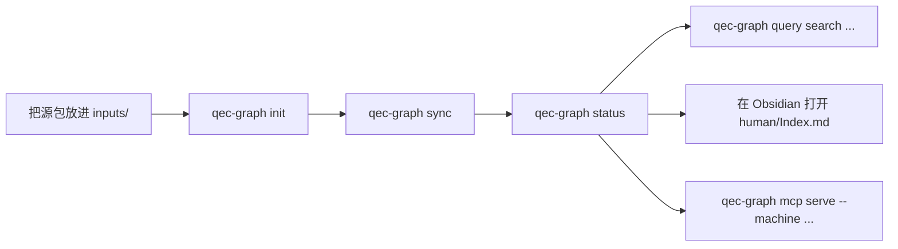

# 用户指南

> **状态：当前（0.4.x）。**

> **中文** · [English](README.md)

> [!TIP]
> 从未运行过 QEC Graph，请使用[中文快速开始](quickstart.zh-CN.md)。
> 已有工作区时，直接看下面的任务表。

## 本页目录

- [按任务选择](#按任务选择)
- [指南地图](#指南地图)
- [常见流程](#常见流程)

## 按任务选择

| 我需要…… | 去哪里 |
|---|---|
| 安装并导入第一篇论文 | [快速开始](quickstart.zh-CN.md) |
| 配置入口或归档行为 | [工作区说明](workspace.zh-CN.md) |
| 搜索来源、记录、码或性能点 | [数据与检索](data-and-search.zh-CN.md) |
| 查命令、退出码或发布检查 | [进阶用法](advanced-usage.zh-CN.md) |
| 不使用工作区，单独切割 LaTeX 工程 | [单篇切割](splitter.zh-CN.md) |
| 查看版本之间发生了什么 | [变更日志](../../CHANGELOG.md) |

## 指南地图

| 指南 | 语言 | 类型 | 重点 |
|---|---|---|---|
| [快速开始](quickstart.zh-CN.md) | 中文 | Tutorial | 最短路径：安装 → `init` → `sync` → `status` → 查询 |
| [工作区说明](workspace.zh-CN.md) | 中文 | How-to | `qecgraph.toml`、入口、来源、Obsidian、审核交接 |
| [数据与检索](data-and-search.zh-CN.md) | 中文 | Reference | `research`、证据、距离策略、CLI/MCP 查询 |
| [进阶用法](advanced-usage.zh-CN.md) | 中文 | How-to / reference | 安装器、命令分组、JSON/退出码、发布检查 |
| [单篇切割](splitter.zh-CN.md) | 中文 | Reference | 来源区间、片段布局、自定义环境、限制 |

## 常见流程

这些命令背后的 Schema、发布和 MCP 保证见[系统设计](../design/DESIGN.zh-CN.md)。
