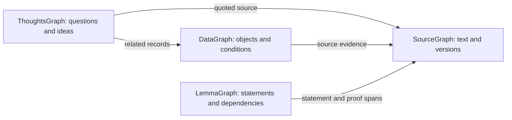

# Data and search

> **Status: Current (0.6.x).** Research records, evidence policy and query contracts.

> **English** · [中文](data-and-search.zh-CN.md)

QEC Graph keeps the original sources, the graph extracted from them, and
versioned research records. Search results refer to the machine release that
served the query, so you can trace a result back to the same data later.

## On this page

- [What the workspace stores](#what-the-workspace-stores)
- [How the four graphs work together](#how-the-four-graphs-work-together)
- [Research record types](#research-record-types)
- [Search by keyword, source, or structured fields](#search-by-keyword-source-or-structured-fields)
- [AI proposals](#ai-proposals)
- [Read and reproduce a query result](#read-and-reproduce-a-query-result)

> [!IMPORTANT]
> A field marked `known` means evidence is attached; it does not mean the
> paper's theorem is mathematically verified. Distance bounds, review states
> and Lean (deferred) remain separate evidence dimensions.

## What the workspace stores

| Layer | Contents |
| --- | --- |
| Original sources | `archive/` keeps submitted package bytes by SHA-256 and receipts with the original filename and claim time. The registry tracks the source tree, selected entry point, processing outcome, and upstream work and version when known. A failed extraction can still have a registered `source_artifact`. |
| Source graph | Parsed LaTeX files and blocks such as definitions, theorems, proofs, equations, tables, and figures. Nodes carry source paths, line and character spans, and content hashes. Edges capture structure, references, and explicitly qualified proof or dependency relations. |
| Research records and assets | Typed records for QEC objects, experiments, and software, plus exact revision links and field-level evidence. Registered assets such as matrices, circuits, or data files have byte lengths and content hashes. Queries expose assets bound to eligible records. |
| Releases and status | `machine/` stores immutable releases, source snapshots, records, and query indexes. Operational status reports package counts and whether the generated views are current. |
| Human views | `human/Index.md` and `human/generated/` are derived Obsidian pages. Personal notes live in `human/notes/`. Workspace MCP reads from `machine/`. |

Importing a paper creates the source graph for supported TeX and can generate
`code_parameters_mention` proposals for recognized parameter notation. A proposal carries
its source location and any unresolved fields. Structured code parameters,
distance bounds, experimental conditions, and performance data points depend on
explicit records and evidence. Source links preserve what the paper reports.
Mathematical checks and semantic review carry separate evidence. Lean is
deferred in 0.6.x; any experimental Lean fixture is not a verification claim.
[Graph semantics and data contracts](../design/DESIGN.md#4-data-contracts)

## How the four graphs work together

SourceGraph provides document structure and exact source locations. LemmaGraph
organizes definitions, assumptions, statements and proof/dependency relations.
DataGraph connects QEC objects to their representations, experimental conditions
and reported results. ThoughtsGraph records why a problem matters, how the paper
approaches it and what questions remain. They share source versions and object
identities rather than maintaining four separate databases.



For example, understanding a decoder improvement may start with its motivation
and approach in ThoughtsGraph, continue with the experiment/noise/metric bindings
in DataGraph, and follow mathematical claims through LemmaGraph. SourceGraph
provides the original text throughout. The arrows show reading paths; only
explicit, evidence-bound relationships establish a recorded dependency or link.

## Research record types

The code examples use the bundled 13-qubit hypergraph-product (HGP) example
to illustrate `qecgraph.research` records. The experiment below uses
hypothetical settings and counts. [Bundled HGP example](../../examples/paper/sections/hgp.tex)

### Papers and codes

| Record kind | Example |
| --- | --- |
| `paper_version` | Stores `work_id`, `upstream_version`, and `source_snapshot_id`. An arXiv paper's `v2` and `v3` can have distinct source snapshots under the same work ID. |
| `code_parameters_mention` | In a supported paragraph such as “A CSS quantum code has parameters `[[13,1,3]]`”, import can propose `n: 13` and `k: 1`, preserve the full notation and its source span, and leave `code_ref` and `distance_interpretation` unresolved. |
| `classical_code` | Describes a classical input, such as the binary length-three repetition code with a `2 × 3` parity-check matrix. |
| `code_family` | Describes the class of ordinary hypergraph-product codes. A family can contain many instances with different seed choices. |
| `construction` | Specifies the recipe for building HGP checks from two repetition seeds. A reconstructable `matrix_recipe` includes the field, shape, indexing, bit order, formula, recipe version, and exact seed revisions. |
| `quantum_code` | Identifies the particular quantum code constructed from those seeds, with `n: 13`, `k: 1`, and links to its construction, check-matrix representations, and distance estimates. |
| `check_matrix` | Records a concrete representation of the instance, such as its `H_X` and `H_Z` check-matrix assets and qubit order. Check-weight statistics specify the check set, sector, and scope, such as X stabilizers. |
| `distance_estimate` | Binds a subject and a metric. For a joint CSS distance of 3, `relation: "exact"` has `lower_bound: 3` and `upper_bound: 3`. A weight-3 logical witness supports `relation: "upper_bound"` with `lower_bound: null`. |

These records let you follow a paper's notation to a specific instance once
`code_ref` is resolved, then inspect the matrices and the evidence for its
distance. The historical HGP example includes a finite enumeration check.

### Circuits, experiments, and results

Suppose a paper describes a simulation of that code with three syndrome
rounds and reports a logical error rate at `p = 0.005`.

| Record kind | Example |
| --- | --- |
| `syndrome_measurement_circuit` | Links the check-matrix representation to the three-round syndrome circuit, with its circuit asset and boundary conditions when supplied. A depth measurement gives its counting rule and unit, such as `two_qubit_layers` in `layers`. |
| `noise_model` | Describes where errors occur, such as two-qubit depolarizing noise after each CNOT. It records whether idle errors, loss, erasure, and leakage are included or excluded when the source establishes this. An unresolved channel field stays `null`. |
| `noise_model_instance` | Binds the model to the circuit and stores `reported_coordinates`, such as `{"p": 0.005}`. Fill `resolved_channel_parameters` when the source establishes what that axis value means for the gates or other channels. |
| `decoder` | Binds the decoding algorithm and the settings used for this experiment, such as minimum-weight perfect matching with a specified weighting rule. |
| `hardware_model` | Records assumptions such as which qubits can interact and whether all CNOTs have the same duration, when the paper specifies them. |
| `experiment` | Links the paper revision, code, check-matrix representation, circuit, noise model, and decoder. An exact link identifies which circuit and decoder the reported result belongs to. |
| `metric` | Defines the event, denominator, and unit, such as a wrong final logical parity per accepted shot, expressed as a fraction. A per-round rate has its own metric. |
| `performance_curve` | Groups performance data points on the same curve, such as logical error rate versus `p` for the three-round experiment. It links the exact experiment and metric revisions. |
| `performance_data_point` | Links the experiment, noise-model instance, metric, and optionally the performance curve. For 20 failures in 10,000 shots with zero discards, the value is `0.002`. In real records, the reported value, counts, and confidence interval each need an exact source locator when supplied. |
| `execution_environment` | Describes the environment of an actual run, such as the operating system, CPU architecture, interpreter, and dependency versions. |
| `execution_run` | Ties a specific execution to its environment and execution evidence, such as a saved log and output hash. A local reproduction can link back to the reported experiment through `experiment_ref`. |

The synthetic fixture shows how partial data is stored. `demo:noise-point`
has the axis coordinate but leaves the channel mapping unresolved. The
linked `demo:point` has `value: null` because the fixture supplies no logical
failure rate. [Linked synthetic fixture](../../tests/fixtures/performance_context.synthetic.json)

### Software and algorithms

| Record kind | Example |
| --- | --- |
| `algorithm` | Minimum-weight perfect matching (`MWPM`) identifies the method that a `decoder` can reference. |
| `software_project` | `software:stim` identifies the Stim project and its repository. |
| `software_distribution` | The `stim` package in the `pypi` ecosystem links back to the project through `project_ref`. |
| `software_release` | Stores an exact package version, for example `version: "1.2.3"` when a manifest pins that version. Its `distribution_ref` identifies which package it belongs to. |
| `software_usage` | A citation can use `usage_kind: "citation"`. If the methods section explicitly says Stim simulated a particular experiment, `source_reported_use` binds that paper and experiment. `locally_observed_use` binds a real run. Keep `release_ref: null` when the version is unknown. |
| `software_catalog_observation` | Captures a dated observation such as the repository's `archived` and `disabled` flags from a metadata refresh. The field evidence links the catalog source that recorded the API URL and response hash. |
| `catalog_source` | Identifies the catalog or upstream metadata source and its checked scope. For example, the bundled seed records that its coverage is non-exhaustive. |

Importing the bundled catalog creates catalog, project, distribution, and
algorithm records. A usage record needs evidence of what the paper or run
actually used, including the version when available. [Bundled software catalog](../../qecgraph/catalog/software_catalog.seed.json)

### Research thoughts — ThoughtsGraph

The `research_thought` kind preserves one source-grounded thought per record.
Its nine categories correspond to the questions retained in
[Human.md](../design/Human.md):

| `category` | What to retain |
|---|---|
| `problem` | The question or limitation the paper addresses |
| `motivation` | Why that question matters |
| `approach` | The proposed method or route to a solution |
| `intuition` | An intuition or guiding idea stated in the paper |
| `assumption` | A premise or restriction important to the argument |
| `conclusion` | The reported outcome and its scope |
| `open_question` | An unresolved issue or suggested next question |
| `surprising_result` | A surprising or counterintuitive finding identified in the source |
| `side_result` | A result outside the main line of the paper |

Read `approach` together with `conclusion` to assess what was accomplished.
`relation_to_prior` can record an extension, strengthening or contradiction of
prior work; it remains unknown when the source does not establish the relation.

Each record includes `statement`, the verbatim `source_quote`, `attribution`
and a `source_ref` to an exact `paper_version` revision. For `author_explicit`,
the statement must equal the quotation. `editorial_inference` identifies a
human or AI interpretation supported by that quotation. Real records bind both
fields to the same source span; successful quotation checks do not verify the
paper's conclusion or turn an interpretation into the author's words.

`addresses_refs`, `motivated_by_refs`, `extends_refs` and `contradicts_refs`
link exact revisions of other thoughts. `related_refs` can connect a thought to
research records such as a construction, decoder or experiment. An `assumption`
thought captures the paper's premise; it does not automatically create a
reviewed theorem dependency. Generated pages for registered thought records
appear under `human/generated/thoughts/`. Private `human/notes/` is never input.

### Fields, revisions, and evidence

Each `qecgraph.research` record has a `schema`, stable `id`, exact
`revision`, `kind`, `data`, `field_evidence`, and `is_synthetic` flag. A
reference such as `{"id": "demo:source", "revision": "r1"}` names the exact
source revision. Evidence can also specify the source location and the limits
of the extraction or check. In this excerpt from the synthetic code example,
the fixture supplies the qubit count, and the construction is still unknown.

```json
{
  "data": {"n": 13, "construction_ref": null},
  "field_evidence": {
    "/data/n": {
      "status": "known",
      "source_ref": {"id": "demo:source", "revision": "r1"},
      "method": "synthetic_fixture"
    },
    "/data/construction_ref": {"status": "not_extracted"}
  }
}
```

Use `null` for unknown fields. `not_extracted` indicates unfinished
extraction. `unresolved` can indicate an ambiguous link. `not_reported`
requires a dated check of a specified part of the source. `not_applicable`
and `conflicting` record why the field has no single value. Default workspace
queries filter synthetic records and stale provider approvals. Proposed or draft
records remain visible with their `review_status`; they are never treated as verified. Legacy
`qecgraph.record` records can also carry claims and evidence, plus
experimental Lean mapping fields. Lean is deferred and is not part of the
supported 0.6.x workflow; see [the design note](../design/DESIGN.md#10-lean-deferred-not-supported).
The research schema lists the supported kinds, the fields that must be present
for each kind, and the shape of nullable `{id, revision}` links. Its
`x-qec-target-kinds` annotations describe the allowed target kinds. A JSON
Schema validator also checks evidence metadata, managed asset IDs, and
portable value constraints such as matrix recipes, code parameters, bound
direction, measurement units, and rates.
QEC Graph checks consistency between related values, that the exact target
revision is present, that the pointer resolves to the value, and that the
records agree.

[Research record schema](../../qecgraph/validators/schemas/research.schema.json) · [Corpus record schema](../../qecgraph/validators/schemas/record.schema.json)

## Search by keyword, source, or structured fields

The CLI and MCP use the same read-only workspace tools. Use these names in
your MCP client or pass them to `qec-graph query-tool` with JSON arguments.

| Goal | Tools | How to start |
| --- | --- | --- |
| Find a term, label, source, or record | `qecgraph_search` | Pass `query` and optionally `kind`, `limit`, and `offset`. The workspace search matches keywords case-insensitively. Use `kind: "code_parameters_mention"` to focus on notation proposals. |
| Search the reading view | `qecgraph_search` | Set `view: "reading"` or run `qec-graph search TERM --workspace . --view reading`. Results contain a bounded excerpt and the source occurrence. |
| Read a record and follow its links | `qec_get_entity`, `qec_get_context` | Pass the result's `id` as `identifier`. Supply `revision` to select an exact research record when several revisions are available. |
| Read the original passage or asset | `qec_get_source`, `qec_get_asset` | Use the registered source occurrence ID or a record's asset ID. Source ranges use half-open Unicode code point offsets. Asset ranges use byte offsets. |
| Inspect graph nodes and dependencies | `qecgraph_show`, `qecgraph_context`, `qecgraph_deps`, `qecgraph_impact` | Use the graph node ID or a unique label. `deps` follows what a result depends on. `impact` follows what depends on it. Inspect edge status before relying on a candidate or historical link. |
| Filter quantum codes | `qec_find_codes` | Use `n_min` or `n_max` to filter code size. For a hard distance bound, specify the metric ID and choose a sector (`joint` by default). The default `verified` policy requires current bound evidence and accepts an exact `metric_revision`. For a workspace hard filter with `source_reported`, specify `metric_revision`. The distance estimate must name a check-matrix representation linked to the code and cite a span in the current source projection. |
| Find performance data points | `qec_find_performance` | Filter by `code_id`, `decoder_id`, `noise_model_id`, or `metric_id`. Use `complete_only: true` for points with the required context bound. Coordinate selection supports exact or nearest reported points and returns the actual reported coordinate. |
| Find software or an algorithm | `qec_find_software` | Search by `query` or `role`. A project entry describes the catalog. Follow its usage records for evidence that a paper or run used it. |
| Inspect workspace status | `qec_workspace_status` | Pass `{}` to read the latest recorded operational status alongside the connection's fixed knowledge release. If the operational report is missing or malformed, `operational_status` is `null`; the fixed release and its coverage are still returned. |

For example, after importing the bundled paper, search for HGP.

```sh
qec-graph query-tool qecgraph_search --workspace . --arguments /dev/stdin <<'JSON'
{"query":"HGP","limit":5}
JSON
```

Copy a result's `id` into `qec_get_entity`. For a graph hit with a source span,
pass its occurrence ID to `qec_get_source` to retrieve the exact LaTeX. MCP
clients can also list and read registered passages by their `qec://source/`
resource URIs. In the CLI, use `--revision` with workspace `query show` or
`query context` to select an exact research record revision. The CLI also
offers direct commands for structured queries.

```sh
qec-graph query codes --workspace . --n-min 10 --n-max 100 --limit 5
qec-graph query performance --workspace . --coordinate-name p --coordinate 0.01 --selection exact
qec-graph query software --workspace . --query Stim --limit 5
```

Pass `--release RELEASE_ID` to repeat a query against the same workspace release.
Use `--machine` to query a mounted machine directory directly.

A workspace populated only by paper imports can contain notation proposals
and source passages while the structured instance or performance query comes
back empty. For distance filtering, check the metric, sector, direction of
the bound, and evidence policy. For performance, compare the returned metric
definition, experiment and curve revisions, noise, decoder, and unresolved
conditions before comparing values. [Import and review records](advanced-usage.md#manage-the-obsidian-vault-and-research-records)

## AI proposals

AI extraction writes `qecgraph.ai.proposal` files under
`machine/ai/proposals/`. They remain `proposed` and are not selected by the
default verified evidence policy. List them with `qec-graph ai proposals` and
record an explicit decision with `qec-graph ai decide`. A decision binds the
published proposal hash and source snapshot. If either changes, the original
decision is retained and reported as stale. Proposal references use
`projection_path:first-last` with 1-based inclusive lines. The projection maps
back to the archived source. Existing unbound proposals are retained on disk.
Run `sync` with AI configured to generate bound proposals from the archive.

### Extract and read research thoughts

With a provider configured and `[ai].extract_proposals = true`, `sync` runs
`extract_thoughts` alongside the other extraction skills. AI must be enabled,
credentials available and source upload allowed. With `extract_proposals = false`,
this semantic extraction does not run; AI normalization/structure fallback has
separate controls. The output keeps
exact quotations and source references and remains a proposal, including when
`attribution` is `author_explicit`. A review decision does not automatically
convert it to a `research_thought` record.

The current [skill v2](../../qecgraph/llm/skills/extract_thoughts/SKILL.md) specifies
the extraction procedure, all nine category boundaries and a complete JSON
example. It directs the model to distinguish the initial problem, its motivation,
the method and the outcome, then check intuition, assumptions, open questions,
surprising and side results. Conditions such as noise, idle/loss treatment,
decoder and simulated range stay with the claim. Missing categories and context
go in `unresolved`; the model must not invent them. Exact author quotations use
`author_explicit`; paraphrases and interpretations use `editorial_inference`.

The skill produces thought items, not relationships between them. Links such as
`addresses_refs`, `extends_refs` and `contradicts_refs` belong to separately
curated, evidence-bound research records. Program checks enforce the schema,
valid source ranges and verbatim quotations; they do not establish that a
category or interpretation is scientifically correct.

v0.6.2 shipped skill v1. Skill v2 keeps the same output fields and is used for
new or missing extraction jobs after updating the source installation. Completed
jobs retain their proposals and `provenance.skill_version`: neither `sync` nor
`rebuild` reruns them just because a skill version changed. There is currently no
CLI command for explicitly re-extracting a completed batch with a new skill.

Search bound thought proposals through the research profile:

```sh
qec-graph query-tool qec_search --workspace . --profile research --arguments /dev/stdin <<'JSON'
{"query":"decoder","kind":"research_thought_proposal","include_proposals":true,"limit":5}
JSON
```

Use a returned ID with `qec_fetch` to inspect the proposal and its quotation.
Check the original passage and record an explicit review decision. To publish
a research record, prepare the source-bound JSON and use the
[research import workflow](advanced-usage.md#manage-the-obsidian-vault-and-research-records);
its evidence and review status remain explicit.

Search registered thought records separately:

```sh
qec-graph query-tool qec_search --workspace . --profile research --arguments /dev/stdin <<'JSON'
{"query":"decoder","kind":"research_thought","limit":5}
JSON
```

Pass a record's `id` and `revision` to `qec_get_context` with `purpose: "thought"`
for linked records and evidence, or to `qec_trace` for typed relationships.
Editorial-inference relations are candidates and require `include_candidates`
to follow. Missing components stay explicit. An empty result does not mean
the paper contains no such idea; search its source text and check extraction
coverage. Proposal search requires opt-in; registered records may still have
draft/proposed review status.

## Read and reproduce a query result

Use `scope` and `knowledge_snapshot` to identify the release, and `coverage`
to see what is registered or indexed. If a result is `truncated`, use its
`continuation` as the next `offset` when the tool supports paging. A response
budget can shorten a page, and the continuation starts at the next complete
result. For a source passage that exceeds the response budget, request a smaller character
range. An empty result describes the search and release you queried.

An MCP connection fixes the knowledge release at startup. Reconnect after
`sync` to read the newly published release. If the client configuration came
from `mcp-config`, regenerate it to update its explicit release ID. The CLI
also accepts `--release` to repeat a query against a particular release.
[MCP setup](../../README.md#mcp)

### Document reading profiles

The default MCP profile retains the original 13 tools. Use `--profile research`
with `mcp serve`, `mcp config` or `query-tool` for seven task tools, including
`qec_fetch` and `qec_search`. `qec_fetch` accepts an exact `identifier` and
`view: "outline"`, `"raw"` or `"reading"`. Outlines use `limit`/`offset`;
source ranges use original Unicode `char_start`/`char_end`. A document returns
its registered source files separately, preserving include boundaries. A section
returns continuous text through the next section boundary, including subsections.
Exact `source_version_id` requests never fall back to a different version.

`--profile compatible` exposes just `search(query)` and `fetch(id)`, returning
citable evidence units. Register a version-specific public `canonical_url` in
`[sources."<source-tree-hash>"]` alongside `work_id`, then rebuild. No URL is
invented for local sources; they remain available in the research profile.
Large generic fetches fail with `BUDGET_TOO_SMALL`; use research ranges or a
larger session budget. `qec_status` reports full-text and metadata-only coverage.

### Optional hybrid retrieval

Enable the local projection in `qecgraph.toml`, then run sync or rebuild. The
local model hashes lexical features; it is an offline retrieval baseline, not a
pretrained semantic model. The index contains BM25 term counts and chunk vectors,
never private notes. Source text remains searchable without an index.

```toml
[retrieval]
enabled = true
provider = "local"
model = "qecgraph-word-char-hash"
model_revision = "1"
dimensions = 512
chunk_chars = 2048
allow_source_upload = false
```

For semantic embeddings, use an OpenAI-compatible endpoint. Set `provider` to
`"openai_compatible"`, the actual `model`, an operator-pinned `model_revision`,
`base_url`, supported `dimensions`, `api_key_env`, and `allow_source_upload = true`.
Never put a key in this table. The model/revision must identify the same embedding
space during ingestion and queries; dimensions alone are insufficient.

`qec_search` accepts `mode: "keyword"`, `"vector"` or `"hybrid"` (default).
`kind` and exact `source_version_id` restrict candidates before ranking. Results
include index identity and coverage. Hybrid mode reports keyword fallback when
embeddings are unavailable; vector-only mode returns an explicit error. Source
and record results are discovery candidates, never proof of a hard condition.
After explicit research-record imports, refresh the projection with sync.
The writer checks `max_chunks` and `max_total_chars` before publishing; failures
keep the previous release. Rebuild can restore a damaged derived index.

### Research context and exact conditions

In the research profile, `qec_get_context` adds `purpose`:
`theorem`, `performance`, `construction`, `thought` or `lean`. It returns whole
source blocks/records, typed evidence links, `missing_components`, `unknown_fields`
and `conflicts`. Local definitions are labeled context, not inferred dependencies.
The root is never silently shortened. Lean mode only prepares reading material.

`qec_trace` accepts an exact identifier/revision, `relations`, `direction`
(`outgoing`, `incoming`, `both`), `depth`, `max_nodes` and `include_candidates`.
Stale/unbound/unresolved edges remain excluded; candidate relations require opt-in.

`qec_query_codes` retains the distance policy and adds `k_min`/`k_max`,
`classification` (such as `css`), and the complete triplet `check_weight_max`,
`check_weight_sector`, `check_weight_scope`. Classification and weight need current
source evidence. Distance and weight must qualify on the same check-matrix revision.
`qec_query_performance` adds exact `circuit_id`, `source_version_id`, `idle` and
`loss` (`included`/`excluded`). Unknown noise conditions never satisfy those filters.
Reported points are not interpolated. `comparison_group` groups identical bound
conditions; missing conditions leave it null and mathematical validity is not asserted.

These exact queries enumerate records with pagination and field coverage. Pass
`source_query` to obtain a separately labeled, bounded set of raw-source candidates;
those candidates do not count as confirmed parameter matches. Empty field results
always retain a source-search route.
