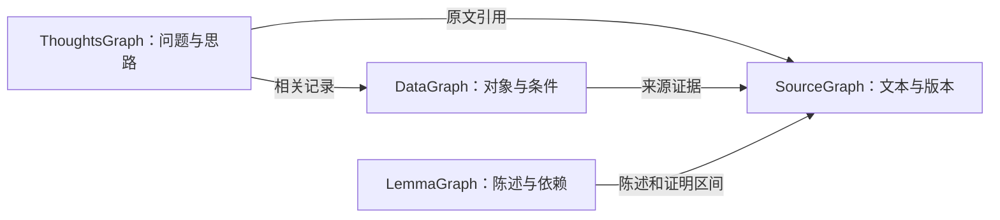

# 数据与检索

> **状态：当前（0.6.x）。** 研究记录、证据策略和查询契约。

> **中文** · [English](data-and-search.md)

QEC Graph 保存原始来源、从来源抽取的图，以及带版本的研究记录。搜索结果指向
实际提供查询的机器 release，因此之后可以把结果追溯到同一份数据。

## 本页目录

- [工作区保存什么](#工作区保存什么)
- [四种图如何配合](#四种图如何配合)
- [研究记录类型](#研究记录类型)
- [按关键词、来源或结构化字段检索](#按关键词来源或结构化字段检索)
- [AI proposals](#ai-proposals)
- [读取和复现查询结果](#读取和复现查询结果)

> [!IMPORTANT]
> 字段标记为 `known` 只表示已绑定证据，不表示论文定理已获数学验证。
> 距离界、审核状态和 Lean（延期）是彼此独立的证据维度。

## 工作区保存什么

| 层 | 内容 |
| --- | --- |
| 原始来源 | `archive/` 按 SHA-256 保存提交包字节，并保存带原始文件名和认领时间的收据。registry 跟踪来源树、选定入口、处理结果，以及已知时上游 work/version。抽取失败仍可有已登记的 `source_artifact`。 |
| 来源图 | 解析后的 LaTeX 文件与块，如定义、定理、证明、公式、表格和图片。节点带来源路径、行/字符区间和内容哈希。边表示结构、引用，以及明确限定的证明或依赖关系。 |
| 研究记录和资产 | QEC 对象、实验和软件的类型化记录，以及精确修订链接和字段级证据。矩阵、电路或数据文件等登记资产带字节长度和内容哈希。查询只暴露绑定到合格记录的资产。 |
| Release 和状态 | `machine/` 保存不可变 release、来源快照、记录和查询索引。运行状态报告包计数及生成视图是否最新。 |
| 人类视图 | `human/YYYY/MM/*_thoughts.md` 每篇论文一份派生问答笔记。个人笔记放在 `human/` 之外。工作区 MCP 从 `machine/` 读取。 |

导入论文会为受支持 TeX 创建来源图，并可对识别出的参数记法生成
`code_parameters_mention` 提案。提案带来源位置和未解决字段。结构化码参数、距离界、
实验条件和性能点依赖显式记录和证据。来源链接保留论文实际报告的内容。
数学检查和语义审核携带独立证据。Lean 在 0.6.x 中延期；任何实验 Lean fixture
都不是验证结论。[图语义和数据契约](../design/DESIGN.zh-CN.md#4-数据契约)

## 四种图如何配合

SourceGraph 提供文档层级与精确来源位置；LemmaGraph 组织定义、假设、陈述、证明文字
及依赖关系；DataGraph 将 QEC 对象与具体呈现、实验条件和报告结果关联；ThoughtsGraph
保存问题的重要性、论文采用的思路以及遗留的问题。它们共享来源版本和对象身份，
不是四套各自维护的数据库。



例如，要理解某个 decoder 的改进，可以从 ThoughtsGraph 的动机与方法出发，在
DataGraph 核对实验、噪声与度量，再通过 LemmaGraph 查看涉及的数学陈述。
整个过程都能回到 SourceGraph 阅读原文。图中箭头表示阅读路径；实际记录的依赖或关联
以显式、带证据的关系为准。

## 研究记录类型

代码示例使用自带的 13-qubit hypergraph-product（HGP）示例说明
`qecgraph.research` 记录。下面的实验使用假设设置和计数。
[自带 HGP 示例](../../examples/paper/sections/hgp.tex)

### 论文和码

论文列表和卡片离线显示 `arxiv_id` 及其来源。已登记的 arXiv 摘要页 URL 优先于归档文件名中的唯一编号。文件名给出多个不同编号时，编号留空并列出候选项。文件名不会更改已登记的论文身份或引用 URL。

| 记录 kind | 示例 |
| --- | --- |
| `paper_version` | 保存 `work_id`、`upstream_version` 和 `source_snapshot_id`。arXiv 论文的 `v2` 和 `v3` 可以在同一 work ID 下有不同来源快照。 |
| `code_parameters_mention` | 在受支持段落如“A CSS quantum code has parameters `[[13,1,3]]`”中，导入可提议 `n: 13` 和 `k: 1`，保留完整记法和来源区间，并让 `code_ref` 和 `distance_interpretation` 保持未解决。 |
| `classical_code` | 描述经典输入，如带 `2 × 3` 校验矩阵的二元长度三重复码。 |
| `code_family` | 描述普通 hypergraph-product 码这一类。一个 family 可包含许多不同 seed 选择的实例。 |
| `construction` | 指定从两个 repetition seed 构建 HGP checks 的配方。可重建的 `matrix_recipe` 包含域、形状、索引、bit order、公式、recipe 版本和精确 seed 修订。 |
| `quantum_code` | 标识由这些 seed 构建的特定量子码，带 `n: 13`、`k: 1`，并链接其 construction、check-matrix representations 和 distance estimates。 |
| `check_matrix` | 记录实例的具体表示，如 `H_X`/`H_Z` 校验矩阵资产和 qubit 顺序。check-weight 统计指定 check 集、sector 和范围，如 X stabilizers。 |
| `distance_estimate` | 绑定对象和度量。联合 CSS 距离 3 时，`relation: "exact"` 有 `lower_bound: 3` 和 `upper_bound: 3`。weight-3 逻辑 witness 支持 `relation: "upper_bound"` 且 `lower_bound: null`。 |

这些记录让你在 `code_ref` 解析后，从论文记法追到具体实例，再检查矩阵和
距离证据。历史 HGP 示例包含有限枚举检查。

### 电路、实验和结果

假设论文描述该码在三轮 syndrome 下的模拟，并报告 `p = 0.005` 处的逻辑失败率。

| 记录 kind | 示例 |
| --- | --- |
| `syndrome_measurement_circuit` | 把码表示链接到三轮 syndrome 电路，提供时带电路资产和边界条件。深度测量给出计数规则和单位，如 `layers` 中的 `two_qubit_layers`。 |
| `noise_model` | 描述错误发生位置，如每个 CNOT 后的两 qubit depolarizing noise。来源明确时记录是否包含 idle errors、loss、erasure 和 leakage。未解决 channel 字段保持 `null`。 |
| `noise_model_instance` | 把模型绑定到电路并保存 `reported_coordinates`，如 `{"p": 0.005}`。来源明确该轴值对门或其他 channel 的含义时，填写 `resolved_channel_parameters`。 |
| `decoder` | 绑定解码算法和本实验设置，如带指定加权规则的 minimum-weight perfect matching。 |
| `hardware_model` | 记录论文明确说明的假设，如哪些 qubit 可交互、所有 CNOT 是否同时长。 |
| `experiment` | 链接论文修订、码、表示、电路、噪声模型和解码器。精确链接标识报告结果属于哪个电路和解码器。 |
| `metric` | 定义事件、分母和单位，如每个 accepted shot 的错误最终逻辑 parity，以分数表示。每轮速率有自己的 metric 定义。 |
| `performance_curve` | 把同一 performance curve 上的 data points 分组，如三轮实验的逻辑失败率对 `p`。它链接精确实验和 metric 修订。 |
| `performance_data_point` | 链接实验、噪声实例、metric，可选 performance curve。10,000 shots 中 20 次失败、零丢弃时值为 `0.002`。真实记录中，报告值、计数和置信区间在提供时都需精确来源定位。 |
| `execution_environment` | 描述实际运行环境，如操作系统、CPU 架构、解释器和依赖版本。 |
| `execution_run` | 把具体执行绑定到环境和执行证据，如保存的日志和输出哈希。本地复现可用 `experiment_ref` 链接回报告实验。 |

合成 fixture 展示部分数据如何保存。`demo:noise-point` 有轴坐标，但 channel
映射未解决。链接的 `demo:point` 的 `value: null`，因为 fixture 未提供逻辑
失败率。[链接的合成 fixture](../../tests/fixtures/performance_context.synthetic.json)

### 软件和算法

| 记录 kind | 示例 |
| --- | --- |
| `algorithm` | Minimum-weight perfect matching（`MWPM`）标识 `decoder` 可引用的方法。 |
| `software_project` | `software:stim` 标识 Stim 项目及其仓库。 |
| `software_distribution` | `pypi` 生态中的 `stim` 包通过 `project_ref` 链接回项目。 |
| `software_release` | 保存精确包版本，如 manifest 固定该版本时 `version: "1.2.3"`。其 `distribution_ref` 标识所属包。 |
| `software_usage` | 引用可用 `usage_kind: "citation"`。若方法节明确说明 Stim 模拟了某实验，`source_reported_use` 绑定该论文和实验；`locally_observed_use` 绑定真实运行。版本未知时 `release_ref: null`。 |
| `software_catalog_observation` | 记录带日期的观察，如元数据刷新得到仓库的 `archived` 和 `disabled` 标志。字段证据链接记录 API URL 和响应哈希的 catalog 来源。 |
| `catalog_source` | 标识 catalog 或上游元数据来源及其检查范围，例如自带 seed 记录其覆盖并非穷尽。 |

导入自带 catalog 会创建 catalog、project、distribution 和 algorithm 记录。
usage 记录需要论文或运行实际使用内容的证据，包括已知版本。
[自带软件 catalog](../../qecgraph/catalog/software_catalog.seed.json)

### 研究思路 — ThoughtsGraph

`research_thought` 每条记录保存一项有来源依据的研究思路，九个类别对应
[Human.md](../review/Human-2026-11-11.zh-CN.md) 中保留的问题：

| `category` | 保存什么 |
|---|---|
| `problem` | 论文针对的问题或已有工作的局限 |
| `motivation` | 这个问题为什么重要 |
| `approach` | 提出的方法或解决路线 |
| `intuition` | 论文明确描述的直觉或关键想法 |
| `assumption` | 对论证重要的前提或限制 |
| `conclusion` | 报告的结果及其适用范围 |
| `open_question` | 未解决的问题或提出的后续问题 |
| `surprising_result` | 来源指出的不同寻常或反直觉发现 |
| `side_result` | 主线之外的结果 |

“是否解决了问题”需要结合 `approach` 与 `conclusion` 阅读。
`relation_to_prior` 可记录对前人工作的补充、加强或矛盾；来源没有确立关系时保留未知。

每条记录包含 `statement`、逐字原文 `source_quote`、归属 `attribution`，以及指向
精确 `paper_version` 修订的 `source_ref`。`author_explicit` 要求陈述与引用完全相同；
`editorial_inference` 表示人工或 AI 根据引用做出的解读。真实记录的两项内容都需绑定
同一来源区间。引用校验通过不证明论文结论正确，也不会把解读变成作者的原话。

`addresses_refs`、`motivated_by_refs`、`extends_refs`、`contradicts_refs` 关联其他
思路的精确修订；`related_refs` 可关联构造、decoder、实验等研究记录。
`assumption` 思路保存论文前提，不会自动产生经审核的定理依赖。当前来源绑定的 AI 提案
与已登记思路汇入 `human/YYYY/MM/*_thoughts.md`，每篇论文一份，AI 回答仍是 proposed，
缺失答案明确显示。Skill 从 v3 开始同时抽取带引用的书目信息和主要主题，供 Obsidian 属性使用。
Skill v4 读取带行号的正文和附录文件，引用只保留关键短句（建议少于 240 字符，
新抽取最多 480 字符），解释留在回答中。已有提议仍可读取。
人类笔记和私人笔记永不作为输入。[布局与迁移](workspace.zh-CN.md#obsidian-和机器访问隔离)

### 字段、修订和证据

每条 `qecgraph.research` 记录有 `schema`、稳定 `id`、精确
`revision`、`kind`、`data`、`field_evidence` 和 `is_synthetic` 标志。
引用如 `{"id": "demo:source", "revision": "r1"}` 指定精确来源修订。证据也可
指定来源位置及抽取/检查限制。下面的合成代码示例中，fixture 提供 qubit 数，
construction 仍未知。

```json
{
  "data": {"n": 13, "construction_ref": null},
  "field_evidence": {
    "/data/n": {
      "status": "known",
      "source_ref": {"id": "demo:source", "revision": "r1"},
      "method": "synthetic_fixture"
    },
    "/data/construction_ref": {"status": "not_extracted"}
  }
}
```

未知字段用 `null`。`not_extracted` 表示抽取未完成；`unresolved` 表示链接有
歧义；`not_reported` 要求对来源指定部分做带日期检查；`not_applicable` 和
`conflicting` 记录字段为何没有单一值。默认工作区查询过滤 synthetic 记录和
过期 provider 批准；proposed/draft 记录仍可见并携带 `review_status`，但绝不当作已验证。
旧 `qecgraph.record` 记录也可携带 claims、证据和实验性
Lean 历史映射字段。Lean 执行已移除。见
[设计说明](../design/DESIGN.zh-CN.md#10-lean-路线已移除)。
research schema 列出受支持 kinds、每种 kind 必填字段，以及可空 `{id, revision}`
链接形状。`x-qec-target-kinds` 注解描述允许的目标 kind。JSON Schema 校验器还
检查证据元数据、受管理资产 ID，以及矩阵 recipe、码参数、界方向、测量单位和
速率等可移植值约束。QEC Graph 检查相关值的一致性、精确目标修订是否存在、
指针是否解析到该值，以及记录是否一致。

[研究记录 schema](../../qecgraph/validators/schemas/research.schema.json) · [corpus 记录 schema](../../qecgraph/validators/schemas/record.schema.json)

## 按关键词、来源或结构化字段检索

CLI 和 MCP 使用同一套只读工作区工具。在 MCP 客户端中使用这些名称，或把 JSON
参数传给 `qec-graph query-tool`。

| 目标 | 工具 | 如何开始 |
| --- | --- | --- |
| 查找术语、标签、来源或记录 | `qecgraph_search` | 传 `query`，可选 `kind`、`limit`、`offset`。工作区搜索大小写无关。用 `kind: "code_parameters_mention"` 聚焦记法提案。 |
| 搜索阅读视图 | `qecgraph_search` | 设置 `view: "reading"`，或运行 `qec-graph search TERM --workspace . --view reading`。结果带有界摘录和原文 occurrence。 |
| 读取记录并跟踪链接 | `qec_get_entity`、`qec_get_context` | 把结果 `id` 作为 `identifier`。有多个修订时传 `revision` 选择精确研究记录。 |
| 读取原始段落或资产 | `qec_get_source`、`qec_get_asset` | 用已登记来源 occurrence ID 或记录的 asset ID。来源区间用半开 Unicode codepoint 偏移，资产区间用字节偏移。 |
| 检查图节点和依赖 | `qecgraph_show`、`qecgraph_context`、`qecgraph_deps`、`qecgraph_impact` | 用图节点 ID 或唯一标签。`deps` 跟随结果依赖什么，`impact` 跟随什么依赖它。依赖 candidate 或历史链接前检查边状态。 |
| 过滤码实例 | `qec_find_codes` | 用 `n_min`/`n_max` 过滤码大小。硬距离界需指定 metric ID 和 sector（默认 `joint`）。默认 `verified` 策略要求当前界证据，并接受精确 `metric_revision`。`source_reported` 策略的硬距离过滤要求 `metric_revision`。 工作区的 `source_reported` 硬筛选还要求距离估计绑定该码的校验矩阵表示，并引用当前来源投影中的区间。 |
| 查找性能点 | `qec_find_performance` | 按 `code_id`、`decoder_id`、`noise_model_id` 或 `metric_id` 过滤。`complete_only: true` 只取满足必需上下文的点。坐标选择支持精确或最近报告点，并返回实际报告坐标。 |
| 查找软件或算法 | `qec_find_software` | 按 `query` 或 `role` 搜索。项目条目描述 catalog；沿 usage 记录查论文或运行使用证据。 |
| 检查工作区状态 | `qec_workspace_status` | 传 `{}`，读取最新运行状态及连接的固定知识 release。运行报告缺失或格式错误时 `operational_status` 为 `null`，固定 release 及其覆盖仍返回。 |

例如，导入自带论文后搜索 HGP。

```sh
qec-graph query-tool qecgraph_search --workspace . --arguments /dev/stdin <<'JSON'
{"query":"HGP","limit":5}
JSON
```

把结果 `id` 复制到 `qec_get_entity`。图命中带来源区间时，把 occurrence ID 传给
`qec_get_source` 取精确 LaTeX。MCP 客户端还可按 `qec://source/` resource URI
列出和读取已登记段落。CLI 中用 `--revision` 配合工作区 `query show` 或
`query context` 选择精确研究记录修订。CLI 也提供结构化查询的直接命令。

```sh
qec-graph query codes --workspace . --n-min 10 --n-max 100 --limit 5
qec-graph query performance --workspace . --coordinate-name p --coordinate 0.01 --selection exact
qec-graph query software --workspace . --query Stim --limit 5
```

传 `--release RELEASE_ID` 可对同一工作区 release 重复查询。用 `--machine`
直接查询挂载的 machine 目录。

只导入论文的工作区可以有记法提案和来源段落，而结构化实例或性能查询为空。
距离过滤前检查 metric、sector、界方向和证据策略。性能比较前，先比较返回的
metric 定义、实验和曲线修订、噪声、解码器及未解决条件。
[导入和审核记录](advanced-usage.zh-CN.md#管理-obsidian-vault-和研究记录)

## AI proposals

AI 抽取会把 `qecgraph.ai.proposal` 写入 `machine/ai/proposals/`。它们保持
`proposed`，不会被默认的 verified 证据策略选中。用 `qec-graph ai proposals`
列出，用 `qec-graph ai decide` 记录显式决定。决定绑定已发布提案的哈希和来源快照。
任一绑定变化时保留原决定，并显示为失效。提案引文使用
`projection_path:first-last`，行号从 1 开始并包含两端，投影可映射回归档来源。
旧版未绑定的提案保留在磁盘。配置 AI 后运行 `sync`，可从归档生成已绑定的提案。

### 提取与阅读研究思路

配置 provider 并启用 `[ai].extract_proposals = true` 后，`sync` 与其他抽取 skill
一起运行 `extract_thoughts`，同时要求 AI 已启用、凭据可用且允许上传来源。
新配置默认开启提案抽取，选择 OpenRouter 和 `deepseek/deepseek-v4.1-flash-1017`，
API key 留给用户填写。
`extract_proposals = false` 时不运行这一步语义抽取；AI 规范化与结构回退另有控制开关。
输出保留精确引用和来源位置，始终是提案；
即使 `attribution` 为 `author_explicit` 也不例外。审核决定不会自动将其转换为
`research_thought` 记录。

当前 [skill v5](../../qecgraph/llm/skills/extract_thoughts/SKILL.md) 给出具体抽取步骤、
九类内容的区分规则和完整 JSON 示例：先区分“要解决什么问题”“为什么值得解决”
“采用什么方法”“实际得到什么结果”，再检查直觉、假设、开放问题、意外结果和旁支结果。
噪声模型、idle/loss、解码器、模拟范围等条件必须与结论一起保留。
缺失类别或上下文写入 `unresolved`，不能凭空补齐；作者逐字原文标为
`author_explicit`，改写、概括和解读标为 `editorial_inference`。

该 skill 生成思路条目，不生成条目之间的关系。`addresses_refs`、`extends_refs`、
`contradicts_refs` 等关系需要另行整理成附证据的研究记录。程序检查输出格式、
来源区间和逐字引用，不能据此保证分类与解读在科学上正确。

v0.6.2 发布包内是 skill v1，当前 v5 要求所有生成内容使用英文，包括回答、元数据、
主题词和 `unresolved`。新输出在发布前检查中文字符，human 九问与提示也统一为英文。
`sync` 会重新抽取旧中文提案；已经完成的英文提案保留原版本与来源绑定，不会仅因
skill 版本变化重跑。human 继续读取同一份机器结果，不另行调用 AI。

通过研究 profile 搜索已绑定来源的思路提案：

```sh
qec-graph query-tool qec_search --workspace . --profile research --arguments /dev/stdin <<'JSON'
{"query":"decoder","kind":"research_thought_proposal","include_proposals":true,"limit":5}
JSON
```

将返回的 ID 传给 `qec_fetch`，查看提案与原文引用，核对原文后记录明确的审核决定。
要发布研究记录，需准备绑定来源的 JSON 并使用
[research 导入流程](advanced-usage.zh-CN.md#管理-obsidian-vault-和研究记录)；
记录仍保留明确的证据和审核状态。

另行搜索已登记的思路记录：

```sh
qec-graph query-tool qec_search --workspace . --profile research --arguments /dev/stdin <<'JSON'
{"query":"decoder","kind":"research_thought","limit":5}
JSON
```

将记录的 `id`、`revision` 传给 `qec_get_context`，设置 `purpose: "thought"`，
读取相关记录与证据；或使用 `qec_trace` 查看类型化关系。整理者解读的关系是 candidate，
跟随这些关系需要 `include_candidates`。缺失组件会明确列出。搜索为空不代表论文没有
相关想法，应继续查询原文并检查抽取覆盖。提案搜索需要显式开启；已登记记录也可能仍为
draft/proposed 审核状态。

## 读取和复现查询结果

用 `scope` 和 `knowledge_snapshot` 标识 release，用 `coverage` 查看已登记或
索引内容。结果 `truncated` 时，在工具支持分页时把 `continuation` 作为下一个
`offset`。响应预算会缩短一页，continuation 从下一个完整结果开始。来源段落
超过响应预算时，请求更小的字符区间。空结果描述你查询的搜索和 release。

MCP 连接在启动时固定知识 release。`sync` 后重新连接以读取新发布 release。
客户端配置来自 `mcp-config` 时，重新生成以更新显式 release ID。CLI 也接受
`--release`，对特定 release 重复查询。
[MCP 配置](../../README.zh-CN.md#mcp)

### 文档阅读 profiles

Workspace MCP 默认使用八个 `research` 工具。指定 `--profile legacy` 保留原有
13 个工具。`mcp serve`、`mcp config` 和 `query-tool` 的默认工具包括 `qec_fetch`
与 `qec_search`。`qec_fetch` 接受精确 `identifier`，以及 `view: "outline"`、
`"raw"` 或 `"reading"`。目录用 `limit`/`offset` 分页，来源范围用原始 Unicode
`char_start`/`char_end`。论文分别返回登记源文件，保留 include 边界；章节返回
到下一个章节边界的连续文本，包括子章节。精确 `source_version_id` 不回退版本。

对论文标识调用 `qec_fetch` 并传入 `view: "graph"`。分页结果提供按论文顺序排列的来源节点、父节点 ID、已登记研究记录的引用，以及论文内部的显式边。使用返回的 ID 读取准确原文和记录证据。关系状态保留文字引用与声明依赖的区别。

`--profile compatible` 只暴露 `search(query)` 和 `fetch(id)`，返回可引用证据单元。
在 `[sources."<source-tree-hash>"]` 中与 `work_id` 一起登记版本对应的公开
`canonical_url`，再 rebuild。不会为本地来源捏造 URL；它们仍可用研究 profile 访问。
通用 fetch 超预算返回 `BUDGET_TOO_SMALL`，可改用研究范围读取或增加会话预算。
`qec_status` 报告全文与仅元数据的覆盖情况。

对 `qec_search` 传入 `unit: "section"`，按原文最近的章节或子章节聚合来源命中。无章节的文字归在论文下。每组保留排名最高的证据及其准确出现位置 ID。默认的证据检索继续返回单独的来源块和记录。

### 可选混合检索

在 `qecgraph.toml` 启用本地投影，然后 sync 或 rebuild。本地模型对词法特征做哈希，
是离线检索基线，不是预训练语义模型。索引含 BM25 词频和分块向量，不包含私人笔记。
没有索引仍能检索原文。

```toml
[retrieval]
enabled = true
provider = "local"
model = "qecgraph-word-char-hash"
model_revision = "1"
dimensions = 512
chunk_chars = 2048
allow_source_upload = false
```

语义 embedding 使用 OpenAI-compatible endpoint：设置 `provider` 为
`"openai_compatible"`，填入真实 `model`、由操作者固定的 `model_revision`、
`base_url`、支持的 `dimensions`、`api_key_env` 和 `allow_source_upload = true`。
表内不存 key。入库与查询必须使用同一个模型/版本空间，仅维度相同不够。

`qec_search` 支持 `mode: "keyword"`、`"vector"` 或 `"hybrid"`（默认）。
`kind` 和精确 `source_version_id` 在排序前过滤。结果报告索引身份与覆盖。
embedding 不可用时 hybrid 明确报告关键词回退，纯向量模式返回错误。
原文和记录搜索结果都是发现候选，不证明硬条件成立。显式导入研究记录后用 sync 刷新投影。
写事务发布前检查 `max_chunks` 与 `max_total_chars`，失败保留旧 release；rebuild 能恢复损坏的派生索引。

### 研究上下文与精确条件

研究 profile 的 `qec_get_context` 增加 `purpose`：`theorem`、`performance`、
`construction`、`thought` 或 `lean`。返回完整来源块/记录、类型化证据关系、
`missing_components`、`unknown_fields` 和 `conflicts`。局部定义标为上下文，
不推断为依赖；根陈述不静默截断。Lean 模式只准备阅读材料。

`qec_trace` 接受精确 identifier/revision、`relations`、`direction`
（`outgoing`、`incoming`、`both`）、`depth`、`max_nodes`、`include_candidates`。
stale/unbound/unresolved 边继续排除，候选关系需显式启用。

`qec_query_codes` 保留距离策略，增加 `k_min`/`k_max`、`classification`（如 `css`）
以及必须一起使用的 `check_weight_max`、`check_weight_sector`、`check_weight_scope`。
分类和权重需要当前来源证据；距离与权重必须在同一校验矩阵修订上满足。
`qec_query_performance` 增加精确 `circuit_id`、`source_version_id`、`idle` 和
`loss`（`included`/`excluded`）。未知噪声条件不能满足过滤；报告点不插值。
`comparison_group` 对绑定条件完全一致的结果分组，条件缺失则为 null，不断言数学有效性。

精确查询带分页和字段覆盖，枚举记录。传 `source_query` 可另获明确标记的有界原文候选，
这些候选不计为确认参数匹配。字段没有结果时始终保留原文搜索路线。
